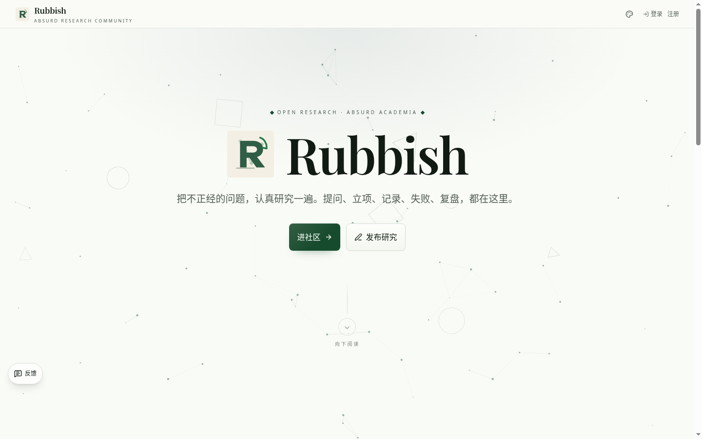
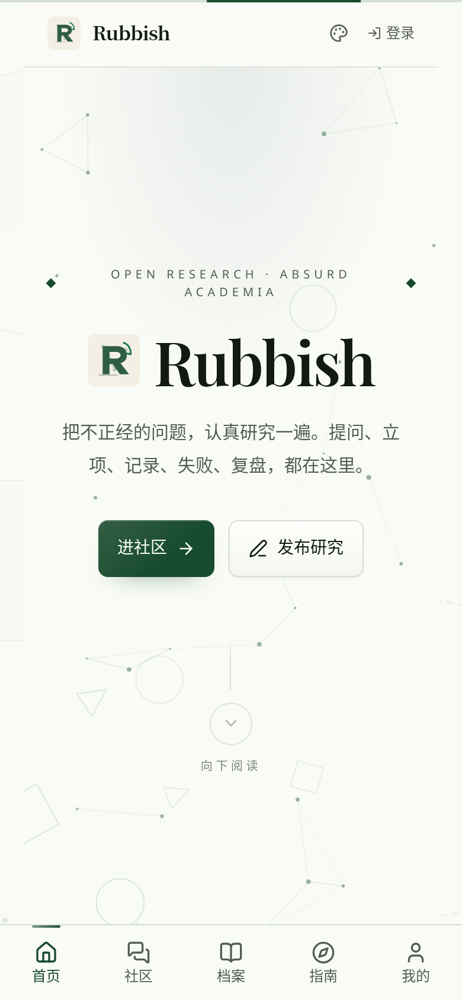
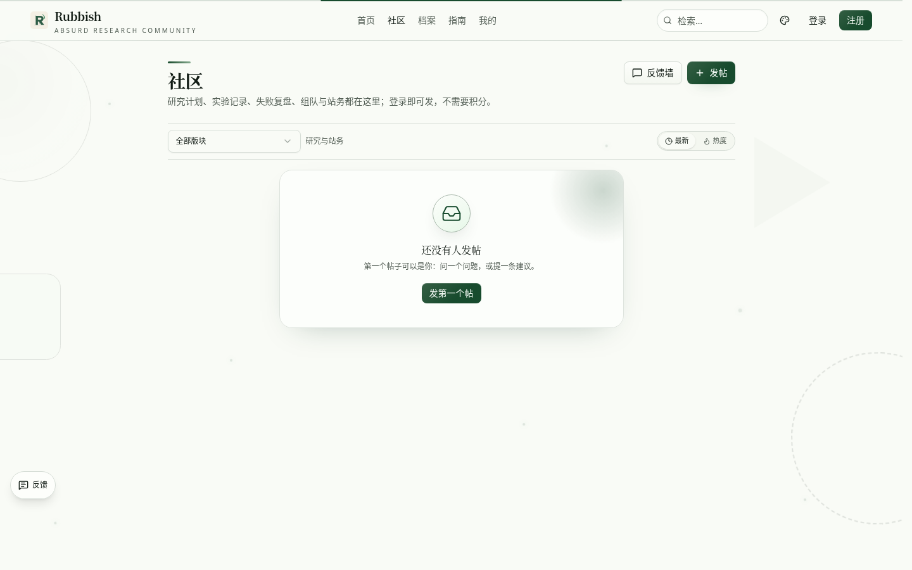
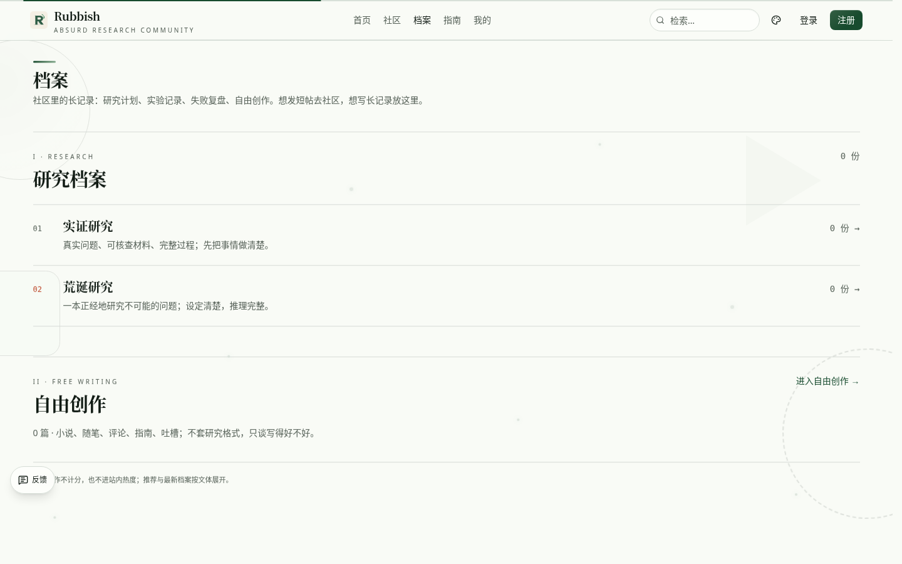
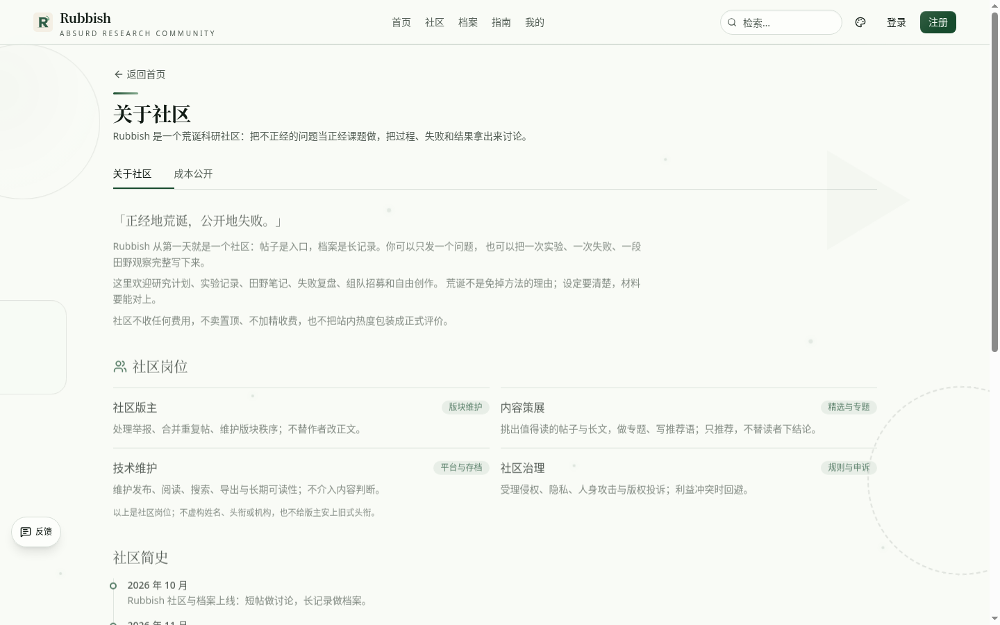
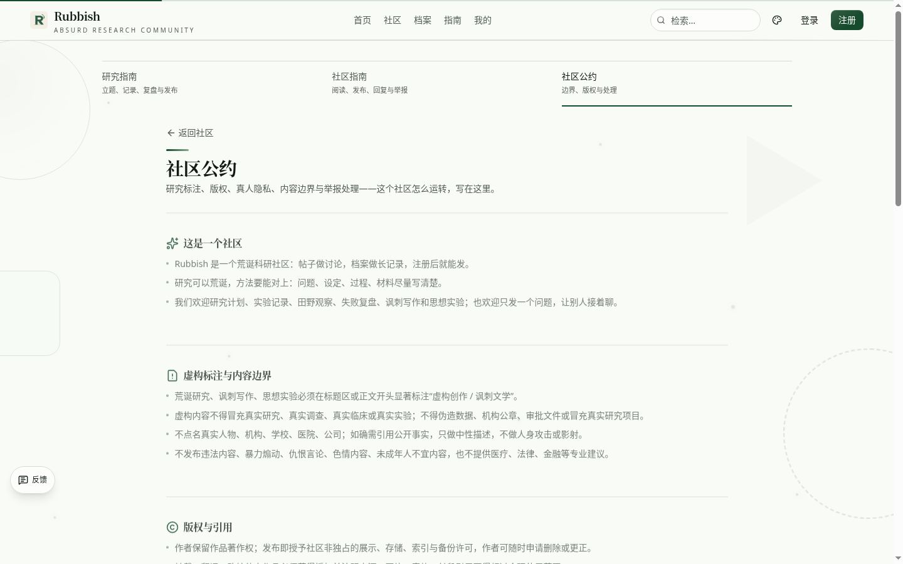

<div align="center">


# Rubbish

**An absurd research community — ask, record, fail, review, argue in the open.**

> 16 backend modules · community + research archive · Playwright E2E · strictly typed end to end

**🌐 [English](README.md) · [简体中文](README.zh-CN.md)**

[](LICENSE)
[](https://www.python.org/)
[](https://fastapi.tiangolo.com/)
[](https://react.dev/)
[](https://www.typescriptlang.org/)
[](https://www.postgresql.org/)
[](https://docs.docker.com/compose/)
[](#testing)
[](#testing)

**Mirrors**: [GitHub x33834](https://github.com/x33834/rubbish) · [GitHub Morningstar](https://github.com/Morningstar202604/rubbish) · [GitHub badhope](https://github.com/badhope/rubbish) · [GitCode](https://gitcode.com/badhope/rubbish) · [Gitee](https://gitee.com/badhope/rubbish)

**[Features](#features) · [Screenshots](#screenshots) · [Architecture](#architecture) · [Quick Start](#quick-start) · [Tech Stack](#tech-stack) · [Testing](#testing) · [Docs](#docs)**

</div>

---

## Positioning: open-source example vs. production service

| | What it is | Where showcase content lives |
| --- | --- | --- |
| **Open-source example** (this repo) | Reference implementation of the Rubbish community — clone it, self-host it, adapt it. | `site/`, `docs/assets/`, README screenshots |
| **Production service** ([rubbish.argjiemi.cn](https://rubbish.argjiemi.cn)) | A public absurd research community. The site is currently offline while the rebuild is being finished. | nowhere — de-showcased by design |

## Features

| Role | Capability |
| --- | --- |
| **Writer** | Publish a research note or community post; markdown editor, draft autosave, optional metadata |
| **Reader** | Public archive, community reading, typography controls, reading progress, follows and bookmarks |
| **Community** | Boards, topics, replies, reactions, reports, feedback board, notifications; no login wall for reading |
| **Moderator** | Report triage, content hide/restore, pin/lock, board management, audit trail |
| **Admin** | Users and roles, content, points ledger, system health, announcements; community operations only |

**Secure by default**: passwordless email-code sign-in (hashed one-time codes, rate limited), WebAuthn passkeys + TOTP 2FA, server-side JWT revocation with key rotation, sign-up captcha, per-action audit logs, multi-tenant isolation (PostgreSQL RLS).

**Lightweight deployment**: single-node `docker compose up`; PostgreSQL for production, SQLite + single-port service for dev/demo.

## Screenshots

| Home (desktop) | Home (mobile) |
| --- | --- | --- |
|  |  |

| Forum | Works |
| --- | --- |
|  |  |

| About the community | Community rules |  |
| --- | --- | --- |
|  |  | |

## Architecture


**Core flow**: Post → discuss → collect → read → report → moderate.


## Quick Start

### Option 1: Docker Compose (recommended, one command)

```bash
docker compose up -d
# open http://localhost:8000
```

### Option 2: Single-port dev/demo service (no containers)

```bash
cd apps/backend
cp .env.example .env          # adjust secrets as needed
uv sync --group dev --locked  # install dependencies
uv run alembic upgrade head   # initialize the database
uv run python deploy_server.py
# backend API + frontend static assets + uploads, all on http://localhost:8000
```

## Tech Stack

| Layer | Technology |
| --- | --- |
| Frontend | React 19 · TypeScript 5.9 · TanStack Router/Query · Tailwind CSS v4 · pdf.js |
| Backend | FastAPI · SQLAlchemy 2 (async) · Alembic · PostgreSQL 17 / SQLite |
| Security | WebAuthn · TOTP · JWT denylist · bcrypt · CSP headers |
| Quality | pytest (870) · Playwright E2E (68) · ruff · mypy strict · npm audit |

## Testing

```bash
# Backend (unit + migration consistency)
cd apps/backend && uv run pytest

# Frontend (lint + typecheck + unit + build)
cd apps/frontend && npm ci && npm run lint && npm run typecheck && npm test

# E2E (register → publish → reply journey)
cd apps/frontend && E2E_SPAWN_SERVER=1 npx playwright test
```

## Docs

- [Architecture deep dive](docs/ARCHITECTURE.md) · [Deployment guide](DEPLOY.md)
- [Contributing](CONTRIBUTING.md) · [Code of Conduct](CODE_OF_CONDUCT.md)

## License

Code is released under [PolyForm Noncommercial 1.0.0](LICENSE): free to use, modify, and redistribute for **learning, research, and noncommercial purposes only** — commercial use, paid services, and bundling into charged products are not permitted.

Papers and site content remain the property of their authors.
