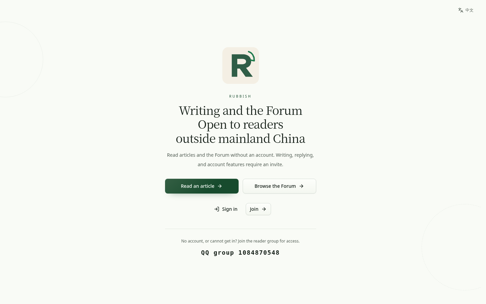
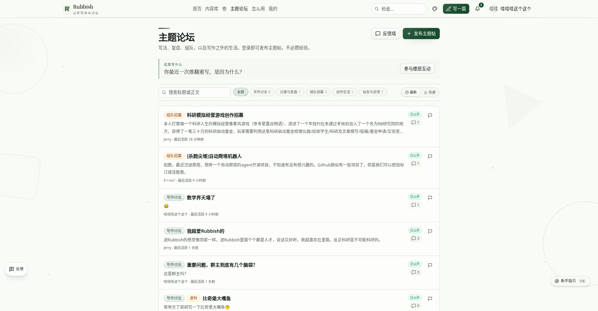
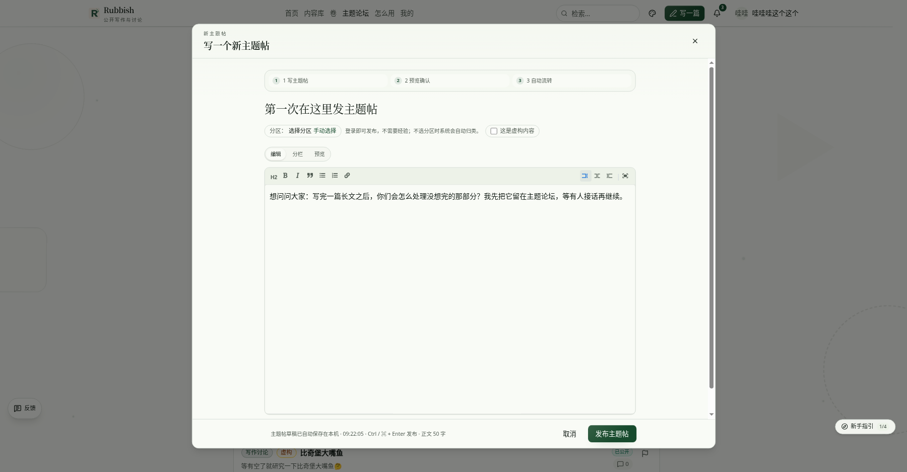
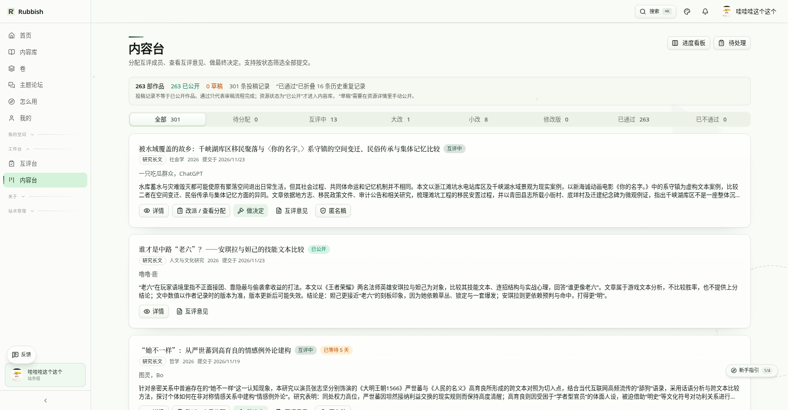
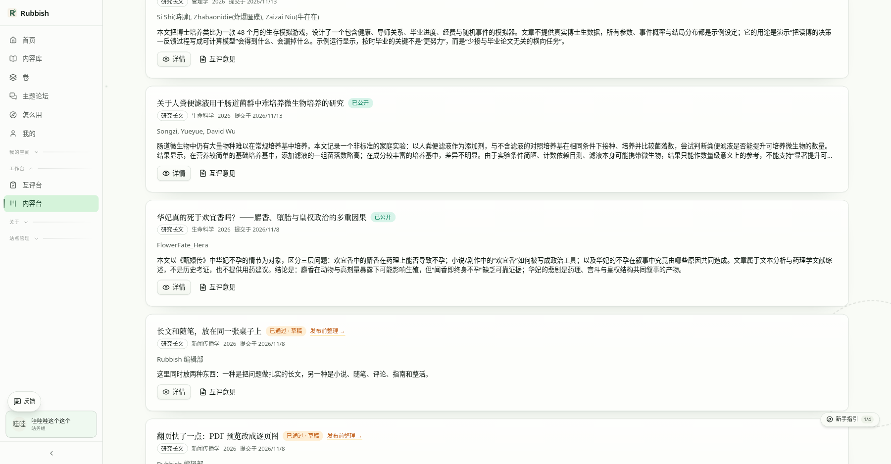

<div align="center">


# Rubbish

**A self-hostable public writing and discussion community — open a question, keep the process, say the thing plainly.**

**English · [简体中文](README.zh-CN.md)**

[](https://github.com/badhope/rubbish/actions/workflows/ci.yml)
[](LICENSE)

</div>

Rubbish does not ask for a particular format. A long piece can be a careful investigation, a short story, or an essay; a short thread can be a stuck point or an argument. Finished work goes into the library, unfinished thoughts stay in the forum, and readers can reply or just read.

It is one FastAPI service, one React app, and PostgreSQL. You can run the whole thing on a single small server.

## Interface language

The interface switches between Chinese (source) and English (a hand-written editorial layer) from the top-right button, or by opening a page with `?lang=en`. English browsers land on the English edition; the choice is remembered. Author titles, bodies, comments and names are never run through the translation layer — the English edition does not pretend a machine translation is the author's voice.



## What you can do

- **Talk in the sections.** Writing methods, retrospectives, team-finding, creative life, and site feedback each have their own place.
- **Publish a piece.** A longer piece gets a stable page with a body, revision history, downloads, comments, and related work.
- **Mark fiction as fiction.** Stories, jokes, and invented situations can carry a visible fiction label, so readers are not misled.
- **Follow what matters.** Bookmarks, reading progress, author follows, notifications, and topic subscriptions work across devices.
- **Keep moderation practical.** Reports, section management, announcements, audit logs, and a small admin area are built in. Topic posts go through an explainable rule pass first; borderline items land in a manual review queue with an SLA, audit trail and author notification.
- **Read it in Chinese or English.** The interface has a visible language switch and a shareable `?lang=en` link. English is a hand-written editorial layer, not a machine pass; author-written titles and bodies stay in their original language.
- **Bring your own AI.** Personal API tokens let an MCP client submit, revise, review and make editorial decisions through the same role gates and audit trail as the web UI; see [`tools/rubbish-mcp`](tools/rubbish-mcp/README.md).
- **Run it yourself.** Docker Compose, automatic HTTPS through Caddy, Alembic migrations, and PostgreSQL row-level security are already wired up.

## Quick start

```bash
git clone https://github.com/badhope/rubbish.git
cd rubbish
cp .env.example .env
# Set SITE_DOMAIN, POSTGRES_PASSWORD, RUBBISH_SECRET_KEY, RUBBISH_FERNET_KEY, RUBBISH_ADMIN_PASSWORD
docker compose up -d --build
```

Open `https://<your-domain>` and check `https://<your-domain>/api/health`. The first startup runs the database migrations.

For local development without Docker:

```bash
# backend
cd apps/backend
uv sync
uv run alembic upgrade head
uv run python e2e_run_server.py

# frontend, in another terminal
cd apps/frontend
npm ci
npm run dev
```

The frontend runs on `http://localhost:5173`; the API runs on `http://localhost:8000`.

## Product screenshots

| Theme forum | Three-step composer with local autosave |
|---|---|
|  |  |
| **Manual review queue** | **Rule settings** |
|  |  |

Admin data semantics: published articles and drafts are shown separately; the content desk distinguishes submission records from unique works.

| Admin overview | Content desk |
|---|---|
|  |  |

A draft work is labelled "approved · draft", never "published":



Operator quick panel on a topic detail, jumping straight to the review record for that topic:


Mobile theme forum, same data and actions:


The queue screenshot uses a temporary demo topic; it was deleted right after capture. The rest are live production UI from the current release.

## Project layout

| Path | Purpose |
|---|---|
| `apps/backend` | FastAPI app, domain modules, Alembic migrations, tests |
| `apps/frontend` | React + TypeScript SPA, section UI, reader, admin shell |
| `infra/` | Docker, Caddy, and deployment helpers |
| `ops/` | Server maintenance and release scripts |
| `content/articles` | Public article texts and author names, including drafts and duplicate records |
| `docs/` | Product notes, architecture, deployment, and screenshots |

## Published work

The current server texts and author names are in [`content/articles`](content/articles/README.md): 263 published entries, with bodies, titles, categories, image credits and source notes checked. This is public work only. Scores, review notes, account details, and server secrets are not stored here.

## Docs

| Document | English | 中文 |
|---|---|---|
| Product and vocabulary | [docs/POSITIONING.md](docs/POSITIONING.md) | [docs/POSITIONING.zh-CN.md](docs/POSITIONING.zh-CN.md) |
| Architecture | [docs/ARCHITECTURE.md](docs/ARCHITECTURE.md) | [docs/ARCHITECTURE.zh-CN.md](docs/ARCHITECTURE.zh-CN.md) |
| Deployment | [DEPLOY.md](DEPLOY.md) | [DEPLOY.zh-CN.md](DEPLOY.zh-CN.md) |
| Contributing | [CONTRIBUTING.md](CONTRIBUTING.md) | [CONTRIBUTING.zh-CN.md](CONTRIBUTING.zh-CN.md) |
| Security | [SECURITY.md](SECURITY.md) | [SECURITY.zh-CN.md](SECURITY.zh-CN.md) |
| Project baseline | — | [docs/PROJECT_BASELINE.zh-CN.md](docs/PROJECT_BASELINE.zh-CN.md) |
| Operations manual | — | [docs/OPERATIONS_MANUAL.zh-CN.md](docs/OPERATIONS_MANUAL.zh-CN.md) |
| Moderation rules | — | [docs/AUTOMATION_RULES.zh-CN.md](docs/AUTOMATION_RULES.zh-CN.md) |
| Competitor matrix | — | [docs/COMPETITOR_MATRIX.zh-CN.md](docs/COMPETITOR_MATRIX.zh-CN.md) |

## Checks

```bash
cd apps/backend
uv run ruff check .
uv run mypy app --exclude 'app/domain/submission' --exclude 'app/domain/ingest' \
  --exclude 'app/interfaces/http/submission' --exclude 'app/interfaces/http/review'
uv run pytest -q

cd ../frontend
npm run lint
npm run typecheck
npm run build
```

## License

Source code is available under the [PolyForm Noncommercial License 1.0.0](LICENSE). Commercial use needs a separate agreement.
