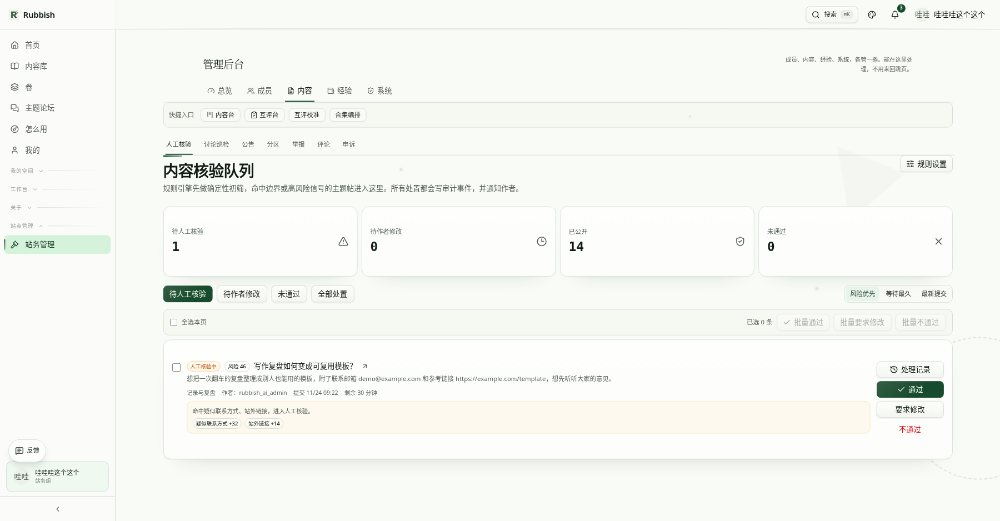
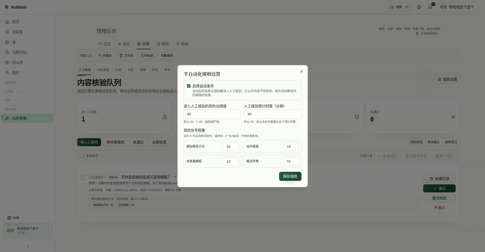
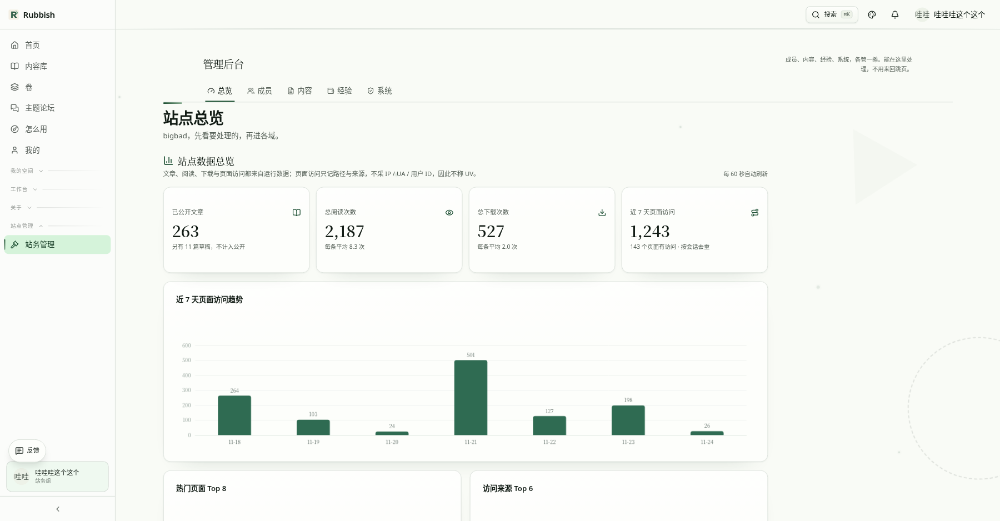
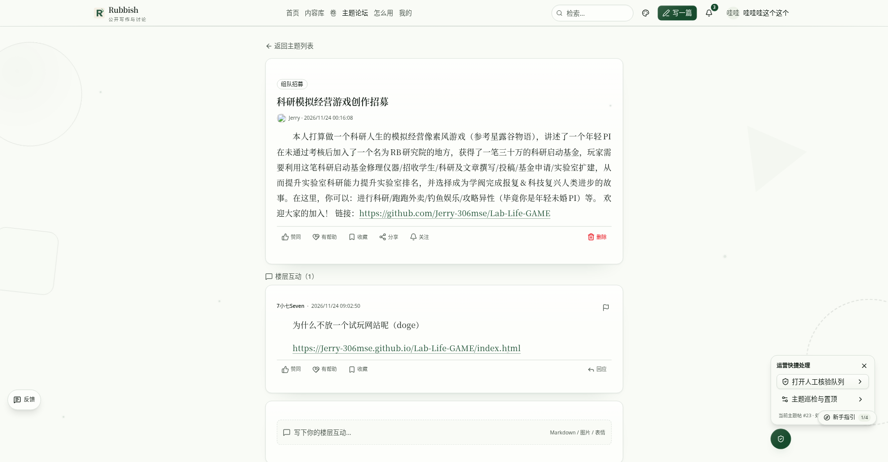
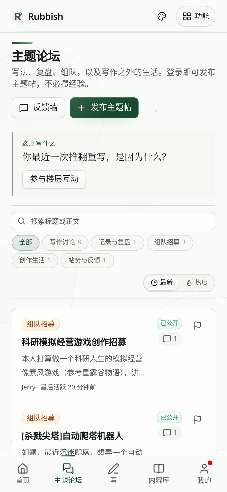

<div align="center">


# Rubbish

**一个可以自己部署的公开写作与主题交流社区：把问题写开，把过程留下，把话说明白。**

**[English](README.md) · 简体中文**

[](https://github.com/badhope/rubbish/actions/workflows/ci.yml)
[](LICENSE)

</div>

Rubbish 不挑格式。长文可以是扎实的调查，也可以是一篇小说、一篇随笔；短话可以是一句卡点，也可以是一场争论。写下的东西放进内容库，没想完的话留在主题论坛，读的人可以接一句，也可以只看看。

整个项目是一个 FastAPI 服务、一个 React 前端和一份 PostgreSQL 数据库，一台小服务器就能跑起来。

## 界面语言

右上角按钮可在中文（源语言）与英文之间切换，也可以直接用 `?lang=en` 打开页面。英语浏览器首次访问会进入英文版，选择会被记住。作者标题、正文、评论与用户名不经过翻译层——英文版不会把机器翻译冒充成作者的声音。


## 可以做什么

- **在分区里说话。** 写法、复盘、组队、创作生活、站务与反馈，各有各的位置。
- **公开一篇作品。** 较长的内容会得到稳定页面，包含正文、版本记录、下载、评论和相关内容。
- **虚构内容明确标注。** 小说、段子和想象出来的事可以带上醒目的“虚构”标记，不让读者当真。
- **跟进关心的内容。** 收藏、阅读进度、关注作者、通知和主题订阅都能跨设备使用。
- **够用的管理能力。** 举报、分区管理、公告、审计日志和后台入口都已经接好。
- **中英文切换。** 右上角有常驻语言按钮，也支持 `?lang=en` 分享链接；英文是人工润色的站方文案，不是机器翻译，作者标题与正文保持原文。
- **自己部署。** Docker Compose、Caddy 自动 HTTPS、Alembic 迁移和 PostgreSQL 行级安全都已配置。

## 快速开始

```bash
git clone https://github.com/badhope/rubbish.git
cd rubbish
cp .env.example .env
# 填写 SITE_DOMAIN、POSTGRES_PASSWORD、RUBBISH_SECRET_KEY、RUBBISH_FERNET_KEY、RUBBISH_ADMIN_PASSWORD
docker compose up -d --build
```

打开 `https://<你的域名>`，再访问 `https://<你的域名>/api/health` 检查服务。首次启动会自动执行数据库迁移。

不用 Docker 的本地开发方式：

```bash
# 后端
cd apps/backend
uv sync
uv run alembic upgrade head
uv run python e2e_run_server.py

# 前端，另开一个终端
cd apps/frontend
npm ci
npm run dev
```

前端地址是 `http://localhost:5173`，API 地址是 `http://localhost:8000`。

## 功能截图

| 主题论坛 | 三步发布与草稿自动保存 |
|---|---|
|  |  |
| **人工核验队列** | **规则设置** |
|  |  |

后台数据口径：已公开文章与草稿分开计数；内容台把投稿记录与作品数分开，草稿不再冒充“已公开”。

| 站务总览 | 内容台 |
|---|---|
|  |  |

草稿作品显示为“已通过 · 草稿”，不再显示“已公开”：


主题详情页的运营快捷面板，可直达当前主题帖的核验记录：



移动端主题论坛，同一套数据与操作：



核验队列截图中使用了一条临时演示主题帖，截完即删除；其余为 1.19.53 生产界面。

## 目录

| 路径 | 用途 |
|---|---|
| `apps/backend` | FastAPI、领域模块、Alembic 迁移和测试 |
| `apps/frontend` | React + TypeScript 前端、分区、阅读器和后台 |
| `infra/` | Docker、Caddy 和部署辅助文件 |
| `ops/` | 服务器维护与发布脚本 |
| `content/articles` | 公开文章正文与作者姓名，含待处理稿和重复记录 |
| `docs/` | 产品说明、架构、部署和截图 |

## 作品正文

当前服务器上的作品正文与作者姓名在 [`content/articles`](content/articles/README.md)：263 篇已发布，正文、标题、分类、图源与文献说明已完成核查。这里只放公开内容，不存放评分、互评意见、账号信息或服务器密钥。

## 文档

| 文档 | English | 中文 |
|---|---|---|
| 产品与用词 | [docs/POSITIONING.md](docs/POSITIONING.md) | [docs/POSITIONING.zh-CN.md](docs/POSITIONING.zh-CN.md) |
| 架构 | [docs/ARCHITECTURE.md](docs/ARCHITECTURE.md) | [docs/ARCHITECTURE.zh-CN.md](docs/ARCHITECTURE.zh-CN.md) |
| 部署 | [DEPLOY.md](DEPLOY.md) | [DEPLOY.zh-CN.md](DEPLOY.zh-CN.md) |
| 贡献 | [CONTRIBUTING.md](CONTRIBUTING.md) | [CONTRIBUTING.zh-CN.md](CONTRIBUTING.zh-CN.md) |
| 安全 | [SECURITY.md](SECURITY.md) | [SECURITY.zh-CN.md](SECURITY.zh-CN.md) |
| 项目基线 | — | [docs/PROJECT_BASELINE.zh-CN.md](docs/PROJECT_BASELINE.zh-CN.md) |
| 人工运营手册 | — | [docs/OPERATIONS_MANUAL.zh-CN.md](docs/OPERATIONS_MANUAL.zh-CN.md) |
| 自动化规则 | — | [docs/AUTOMATION_RULES.zh-CN.md](docs/AUTOMATION_RULES.zh-CN.md) |
| 竞品矩阵 | — | [docs/COMPETITOR_MATRIX.zh-CN.md](docs/COMPETITOR_MATRIX.zh-CN.md) |

## 检查

```bash
cd apps/backend
uv run ruff check .
uv run mypy app --exclude 'app/domain/submission' --exclude 'app/domain/ingest' \
  --exclude 'app/interfaces/http/submission' --exclude 'app/interfaces/http/review'
uv run pytest -q

cd ../frontend
npm run lint
npm run typecheck
npm run build
```

## 许可

源码采用 [PolyForm Noncommercial License 1.0.0](LICENSE)。商业用途需要单独授权。
