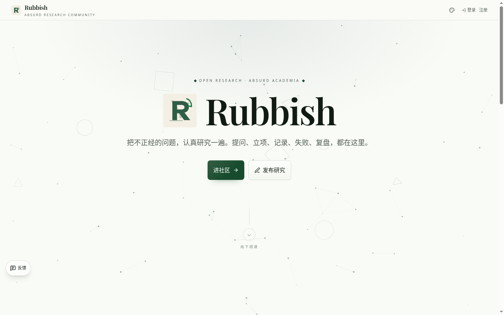
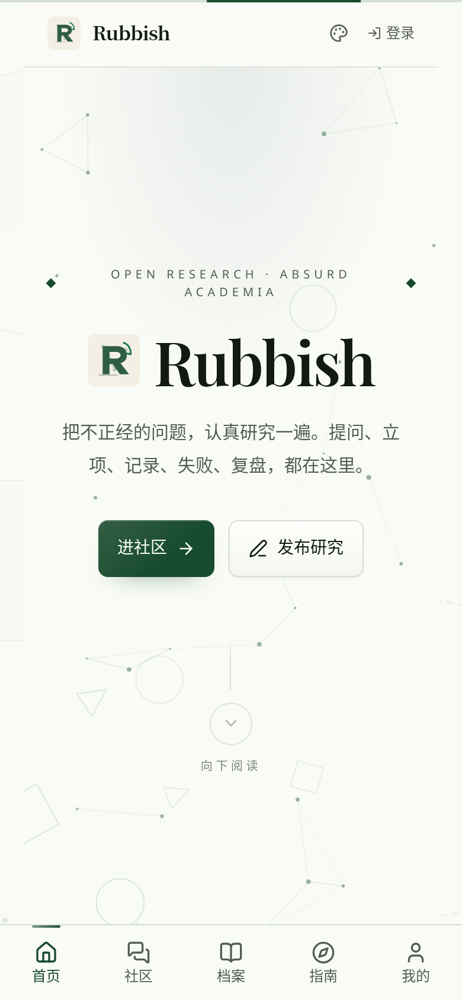
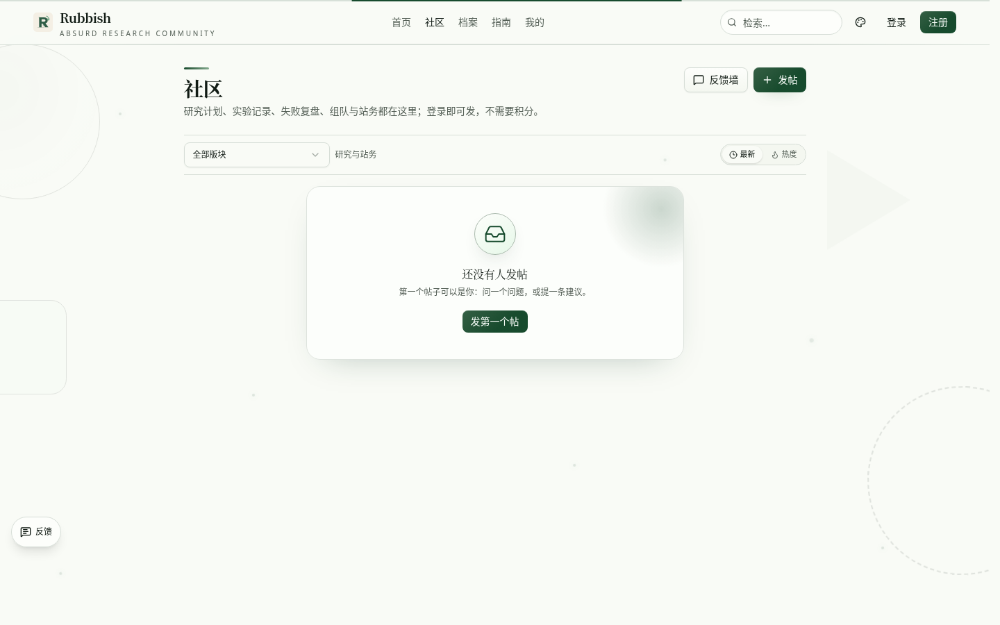
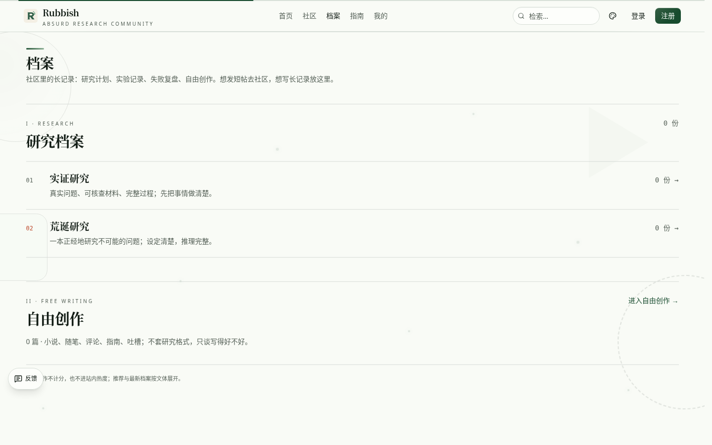
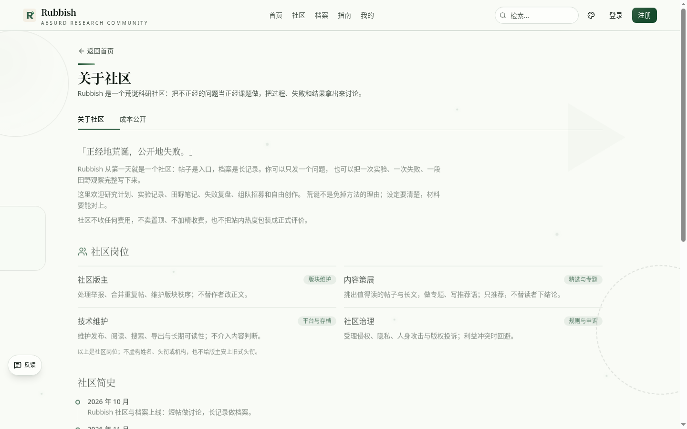
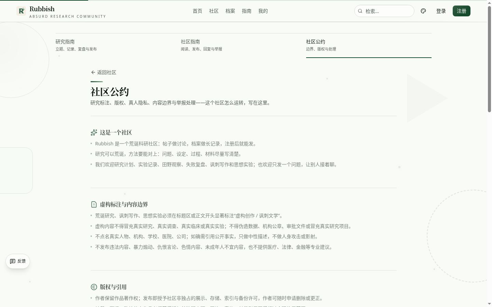

<div align="center">


# Rubbish

**荒诞科研社区 — 提问、立题、记录、复盘、认真讨论。**

> 16 个后端模块 · 社区 + 研究档案 · Playwright E2E · 全链路严格类型

**🌐 [English](README.md) · [简体中文](README.zh-CN.md)**

[](LICENSE)
[](https://www.python.org/)
[](https://fastapi.tiangolo.com/)
[](https://react.dev/)
[](https://www.typescriptlang.org/)
[](https://www.postgresql.org/)
[](https://docs.docker.com/compose/)
[](#测试)
[](#测试)

**镜像仓库**：[GitHub x33834](https://github.com/x33834/rubbish) · [GitHub Morningstar](https://github.com/Morningstar202604/rubbish) · [GitHub badhope](https://github.com/badhope/rubbish) · [GitCode](https://gitcode.com/badhope/rubbish) · [Gitee](https://gitee.com/badhope/rubbish)

**[功能一览](#功能一览) · [界面预览](#界面预览) · [架构](#架构) · [快速开始](#快速开始) · [技术栈](#技术栈) · [测试](#测试) · [文档](#文档)**

</div>

---

## 定位：开源示例 vs 生产服务

| | 是什么 | 展示性内容放在哪 |
| --- | --- | --- |
| **开源示例**（本仓库） | Rubbish 社区的参考实现——克隆、自部署、二次开发。 | `site/`、`docs/assets/`、README 截图 |
| **生产服务**（[rubbish.argjiemi.cn](https://rubbish.argjiemi.cn)） | 面向公众的荒诞科研社区。社区改版期间站点暂时下线。 | 无——设计上已去展示化 |

## 功能一览

| 角色 | 能力 |
| --- | --- |
| **创作者** | 发布研究记录或社区帖子；Markdown 编辑器、草稿自动保存、研究信息可选 |
| **读者** | 公开档案、社区阅读、字号/行高/字体控制、阅读进度、关注与收藏 |
| **社区** | 版块、主题、回复、表情回应、举报、反馈板、通知；阅读不设登录墙 |
| **版主** | 举报处理、内容隐藏/恢复、置顶/锁定、版块管理、审计留痕 |
| **管理员** | 用户与角色、内容、积分账本、系统健康、公告；不再管理卷期 |

**安全默认开启**：邮箱验证码登录（一次性哈希码 + 频率限制）、WebAuthn 通行密钥 + TOTP 双因素、JWT 服务端吊销与密钥轮换、注册验证码、全操作审计日志、多租户隔离（PostgreSQL RLS）。

**轻量部署**：单机 `docker compose up` 即可；生产用 PostgreSQL，开发/演示用 SQLite + 单端口服务。

## 界面预览

| 首页（桌面） | 首页（手机） |
| --- | --- |
|  |  |

| 社区 | 档案 |
| --- | --- |
|  |  |

| 关于社区 | 社区公约 |  |
| --- | --- | --- |
|  |  | |

## 架构


**核心流程**：发帖 → 讨论 → 收藏 → 阅读 → 举报 → 处理。


## 快速开始

### 方式一：Docker Compose（推荐，一条命令）

```bash
docker compose up -d
# 打开 http://localhost:8000
```

### 方式二：单端口开发/演示服务（无需容器）

```bash
cd apps/backend
cp .env.example .env          # 按需修改密钥
uv sync --group dev --locked  # 安装依赖
uv run alembic upgrade head   # 初始化数据库
uv run python deploy_server.py
# 后端 API + 前端静态资源 + 上传文件，全部跑在 http://localhost:8000
```

## 技术栈

| 层 | 技术 |
| --- | --- |
| 前端 | React 19 · TypeScript 5.9 · TanStack Router/Query · Tailwind CSS v4 · pdf.js |
| 后端 | FastAPI · SQLAlchemy 2 (async) · Alembic · PostgreSQL 17 / SQLite |
| 安全 | WebAuthn · TOTP · JWT denylist · bcrypt · CSP 安全头 |
| 质量 | pytest (870) · Playwright E2E (68) · ruff · mypy strict · npm audit |

## 测试

```bash
# 后端（单元 + 迁移一致性）
cd apps/backend && uv run pytest

# 前端（lint + typecheck + 单测 + 构建）
cd apps/frontend && npm ci && npm run lint && npm run typecheck && npm test

# E2E（注册 → 发布 → 回复全链路）
cd apps/frontend && E2E_SPAWN_SERVER=1 npx playwright test
```

## 文档

- [架构详解](docs/ARCHITECTURE.md) · [部署手册](DEPLOY.md)
- [贡献指南](CONTRIBUTING.md) · [行为准则](CODE_OF_CONDUCT.md)

## License

代码以 [PolyForm Noncommercial 1.0.0](LICENSE) 发布：可自由使用、修改、再分发，但**仅限学习、研究与非商业用途**——不得商用、不得收费提供服务、不得捆绑进收费产品。研究记录与站点内容的著作权归作者所有。
