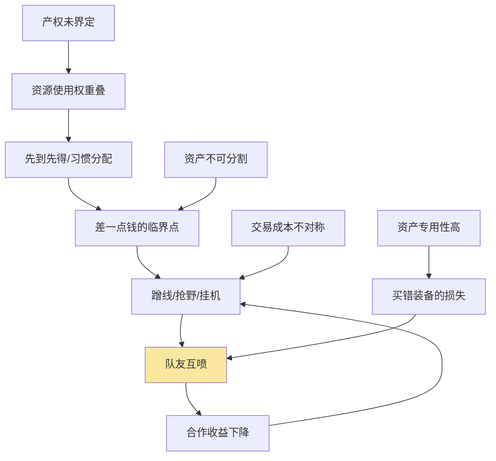

# 用“借钱”和“倒卖装备”终结峡谷内讧——一个 MOBA 资源冲突的制度经济学方案

## 摘要

兵线、野怪、BUFF 没有正式产权，玩家只能靠先到先得，冲突自然不断。本文用产权和机制设计，提出局内借钱与装备二手交易两套再分配方案。
## 关键词

MOBA；产权；资产专用性；公共池塘资源；机制设计；帕累托改进

## 1 引言

5v5 对局的本质是五个人在有限地图与时间内争夺资源，把资源转化为装备与等级优势。资源是有限的，规则是不完全的：兵线归谁、野怪归谁、BUFF 归谁，游戏没有强制界定，只靠玩家习惯。

规则不完全，冲突就不可避免。本文想做的，是把“抢资源”从道德问题变成制度问题：不是“玩家素质差”，而是“产权没界定、资产不可分割、资产专用性高”。

### 1.1 为什么用《王者荣耀》做例子

《王者荣耀》的资源结构很典型：兵线是持续流量，野怪是周期性存量，BUFF 是带时效的增益，装备是离散的资本品。四类资源的经济属性不同，冲突的方式也不同。用同一个“抢”字概括，会看不清问题。

本文不评价具体版本强弱，也不建议任何补丁。它只把游戏当成一个“制度实验室”：规则可以改、数据可记录、行为可观察。现实世界的产权冲突很难做实验，游戏可以。

### 1.2 文章的边界

本文没有真实对局数据，装备价格来自游戏内公开数值或示例设定，冲突案例来自作者观察。文章不构成游戏平衡、匹配机制或商业建议；它是一篇制度经济学的类比练习。

类比有风险。游戏资源是代码生成的，规则可以随时改；现实资源是稀缺的，产权变更涉及法律与暴力。把游戏结论直接搬到现实，是过度外推。本文会尽量把类比限制在“机制结构”上，而不是“具体数值”上。

## 2 理论工具：把“抢”拆成产权问题

### 2.1 产权是一束权利

产权不是“这个东西归谁”这么简单，而是一束权利：使用权、收益权、排他权、转让权。游戏里的兵线、野怪没有正式产权，只有非正式习惯：兵线归对线者，野怪归打野，BUFF 归需要的人。

习惯没有强制力，所以容易被打破。一个打野可以说“我路过顺便收一波”，一个中路可以说“我支援顺便吃线”，一个射手可以说“我发育需要钱”。每个人都有理由，因为产权没有界定。

### 2.2 资源的四象限

把游戏资源按“竞争性”和“排他性”分类，会更清楚：

**表 1 游戏资源的产权属性**

| 资源 | 竞争性 | 排他性 | 典型冲突 |
|---|---|---|---|
| 兵线 | 高 | 低 | 蹭线、控线、支援吃线 |
| 野怪 | 高 | 中 | 抢野、反野、让野 |
| BUFF | 高 | 中 | 抢蓝、抢红、让 BUFF |
| 装备 | 高 | 高 | 买错、卖错、差钱 |
| 视野 | 低 | 低 | 谁插眼、谁扫雷 |

兵线是“公共池塘”式的资源：一个人吃了，另一个人就少了；但很难阻止别人吃。野怪与 BUFF 有相对明确的“先到先得”，但没有正式排他。装备是私有品，买下就归你，但“买错”会造成专用性损失。

### 2.3 资产不可分割性

装备必须整件购买，不能只买一半。玩家差 33 块就能买整件时，会去蹭线、抢野，甚至挂机等钱。这是“不可分割性”导致的非凸性：资源不能平滑分配，只能离散地跳变。

离散跳变会制造“临界点冲突”。差 33 块的人，愿意为 33 块付出很高的社会成本；队友不愿意让，因为让出 33 块可能让自己也差一点。双方都不是坏人，只是被同一个阈值卡住。

### 2.4 资产专用性

买错的装备转作他用时价值大幅下降。玩家买错装备，只能卖掉，回收一部分金币；这笔损失会转化为“悔恨”，也会转化为对队友的抱怨。

专用性越高，买错越痛。一个通用的小件，卖掉损失小；一个为特定阵容买的大件，卖掉损失大。队友的“你怎么买这个”不是事后聪明，而是对专用性损失的直觉反应。

### 2.5 交易成本

Coase 提醒我们：产权不只是“归谁”，还包括“谈判、监督、执行”的成本。游戏里，让兵线需要沟通，沟通需要时间，时间就是金币；抢兵线不需要沟通，只需要动作。交易成本不对称，抢就比让更“便宜”。

这也是为什么“讲道理”常常没用：讲道理的成本落在愿意讲的人身上，抢的收益落在先动手的人身上。制度如果不改变成本结构，道德劝说就只是让好人更累。

### 2.6 公共池塘资源的治理

Ostrom 在研究公共池塘资源时提出，长期稳定的自治治理通常需要清晰边界、规则与本地条件匹配、参与式规则制定、有效监督、渐进惩罚、冲突解决机制、对组织权的最低承认。把这几条放到 MOBA 里，会发现游戏缺的不是“玩家道德”，而是“治理结构”。

- 边界：兵线、野区、BUFF 的归属没有清晰边界。
- 匹配：规则没有区分段位、阵容、版本。
- 参与：玩家不能参与规则制定。
- 监督：没有可信的监督与记录。
- 惩罚：惩罚来自举报系统，滞后且不确定。
- 冲突解决：没有局内仲裁，只有赛后互喷。

这张清单不是要游戏照搬 Ostrom，而是说明：资源冲突是治理问题，不只是道德问题。

### 2.7 一个形式化

把一局游戏看成一个资源分配博弈：五名玩家对兵线、野怪、BUFF 有重叠的使用权，但没有排他性的产权界定。设资源收益为 v，争抢成本为 c，合作收益为 s。当 v > c 且 s 很小时，抢是理性选择；当 c 很高（互喷、挂机、输掉团战）时，合作才可能占优。

用简单的不等式表示：

```text
抢的净收益 = v − c
合作的净收益 = s − c_coop
```

如果 `v − c > s − c_coop`，玩家就会抢；如果制度把 `c` 提高，或把 `s` 提高，抢的相对收益下降。制度设计的目标，不是让玩家“变成好人”，而是让“合作”在收益上不吃亏。

### 2.8 图 1：资源冲突的因果链



图里最关键的是 G→E 的回环：互喷让合作收益下降，合作收益下降又让抢更理性。制度如果不打断这个回环，冲突会自我强化。

### 2.9 租金与寻租

在经济学里，租金不是“房租”，而是“超出正常回报的收益”。一个资源如果谁先占谁得利，就会吸引人把时间、精力、情绪投入“占位”，而不是投入生产。这叫寻租。

MOBA 里的寻租很明显：玩家为了一个 BUFF 提前蹲守，为了一个兵线故意不回城，为了一个野怪和队友耗着。这些时间没有变成击杀或推塔，只变成“我先到的”。寻租不创造新价值，它只重新分配价值。

制度设计如果只喊“别抢”，就是在劝人放弃租金；只要租金还在，劝说就很难持久。更好的办法是降低租金的吸引力：让“让”有回报，让“抢”有成本，让“合作”能分到更大的蛋糕。

## 3 诊断：三种典型内讧

### 3.1 兵线：你的兵线我的家

兵线是非正式产权：对线者认为自己有优先权，打野认为自己需要蹭线发育，中路认为自己需要支援。三方都有道理，三方都没有强制规则。冲突不是因为“谁坏”，而是因为“权利重叠”。

兵线的另一个特点是“流量”：它持续到来，不是一次性资源。流量资源的冲突更容易日常化：每一波兵线都是一次小谈判，每一次谈判都可能积累不满。一次蹭线不算什么，十次蹭线就变成“你就是针对我”。

### 3.2 就差 33 块

装备的整件购买机制，让“差一点钱”变成高频冲突点。玩家会为了 33 块去蹭线、抢野、甚至故意拖延回城。这个行为的收益很小，但情绪成本很高。

“差 33 块”还有一个隐蔽的公平问题：这 33 块对差钱的人是“临界救急”，对队友可能是“可有可无”。但队友看不到你的金币，只能看到你在抢。信息不对称，让“紧急”无法被验证。

### 3.3 买错装备

买错装备的损失，不只是金币，还有“被队友看见”的羞耻感。玩家会更倾向于责怪队友“不提醒”，而不是承认自己选错。这是典型的沉没成本与面子成本的叠加。

买错之后，玩家有两个选择：卖掉，承担折价；留着，承担低效。两个选择都不好，于是第三个选择出现：怪队友。怪队友不能挽回金币，但能挽回一点面子。

### 3.4 打野与线上的结构性矛盾

打野与线上不是“谁对谁错”，而是两种经济模式的冲突。线上需要稳定兵线，打野需要游走与野区收益；线上希望打野来抓，打野希望线上让资源。两边的 KPI 不一样，冲突就结构化。

一个打野如果长期不蹭线，经济可能落后；一个线上如果长期让线，等级可能落后。两边都在为自己的 KPI 负责，谁都不是“自私”，只是制度把他们的利益分开了。

这也是为什么“团队游戏”不能只靠“团队精神”。团队精神是稀缺品，制度设计要让“合作”成为默认选项，而不是靠每个人每次都做圣人。

## 4 机制设计：借钱与二手交易

### 4.1 局内“借钱”：跨期流动性平滑

允许玩家向队友借一小笔金币，在接下来的 1–2 分钟内归还，利息可以用“让出下一波兵线”或“帮忙守塔”来支付。这个机制把“差 33 块”的离散跳变，变成可平滑的跨期交换。

设计要点：

- **额度有限**：只能借“差一点”的小额，不能借一整件装备。
- **期限明确**：1–2 分钟内自动结算，避免无限期拖欠。
- **利息非现金**：用兵线、守塔、视野等“劳动”支付，避免金币通胀。
- **自动扣款**：到期自动从借款者后续金币收入中扣除，减少催债冲突。
- **信用记录**：不还款者在一定时间内不能再借，形成渐进惩罚。

风险：借钱不还会引发新的冲突；需要设计自动扣款或信用惩罚。还有一个更隐蔽的风险：借钱可能被用来“刷经济”，两个队友互相借来借去，绕过资源限制。因此，借款必须有冷却时间与总额上限。

### 4.2 装备二手交易：存量再分配

允许玩家把买错的装备卖给队友，价格由系统按原价的一定比例生成，队友可以用略低于商店的价格买入。这个机制把“专用性损失”转化为“队内再分配”，减少卖装备的折价。

设计要点：

- **价格区间**：系统定价，不允许自由报价，避免“低买高卖”。
- **交易次数**：每人每局有限次数，避免倒卖套利。
- **绑定规则**：交易后的装备在一定时间内不能再次转卖，避免“击鼓传花”。
- **税收/折价**：每次交易收取小额手续费，抑制套利，同时给系统一个“金币回收”的口子。
- **信息透明**：队友能看到装备的剩余价值与适配性，减少“坑队友”的猜疑。

风险：可能被用来“倒卖”套利；需要限制交易次数与价格区间。另一个风险是“强制交易”：队友逼你买他的装备，形成新的权力关系。因此，交易必须是自愿的，且不能在被举报/挂机状态下进行。

### 4.3 机制比较：借钱与二手交易的差异

借钱是跨期机制，解决“现在差一点、未来能还”的流动性问题；二手交易是存量机制，解决“买错了、但还能用”的专用性问题。借钱的难点是信用与催收，二手交易的难点是定价与套利。两者都需要一个“可信的结算层”：借钱要能自动扣款，交易要能限制价格区间。没有结算层，机制会把原来的资源冲突转化为新的信用冲突。

相比之下，二手交易的副作用更可控，因为它是一次性、可记录的交易；借钱则涉及持续的关系与还款预期。借钱更像“微型金融”，需要信用制度；二手交易更像“二手市场”，需要定价制度。两者的制度能力要求不同。

### 4.4 两套机制的协同

借钱解决“短期流动性”，二手交易解决“存量错配”。两者结合，可以把一部分“互喷”转化为“互惠”。但制度设计不能消除所有冲突，只能降低冲突的成本。

协同的关键是“结算层”统一：借钱与交易都用同一套金币账本、同一套信用记录、同一套冷却时间。否则，玩家会在两个机制之间套利：借钱买装备，再卖装备还钱，凭空制造金币。

### 4.5 机制落地的三个前提

第一，结算必须可信。借钱需要自动扣款或可执行的还款承诺，否则“催债”会取代“抢线”成为新的冲突源。第二，价格必须受限。二手交易若允许自由定价，会出现低买高卖与跨局套利；系统应设置价格区间与交易次数。第三，规则必须可解释。玩家需要在对局开始前知道“借钱不还”的后果，而不是在冲突发生后才发现。

三个前提缺一个，机制就会把资源冲突转化为信用冲突。制度设计不是加一个按钮，而是改一组激励；按钮可以很轻，激励必须清楚；否则，玩家学到的不是合作，而是如何钻新规则的空子。

### 4.6 机制可能制造的新问题

任何制度都会制造新的博弈。借钱可能制造“信用绑架”：出借人用“我借过你”要求队友让资源。二手交易可能制造“装备歧视”：买了便宜装备的玩家被队友看不起。还有“职业倒爷”：玩家专门低买高卖，破坏经济平衡。

设计者要预判这些博弈，而不是假设玩家会“友好使用”。可以做的是：限制额度、限制次数、限制价格、记录交易、渐进惩罚。制度不是一次性设计，而是持续迭代。

## 5 讨论：游戏不是市场，但可以借鉴市场

### 5.1 游戏不是市场

游戏资源是代码生成的，不是稀缺自然资源；游戏规则可以随时改，不需要立法。把新制度经济学套到游戏里，是一种类比，不是严格应用。

但类比也有价值：游戏把产权、交易成本、资产专用性压缩成几分钟一局，让玩家能直观看到制度如何改变行为。它是“制度实验室”，不是“制度本身”。

### 5.2 负反馈与“宝宝荣耀”

运营方近年降低负反馈、减少资源冲突，方向是对的。但只靠数值平衡与惩罚机制，不够；产权与交易机制才是底层。本文的方案是思想实验，不是补丁说明。

“宝宝荣耀”这个说法带着嘲讽，但它点出一个真实问题：当游戏把冲突成本外部化，玩家会变得更依赖系统裁判，而不是自己协商。制度设计不能只靠“减少负反馈”，还要给玩家“正向合作”的激励。

### 5.3 制度的副作用

借钱可能引发“催债”冲突，二手交易可能引发“倒卖”冲突。任何新机制都会产生新的博弈。设计者要预判这些博弈，而不是假设玩家会“友好使用”。

副作用不是拒绝设计的理由，而是设计的一部分。一个好的机制，不是“没有副作用”，而是“副作用可预测、可限制、可修复”。

### 5.4 从“惩罚”转向“激励”

举报与惩罚是事后机制，只能在冲突发生后补偿。借钱与二手交易是事前机制，把冲突转化为交易。两者不冲突：事前机制降低冲突频率，事后机制处理恶意行为。

但激励设计要小心：如果合作收益太高，玩家可能“为了收益而合作”，形成新的表演。制度不能只奖“好人”，还要防止“好人”被利用。

### 5.5 现实类比的三条边界

把 MOBA 类比到现实，要守住三条边界：

第一，**资源性质不同**。游戏资源是代码生成的，可以无限刷新；现实资源是有限的，涉及土地、水、矿产与劳动。游戏里“让一波兵线”不会让人饿死，现实里“让一块地”可能让人失去生计。

第二，**退出成本不同**。游戏可以重开，现实不能。玩家在一局里受了委屈，下一局可以换队友；现实里的产权冲突，可能影响一辈子。制度的容错空间完全不同。

第三，**权力结构不同**。游戏规则由运营方单方面制定，玩家只能接受或退出；现实规则由多方博弈，涉及法律、政府、社区与资本。把“运营方改规则”当成“制度设计”，会低估现实的复杂性。

守住这三条边界，类比才有价值：它能帮我们看清“产权—成本—激励”的结构，但不能直接给出政策方案。

## 6 如果真要做研究，该怎么测

### 6.1 数据

需要三类数据：对局日志（金币、兵线、野怪、装备、交易）、玩家行为（举报、挂机、聊天）、赛后评价（满意度、公平感）。没有这三类，无法判断机制是“减少了冲突”，还是“把冲突藏起来了”。

### 6.2 设计

可以做 A/B 测试：同一版本，随机开放/关闭借钱与二手交易；记录 1000 局以上的指标；比较金币分布、装备完成时间、举报率、投降率、聊天负面情绪。要注意版本、段位、阵容的分层。

### 6.3 指标

至少五个指标：金币基尼系数、装备完成时间中位数、举报率、挂机率、赛后满意度。前两个看经济效率，后三个看社会成本。只测“胜率”不够，因为机制可能让赢了的人更爽，输了的人更恨。

### 6.4 伦理

游戏研究也要伦理：不能未经同意记录玩家聊天；不能把玩家分成“实验组”而不告知；不能用机制诱导过度消费。数据要脱敏，报告要聚合，不能公开个体行为。

### 6.5 负结果也有价值

如果 A/B 测试发现借钱没有降低举报率，二手交易没有提高装备完成率，也不能立刻说“机制失败”。要看三种可能：

1. **机制没被使用**：玩家不知道、不敢用、不会用，效果自然为零。
2. **机制被滥用**：少数玩家套利，把收益吃光，普通玩家反而更差。
3. **指标不对**：举报率下降，可能只是玩家懒得举报，不是冲突减少。

负结果能帮设计者排除错误假设。最怕的不是“没效果”，而是“没效果却硬说有效”。游戏平衡需要证据，制度设计也需要。

## 7 研究局限

第一，没有真实对局数据，装备价格来自公开数据，冲突案例来自作者观察。第二，没有做玩家行为实验，无法评估机制效果。第三，新制度经济学的概念是类比，不是严格模型。第四，没有考虑版本、段位、阵容的差异。第五，文章不构成游戏平衡或补丁建议。第六，两套机制都可能被滥用，需要额外的规则设计。第七，本文没有讨论玩家聊天记录与举报系统的具体机制，也没有评估“借钱”对新手、女性玩家或休闲玩家的差异化影响；这些差异可能比经济模型更重要，但需要单独研究。

## 8 结论

峡谷内讧的根源，不是玩家“素质差”，而是产权没界定、资产不可分割、资产专用性高。借钱与二手交易，是两种可能的制度回应：一个平滑短期流动性，一个再分配存量资产。

它们不能终结所有内讧，但可以把一部分“互喷”变成“互惠”。至于能不能上线，要看设计者愿不愿意承担新的博弈。

如果把这篇当作一句话：别劝玩家“素质高一点”，先把“抢”的成本和“让”的收益改一改。制度不改，道德劝说就只是让好人多受一点委屈。

这句话不只适用于峡谷。任何一群人争有限资源，只要产权不清、交易成本不对称、资产不可分割，冲突就会反复出现。骂人容易，改规则难；但只有改规则，才能让“合作”从偶发变成默认。峡谷内讧不是素质问题，是制度问题；制度问题，只能用制度解。这句话听起来像替玩家开脱，其实不是。它只是把责任放回制度：如果规则奖励抢，抢就是理性；如果规则奖励让，让才会变成习惯。制度设计者要做的，不是等玩家变成圣人，而是让普通人不必做圣人也能合作。这不是降低标准，而是把标准放在可执行的地方；这才是真正的设计，也是唯一可持续的设计。

## 参考文献


[1] Alchian A A, Demsetz H. The property rights paradigm. *Journal of Economic History*, 1973, 33(1): 16–27.

[2] Demsetz H. Toward a theory of property rights. *American Economic Review*, 1967, 57(2): 347–359.

[3] Williamson O E. *The Economic Institutions of Capitalism*. New York: Free Press, 1985.

[4] Coase R H. The problem of social cost. *Journal of Law and Economics*, 1960, 3: 1–44.

[5] Ostrom E. *Governing the Commons: The Evolution of Institutions for Collective Action*. Cambridge: Cambridge University Press, 1990.

[6] Hardin G. The tragedy of the commons. *Science*, 1968, 162(3859): 1243–1248.

[7] Hurwicz L. The design of mechanisms for resource allocation. *American Economic Review*, 1973, 63(2): 1–30.

## 作者贡献、利益冲突与数据可用性

作者独立完成理论框架、制度诊断、机制设计与文稿撰写；本文未接受任何资助，作者声明无利益冲突；装备价格来自游戏内公开数值或示例设定，冲突案例来自作者观察，未做玩家调查；文章为思想实验，不构成游戏平衡或补丁建议。
