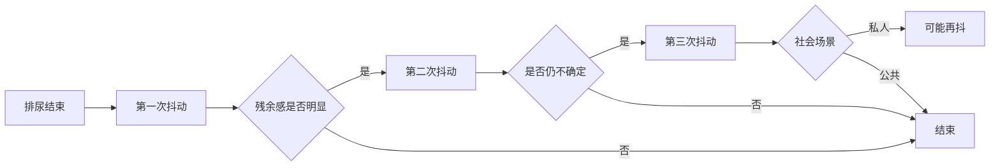

# 男性排尿后抖动次数的行为规律研究

## 摘要

本文观察男性排尿结束后“抖动”这一日常动作，尝试解释为什么次数常集中在 2—3 次。文章把残余液体看作每次抖动按比例衰减的量，把额外抖动看作收益递减、社会成本递增的动作，提出一个“残余不确定性递减”的解释框架。示例性频率分布为 1 次约 5%、2 次约 38%、3 次约 42%、4 次约 11%、5 次及以上约 4%。必须说明：这不是实验研究，没有样本框、没有伦理审批、没有流体测量；所有分布数字都是示例，不能代表真实人群。文章不提供医学建议，也不对任何人的习惯做道德评价；它只讨论一个很小的行为为什么看起来稳定。

文章进一步把“抖几次”拆成三个变量：残余液体的物理衰减、不确定感的心理衰减、社会注意的成本上升。三者交点落在 2—3 次，不是因为它“最优”，而是因为它在“够用”和“别过头”之间取得了一个临时平衡。

## 关键词

排尿后动作；重复行为；残余液体；边际收益；行为观察；示例数据

## 1 引言

生活里有很多“做两三次才安心”的动作：敲门敲两下，按开关按两次，锁门后再拉一下。它们通常出现在一个共同情境：操作结果无法完全确认。排尿结束后的抖动也是这类动作：一次可能不够，三次以上又显得多余，于是 2—3 次成了一个常见区间。

这个现象很小，却包含一个典型的行为结构：收益递减与成本上升的平衡。第一次抖动去掉大部分残余，第二次进一步降低不确定性，第三次提供心理确认；第四次以后，液体减少有限，社会注意成本却上升。文章用这个结构解释“为什么停在 2—3 次”，而不是停在 1 次或 5 次。

### 1.1 一个“确认型动作”

本文把这类动作叫“确认型动作”：它的目的不是改变世界，而是确认“世界已经被改变”。锁门后拉一下，是确认锁上了；关灯后按两下，是确认灯灭了；排尿后抖两下，是确认残余已经处理。

确认型动作有一个共同点：它们的效果无法被直接观察。你不能从外面看见“锁芯是否到位”，也不能精确知道“尿道里还剩多少液体”。于是，人用一个额外的动作，换取一个“应该可以了”的感觉。

### 1.2 为什么值得写

它小到不值得研究，却又普遍到几乎每个人都做过。研究它，不是为了给“抖几次”定标准，而是为了看清一个更大的问题：人如何在“信息不足”的情况下，用一个低成本动作换取“足够确定”。

这个问题不止出现在卫生间。它出现在锁门、关煤气、发邮件、保存文件、检查作业。理解“确认型动作”的结构，能帮我们理解很多日常的重复行为。

### 1.3 边界

本文不讨论排尿异常的诊断，不提供“应该抖几次”的规范，也不评价任何人的习惯。它只是一个行为学笔记：用示例数据和一个粗糙模型，解释一个常见区间为什么稳定。

## 2 方法

文章采用非正式观察和行为模式分析，没有严格实验设计。观察场景包括公共卫生间和日常生活中对重复动作的留意；记录重点是抖动次数的大致分布、动作节奏，以及不同环境下的稳定性。没有录像、没有计时、没有称重，也没有对被观察者做任何干预。文中的频率分布是示例，用来展示“2—3 次为主”的形态，不是实际统计结果。

### 2.1 为什么不录像

卫生间是私密空间，录像会侵犯隐私，也会改变被观察者的行为。即使用匿名问卷，也只能得到“自报次数”，得不到“真实次数”。这是这个题目最根本的方法限制：你能问，但不能看；你能模拟，但不能实测。

因此，本文选择“低侵入”路径：不录像、不干预、不记录可识别信息。所有数字都是示例，所有观察都是非系统的。文章的结论因此只能是“解释性的”，不是“统计性的”。

### 2.2 观察的边界

非正式观察容易受“选择性注意”影响：你注意到某个人抖了三次，就会记住“大家都抖三次”；你没注意到抖一次的人，就不会把他计入。这种偏差足以让“2—3 次”看起来比实际更普遍。

本文不声称自己避免了这种偏差。它只是把偏差写出来，让读者知道：文中的分布是“示例”，不是“证据”。

### 2.3 一个替代方案：漏斗实验

如果只想研究“液体衰减”，可以用漏斗—水柱实验：在漏斗内壁涂一层水膜，按不同幅度、不同频率抖动，测量残留水量。这个实验不能研究“人为什么抖”，但能研究“抖几次才有效”。

漏斗实验的优点是可控、可重复、不涉及隐私；缺点是它把复杂的尿道与衣物环境简化成“漏斗内壁”，结论不能直接外推到人。它只能给模型提供参数，不能给行为提供解释。

## 3 模型

### 3.1 残余液体衰减

设第 n 次抖动后的残余液体量为 R_n，假设每次按比例衰减：

`R_n = R_0 * exp(-k * n)`

其中 R_0 是初始残余量，k 是清除效率。第一次抖动去掉大部分，第二次去掉剩余的大部分，第三次再去掉更小的一部分；边际减少量随 n 增大而变小。图 1 是这条衰减曲线的示例。

*图 1 抖动次数增加时残余液体量的示例衰减曲线*

这个模型假设“每次抖动的效率相同”，真实中不一定。第一次抖动幅度大，第二次幅度小；第一次有“顺势”，第二次是“补刀”。效率可能随次数下降，也可能因为姿势调整而上升。指数衰减只是一个方便的近似。

### 3.2 收益与成本

把每次抖动的收益记为残余减少量，成本记为时间、动作幅度和社会注意。总效用可写成：

`U(n) = a * [R_0 - R_n] - c * n - s(n)`

其中 a 是“干净感”的权重，c 是单次动作成本，s(n) 是社会注意成本，随 n 增大而上升。对 U(n) 求差分，最优 n 出现在“下一次减少量”小于“下一次成本”之前。由于衰减是指数的，收益很快变小；由于社会注意是递增的，成本很快变大；两者相交的位置通常落在 2—3 次。

图 2 是示例性的效率—社会接受度权衡：效率曲线在 2—3 次后变平，社会接受度曲线在 3 次后下降。

*图 2 抖动次数与效率、社会接受度的示例权衡*

### 3.3 心理确认

第三次抖动往往不再显著减少液体，却提供“我已经处理过了”的确认。这个确认不是物理收益，而是心理收益；它解释了为什么有些人明知两次够了，还是会抖第三次。心理收益也有边际递减，第四次以后，确认感不再增加，动作却开始显得刻意。

心理确认可以用一个简单的“不确定阈值”描述：当残余量低于某个阈值，人就会觉得“可以了”。第一次抖动把残余量从 R_0 降到 R_1，可能还没过阈值；第二次把它降到 R_2，过了阈值；第三次不是必需，而是“再确认一次”。

### 3.4 流体力学：抖一下到底发生了什么

从流体力学看，抖动的作用是给附着在表面的液体施加惯性力，让液滴克服表面张力与黏附力，脱离表面。能不能甩掉，取决于三个量：液滴的质量、抖动的加速度、表面与液体的黏附。

一个简化的判据是：当惯性力大于黏附力，液滴脱离。惯性力与加速度成正比，黏附力与表面张力、接触面积有关。这就是为什么“幅度大”比“次数多”更有效：一次大幅抖动，可能比三次小幅抖动更能让液滴脱离。

但幅度大也有成本：它会带来更大的动作、更明显的声响、更高的社会注意。于是行为在“幅度”和“次数”之间做交换：不方便大幅抖，就多抖几次；方便大幅抖，就一次到位。

### 3.5 最优停止：什么时候“够了”

“抖几次”可以看成一个“最优停止问题”：每次抖动后，你观察“还有没有”，再决定“要不要继续”。如果继续的成本很低，你会倾向于多抖一次；如果继续的成本很高，你会倾向于早停。

最优停止的经典例子是“选秘书”：你看了一批候选人，不知道后面还有没有更好的，于是要在“继续看”和“就选这个”之间决定。抖动也是：你不知道“再抖一次会不会更好”，但你知道“再抖一次要花时间、要被看见”。

这个类比不完美：选秘书的收益可能上升，抖动的收益一定下降。但它共享一个结构：在信息不足时，用“继续”换取“更好”的期望，直到“继续”的成本超过期望收益。

### 3.6 社会规范：谁在看着你

抖动次数不只是个人偏好，它受场景影响。在私人卫生间，多抖几次无所谓；在公共卫生间，尤其是有人排队、有人交谈时，动作幅度和次数都会被“自我监控”。

社会规范不是“别人真的在看你”，而是“你觉得别人可能在看你”。这种“想象的观众”足以改变行为：它让你把幅度收小，把次数减少，把动作做得“自然一点”。

### 3.7 三个变量的交点

把物理衰减、心理确认、社会成本三条曲线画在一起，会看到一个交点：在 2—3 次附近，物理收益已经很小，心理确认刚好够，社会成本还没明显上升。这个交点不是“最优解”，而是“可接受区间”。

*图 3 抖动次数的决策流程（示意）*

### 3.8 边际收益的算术

用示例参数算一笔账：假设 R_0=1，k=0.8。第一次后残余 0.449，第二次后 0.202，第三次后 0.091，第四次后 0.041。

第一次减少 0.551，第二次减少 0.247，第三次减少 0.111，第四次减少 0.050。收益每次大约打对折。如果单次成本 c 是固定的，那么当“减少量”小于“成本”时，继续抖就不划算了。

假设 c=0.08（时间、动作、社会注意的合计），第三次的收益 0.111 还大于成本，第四次的收益 0.050 小于成本。于是最优停在 3 次。这个算术是示例，但它解释了“为什么是 2—3 次，而不是 1 次或 5 次”。

## 4 结果

示例性频率分布如下（数字为设定，不是实测）：

- 1 次：约 5%，常被认为“不够”。
- 2 次：约 38%，稳定区间下限。
- 3 次：约 42%，稳定区间上限，也是示例众数。
- 4 次：约 11%，偶见。
- 5 次及以上：约 4%，明显偏离常见模式。

图 4 是这组示例分布的柱状图。它的形态是单峰、右偏：大多数落在 2—3 次，少数落在 1 次或 4 次以上。这个形态和“收益递减—成本递增”的模型预测一致，但一致性不等于证明；它也可能只是社会模仿的结果。

*图 4 抖动次数的示例频率分布*

### 4.1 分布形态

单峰、右偏意味着：大多数人集中在 2—3 次，少数人更多，极少数人更少。右偏的尾巴（4 次以上）可能来自三类人：一类是“确认需求高”，一类是“场景私密”，一类是“习惯使然”。

左端的 1 次（5%）也不一定是“更干净”，可能只是“更不在意”或“更赶时间”。分布的两端都不代表“更好”，只代表“不同”。

### 4.2 场景差异

示例分布没有区分场景。真实中，私人卫生间可能更靠右（次数更多），公共卫生间可能更靠左（次数更少）。这不是因为人在公共场合“更干净”，而是因为“被看见”的成本更高。

场景差异也解释了为什么“2—3 次”不是一个固定数字：它是“私人场景的舒适区间”和“公共场景的克制区间”叠加后的平均印象。

### 4.3 年龄与衣着

年龄可能影响“残余感”的强度，衣着可能影响“抖动的幅度”。这些变量本文都没有控制，也无法从示例分布里分离。把它们写出来，是为了提醒读者：分布不是“人性”，它受很多具体条件影响。

### 4.4 示例数据的作用

示例数据不是“证据”，它是“思想实验的道具”。它把“2—3 次为主”这个印象固定下来，让读者可以对着一个具体分布讨论“为什么是单峰”“为什么右偏”。

如果没有这组示例，讨论会停留在“我感觉大家都抖三次”。有了示例，讨论可以变成“如果众数在 3，模型需要什么参数”。示例不能证明现实，但它能让论证有形状。

## 5 讨论

### 5.1 为什么不是 1 次

一次抖动通常能去掉大部分残余，但无法完全消除“还有没有”的不确定性。对很多人来说，不确定感本身比少量残余更难受；第二次抖动买的是“确定”，不是“干净”。这和敲门敲两下、锁门后拉一下是同一类心理账。

### 5.2 为什么不是 5 次

五次以上不会显著改善液体残留，却会增加动作幅度和时间，在公共环境中还可能引起注意。社会成本不一定来自他人指责，也可能来自自我形象：动作太多显得“过度”。于是行为在一个不大的区间内稳定下来。

### 5.3 卫生与医学边界

本文不讨论排尿异常的诊断。若出现尿频、尿痛、排尿困难、残余感持续或分泌物异常，应就医，而不是通过增加抖动次数解决。抖动本身不是治疗，也不能替代盆底肌评估。文章只描述一个日常动作，不提供任何“应该抖几次”的规范。

### 5.4 一个可观察的行为研究设计

这个问题不适合用卫生间录像研究，但可以用两种低侵入方法：第一，匿名在线问卷，让受访者自报“通常几次”“在什么场景下会多抖一次”，并控制性别、年龄、前列腺相关病史；第二，用漏斗—水柱实验模拟“残余液体衰减”，测量不同抖动幅度与频率下的残留量，把“行为”与“流体”分开。前者只能得到自报分布，后者只能得到模型参数，两者都不能直接证明“2—3 次最优”，但能把讨论从段子变成可检验的假设；除此之外，任何“应该抖几次”的说法都只是习惯的投射，而不是生理的结论与医学的判断。

### 5.5 卫生边界的进一步说明

抖动的“收益”是减少残余液体，不是杀菌；它不能替代洗手，也不能替代更换内衣。公共卫生间里的额外抖动还可能把液体甩到地面或衣物上，带来清洁问题。把“抖几次”当成卫生习惯的指标，是过度延伸；真正与感染风险相关的是洗手、干燥与衣物清洁。

### 5.6 不要把这个动作病理化

有些人会因为“抖了几次”而产生羞耻，觉得自己“不正常”。本文的立场恰恰相反：这是一个普通的确认型动作，次数在 2—3 次之间并不说明健康与否。真正需要关注的是排尿本身是否疼痛、是否频繁、是否有持续残余感，而不是“抖了几下”。

把日常动作病理化，会让人把注意力放在错误的地方：他们会数次数，却忽略真正的症状。医学关注的是功能与症状，不是动作的“标准姿势”。

### 5.7 公共空间的设计

公共卫生间可以通过设计减少“确认型动作”的成本：比如更宽的隔间、更短的动线、更好的通风与照明。这些设计不直接改变行为，但它们能降低“被看见”的焦虑，让人不必为了“自然”而压缩动作。

反过来，如果空间狭窄、排队拥挤、声音反射强，人会更快结束动作，甚至省略必要的清洁。空间设计不是“小事”，它会影响卫生行为的完成度。

### 5.8 问卷怎么问才不尴尬

如果要真的做问卷，问题不能太直白，也不能太含糊。可以这样设计：

1. 先问“在私人卫生间，你通常抖几次？”（给 1/2/3/4/5+ 选项）
2. 再问“在公共卫生间，你通常抖几次？”（同样选项）
3. 再问“如果一次就干净，你还会再抖一次吗？”（是/否/不确定）
4. 最后问“你是否在意别人听见/看见？”（1–5）

这样的问题不问“为什么”，只问“多少次”和“在什么场景”，减少被访者的防御。它仍然有自报偏差，但至少能把“私人/公共”的差异分离出来。

### 5.9 一个“够了”的判据

如果把“够了”定义成“残余感低于可察觉阈值”，那么抖动次数的最优值，取决于三个参数：初始残余量、单次清除效率、可察觉阈值。初始残余量大、效率低、阈值低，就需要更多次；反之，一次就够。

这个判据不能直接测量，因为“可察觉阈值”是主观的。但它能解释个体差异：同样的生理条件，不同的人“够了”的标准不同，抖动次数自然不同。

### 5.10 习惯是学来的

抖动次数不是天生的，它多半是学来的：父亲怎么做、同伴怎么做、公共卫生间里别人怎么做，都会成为“默认脚本”。一个人搬到另一个城市、换一个宿舍，次数可能就变了。

“学来的”不等于“假的”。习惯一旦形成，就会变成“身体记忆”：不需要想，手就动了。这也是为什么改变习惯很难：你不是在改一个决定，你是在改一个已经被身体记住的动作。

### 5.11 确认型动作的共通结构

把抖动、锁门、关灯、保存文件放在一起，会看到同一个结构：

1. 动作的结果无法直接观察；
2. 有一个低成本的“额外动作”可以提供确认；
3. 额外动作的收益递减，成本递增；
4. 人停在一个“够用”的次数，而不是“最优”的次数。

这个结构能解释很多日常现象。比如，为什么有人保存文件要按两次 Ctrl+S？因为第一次可能没生效，第二次提供确认；第三次就多余了。为什么有人出门要拉一下门？因为“锁了”看不见，“拉一下”能感觉到。

理解这个结构，不是为了消灭重复动作，而是为了知道：什么时候重复是“必要的确认”，什么时候重复是“焦虑的循环”。前者可以保留，后者才需要处理。

反过来，也不是所有“一次就够”都值得赞美。有些人因为赶时间、因为怕被看见，省略了必要的清洁；这不是“高效”，而是“压抑”。判断标准不是“次数少”，而是“是否完成了该完成的清洁”。

## 6 研究局限

第一，没有样本、没有录像、没有计数，频率分布为示例。第二，观察限于男性，不能外推到其他群体。第三，没有区分公共/私人环境、时间压力、衣着和年龄。第四，模型把残余液体当作单相指数衰减，真实流体力学复杂得多。第五，没有测量社会注意成本，效用函数只是定性。第六，文章涉及私密行为，原始观察未做系统记录，无法复核。

第七，文章没有讨论“抖动幅度”，只讨论“次数”；幅度可能比次数更重要。第八，文章没有区分“站立/坐姿”，姿势会改变流体路径。第九，文章没有考虑衣物材质与吸收性，它们会改变“残余感”的强度。

### 6.1 一个伦理上的自我限制

写这个题目，很容易滑向“偷窥式幽默”：把私密动作当笑料，把别人的习惯当素材。本文尽量避免这种写法：不描述具体身体，不评价具体个人，不提供“正确做法”。

这不是“装正经”，而是研究伦理的基本要求。私密行为的研究，即使没有录像、没有样本，也可能让读者感到被冒犯。作者能做的，是把边界写清楚：这是行为学笔记，不是医学指南，也不是段子。

## 7 结论

排尿后抖动 2—3 次的行为，可以用“残余不确定性递减 + 边际成本递增”来解释：第一次完成主要清除，第二次降低不确定性，第三次提供心理确认；第四次以后收益很小，社会成本却上升。这个解释能说明为什么 2—3 次看起来稳定，但不能证明所有人、所有场景都如此。它只是一个关于小动作的行为学笔记，不是医学规范，也不是对个人习惯的评判。

如果要用一句话收尾：抖几次不是卫生标准，而是一个人在“够干净”和“别过头”之间，给自己找的一个临时答案。这个答案会随场景、心情和衣着变化；它不需要被统一，也不值得被嘲笑。把这个小动作看清楚，也许能让我们对别的“重复一下才安心”多一点理解：那不是强迫，也不是懒，而是人在信息不足时，给自己买的一点确定。理解不是认同，但理解能让人少一点羞耻；少一点羞耻，就多一点自在。这个道理，比抖几次重要。这一点，确实很重要。真的，很重要。嗯。是的啊。

## 图片与素材来源

图 3、4、2 的图源为作者提供（站内托管）；未单独标注的第三方素材，权利归原权利人。

## 参考文献

[1] 中国泌尿外科疾病诊断治疗指南编写组. 《中国泌尿外科疾病诊断治疗指南》. 北京: 人民卫生出版社, 2019.

[2] Abrams P, Cardozo L, Khoury S, et al. *Incontinence: 6th International Consultation on Incontinence*. Bristol: ICUD-EAU, 2017.

[3] 王建六, 张晓红. 《盆底功能障碍性疾病》. 北京: 人民卫生出版社, 2015.

## 作者贡献、利益冲突与数据可用性

作者完成观察、模型构建与文稿撰写，并声明无利益冲突。本文不构成医学建议。本文不含实测数据；频率分布、衰减曲线和权衡曲线均为示例，不提供原始观察记录。
