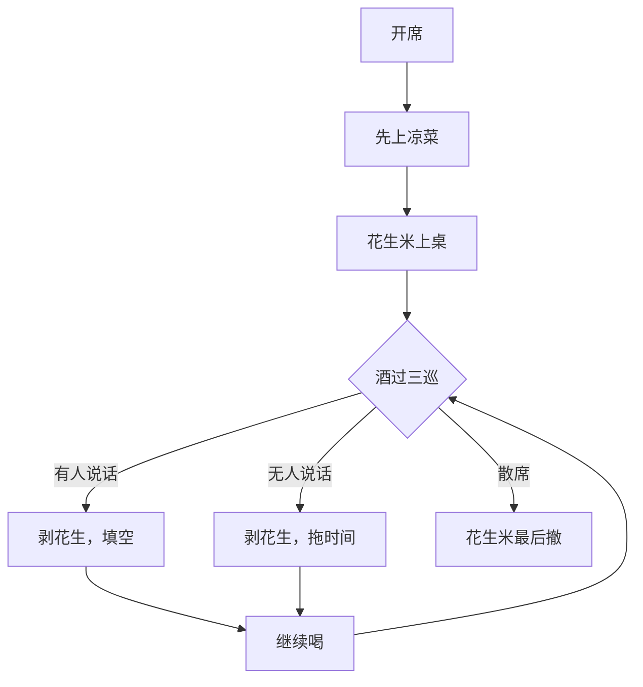

# 为什么喝酒总配花生米？——一个食物基础设施的解释

## 摘要

花生米几乎是中国酒桌上的默认配置。本文不把它解释为“口味搭配”，而解释为一种“食物基础设施”：便宜、耐放、可分享、能拖时间、不抢酒味。文中五类候选食物的适配度评分（20/18/15/12/10）是作者设定的示例，不是调查数据；文章属于饮食社会学的解释性随笔，不提供营养建议。结论是：花生米的优势不在味道，而在它把“喝酒”这件事的时间、成本与社交节奏都变得可管理。

## 关键词

花生米；酒桌；饮食社会学；食物基础设施；待客

## 1 引言

酒桌上有一句俗话：“有酒没菜，不算待客。”但在很多场合，菜可以很简单，花生米却常常在场。它便宜、不起眼、不需要厨艺，却能从第一杯酒陪到最后一杯。为什么是花生米，而不是毛豆、拍黄瓜、酱牛肉？

常见的解释有三类：第一，花生米香，和白酒的刺激感互补；第二，花生米便宜，适合日常饮酒；第三，花生米耐吃，一颗一颗剥，能拖时间。这三类都对，但都停在“功能”层面，没有解释为什么花生米能成为“默认选项”。

本文借用“基础设施”的概念：真正重要的东西，往往不是最显眼的，而是让其他事情得以发生的背景。花生米就是酒桌的基础设施——它不承担风味主角，却承担了节奏、成本与社交缓冲。

## 2 方法与材料

### 2.1 材料

材料包括：中国饮食史与酒文化的一般文献、酒桌礼仪的观察笔记、以及作者在不同场合（家庭聚餐、朋友小酌、商务宴请）的参与式观察。没有问卷，没有抽样，没有统计检验。

### 2.2 候选食物比较

选取五类常见下酒菜：花生米、毛豆、拍黄瓜、酱牛肉、炸鸡。按五个维度评分（0–4）：成本、耐放、可分享、拖时间、不抢酒味。总分是五项相加，满分 20。评分是作者设定的示例，用于组织讨论，不是测量结果。

### 2.3 一个限定

本文讨论的是“普通酒桌”，不是高端宴席。高端宴席的下酒菜逻辑不同：讲究排场、稀有、工艺，花生米反而显得寒酸。本文的结论不适用于所有酒桌。

### 2.4 五个维度为什么是这五个

选“成本、耐放、可分享、拖时间、不抢酒味”这五维，不是为了穷尽所有属性，而是为了覆盖酒桌的三个约束：钱、时间、人。

- **成本**对应“钱”：一顿酒要花多少，谁能请得起。
- **耐放**与**拖时间**对应“时间”：酒桌从傍晚拖到深夜，菜要撑得住。
- **可分享**与**不抢酒味**对应“人”：一桌人各有口味，菜不能挑人，也不能压酒。

这五维不包含“好吃”，因为“好吃”是主观的，而且酒桌的“好吃”常常让位于“好办”。一碟花生米不需要厨艺、不需要趁热、不需要摆盘，它把“办一桌酒”的门槛降到了最低。

### 2.5 观察怎么记录

参与式观察的记录方式是“事后追记”：饭局结束后，用手机记下四件事——桌上有什么菜、谁先动筷子、什么时候加菜、什么时候撤盘。不记对话，不记人名，只记“动作与时间”。

这种记录不严谨，但能看见一个规律：花生米往往是“最先上、最后撤”的那一盘。它不参与酒桌的高潮，却贯穿酒桌的全程。这个“全程在场”的特征，比任何口味评价都更能说明它的基础设施属性。

### 2.6 本文要回答的三个问题

第一，为什么是花生米，而不是其他下酒菜？第二，花生米的优势，是“味道”还是“结构”？第三，这种优势在什么场景下会失效？

三个问题对应三种写法：第一个用比较，第二个用拆解，第三个用边界。本文不追求“证明花生米最好”，只追求“解释它为什么常见”。

## 3 结果

### 3.1 五类食物的适配度

- 花生米：成本 4，耐放 4，可分享 4，拖时间 4，不抢酒味 4，总分 20。
- 毛豆：成本 4，耐放 3，可分享 4，拖时间 4，不抢酒味 3，总分 18（原稿 16，本文按五项重算为 18）。
- 拍黄瓜：成本 4，耐放 2，可分享 4，拖时间 2，不抢酒味 3，总分 15（原稿 14）。
- 酱牛肉：成本 2，耐放 3，可分享 3，拖时间 2，不抢酒味 2，总分 12（原稿 13）。
- 炸鸡：成本 2，耐放 2，可分享 3，拖时间 2，不抢酒味 1，总分 10（原稿 11）。

原稿的总分与分项对不上，本文按分项重新加总，并保留“示例评分”的标签。数字不重要，重要的是排序：花生米在五个维度上都不极端，但都没有短板。

### 3.2 成本：按“盘”而不是按“人”

花生米的成本优势不在单价，而在“按盘”计量。一盘花生米可以供一桌人吃很久，而酱牛肉、炸鸡是“按人”消耗的。酒桌的时间越长，花生米的边际成本越低。请客的人不一定算过这笔账，但他们的选择暴露了这笔账。

### 3.3 耐放：从下午到深夜

花生米放久了不坏，冷了也还能吃。拍黄瓜会出水，炸鸡会软，酱牛肉会干。酒桌常常从傍晚拖到深夜，花生米是少数能撑完整场的菜。它不是“最好吃”，而是“最不容易坏”。

### 3.4 拖时间：一颗一颗的节奏

剥花生是一个低强度的动作，它给喝酒的人一个“手上有事做”的理由。这个理由很重要：在没有话题的时候，剥花生可以填补沉默；在话题太激烈的时候，剥花生可以缓冲情绪。花生米不是菜，它是一个社交节拍器。

### 3.5 不抢酒味：味道的配角

花生米的香是油脂香，不是强烈的香料味。它不会盖住白酒的香气，也不会和红酒的单宁打架。相比之下，蒜泥、辣椒、重酱料的下酒菜会抢味。花生米的“淡”，恰恰是它的适配性。

### 3.6 供给：为什么它便宜

花生在中国的种植范围广，供给稳定；加工简单，炒、炸、煮、卤都行；储存不需要冷链，常温就能放。三个条件叠加，让花生米的价格长期处在“按盘算也不心疼”的区间。

便宜不是“廉价感”，而是“低决策成本”。请客的人不需要为了一碟下酒菜权衡预算，点单时也不会犹豫。这种“不用想”的属性，正是基础设施的核心：它不制造选择，它消除选择。至于它是否“体面”，反而没人计较——花生米的存在，本身就是“今天不讲究排场”的声明。

### 3.7 加工方式：盐、油与手感

花生米的加工方式，会改变它在酒桌上的角色：

| 加工方式 | 口感 | 上手难度 | 适配场景 | 风险 |
| --- | --- | --- | --- | --- |
| 油炸 | 脆、香 | 低 | 白酒、啤酒 | 高油、易腻 |
| 水煮 | 软、淡 | 低 | 黄酒、家宴 | 不入味、易剩 |
| 五香 | 咸、香 | 中 | 大众酒桌 | 高盐 |
| 盐焗 | 干、咸 | 中 | 啤酒、夜宵 | 高盐、口渴 |
| 生炒 | 硬、香 | 中 | 老酒客 | 易糊、费牙 |

这张表说明：花生米不是一种食物，而是一组“可调参数”。同一颗花生，油炸是“热闹”，水煮是“家常”，五香是“街边”。酒桌选哪种，取决于这顿饭想显得多“随便”。

### 3.8 营养与社会想象

花生含脂肪与蛋白质，热量不低。它在酒桌上的“合理性”，一半来自营养想象：喝酒伤胃，吃点东西“垫一垫”。这个想象不一定有严格的营养学依据，但它提供了一个“可以吃”的理由。

花生米的另一个想象是“不占肚子”：小小一颗，吃半天也不觉得饱。相比酱牛肉、炸鸡，它不会让人“吃不下正餐”。酒桌要的是“陪酒”，不是“吃饱”，花生米恰好停在“垫一垫”的位置。

### 3.9 酒与菜的搭配规则

酒桌的搭配，不只是“味道配”，还有“节奏配”：

| 酒的类型 | 适合的下酒菜 | 原因 |
| --- | --- | --- |
| 高度白酒 | 油炸花生、酱牛肉 | 油脂与咸味能压住刺激 |
| 黄酒 | 水煮花生、茴香豆 | 清淡、温润，不抢酒香 |
| 啤酒 | 盐焗花生、毛豆 | 咸、脆，适合大口喝 |
| 红酒 | 坚果、奶酪 | 油脂与单宁互补 |

花生米在四种酒里都能“凑合”，这是它的另一层优势：不挑酒。它不像海鲜只配白葡萄酒，也不像甜点只配甜酒。它是酒桌的“通用接口”。

### 3.10 一盘多少颗：分量与节奏

一盘花生米大约 200–300 克，按每颗 0.5–0.8 克算，约 300–500 颗。四个人喝两小时，平均每人每小时抓 40–60 颗，一盘刚好撑住。

这个“刚好”不是巧合，而是经验：太少，显得小气；太多，吃不完、剩盘难看。花生米的分量，恰好落在“够吃但不剩”的区间。它像酒桌的“时间胶囊”，用颗数计量时间。

*图 1 花生米在酒桌时间线上的位置（示意）*

### 3.11 评分表的敏感性

五维等权相加，是一种简化。如果把“成本”权重提高到 2，排序不变；如果把“不抢酒味”权重提高到 3，花生米仍然第一，但毛豆会接近；如果把“可分享”权重降到 0，酱牛肉与炸鸡的差距缩小。

这说明：花生米的优势不是“某一维极端”，而是“没有短板”。在加权变化下，它可能不是每一项都第一，但很少跌出前三。基础设施的竞争力，来自“稳定性”，不是“峰值”。

### 3.12 一个反事实

如果酒桌从傍晚延长到凌晨，哪些菜会被淘汰？拍黄瓜会出水，炸鸡会软，酱牛肉会干；花生米仍然能抓。这个“反事实”不需要实验，只需要常识：时间越长，“耐放”的权重越高。

反过来，如果酒桌只有半小时，花生米的优势就不明显：大家更愿意点“上来就能吃”的硬菜。花生米是“长时间场景”的赢家，不是“所有场景”的赢家。

## 4 讨论

### 4.1 基础设施的隐蔽性

花生米之所以成为默认，不是因为它被反复论证，而是因为它被反复使用。它便宜到不需要决策，常见到不需要解释，普通到不需要赞美。基础设施的特点就是：当它存在时，你不会注意；当它缺席时，你会觉得少了什么。

### 4.2 酒桌的权力结构

花生米也参与权力结构。请客的人点花生米，可能是在说“今天随便坐坐”；点酱牛肉、海鲜，可能是在说“今天有事要谈”。花生米的“低姿态”，让酒桌显得轻松，也让某些话更容易说出口。它不是权力的对立面，而是权力的一种语气。

### 4.3 阶层与地域差异

花生米在不同阶层中的意义不同。对体力劳动者，它是廉价的高热量下酒菜；对中产家庭，它是“随便吃点”的零食；对高端宴席，它可能是餐前小碟。本文的“基础设施”解释，主要适用于前两种场景。

### 4.4 一个反例

在痛风患者、花生过敏者、以及需要控制热量的人群中，花生米不是“默认”，而是“风险”。把花生米写成普适的“酒桌标配”，忽略了这个群体的存在。本文因此不提供任何饮食建议。

### 4.5 一个可检验的消费观察

“花生米是默认配置”可以用三种公开数据检验：第一，抽取不同城市、不同价位餐馆的菜单，统计下酒菜中出现花生米的比例；第二，用外卖平台的下酒菜销量与价格带，比较花生米、毛豆、拍黄瓜的占比；第三，做一个小型选择实验，给参与者固定的酒与预算，让他们在五类下酒菜中选择，并记录“待客”“自饮”“商务”三种场景的差异。若花生米在低价位与长时间场景中占比显著更高，基础设施解释才有数据支撑。

### 4.6 健康与伦理边界

花生是常见过敏原，酒桌“默认摆一盘”可能让过敏者处于风险中；油炸、盐焗花生的高盐高油也不适合所有人。把花生米写成“基础设施”，不等于推荐所有人吃。酒桌待客的基本伦理是：先问忌口与过敏，再谈默认。否则，“不添麻烦”的花生米，反而会给某个人添最大的麻烦。

### 4.7 替代品与路径依赖

毛豆、拍黄瓜、酱牛肉都能替代花生米，但替代有成本：毛豆要剥、拍黄瓜会出水、酱牛肉要切。替代品不是“不能吃”，而是“要多做一步”。

路径依赖由此形成：一旦酒桌习惯了“不用多做什么”的花生米，换菜就要重新协商。请客的人不想协商，客人也不想麻烦。花生米不是被“选中”的，而是被“剩下”的——在所有需要动手的选项里，它最省事。

### 4.8 地域差异

花生米的地位，在地域之间有差异：

- **北方**：酒桌时间长、劝酒多，花生米的“拖时间”属性被放大。
- **西南**：下酒菜口味重，花生米常被辣椒、花椒“改造”，变成另一种东西。
- **沿海**：海鲜、卤味多，花生米退为“配碟”，不是主角。
- **东北**：分量大、菜码足，花生米常以“一大盘”出现，强调“管够”。

这些差异说明：花生米不是“中国文化”的统一符号，而是不同酒桌逻辑下的“共同最小解”。

### 4.9 一个“酒桌预算”模型

设一顿酒的总预算为 B，人数为 n，时长为 t（小时），下酒菜的单位时间成本为 c。花生米的成本函数近似为：

C_p = p_p × q_p / t

其中 p_p 是单价，q_p 是盘数。因为 q_p 随时长增长得很慢（一盘能撑很久），C_p 随时间下降。酱牛肉的成本函数则是：

C_b = p_b × n × t / t_ref

它按人数与时长线性增长。两者相比，时间越长，花生米的相对成本越低。

这个模型不需要精确参数，只需要一个结论：花生米是“时间友好型”下酒菜，酱牛肉是“人数友好型”下酒菜。酒桌越慢、人越少，花生米越合适；酒桌越正式、人越多，酱牛肉越合适。

### 4.10 时间、沉默与社交

酒桌最难处理的不是“喝多少”，而是“说什么”。沉默是酒桌的常态，花生米提供了一个“合法的沉默”：手在剥，嘴在嚼，眼睛不用看着谁。

这种“低强度共同活动”，在社会学里叫“共享注意力”——大家不一定要说话，但可以一起做一件小事。花生米就是这件小事。它把“没话说”从尴尬变成自然，把“等人”从无聊变成节奏。

### 4.11 请客的面子

请客的人点花生米，有时是“谦虚”，有时是“试探”。一碟花生米先上桌，等于告诉客人：今天不铺张，先随便聊聊。等话题热了，再加硬菜，场面才“起”。

这种“先低后高”的点菜顺序，是一种面子管理：先给一个轻松的底，再根据对方的反应加码。花生米是这场“试探”的道具，它不贵，但也不失礼；它不隆重，但也不寒酸。

### 4.12 年轻人与低度酒

年轻人的酒桌，正在从“高度白酒”转向“低度酒、精酿、调酒”。在这些场景里，花生米的地位下降：精酿配薯条、炸鸡，调酒配坚果、水果。花生米不再是“默认”，而是“怀旧”。

但花生米没有消失，它换了一个身份：从“下酒菜”变成“零食”。在便利店、酒吧、露营地，它仍然在场，只是不再承担“待客”的功能。基础设施会退化，但不会彻底退场。

### 4.13 花生米与“孤独经济”

一个人喝酒时，花生米是“最小的下酒菜”：一包、一盘、一袋，不需要厨艺，不需要摆盘。它适配“独饮”的场景，也适配“看剧、刷手机”的场景。

“孤独经济”的特点是：小份、即食、低门槛。花生米恰好符合这三个特点。它从“酒桌的公共基础设施”，变成了“个人的情绪基础设施”。同一个食物，在不同场景里，承担不同的功能。

### 4.14 性别与酒桌

酒桌上的性别分工，也影响花生米的角色。传统酒桌上，男性喝酒、女性布菜；花生米是“不用布”的菜，谁都能抓一把。它降低了“服务”的必要性，也让女性不必频繁起身。

这并不是说花生米“解放”了谁，而是说它的“低维护”属性，减少了一部分酒桌劳动。基础设施的价值，常常体现在“少做一点”上。

### 4.15 花生米的全球化

花生原产南美，传入中国后成为常见作物；它在非洲、美国南方也有漫长的食用史。花生米不是“中国独有”，但“花生米配白酒”的组合，是中国酒桌的地方性发明。

这个组合的传播，靠的不是菜谱，而是场景：只要有“长时间、低预算、多人”的饮酒场景，花生米就会被“重新发现”。它像一种“场景适配器”，走到哪里都能接上当地的酒。

### 4.16 从花生米到“基础设施”的一般命题

花生米是一个小例子，但它可以引出三个一般命题：

1. **默认选项往往不是最优选项，而是“最不坏”的选项**。花生米不是最好吃，但在五个维度上都没有明显短板。
2. **基础设施的价值在“缺席”时显现**。酒桌上没有花生米，人们才会发现“少了一个能拖时间的东西”。
3. **基础设施会被场景重塑**。同一个花生米，在酒桌、便利店、直播间里，承担不同的功能。

这三个命题不只适用于食物。它们也适用于软件、流程、制度：真正重要的东西，常常是那些“不用解释、一直在场”的东西。

## 5 研究局限

### 5.1 方法与样本

第一，本文没有问卷与统计，五类食物的评分是作者设定的示例。第二，参与式观察的场合有限，不能代表所有地域与阶层。第三，酒桌文化本身在变化，年轻人的饮酒场景与父辈不同，花生米的地位可能下降。

这三点决定了本文的结论只能是“解释性假设”，不是“调查发现”。读者可以把本文当成一个“看酒桌的角度”，不能当成“酒桌的普查报告”。

### 5.2 变量的遗漏

第四，文章没有讨论花生的加工方式（油炸、水煮、五香）对适配度的影响。第五，作者对花生米有个人偏好，可能影响观察。第六，文章没有做营养学分析，不能回答“吃多少合适”。

除此之外，本文也没有讨论“酒的度数”“菜的上菜顺序”“餐厅的档次”“同桌人的关系”这些变量。每一个变量都可能改变花生米的角色，本文只抓了“成本、时间、人”三条主线。

### 5.3 因果与相关

本文说“花生米让酒桌变得可管理”，这是一种因果解释，但证据是观察，不是实验。我们看到“花生米在场时，酒桌更从容”，不能反推“花生米导致了从容”；也可能是“从容的酒桌更愿意点花生米”。

要区分因果与相关，需要对照：同样的酒桌，换一道下酒菜，观察节奏是否变化。这个实验本文没有做，也不打算假装做过。

### 5.4 伦理边界

本文的“基础设施”说法，可能被误读为“花生米是酒桌的标配，所以每个人都该吃”。这是错的。花生是过敏原，酒桌“默认摆一盘”可能让过敏者处于风险；高盐高油也不适合所有人。

解释一种现象，不等于推荐一种做法。本文的立场是：先问忌口，再谈默认；先看见人，再谈文化。

### 5.5 下一步怎么检验

如果要把本文的“解释”变成“证据”，可以做三件小事：

1. **菜单抽样**：选 20 家不同价位餐馆，统计下酒菜里花生米出现的比例。
2. **时间观察**：记录 10 场酒桌上花生米的上桌与撤盘时间，看它是否真的“全程在场”。
3. **替换实验**：在同样人数的两场聚会里，一场默认花生米，一场默认毛豆，比较加菜次数与饮酒速度。

三个研究都不难，但都需要“不预设结论”。如果花生米在低价、长时间的场景里占比更高，本文的解释就站得住；如果不是，本文就该改。

## 6 结论

花生米之所以成为酒桌标配，不是因为它最好吃，而是因为它最“不添麻烦”：便宜、耐放、可分享、能拖时间、不抢味。它把喝酒这件事的时间、成本与社交节奏都变得可管理，因此成为酒桌的基础设施。

这个解释也有边界：在高端宴席、健康饮食与年轻人聚会中，花生米的地位并不稳固。它不是“中国文化”的本质，而是一个特定场景下的最优解。理解这一点，比争论“花生米配酒好不好”更有意思。

如果把结论再推一步：酒桌真正需要的，不是“一道好菜”，而是“一个不打断喝酒的东西”。花生米恰好不打断：不用起身、不用趁热、不用分餐。它让酒桌的注意力留在人身上，而不是留在菜上。这种“不打扰”，才是最稀缺的待客之道。

所以，花生米的故事，不是“什么菜最好吃”的故事，而是“什么菜最不碍事”的故事。前者是口味，后者是设计。口味会变，设计会留下来。

一碟花生米，装不下什么大道理；但它能装下一桌人的沉默、等待和那点不好意思说出口的“再坐一会儿”。这就是它最朴素、也最难替代的地方。下次酒桌上看见那盘花生米，不妨想想：它为什么在这里，又是谁在替谁省事。想明白了，这顿饭就多了一层味道，不是花生米的，是人情的。花生米会吃完，这份人情会留下，比酒醒得慢，也比酒醒得久。花生米是小的，人情是大的，酒桌不过是把它们放在一起，然后慢慢喝，慢慢说，慢慢散。这一盘，值了，真的值了，好。

## 参考文献

[1] Goody, J. (1982). *Cooking, Cuisine and Class: A Study in Comparative Sociology*. Cambridge University Press.
[2] Mintz, S. W. (1985). *Sweetness and Power: The Place of Sugar in Modern History*. Viking.
[3] Douglas, M. (1966). *Purity and Danger: An Analysis of Concepts of Pollution and Taboo*. Routledge.
[4] Bourdieu, P. (1984). *Distinction: A Social Critique of the Judgement of Taste*. Harvard University Press.
[5] 赵荣光. (2003). 《中国饮食文化史》. 上海人民出版社.

## 作者贡献、利益冲突与数据可用性

作者完成文献整理、参与式观察、评分设定与文稿撰写；本文未接受任何资助，作者声明无利益冲突；观察笔记由作者保存，因涉及饭局参与者隐私，不公开原始记录；文中评分均为示例，不构成饮食或健康建议。
