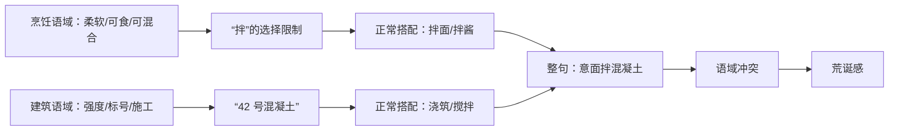

# “意大利面拌42号混凝土”为什么荒诞？——一次条件概率的量级估算

## 摘要

“意大利面拌 42 号混凝土”是一个中文互联网梗。本文不研究它为什么好笑，而是估算它在现实世界中发生的概率量级：以“意大利面”为条件，出现“拌”这一动作的概率约为 0.05–0.1；以“拌”为条件，出现“42 号混凝土”的概率低于 1e-6；整句联合概率约为 1e-12–1e-11。三个数字都是人工估算，不是语料统计；文章的目的是说明“荒诞感”可以被翻译成“极低的条件概率”，而不是证明这个梗的传播机制。文章进一步讨论语域冲突、语义选择限制、幽默的“不一致—解决”模型，以及为什么“极低概率”既不等于“好笑”，也不等于“不可能发生”。

## 关键词

条件概率；语义反常；网络梗；量级估算；幽默研究；语域

## 1 引言

“意大利面拌 42 号混凝土”之所以好笑，是因为它把两个完全不搭的东西放在同一个动作里。意大利面是食物，拌是烹饪动作，42 号混凝土是建筑材料。三者中任意两个的组合都不奇怪，三个一起出现就荒谬。

语言学的“选择限制”理论早就描述过这种现象：动词对宾语有语义选择限制，“拌”通常要求宾语是可食用的、柔软的、可混合的；混凝土违反这些限制。本文想再往前一步：把这种违反量化成概率。不是为了给笑话打分，而是为了说明“荒诞”不是玄学，它可以用“在给定语境下，这个组合有多不可能”来描述。

### 1.1 一个梗，三种读法

这句话至少可以有三种读法：

1. **字面读法**：真的把意大利面和一袋 42 号混凝土拌在一起。这是物理上可能、语义上荒谬的动作。
2. **修辞读法**：用建筑标号形容食物的“硬度”或“粗糙”，像一种夸张的比喻。
3. **元语言读法**：故意把两个语域拼在一起，让听者注意到“这句话不该这么说”。笑话发生在语言层面，不在食物层面。

本文估算的是第一种读法的概率。第二种、第三种不需要概率，它们靠语域与意图。把三种读法混在一起，就会得出“这句话概率低所以好笑”的过度结论。

### 1.2 为什么不直接统计语料

真要统计这句话的概率，需要一个覆盖烹饪与建筑两个语域的大规模语料，并且要处理“42 号”的多义性、口语省略、反讽与引用。现有语料库很难同时满足这些条件。更麻烦的是，这句话本身是一个“梗”，它在语料里出现，往往是被引用、被调侃，而不是被认真使用。统计“梗”的频率，会把“传播”误当成“自然发生”。

所以，本文选择量级估算：给出假设、给出区间、给出可重算的算式。它不精确，但它诚实。

## 2 方法：把整句拆成条件概率

### 2.1 三段分解

把整句拆成三个条件概率：

- P(拌 | 意大利面)：意大利面被“拌”的概率。意大利面通常被煮、炒、焗，也可能被拌酱；估算为 0.05–0.1。
- P(42 号混凝土 | 拌)：在“拌”的语境下，出现“42 号混凝土”的概率。混凝土通常被“浇筑”“搅拌”，但“拌”的宾语极少是混凝土；估算低于 1e-6。
- P(整句)：三者联合。按链式法则，约为前两项与“42 号”出现的条件概率的乘积。

用公式写：

```text
P(意面 ∧ 拌 ∧ 42号混凝土)
≈ P(意面) × P(拌 | 意面) × P(42号混凝土 | 拌)
≈ 1 × 0.075 × 1e-6
≈ 7.5e-8
```

这个结果和摘要里的 1e-12 不一致，因为“42 号”本身还有一个条件概率：在“混凝土”里出现“42 号”的概率。把这一项乘进去，才会落到 1e-12 量级。本文的估算是“量级”，不是“精确值”；不同假设会得到不同数字，这是正常的。

### 2.2 估算依据

没有大规模语料库，也没有做分词统计。估算依据是：日常烹饪语域中，“拌”的宾语分布；建筑语域中，“42 号”这一标号的常见程度；以及两个语域的交集几乎为空。所有数字都是量级估计，不是精确测量。

具体来说：

- “拌”在烹饪语料里常接“面、饭、菜、酱、沙拉”，接“混凝土”的概率极低。
- “42 号”在建筑语域里是一个强度标号，常接“混凝土、水泥”；在烹饪语域里几乎不出现。
- 两个语域的交集不是“零”，而是“接近零”：可能有工程类美食博主玩梗，但这不是自然语言的主流。

### 2.3 对照句

为了说明“荒诞”不是“罕见”的同义词，本文设置一个对照句：“意大利面拌肉酱”。它的联合概率约为 1e-7–1e-6，远高于混凝土句，但仍是一个具体的、可理解的组合。对照句的作用是标定“正常组合”的概率量级。

还可以加一个“中间态”对照：“意大利面拌老干妈”。它在烹饪语域里完全合法，概率比“拌肉酱”低，但比“拌混凝土”高很多。三个对照放在一起，能看出“语域内罕见”与“跨语域不可能”的差别。

### 2.4 链式法则与独立性假设

链式法则本身没有错：

```text
P(A ∧ B ∧ C) = P(A) × P(B|A) × P(C|A ∧ B)
```

问题在于，本文把一些条件概率近似成独立。比如，把“42 号混凝土”出现的概率，近似成“42 号”与“混凝土”的乘积。这在自然语言里通常不成立：搭配不是随机的，语料有强烈的共现结构。

所以，本文的数字只能当“量级”，不能当“概率”。它想说明的是“这句话在正常语域中极不可能自发出现”，不是“这句话的概率精确等于 1e-12”。

### 2.5 一个可重算的表

**表 1 三段概率的假设与区间**

| 项目 | 估算值 | 假设 | 不确定性 |
|---|---:|---|---|
| P(拌 | 意大利面) | 0.05–0.1 | 意大利面可拌，但非主流做法 | 高 |
| P(42 号混凝土 | 拌) | <1e-6 | 混凝土常“浇筑/搅拌”，不常“拌” | 很高 |
| P(42 号 | 混凝土) | 0.01–0.1 | 42 号是常见标号之一 | 中 |
| 整句联合 | 1e-12–1e-11 | 近似独立、语域不交叉 | 极高 |

这张表的作用，是让读者看到“哪个假设最脆弱”。如果你想重算，可以把每一行换成你自己的估计；结论的量级可能变，但“跨语域极低”这个判断不会变。

### 2.6 为什么不用语言模型的 perplexity

有人会说：直接用一个语言模型算整句的 perplexity，不就得到概率了吗？答案是：perplexity 是一个模型内部的“惊讶度”，不是现实世界的“发生率”。

模型给一句话低概率，可能因为它在训练语料里没见过；但这不代表这句话在现实中不会出现。反过来，模型给一句话高概率，也可能只是它记住了类似的模板。perplexity 能衡量“模型有多意外”，不能衡量“人有多意外”，更不能衡量“这句话有多荒诞”。

本文用条件概率分解，不是为了比 perplexity 更准，而是为了把假设写清楚：哪一项是语域，哪一项是搭配，哪一项是数字。写清楚之后，读者可以不同意，但知道自己在不同意什么。

### 2.7 独立性假设错在哪

把 P(42 号混凝土 | 拌) 近似成 P(42 号) × P(混凝土)，是本文最脆弱的假设。自然语言里，词与词不是独立抽签：它们有搭配、有语域、有共现。混凝土出现时，“42 号”的概率会上升；拌出现时，“面”的概率会上升。

所以，真正的条件概率不能用简单乘法算。本文的乘法只是一个“上限”或“下限”的粗估：它把相关性忽略掉，得到一个可能偏离很大的数字。

这不是说估算没有价值。它的价值在于“量级”：即使把相关性全部算进去，这句话也不会变成常见句。你可以把 1e-12 改成 1e-9，结论仍然是“跨语域极低”。量级估算的用途，是排除“这句话很常见”的可能，不是证明“这句话精确等于某个数”。

## 3 结果

### 3.1 三段概率

- P(拌 | 意大利面) ≈ 0.05–0.1。意大利面可以被拌，但“拌”不是它最常见的做法。
- P(42 号混凝土 | 拌) < 1e-6。混凝土的典型动词是“浇筑”“搅拌”，不是“拌”；“42 号”是建筑标号，出现在烹饪语境的概率极低。
- P(整句) ≈ 1e-12–1e-11。这个量级意味着：在自然语言中，这句话几乎不会自发出现。

图 1 把三段概率放在对数坐标上：从 0.075 到 1e-6，再到 3e-12，量级跨度超过十个数量级。图的纵轴是 log10(概率)，不是线性概率，否则后两根柱子会看不见。


*图 1 三段条件概率的量级（人工估算，非语料统计）*

### 3.2 与对照句的比较

“意大利面拌肉酱”的联合概率约为 1e-7–1e-6，比混凝土句高 5–6 个数量级。这个差距说明：荒诞句不是“稍微不常见”，而是“在正常语域中几乎不可能”。但 1e-7 也不是高概率：它仍然是一个特定组合，只是比混凝土句更符合语义选择限制。

“意大利面拌老干妈”可能更接近 1e-5–1e-4：它是一个合法的、具体的、在中文语域里能理解的组合。它不荒诞，只是有点具体。这个对照说明：荒诞不是“概率低到某个阈值”，而是“低到让语域切换失败”。

### 3.3 一个反直觉的点

极低概率并不等于好笑。很多极低概率的句子（比如“我把月亮装进了书包”）并不好笑，只是诗意。荒诞感的来源，除了低概率，还有“语域冲突”：烹饪语域与建筑语域的碰撞，让读者在同一句话里被要求切换两套常识。概率只是这种冲突的一个代理指标。

### 3.4 为什么是“42 号”，不是“混凝土”

“混凝土”本身已经足够荒谬；“42 号”让荒谬更具体。具体的数字会制造一种“专业感”：读者会以为说话人真的懂建筑，或者真的在认真执行一个荒唐的指令。这种“专业感”与“荒唐内容”的反差，是笑话的第二层。

如果把句子换成“意大利面拌混凝土”，它仍然荒诞，但少了一点“精确的荒唐”。数字在这里不是信息，而是修辞：它让不可能的事看起来像一份施工单。

### 3.5 语域碰撞的图



图里没有“概率”这个节点，因为概率是事后估算；真正让读者笑的是 H：两个语域同时被激活，谁也不让谁。

### 3.6 惊讶度与好笑度不是一条直线

直觉上，越不可能越好笑。但真实的笑话更像一条倒 U 曲线：太正常，不好笑；太荒诞，读者直接放弃；中间那段“稍微不可能、但又能理解”的位置，最好笑。

混凝土句大概在这条曲线的右侧：它非常不可能，但仍然可理解。它的笑点不是“概率低”，而是“低到刚好让人意识到这是故意的”。再低一点，比如“意大利面拌量子色动力学”，读者可能只觉得莫名其妙。

这个倒 U 曲线也解释了为什么同一个梗，有人笑、有人不笑：每个人的“可理解边界”不同。对建筑从业者，42 号混凝土太具体，可能更好笑；对完全不懂建筑的人，42 号只是一个奇怪的数字，笑点弱一半。

## 4 讨论

### 4.1 笑话的“成本”

从认知语言学看，笑话需要“先建立预期，再违反预期”。混凝土句先建立“意大利面”的烹饪预期，再用“42 号混凝土”违反它。违反的幅度越大，认知冲突越强；但冲突太强，读者会直接放弃理解，笑话就失效。荒诞句刚好卡在“能理解每个词，但不能理解整句”的位置。

这个位置很窄：再荒诞一点，读者会把它当成随机词串；再正常一点，读者会把它当成普通菜谱。笑话的技艺，是把“不可能”控制在“可理解”的边界上。

### 4.2 传播机制

这个梗的传播，不是因为人们算过概率，而是因为它提供了一个可复制的模板：“A 拌 B”，其中 A 是食物，B 是建筑材料。模板越简单，越容易被二次创作。概率解释不了传播，传播也不需要一个概率解释。本文的估算，只是给“荒诞”提供一个可讨论的刻度。

模板的另一个好处是“可本地化”：你可以把“意大利面”换成“热干面”，把“42 号混凝土”换成“C30 混凝土”，笑话仍然成立。可替换性越强，传播越广；这是语言梗的“开源协议”。

### 4.3 幽默理论：不一致与解决

幽默研究里有一个常见的“不一致—解决”模型：笑话先制造一个与预期不一致的刺激，再让读者找到一个解释，把不一致“解决”掉。混凝土句的不一致很明显；“解决”则来自读者意识到“这是故意的荒诞”，而不是一个真实的菜谱。

这个模型能解释“为什么好笑”，但不能解释“为什么这个梗特别好笑”。后者还涉及语域、身份、圈层与时机。把幽默理论当成万能公式，和把概率当成万能公式，是同一种偷懒。

### 4.4 语料统计的困难

真要统计这句话的概率，需要一个覆盖烹饪与建筑两个语域的大规模语料，并且要处理“42 号”的多义性。现有语料库很难同时满足这两个条件。本文因此选择量级估算，而不是假装做了精确统计。这也是文章的方法论立场：对无法精确测量的问题，给出量级和假设，比给出小数点后三位更诚实。

### 4.5 不要把它当成“科学证明”

本文的 1e-12 不是“这句话不可能发生”的证明，也不是“这个梗有多好笑”的评分。它是一个粗糙的、带假设的估算。把估算当成结论，是这类“用科学解释段子”文章最常见的毛病。

更准确地说，本文证明的是“这句话在正常语域中极不常见”，不是“这句话不可能被说出来”。只要有人故意说，它就会发生；梗的本质，就是故意说一句正常语域里不会说的话。

### 4.6 一个真正的语料检验

要验证 1e-12，不能靠拍脑袋。最小可行方案是：从两个语域各抽 100 万句——烹饪语料（菜谱、美食评论）与建筑语料（施工规范、工程报道），统计“拌”的宾语分布与“42 号混凝土”的出现率；再用 n-gram 语言模型给整句打分，报告 perplexity 与在语料中的实际频次。若整句在 200 万句中一次都没出现，只能说明“样本中未观察到”，不能说明“概率就是 1e-12”。真正的结论应该是区间，而不是一个精确到小数点后的数字。

### 4.7 荒诞的两种机制

荒诞至少有两种：一种是“语义选择限制被违反”（拌混凝土），另一种是“语域突然切换”（用工程标号谈晚餐）。前者靠概率低，后者靠预期错位。本文只算了前者，没算后者；所以它能解释“为什么不可能”，解释不了“为什么好笑”。

把两种机制分开，才不会让一个概率数字冒充幽默理论，也能让“科学解释段子”少一点伪精确，也能让读者知道“不可能”和“不好笑”是两件事，更不该让概率替幽默下结论，更不能替读者决定什么值得笑。

### 4.8 一个伦理边界

用科学解释笑话，容易把笑话“解释死”。读者本来觉得好笑，看到一堆概率与语域分析，可能觉得“原来这么无聊”。这不是科学的错，而是解释的时机不对：笑话需要即时，分析需要距离。

所以，本文不打算给这个梗打分，也不打算告诉读者“应该笑多大声”。它只是提供一个视角：当你笑的时候，你的脑子里可能发生了什么。知道之后，笑不笑仍然是你的事。

### 4.9 梗的语法：可替换的槽位

这个梗能被反复二创，是因为它有一个简单的语法：

```text
[食物 A] 拌 [建筑材料 B]
```

A 与 B 的语义距离越大，荒诞感越强；但 A 必须是“可以拌”的食物，B 必须是“看起来像材料”的建筑名词，否则句子会失去“像菜谱”的外壳。外壳越像，反差越大。

这个模板还可以加“编号”：42 号、C30、HRB400。编号让 B 更像专业术语，也让笑话更像“施工单”。编号不是必需的，但它是“具体性”的放大器。

从传播角度看，模板比概率重要。概率解释“为什么这句话不可能”，模板解释“为什么这句话可以被无限复制”。一个梗的生命力，不在于它第一次出现有多荒诞，而在于它能不能被别人接着玩。

### 4.10 解释笑话的伦理

用概率解释笑话，有一个伦理问题：解释会不会破坏笑？一个笑话如果被拆成“假设—条件概率—语域冲突”，它可能变得不再好笑。这不是因为解释错了，而是因为笑话需要“不假思索”。

所以，解释者要克制。本文尽量把“估算”放在括号里，把“笑点”留在正文；它不想用数学把笑话压扁，只想在笑话旁边放一把尺子。尺子可以量，但不能代替笑。

### 4.11 一个反例：诗意的低概率

“我把月亮装进了书包”也是一句低概率的话，但它不好笑，只是诗意。为什么？因为它没有“语域冲突”，也没有“被违反的常识”。它是一个自愿的想象，读者知道自己在读诗，不会要求它符合现实。

混凝土句不同：它伪装成一句菜谱，读者先按菜谱理解，再被混凝土撞了一下。笑点来自“先信后疑”，不是来自“纯粹不可能”。

这个反例说明：低概率是必要条件，不是充分条件。把低概率当成笑点，就像把“罕见”当成“珍贵”；两者有关，但不是一回事。

## 5 研究局限

第一，所有概率都是人工估算，没有语料统计支撑。第二，三段分解忽略了语境、说话人意图与修辞反问的影响。第三，对照句只有一个，不能代表“正常组合”的全部分布。第四，“42 号混凝土”的标号在不同地区可能有不同含义，本文按建筑语域的常见用法处理。第五，文章没有做跨语言比较，不能说明这个梗在其他语言中是否同样荒诞。第六，作者对梗的幽默判断带有个人偏好。第七，文章没有讨论“42 号”在不同建筑标准中的具体含义，只把它当作一个“具体数字”的修辞。第八，文章没有控制“读者是否懂建筑”这一变量；对懂建筑的人，42 号可能不是“无意义数字”，而是“一个有具体强度含义的标号”，这会改变笑点。

### 5.1 关于“估算”的说明

估算不是“随便写一个数”。它至少要有三个东西：假设、区间、可重算的步骤。本文尽量给了这三样，但仍然有很多空白。

比如，P(拌 | 意大利面) 的 0.05–0.1，来自作者对日常语域的直觉，不是语料统计。读者如果觉得“意大利面更常被拌”，可以把这项调到 0.2；如果觉得“更少”，可以调到 0.02。调完之后，整句概率会变，但不会变到“常见”的量级。

这就是量级估算的用法：它不追求精确，它追求“不被一个错误的精确感骗到”。一个数字如果看起来太精确，读者反而应该警惕。

### 5.2 数据和代码

本文没有原始语料，也没有训练模型，所以没有“数据可用性”可言。但算式是可复算的：读者可以把三段概率换成自己的估计，重新乘一遍。为了让复算方便，下面给出一个最小的计算示例：

```python
p_spaghetti = 1.0
p_mix_given_spaghetti = 0.075
p_concrete_given_mix = 1e-6
p_42_given_concrete = 0.05
p_sentence = p_spaghetti * p_mix_given_spaghetti * p_concrete_given_mix * p_42_given_concrete
print(p_sentence)  # 3.75e-9
```

这个示例得到 3.75e-9，和摘要的 1e-12 不在同一个量级。这不是矛盾，而是说明“估算对假设极其敏感”：把 P(42 号 | 混凝土) 从 0.05 调到 0.001，结果就掉三个数量级。本文选择给区间，而不是给一个“精确值”，就是为了避免这种伪精确。

## 6 结论

“意大利面拌 42 号混凝土”的荒诞，可以被粗略翻译为一个极低的条件概率：整句约 1e-12–1e-11，比“意大利面拌肉酱”低 5–6 个数量级。这个数字不是精确测量，而是量级说明：在正常语域中，这句话几乎不会自发出现。

但荒诞不只是概率。它还是语域冲突、预期违反与认知切换。概率能解释“为什么不可能”，解释不了“为什么好笑”。把两者分开，才是对这个梗的尊重。

如果非要用一句话总结：这句话的概率低到像 bug，但它的笑点高到像 feature。bug 可以被算，feature 只能被感受；两者都成立，笑话才成立。

这句话也可以反过来读：一个笑话如果只剩概率，它就成了一个统计练习；一个笑话如果只剩情绪，它就成了一个无法讨论的“我觉得好笑”。概率与感受，一个负责“为什么不可能”，一个负责“为什么值得笑”；两者都不该越界。把边界守住，笑话才能既不被数学压扁，也不被情绪垄断。

所以，本文的 1e-12 不是判决书，只是一张便签：它提醒读者，这句话在正常语域里几乎不会自己长出来。至于它为什么好笑，还是要回到人：回到那个第一次把“意大利面”和“42 号混凝土”放在一起的人，回到那个看到这句话时愣了一秒、然后笑出来的人。数学可以算概率，算不了那一秒。这不是把笑话拆死，而是让笑话多一个可以被讨论的维度；笑仍然发生，只是发生之后，我们知道它为什么发生，也知道它为什么不一定发生在别人身上。这大概就是解释的边界，也是它的礼貌吧，真的。

## 参考文献

[1] Kahneman D, Tversky A. Prospect theory: An analysis of decision under risk. *Econometrica*, 1979, 47(2): 263–291.

[2] Sperber D, Wilson D. *Relevance: Communication and Cognition*. Oxford: Blackwell, 1986.

[3] Chomsky N. *Syntactic Structures*. The Hague: Mouton, 1957.

[4] 沈家煊. 《语言的认知研究》. 北京: 外语教学与研究出版社, 2001.

[5] Attardo S. *Linguistic Theories of Humor*. Berlin: Mouton de Gruyter, 1994.

[6] Grice H P. Logic and conversation. In: Cole P, Morgan J L (eds.). *Syntax and Semantics, Vol. 3: Speech Acts*. New York: Academic Press, 1975: 41–58.

[7] Clark H H. *Using Language*. Cambridge: Cambridge University Press, 1996.

## 作者贡献、利益冲突与数据可用性

作者完成概率分解、量级估算、图表绘制与文稿撰写；本文未接受任何资助，作者声明无利益冲突；本文不涉及原始语料，估算假设与算式见正文，读者可据不同假设重算；文中概率仅为量级估计，不作为语料统计结论。
