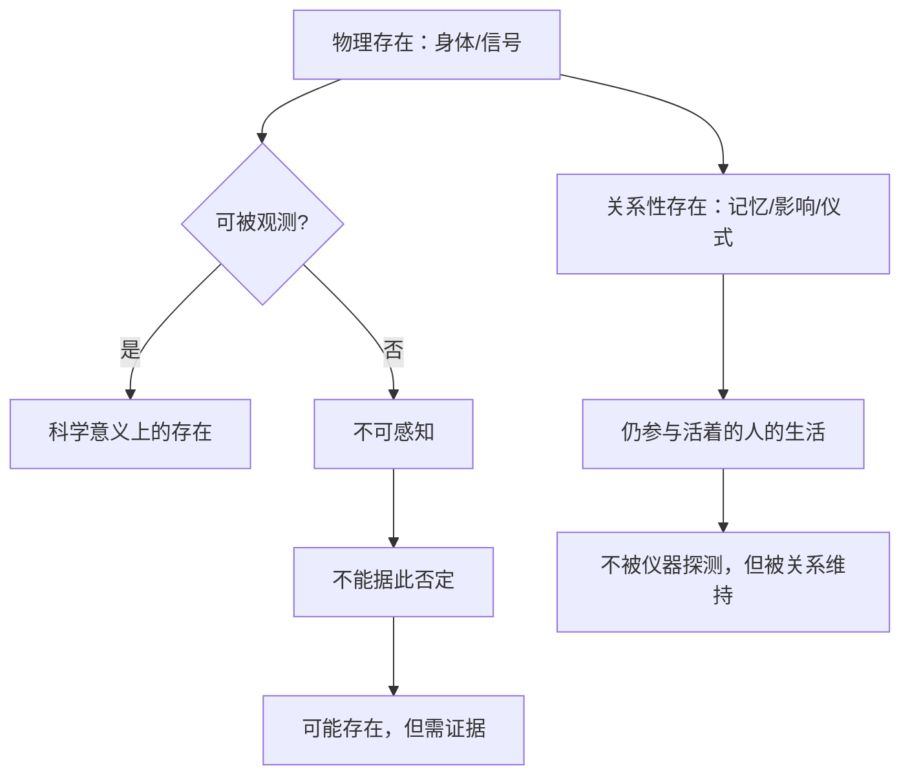

# 不可感知≠不存在——致我们思念的亲人

## 摘要

本文从“人类只看见可见光，动物却能感知紫外或红外”出发，做一个哲学性的外推：不同观察者可能共享同一空间，却处在不同的感知窗口里，因此“看不见”不等于“不存在”。文章把这个结构用于一个更私人的问题：离开的人，是否还能以某种形式“存在”？作者的答案是：如果把“存在”定义为“仍被观测、仍被记忆、仍影响活着的人”，那么他们以另一种形式存在；但这不是物理证明，也不是“阴阳眼”的证据。文章明确区分“感知窗口的差异”与“超自然主张”，不把类比当成事实。文章进一步讨论哀悼中的“持续联结”、仪式如何给缺席者留位置，以及这种思考的边界：它可以安慰人，但不能替代医学、法律与科学。最后，文章回到一个很小的动作：把想念说出来，让不可见的人继续参与可见的生活。

## 关键词

感知窗口；不可见；存在；哀悼；持续联结；类比；边界

## 1 引言

小时候，我听过一句话：人眼只能看见可见光，蜜蜂却能看见紫外线。那时我不懂“可见光”是什么意思，只觉得世界对不同生物有不同的“开关”。后来我又听说，蛇能感知红外，蝙蝠能听见超声波，狗能闻到人闻不到的气味。世界还是那个世界，但每个生命拿到的“菜单”不一样。

这个事实很普通，却让我在很长一段时间里反复想起。因为它意味着：我们看见的，不是世界的全部；我们没看见的，也不一定不存在。这个推论在物理上要小心，在情感上却很有诱惑。尤其是在失去亲人之后，人会忍不住问：他们是不是只是进入了另一个感知窗口？我们看不见他们，不代表他们不在。

这篇文章想认真处理这个诱惑。它既不把类比当成证明，也不把悲伤当成迷信。它试图在“科学上不能证明”与“情感上真实存在”之间，找一个诚实的位置。

### 1.1 一篇不能提供证据的文章

必须先说清楚：本文不提供任何“死后世界”的证据，也不主张“亲人变成了紫外线”或“他们在某个波长里看着我们”。这些说法没有可检验的证据，本文不打算用文学修辞把它们包装成事实。

本文能提供的，是一种思考方式：当“存在”被定义为“可被观测”时，观测能力的变化会改变“存在”的边界；但“可被观测”不等于“全部存在”。这个区分能帮我们理解“看不见”为什么不等于“不存在”，也能帮我们避免把“看不见”直接升级成“超自然”。

### 1.2 为什么用“感知窗口”

“感知窗口”是一个比“维度”更温和的词。它不承诺另一个世界，只说明每个观察者只能接收一部分信号。人眼大约能感知 380 到 750 纳米的电磁波；蜜蜂的视觉能延伸到约 300 纳米的紫外区；某些蛇类能通过颊窝感知红外辐射；蝙蝠用回声定位构建空间。它们不是“看见了另一个世界”，而是“在同一世界里接收了不同的信号”。

这个事实至少说明两件事：第一，感知是有限的；第二，有限不等于虚假。我们看不见红外，但红外真实存在；我们听不见超声波，但超声波真实存在。由此可以谨慎地推一步：不能因为“我们感知不到”，就断定“它不存在”。但这一步只能推到“可能存在”，不能推到“一定存在”，更不能推到“一定以我们希望的方式存在”。

## 2 感知窗口：世界比我们接收到的更宽

### 2.1 可见光只是电磁波的一小段

电磁波谱从伽马射线、X 射线、紫外线，到可见光、红外线、微波、无线电波。人眼只对其中很窄的一段敏感。这个“窄”不是世界的缺陷，而是进化的取舍：可见光在地球表面相对充足，能提供足够的生存信息；太短波长的辐射会损伤组织，太长波长的辐射分辨率低。眼睛不是一台全频段接收机，而是一台为生存调过频的仪器。

### 2.2 其他动物的“窗口”

不同动物在同一空间里接收不同信号。蜜蜂用紫外图案寻找花蜜；响尾蛇用红外感应寻找温血猎物；蝙蝠用超声波在黑暗中定位；大象能听到人耳听不到的次声。它们的世界不是我们的世界的“副本”，而是同一世界的不同采样。

**表 1 不同观察者的感知窗口（示意）**

| 观察者 | 主要信号 | 人眼能否直接感知 | 说明 |
|---|---|---|---|
| 人类 | 380–750 nm 可见光 | 能 | 日常视觉 |
| 蜜蜂 | 约 300–650 nm，含紫外 | 不能 | 紫外图案引导采蜜 |
| 响尾蛇 | 红外辐射 | 不能 | 颊窝感热 |
| 蝙蝠 | 超声波回声 | 不能 | 空间定位 |
| 狗 | 更宽的气味谱 | 不能 | 嗅觉信息 |

这张表不证明“另一个世界”，只证明“同一世界有不同的接收方式”。它是本文类比的事实基础，也是本文类比的天花板。

### 2.3 感知的“过滤器”

人不仅受生理限制，还受注意力限制。同一场聚会，有人记住音乐，有人记住灯光，有人记住谁对谁说了什么。我们不是被动接收世界，而是主动选择世界。选择的依据是经验、情绪、关系与当下的目标。所谓“我看见的”，往往只是“我准备好看见的”。

这个过滤器在悲伤里尤其明显。失去亲人后，人会对某些声音、气味、物件异常敏感：一件旧外套的味道、一首歌的前奏、楼道里相似的脚步声。它们一直都在，但之前没有被“看见”；现在被看见了，因为注意力改了。这不是幻觉，而是感知的重新分配。

### 2.4 不可见的世界不是另一个世界

“感知窗口”这个说法容易被误读成“平行世界”：好像蜜蜂在另一个世界，我们在另一个世界，逝者在第三个世界。其实不是。可见光、紫外、红外都在同一个物理空间里传播；不同的观察者只是接收不同的频段。蜜蜂没有“进入”另一个宇宙，它只是多了几个接收通道。

这个纠正很重要。它让“不可感知≠不存在”保持在一个可讨论的范围内：不是“有另一个世界”，而是“这个世界有我们接收不到的部分”。从这个前提出发，我们可以说“可能有我们不知道的东西”，但不能说“一定有我们想要的东西”。

### 2.5 感知窗口也会变

人的感知窗口不是固定的。年龄会改变视力与听力；训练会改变注意；工具会扩展感官。显微镜让人看见细胞，望远镜让人看见星系，无线电接收机让人“听见”宇宙的背景辐射。工具不是魔法，它只是把原本不可感知的信号转成可感知的信号。

这说明“不可感知”是一个相对词：相对于 naked senses（裸感官），不是相对于所有可能的观察者。今天的“不可见”，可能是明天的“可见”；但“明天可能可见”不等于“今天一定存在一个我们想要的对象”。科学史上有太多“后来被发现”的例子，也有太多“后来被证伪”的例子。两者都不能靠愿望决定。

## 3 “不可感知”不等于“不存在”：能推到哪一步

### 3.1 从感知有限到“可能存在”

逻辑上，最稳的一步是：因为我们的感知有限，所以不能仅凭“看不见”就否定某物的存在。这个推论只要求一个前提：世界包含超出我们感官的信号。这个前提已经被红外、紫外、超声波反复证明。

但它只能得到“可能存在”，不能得到“一定存在”。从“可能有”到“一定有”，中间需要证据，而不是愿望。愿望可以推动人去找证据，但不能代替证据。

### 3.2 从“可能存在”到“一定存在”的跳跃

很多安慰性说法在这里跳跃：既然我们看不见红外，那么亲人可能就在红外里；既然我们听不见超声波，那么他们可能就在超声波里。这个“可能”被悄悄换成了“就是”。修辞上很顺，逻辑上不成立。

“可能”是一个开放的词，它允许很多种假设；“就是”是一个封闭的词，它只允许一种答案。把开放换成封闭，是安慰最常见的偷渡方式。它让人舒服，却让人停止追问。

### 3.3 不可证伪的安慰

更麻烦的是，有些说法天然不可证伪：亲人在另一个窗口看着我们，所以我们看不见；他们不回应，是因为那个窗口不通过声音；他们不显现，是因为我们还没“打开”。无论发生什么，说法都能成立。这样的说法能安慰人，但它不能被检验，也不能被分享为公共知识。

本文不反对私人安慰。一个人在夜里对逝者说几句话，不需要通过科学审查。但如果把私人安慰升级成“科学结论”，就会伤害别人：它会让不接受的人被说成“不够信”，也会让悲伤的人被套上“必须相信”的义务。

### 3.4 一个更稳的定义：关系性存在

如果把“存在”只定义为“可被仪器探测的物理对象”，逝者当然不再以那种方式存在。但人不是只以物理方式存在。一个人还活在另一个人记得他的方式里：他的口头禅、他的菜谱、他生气时皱纹的位置、他教过你的那句话。这些不是物理对象，却真实地影响活着的人。

本文把这种存在称为“关系性存在”：不是“他还在某个地方”，而是“他仍然在关系中起作用”。这个定义不承诺死后世界，也不否认悲伤；它只是承认：存在可以不只有一种语法。

## 4 三种“还在”

### 4.1 物理上的还在：证据问题

物理上的“还在”需要证据：可重复的观测、可检验的假设、可排除的替代解释。到目前为止，没有可靠证据表明逝者以某种物理形式继续存在。这不是科学的“冷漠”，而是科学的规则：谁主张，谁举证；越异常的主张，越需要强的证据。

### 4.2 关系上的还在：记忆与影响

关系上的“还在”不需要仪器。它体现在你做饭时想起谁的口味，遇到困难时想起谁说过“别怕”，路过一家店时想起谁曾在那里等你。这些记忆不是幻觉，它们是你的一部分。逝者通过改变你，继续参与世界。

这种存在有程度，也有条件。它依赖记忆，也依赖讲述；如果没有人记得，它就会变淡。但这不意味着它“不真实”。记忆对行为的影响，是可以观察的：你会不会做某道菜，会不会说某句话，会不会在某个时刻停一下。

### 4.3 仪式上的还在：给缺席者留位置

仪式是关系性存在的公开形式。葬礼、周年、清明、生日、饭桌上多摆的一双筷子，都是给缺席者留位置。仪式不证明逝者“在”，但它让生者有一个地方安放“还在”的感觉。

仪式的好处是它有形状。悲伤太无形，仪式给它一个时间、一个地点、一个动作。你知道那一天要去那里，知道要说什么，知道有人和你一起说。形状不能消除悲伤，但能让悲伤不那么孤独。

## 5 哀悼：从“放下”到“继续联结”

### 5.1 “放下”模型的局限

传统的哀悼理论常把悲伤描述成“放下”：接受失去、切断依恋、回到正常生活。这个模型有它的道理：人不能永远停在葬礼上。但它也有问题：它把“继续想念”当成“没有走出来”，把“保留关系”当成“病态”。

现代哀悼研究更常用“持续联结”（continuing bonds）的概念：哀悼不是切断与逝者的关系，而是重新安排这段关系。逝者不再以身体在场，但仍以记忆、价值观、仪式与叙述在场。这个观点不主张“逝者还在某处”，它主张“生者与逝者的关系还在”。

### 5.2 持续联结不是拒绝现实

持续联结与“否认”不同。否认是“他不可能会死”；持续联结是“他死了，但我仍在关系里记得他”。前者拒绝现实，后者接受现实，同时保留关系。

这个区分很重要。它让悲伤的人不必在“放下”与“放不下”之间二选一。你可以继续爱一个已经离开的人，同时继续过自己的生活。爱不是有限的，生活也不是对爱的背叛。

### 5.3 悲伤的个体差异

有人需要大声哭，有人需要安静做事；有人需要保留遗物，有人需要清空房间。没有一种哀悼方式是标准答案。文化、宗教、家庭、性格都会影响哀悼的形状。旁人可以陪伴，但没资格规定“你应该怎么难过”。

### 5.4 什么时候需要帮助

悲伤不是病，但悲伤可能伴随抑郁、焦虑、失眠、躯体化，甚至自伤风险。如果悲伤持续时间很长、严重影响工作与生活，或者出现“不如一起走”的念头，就应该寻求专业帮助。关系性存在的安慰，不能替代医疗；把一切都解释成“他在另一个窗口”，可能会耽误真正需要治疗的人。

### 5.5 悲伤的公共性

悲伤看起来是私人的，但它有公共维度。葬礼需要场地，墓地需要土地，丧假需要制度，心理咨询需要资源。一个人能不能好好悲伤，不只取决于他的心理，也取决于社会给不给他时间与空间。

现代城市把死亡推得很远：医院、殡仪馆、墓地都在生活区之外。很多人没有参加过一场葬礼，也不知道如何面对一个正在悲伤的人。悲伤被 privatized（私有化）了：它变成一个人关起门来处理的事，而不是一个社区共同承载的事。私有化给了人隐私，也给了人孤独。

这也是“持续联结”有意义的地方：它把悲伤从“个人要尽快恢复”变成“关系可以继续”。当社区允许人们提起逝者、分享故事、保留仪式，悲伤就不必一个人扛。公共性不是要把悲伤展览，而是要让悲伤有地方可去。

## 6 边界：别把类比当证据

### 6.1 紫外线的类比不能证明死后世界

紫外线存在，是因为它有物理信号、能被仪器测量、能产生可重复的实验结果。逝者的“另一个窗口”没有这些。把两者类比，只能说明“看不见不等于不存在”这个一般原则，不能说明“逝者一定在某个看不见的地方”。

类比是一种思考工具，不是证据。它可以帮助我们理解一个抽象结构，但不能把结构里的空位自动填上我们想要的内容。

### 6.2 “能量不灭”不是死后存在的证据

另一个常见说法是“能量不灭，所以人死后能量还在”。物理学里的能量守恒说的是孤立系统的总能量不变，不是“人的意识变成能量飘在空中”。人体死后，身体分解，能量以热、化学能等形式进入环境；这不是“灵魂”，也不是“另一个窗口”。

把物理定律当成死后世界的证明，是对物理学的误用。它听起来很科学，实际上只是把科学词汇借来给愿望镀金。

### 6.3 安慰的伦理

安慰也有伦理。一个安慰如果让别人感到被否定——“你别难过，他在天上看你”——就可能变成压力。真正有用的安慰，不是替对方定义现实，而是陪对方待在他的现实里。

“我不知道他在不在，但我知道你想他。”这句话比“他一定在”更诚实，也更温柔。它不承诺答案，只承认感受。

### 6.4 如何与不同答案的人相处

面对“逝者是否还在”这个问题，人大概有三种答案：相信、不相信、不知道。三种人都可能失去过亲人，也都可能需要安慰。问题不在于谁对谁错，而在于能不能不把自己的答案强加给别人。

相信的人，不必把“他在”说成所有人的事实；不相信的人，也不必把“没有证据”说成“你不该难过”。不知道的人，可以诚实地说“我不知道”，这比假装确定更难得。

一个成熟的态度是：在公共问题上坚持证据，在私人问题上允许沉默。公共问题需要可检验的答案，私人问题需要可承受的答案。把两者混在一起，要么让科学变得冷酷，要么让悲伤变得教条。

## 7 一个很小的个人叙事

外婆去世后的第一年，我总在厨房里闻到她的味道。不是香水，也不是饭菜，是一种很旧的、带一点肥皂和阳光的气味。理智上我知道，那可能是记忆在作怪；情感上，我还是会停一下，好像她就在旁边。

我没有把这件事解释成“她回来看我”。我只是承认：她还在我的嗅觉里，还在我切菜的姿势里，还在我遇到麻烦时想起的那句“慢慢来”里。这种“在”不占据空间，却占据时间；它不回应我，却改变我。

后来我学会在特定的日子做她教我的那道菜。锅热了，油响了，我忽然明白：仪式不是给逝者的，也是给生者的。它让“我想你”有一个可以安放的动作，不必一直悬在空中。

### 7.1 遗物

遗物是关系性存在的物证。一件衣服、一副眼镜、一本翻旧的书，都能让逝者短暂地“回来”。但遗物也会伤人：有人保留，有人扔掉；有人每天看，有人不敢看。没有对错，只有承受能力。

### 7.2 照片与声音

照片把逝者固定在某个时刻，声音却能把人带回动态。很多人不敢听逝者的语音，因为声音比照片更像“他还在”。这种“像”不是欺骗，而是感知的正常反应：声音携带了语调、节奏、呼吸，这些比面孔更难被时间抹平。

### 7.3 名字

名字是最小的纪念碑。我们在谈话里提起逝者的名字，不是“放不下”，而是承认他曾经存在。一个名字被反复说起，他就还在语言里；一个名字被彻底禁止，他就真的消失了。禁止提名字，有时是保护，有时是二次失去。

### 7.4 梦里的相遇

很多人会在亲人去世后梦见他们。梦里的亲人往往很平常：坐在旧沙发上，或者在厨房里切菜，不说一句话。醒来之后，人会有一整天的恍惚，好像昨晚真的见过。

梦不能被当作“他真的回来”的证据。梦是大脑在睡眠中重组记忆的产物，它会把白天的想念、未说完的话、熟悉的场景拼在一起。但梦也不能被轻蔑地当成“只是梦”。它让人在无意识里完成一次告别，或者一次没有机会的拥抱。

对梦最好的态度，可能是不解释、只承认：我梦见了你，我很想你。不需要把它升级成“显灵”，也不需要把它贬低成“幻觉”。它只是悲伤的一种夜间形状。

## 8 结论

人类只看见可见光，动物却能感知紫外或红外。这个事实说明，世界比我们的感官更宽；但它不说明，逝者一定在某个我们看不见的波段里。

不可感知，不等于不存在；但“可能存在”，也不等于“一定存在”。在这两个“不等于”之间，本文选择了一个更稳的位置：逝者不再以物理方式存在，却仍以关系、记忆、仪式与语言的方式存在。这不是物理证明，也不是迷信；它是一种承认——承认爱不会因为死亡而立刻停止，承认悲伤需要形状，承认活着的人可以继续与离开的人保持关系。

致我们思念的亲人：我看不见你，但我没有因此断定你不在。我知道你可能不在任何一个我能抵达的地方；我也知道，你还在我做饭的味道里，在我遇到困难时想起的那句话里，在我每年那一天多摆的一双筷子里。这样的“在”不够证明什么，却足够让我把日子过下去。

如果有一天，科学找到了新的证据，我会认真听；如果它没有找到，我也不会用愿望代替证据。但在那之前，我愿意保留一个诚实的句子：我不知道你在不在，但我想你。这个句子不承诺另一个世界，也不否认这个世界的空。

悲伤没有标准答案，但诚实有一个最低标准：不拿愿望冒充证据，也不拿证据否定愿望。前者会让思念变成教条，后者会让理性变成冷漠；两者都做到，才算真正尊重逝者，也尊重活着的人。这句话说起来容易，做起来很难，但值得一试，一遍一遍地试。

我也愿意保留一个更小的动作：在想起你的时候，不急着解释，不急着证明，只是把那份想念说出来。你可以不在任何波段里，但你仍然可以在一句话里、在一道菜里、在一个名字里。存在有很多种语法，爱也是。我们能做的，不是把失去的人拽回可见的世界，而是让不可见的关系，继续在可见的生活里发光。这不是逃避现实，而是给现实一个可以呼吸的缝隙；缝隙不大，但足够让一个人把今天过完。

## 参考文献

[1] Nagel T. What is it like to be a bat? *The Philosophical Review*, 1974, 83(4): 435–450.

[2] Klass D, Silverman P R, Nickman S L (eds.). *Continuing Bonds: New Understandings of Grief*. Washington, DC: Taylor & Francis, 1996.

[3] Worden J W. *Grief Counseling and Grief Therapy: A Handbook for the Mental Health Practitioner*. 4th ed. New York: Springer, 2009.

[4] Bowlby J. *Attachment and Loss, Vol. 3: Sadness and Depression*. New York: Basic Books, 1980.

[5] Neimeyer R A. Meaning reconstruction and loss. In: Neimeyer R A (ed.). *Meaning Reconstruction and the Experience of Loss*. Washington, DC: American Psychological Association, 2001: 1–9.

[6] Planck M. On the law of distribution of energy in the normal spectrum. *Annalen der Physik*, 1901, 4(1): 553–563.
