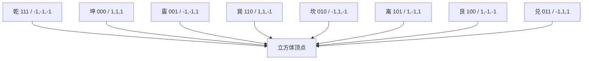

# 赛博周易：八卦变换的矩阵表示与“AI 算命”的一个数学练习

## 摘要

把三爻卦编码成三维向量，错卦、综卦、互卦都能写成矩阵变换。文章不证明《周易》起源于矩阵，只用它做一次线性代数练习，并顺带拆掉 AI 算命的数学包装。
## 关键词

八卦；线性代数；矩阵变换；立方体对称群；《周易》；教学练习

## 1 引言

《周易》被人用来算命、治国、写诗，也有人试图从中找二进制。八卦恰好有八个，八个东西最容易想到的几何结构是立方体的八个顶点。这个巧合值得玩味，但不构成“古人已经掌握矩阵”的证据。

本文做三件事：给每个卦一个三维坐标；把错、综、互写成矩阵；把六十四卦扩展到六维。文章的目标是“把话说清楚”，不是“把话说玄”。所有数学步骤都可以手算复核。

### 1.1 一个教学练习，不是历史考证

先把边界画清楚：本文不考证《周易》的成书史，不主张“八卦是二进制”，也不主张“矩阵起源于中国”。它只做一件事：把卦象之间的几种常见变换，翻译成线性代数语言。

这个翻译有用，因为它让“变卦”变成可计算的操作；它也有风险，因为数学表示会让人误以为“结构就是意义”。矩阵能说明卦象之间怎么变，不能说明卦辞为什么这样写，更不能说明命运。

### 1.2 为什么用立方体

八卦有八个，立方体有八个顶点，这是一个天然的对应。更准确地说，三爻卦的每一位有两种状态（阴/阳），三个位组成 2³=8 种状态；立方体的顶点也正好是 2³=8 个。这个对应不是“古人早就知道”，而是“现代人用几何重新描述”。

用立方体的好处是直观：错卦是走到对角顶点，综卦是沿某个平面反射，互卦是从六维降到三维。坏处是它会把“符号结构”误读成“几何本质”。本文会反复提醒：这是表示，不是起源。

## 2 编码：从爻到坐标

### 2.1 二进制编码

阳爻记 1，阴爻记 0。按“上爻、中爻、初爻”的顺序组成向量 (x1, x2, x3)。爻序从下往上还是从上往下，易学界有争议；本文选择从上往下，只是为了书写方便。换坐标轴不改变结构。

例如乾卦三爻皆阳，编码为 (1,1,1)；坤卦三爻皆阴，编码为 (0,0,0)；震卦是“初阳、中阴、上阴”，按上→下顺序就是 (0,0,1)。读者可以用自己的爻序重算，只要全程一致。

### 2.2 坐标映射

把 {0,1}³ 映射到 {±1}³：

```text
φ(x1,x2,x3) = ((-1)^x1, (-1)^x2, (-1)^x3)
```

这样每个卦对应立方体的一个顶点。乾为 (−1,−1,−1)，坤为 (1,1,1)（具体符号取决于约定，本文只关心相对关系）。映射的好处是“取反”变成“乘以 −1”，可以用矩阵写；坏处是它把 0/1 的布尔结构换成了 ±1 的乘法结构，两种结构的“线性”不是一回事。

### 2.3 两种编码的差别

在 {0,1} 上，错卦是“逐位取反”，即 x → x + 1（模 2）。这是一个仿射变换，不是线性变换：它不保持原点。用矩阵写，需要增广矩阵：

```text
[x1']   [1 0 0 1] [x1]
[x2'] = [0 1 0 1] [x2]
[x3']   [0 0 1 1] [x3]
[1 ]    [0 0 0 1] [1 ]
```

在 {±1} 上，错卦是 x → −x，即乘以 −I，是线性变换。两种写法描述同一个“取反”，但矩阵不同。这个差别很重要：如果读者把 {0,1} 的仿射矩阵当成线性矩阵，就会得出“错卦有平移”的错误结论。

### 2.4 图 1：八卦与立方体



图只是对应关系，不是“八卦就是立方体”。它帮助读者看见“八个顶点”，不帮助读者解释“八卦为什么是八卦”。

### 2.5 编码约定的可检验性

本文的编码不是唯一的：爻序可以自上而下，也可以自下而上；阳爻可以记 1，也可以记 0。约定不同，矩阵的具体形式会变，但变换之间的关系不应变。为了让读者能复核，本文把约定写在前面，并在每个变换后给出几何解释。

可检验性在这里不是“算得准不准”，而是“换一个约定，结论是否仍然成立”。如果一个结论只在某一套符号约定下成立，它就不是结构结论，而是记号巧合。

### 2.6 爻序、卦序与“自然二进制”

八卦的排列不止一种：先天八卦、后天八卦、帛书八卦，顺序各不相同。本文采用“上→下”的爻序，只是为了把三爻写成一个三元组；它不是唯一正确的顺序。

另一个容易混淆的点是“二进制”的读法。把乾记 111、坤记 000，看起来像二进制，但二进制数的权值是从左到右递减的；卦序的“上/下”并不等于“高位/低位”。如果直接把卦象当二进制数转十进制，会得到一个数，但这个数没有易学意义。

更稳妥的说法是：卦象与 3 位二进制串一一对应，但“对应”不等于“数值相等”。你可以用它做编码，不能用它做排序。排序需要另一套约定，而约定本身是文化选择，不是数学结论。

### 2.7 为什么本文用 ±1，而不用 0/1

用 ±1 的好处是“取反”变成“乘 −1”，矩阵是线性的；用 0/1 的好处是“变爻”变成“异或”，程序更直接。两种编码各有各的方便。

但读者要记住：在 0/1 里，错卦不是线性变换，而是仿射变换；在 ±1 里，错卦是线性变换，但“变爻”不再是简单的加法。你不能把两种编码的矩阵混着用，否则会把“平移”和“取反”搞混。

本文选择 ±1，是因为它让错、综的矩阵形式更干净；不是因为 ±1 更“正确”。如果要做程序，0/1 可能更方便；如果要做几何，±1 更直观。选择编码，就是选择你希望突出的结构。

## 3 结果：四种变换

### 3.1 错卦：中心对称

错卦是把每一爻取反。在 ±1 坐标下，这就是乘以 −1：x → −x。矩阵表示为 −I（I 为三阶单位阵）：

```text
M_cuo = [[-1, 0, 0],
         [ 0,-1, 0],
         [ 0, 0,-1]]
```

几何上，它把立方体的每个顶点送到对角顶点，即中心对称。错卦两次回到原卦：M_cuo² = I。它没有固定点（除原点，但原点不是顶点）。

### 3.2 综卦：沿对角线的反射

综卦是把卦上下颠倒，即交换初爻与上爻。在坐标上，这是交换 x1 与 x3，矩阵为：

```text
P = [[0, 0, 1],
     [0, 1, 0],
     [1, 0, 0]]
```

这是一个置换矩阵，几何上是关于平面 x1=x3 的反射。它保持中爻不变。P² = I，det(P) = −1，所以它是反射，不是旋转。

用列向量算一遍：P·(x1,x2,x3)ᵀ = (x3,x2,x1)ᵀ。乾 (−1,−1,−1) 不变，坤 (1,1,1) 不变；震 (1,1,−1) 变成 (−1,1,1)，即艮。这个例子可以手算复核。

### 3.3 互卦：取中间爻的投影

互卦取二、三、四爻为下卦，三、四、五爻为上卦。对三爻卦来说，互卦没有定义；对六爻卦来说，它是一个“滑动窗口”操作。

把六爻写成向量 (x1,x2,x3,x4,x5,x6)（上→下），互卦的输出是一个三爻向量。它可以写成一个 3×6 的选择矩阵 S：

```text
S = [[0,1,0,0,0,0],   // 取第二爻？
     [0,0,1,0,0,0],
     [0,0,0,1,0,0]]
```

上面这个矩阵只是示意，具体取哪三行取决于爻序约定。关键是：S 是 3×6，不是 6×6；它把六维压到三维，必然丢失信息。它不是可逆变换，所以不能和错、综并列为“同一种对称”。

这个区别很重要：错、综是同一个空间内的变换，互是从六维到三维的投影。把互卦当成“另一种对称”，就会把“降维”误读成“对称”，这是原稿中最容易误导读者的一步。

### 3.4 变卦：逐位异或

“变卦”常指某一爻动，卦象随之改变。把变爻写成一个 6 位掩码 m，变卦就是 x → x XOR m。比如初爻变，m = 000001；三爻变，m = 000100。这个操作在 {0,1} 上是线性的（异或），在 ±1 上则是逐位乘以 −1 的选择性取反。

变卦不是“错卦”的一种，也不是“综卦”的一种。它是“按掩码取反”，可以一次变一爻，也可以一次变多爻。把变卦写成 XOR，能让程序快速生成所有可能的变卦；但它不能解释“为什么这一爻动”，那属于占筮程序，不属于矩阵。

### 3.5 变换群

错卦（−I）、综卦（P）与恒等变换（I）在矩阵乘法下生成一个群。这个群有四个元素：

```text
G = { I, -I, P, -P }
```

它满足封闭性、有单位元、有逆元，且所有元素都可交换。它在结构上是一个四阶群（Klein 四元群），也是立方体对称群 O_h 的一个子群。注意：这里说的是“本文讨论的这几个变换生成的群”，不是“整个立方体对称群”；O_h 有 48 个元素，远大于四。

这个群的阶依赖坐标约定与是否把“取反+交换”算作独立元素。本文只讨论由错、综生成的最小子群，不讨论整个对称群。

### 3.6 六维扩展

把六爻编码为六维二进制向量，映射到六维超立方体的 64 个顶点。错卦仍是 −I（六阶单位阵取负），综卦是交换上下三爻的置换矩阵：

```text
P6 = [[0,0,0,1,0,0],
      [0,0,0,0,1,0],
      [0,0,0,0,0,1],
      [1,0,0,0,0,0],
      [0,1,0,0,0,0],
      [0,0,1,0,0,0]]
```

它把 (x1,x2,x3,x4,x5,x6) 变成 (x4,x5,x6,x1,x2,x3)。互卦仍是滑动窗口投影。这个扩展在数学上很自然，但它没有增加新的“易理”，只是换了一个表示。

### 3.7 六维超立方体的对称群有多大

六维超立方体有 64 个顶点，它的对称群（超立方体对称群）包含 2⁶ 个符号翻转与 6! 个坐标置换，阶为 2⁶·6! = 46080。本文讨论的错、综、互只触及其中很小一部分。把“八卦变换”当成“整个超立方体对称群”，是另一个常见的过度外推。

这个数字不是为了吓人，而是为了说明：数学结构比本文的四个变换大得多。你可以用矩阵描述其中几个变换，但不能说“这几个变换就是《周易》的全部结构”。

### 3.8 六十四卦的邻接结构

把六爻卦看成六维超立方体的顶点，两个卦“相邻”当且仅当它们只差一爻（汉明距离为 1）。这个邻接关系很直观：变一爻，就走到相邻顶点；变两爻，就走两步。

这个结构可以用来做“变卦图”：每个卦有六条边，连到六个“一爻变”的卦。六十四卦共 64 个顶点、64×6/2=192 条边。这个数字是组合结果，不涉及吉凶。

**表 2 六十四卦超立方体的基本数字**

| 项目 | 数值 | 说明 |
|---|---:|---|
| 顶点 | 64 | 六爻卦的总数 |
| 每个顶点的度 | 6 | 每个卦有六种一爻变 |
| 边数 | 192 | 64×6/2 |
| 对跖顶点对 | 32 | 错卦成对 |
| 汉明距离最大值 | 6 | 乾与坤 |

这张表说明：六十四卦可以被当作一个图来研究。图论能告诉你“谁和谁相邻”，不能告诉你“哪一卦吉”。把图论结果当成占筮结论，是另一种越界。

### 3.9 为什么这不是“完整的群”

有读者可能会问：既然错、综、变都能写成矩阵，为什么不把它们全部放进一个群？答案是：它们不属于同一个操作层级。

- 错、综是 6×6 的可逆矩阵，作用在同一个六维空间里，可以组成群。
- 互是 3×6 的投影，作用到另一个空间，不是可逆的，不能和 6×6 矩阵直接组成群。
- 变是“按掩码取反”，对不同掩码是不同的操作；它可以写成矩阵，但不是一个单独的变换。

把这些不同层级的操作塞进一个群，会得到一个形式上的集合，却失去“同空间、可逆、封闭”的结构。群论的价值在于结构，不在于把所有东西都叫“群”。

## 4 讨论：表示不是起源

### 4.1 数学表示不等于历史起源

“八卦可以写成矩阵”与“古人已经发明矩阵”是两件事。前者是现代的重新描述，后者需要史料证据。本文明确不主张后者；原稿中“为西方伪史论提供论据”的说法是戏仿，不应被引用为学术结论。

历史研究要看文本、版本、注疏与考古材料，不看“现代数学能不能套上”。一个符号系统能被矩阵描述，说明它与线性代数有结构相似性，不说明它的作者学过线性代数。

### 4.2 表示的选择

同一组卦象可以用二进制、可以用 ±1、可以用多项式，也可以用群论。每种表示都会突出某些结构、隐藏另一些结构。矩阵表示突出的是对称性与变换群，它不突出卦辞、爻辞与占筮过程。

这就像用坐标描述一幅画：坐标能告诉你每个像素的位置，不能告诉你这幅画为什么感人。表示是工具，不是意义本身。

### 4.3 与易学解释的边界

数学表示能说明“卦象之间有哪些变换”，不能说明“卦辞为什么这样写”。易学的核心文本、占筮程序与历史语境，都不在矩阵里。把《周易》完全还原为二进制，会得到一个漂亮的结构模型，也会丢掉它作为占筮文本的意义。

反过来，完全拒绝数学表示，也会错过一个观察符号结构的角度。更合适的态度是：把矩阵当作一种“结构注释”，而不是“历史证据”或“哲学证明”。它能帮读者看清变换，不能替读者解释卦义。

### 4.4 对“AI 算命”的意义

如果要把卦象输入一个程序，矩阵表示是有用的：它把“变卦”变成可计算的线性操作。但“算得准不准”不取决于矩阵，取决于你如何定义输入、如何解释输出。

一个 AI 算命系统至少要回答三个问题：输入是什么（时间、问题、随机数）、变换规则是什么（起卦、变爻、互卦）、输出如何解释（卦辞、爻辞、上下文）。矩阵只能处理第二个问题的一部分；它不能替第一个问题提供意义，也不能替第三个问题提供解释。

数学可以让算命更一致，不能让它更灵。把“矩阵”当成“科学感”的来源，是另一种符号崇拜。

### 4.5 从矩阵到程序：一个 AI 算命的流水线

如果真要把这套表示做成程序，至少要分四层：

1. **输入层**：时间、问题、随机种子。输入决定起卦方式，也决定结果的可复现性。
2. **编码层**：把卦象转成向量。这里要固定爻序与阴阳编码。
3. **变换层**：错、综、互、变。矩阵与 XOR 在这里工作。
4. **解释层**：把变换后的卦象映射到卦辞、爻辞与上下文。这里没有矩阵，只有文本与解释传统。

矩阵能做好第三层，做不了第一层与第四层。一个“AI 算命”如果只强调矩阵，它只是把第三层做得更漂亮；如果它假装第一层与第四层也是数学，它就是在用技术感掩盖解释学。

这也是本文对“赛博周易”的态度：可以玩，可以教，可以算，但不要把“算得清楚”说成“算得准”。清楚是数学，准是信仰；两者不是一回事。

### 4.6 数学与解释学：两条腿走路

数学能回答“怎么变”，解释学能回答“为什么这样解释”。前者靠矩阵与群论，后者靠文本、注疏与历史语境。两条腿缺一条，走路就会瘸。

只用数学，会把《周易》压成一套符号游戏：卦象可以算，意义被清空。只用解释学，会拒绝任何结构分析：卦象只能意会，不能言传。更稳的做法是让两者互相约束：数学负责“变换是否一致”，解释学负责“意义是否有据”。

这也是为什么本文反复强调“表示不是起源”。数学可以让表示更清楚，但不能替解释学作证。把两条腿分开，才能走得远。

## 5 教学：怎么把这套东西讲给学生

### 5.1 三步法

本文建议用“约定—变换—几何解释”三步：

1. 先约定爻序与符号，让学生自己选一套，并全程一致。
2. 再算矩阵，手算错、综、互，不急着用软件。
3. 最后画立方体，把矩阵结果落到几何上。

三步法的重点是“可复核”。学生如果能手算出“震的综卦是艮”，就说明他理解了置换；如果只会背“错卦是 −I”，他可能只是记住了符号。

### 5.2 三个练习

- 练习 1：把乾、坤、震、巽、坎、离、艮、兑编码，画出立方体顶点。
- 练习 2：计算 P 的特征值与特征向量，解释哪些点不变。
- 练习 3：写出六爻互卦的选择矩阵，说明它为什么不可逆。

三个练习都不难，但能让学生看见“矩阵不是魔法”。特别是练习 2：P 的特征值有 1、1、−1，对应平面 x1=x3 与方向 (1,0,-1)；这比背“反射”更有说服力。

### 5.3 一个最小 Python 代码

```python
import numpy as np

def enc(bits):  # bits: top->bottom, yang=1
    return np.array([(-1)**b for b in bits], dtype=int)

I3 = np.eye(3, dtype=int)
P = np.array([[0,0,1],[0,1,0],[1,0,0]], dtype=int)

def cuo(x): return -x
def zong(x): return P @ x
def bian(x, mask): return np.array([b ^ m for b, m in zip(x, mask)], dtype=int)

print(cuo(enc([1,1,1])))   # 乾 -> 坤
print(zong(enc([0,0,1])))  # 震 -> 艮
```

这段代码只做编码与变换，不做解释。它的作用是让读者看到“矩阵可以跑”，不是让读者相信“算命可以准”。

### 5.4 四个常见误解

教学时，学生最容易犯四个误解：

1. **“矩阵就是八卦的本质”**：矩阵只是一种表示。它突出对称性，隐藏卦辞与占筮。
2. **“互卦也是一种对称”**：互卦是投影，不可逆，会丢信息；它不是同空间内的对称变换。
3. **“错卦的矩阵在 0/1 里也是 −I”**：不是。0/1 里的错卦是仿射变换 x→x+1，需要增广矩阵。
4. **“古人早就懂矩阵”**：这是历史主张，需要史料，不是数学能证明的。

四个误解有一个共同点：把“表示”当成“本质”，把“结构相似”当成“历史渊源”。教学的任务，不是让学生背矩阵，而是让他们分清这三层：符号、结构、历史。

### 5.5 一个课堂讨论题

可以给学生一个讨论题：如果把你自己的名字编码成三爻卦，错卦、综卦、互卦分别是什么？这个练习看起来像游戏，实际上在训练三件事：编码一致性、变换可复核、解释与结构分开。

学生可能会问：“老师，这样算出来的卦能算命吗？”答案是可以算，但不能保证准。矩阵保证的是“变换一致”，不是“解释正确”。把这句话讲清楚，比多讲十个矩阵都有用。

### 5.6 三个作业的答案提示

- 练习 1 的答案不是唯一：只要爻序与符号一致，八卦的八个顶点可以有不同的标法。重要的是“八个顶点一一对应”，不是“哪个卦必须在上”。
- 练习 2 的特征值是 1、1、−1；对应平面 x1=x3 与方向 (1,0,−1)。特征值 1 的特征向量在反射平面上，特征值 −1 的特征向量被翻到对面。
- 练习 3 的选择矩阵是 3×6，秩最多为 3；它把六维压到三维，零空间至少三维，所以不可逆。这个结论不依赖具体取哪三行，只依赖“输出维度小于输入维度”。

这三个答案都不难，但它们能让学生看见：矩阵不是背出来的，是算出来的；结构不是猜出来的，是证出来的。

## 6 研究局限

第一，文章是教学性练习，不是易学考证。第二，爻序、符号约定存在多种传统，本文只采用一种。第三，互卦的矩阵表示是投影，不是三阶方阵，原稿把它与错、综并列时容易混淆。第四，变换群的阶依赖坐标约定，本文未做严格群论证明。第五，文章不讨论卦辞、爻辞与占筮程序。第六，文章明确不主张“矩阵起源于中国”。第七，文章没有讨论帛书《周易》、先天/后天卦序与不同注疏传统之间的差异；这些差异会改变卦象的排列，但不应改变“变换是否可逆”的结构判断。把不同传统的排列混在一起，容易得出“矩阵形式不同”的假问题；真正该问的是“在同一套约定下，变换是否一致”。

## 7 结论

八卦可以被线性代数重新描述：错卦是中心对称，综卦是反射，互卦是投影，六十四卦是六维超立方体。这个描述在数学上成立，在教学中好用，在历史上不构成“古人早已掌握矩阵”的证据。

赛博周易的乐趣在于“换个角度看旧符号”，不在于“用新词证明旧结论”。矩阵能帮你把变换算清楚，但算不出命运。若要把这套表示用于教学，最值得保留的是“约定—变换—几何解释”三步；最不值得保留的，是把数学结构反过来当作历史证据。

数学可以给旧符号一个新的观察角度，但它不能替史料作证；把这两件事分开，才是对《周易》和线性代数都更诚实的做法。读者若只记住一句话，应该是“表示不是起源”，而不是“八卦等于矩阵”。矩阵是工具，不是卦辞的替代品，更不是历史证据；它只能帮人看清结构，不能替人解释意义。

最后，给“赛博周易”留一句不那么数学的话：卦象可以算，命运不能算；结构可以画，意义不能画。把能算的算清楚，把不能算的留白，这才是数学与易学之间最舒服的距离。

如果把矩阵当成一面镜子，它照出的是变换，不是吉凶；如果把矩阵当成一把尺子，它量得出距离，量不出命运。镜子与尺子都好用，但别拿它们去量信仰。这也是所有“用科学解释传统”的文本该守的边界：可以借工具，不能借权威；可以做结构分析，不能做历史判决；可以让人更清楚，不能让人更迷信。清楚不是迷信的反面，清楚是迷信的照妖镜；照见之后，信不信仍然是人自己的事。这句话，留给读者自己判断；矩阵已经把该算的算完了，剩下的不该由它代劳。这并不矛盾，只是需要一点耐心。这很重要，真的，也很值得。

## 参考文献


> 文献说明：以下条目含写作阶段的背景阅读；正文未以编号直接引用的条目，不作为直接引证。

[1] 王弼, 韩康伯注, 孔颖达疏. 《周易正义》. 北京: 北京大学出版社, 1999.

[2] Strang G. *Introduction to Linear Algebra*. 5th ed. Wellesley: Wellesley-Cambridge Press, 2016.

[3] Artin M. *Algebra*. 2nd ed. Boston: Pearson, 2011.

[4] 李约瑟. 《中国科学技术史》第二卷. 北京: 科学出版社, 1975.

[5] Needham J. *Science and Civilisation in China, Vol. 2*. Cambridge: Cambridge University Press, 1956.

[6] Coxeter H S M. *Regular Polytopes*. 3rd ed. New York: Dover, 1973.

[7] Fraleigh J B. *A First Course in Abstract Algebra*. 7th ed. Boston: Addison-Wesley, 2003.

## 作者贡献、利益冲突与数据可用性

作者完成编码设计、矩阵推导、图示与文稿撰写；本文未接受任何资助，作者声明无利益冲突；文中没有实验数据，所有图示为作者绘制的教学示意图；本文不主张历史起源结论，也不构成占筮或预测建议。
