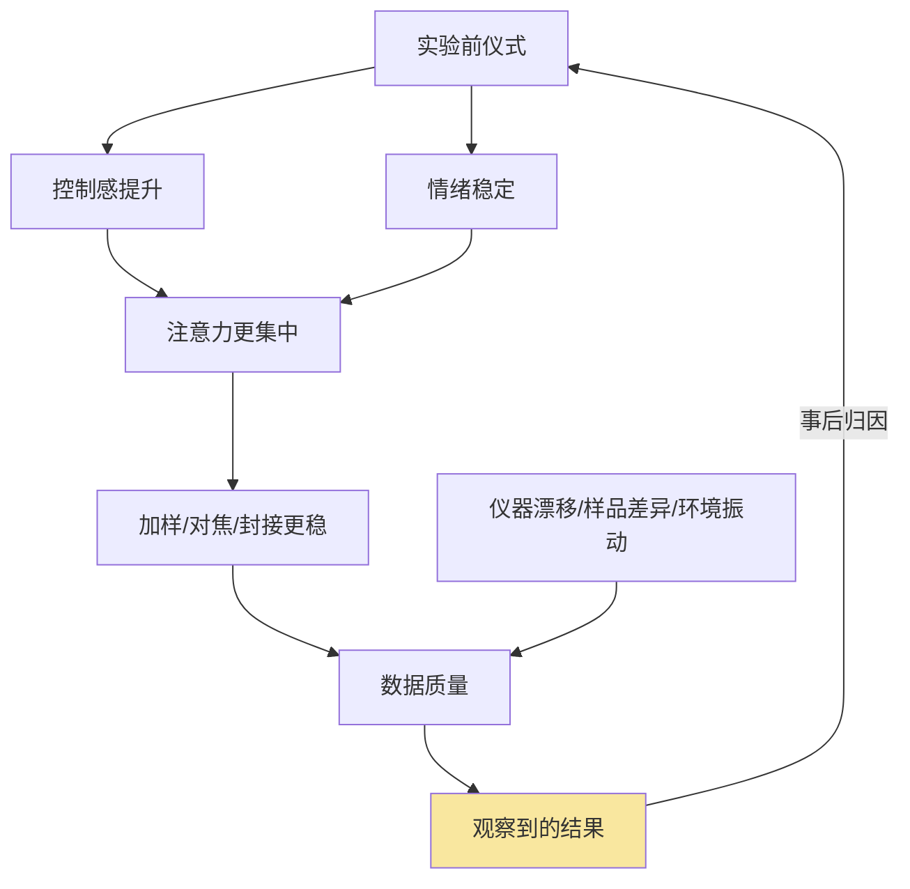

# 实验前祈福仪式对实验结果的影响研究

## 摘要

单分子实验对操作稳定性高度敏感，实验前的仪式化行为常被研究者当作“求个心安”。本文记录一个 n=1 的探索性案例：一名操作者在 smFRET 与膜电流记录前进行 5 分钟祈福仪式，随后比较仪式组与对照组的效率分布、信噪比、基线漂移与重复性。需要先说明，60 组数据中只有 1 组为真实记录，其余 59 组为示例设定；因此文章报告的 P 值与效应量只用于演示分析流程，不能作为“祈福提升数据质量”的证据。文章真正讨论的是机制假设：仪式可能通过提升操作者的控制感与情绪稳定，减少加样、对焦与时序上的微小波动，从而间接影响数据；但这一路径需要多操作者、双盲与真实重复才能检验。

## 关键词

仪式；单分子实验；膜片钳；操作稳定性；安慰剂效应；n=1；科学边界

## 1 引言

在精密实验里，研究者常常有一些说不清的习惯：进实验室前先洗手三遍，开机前敲三下桌子，调激光前默念一句“稳住”，或者把某支笔放在固定位置。外人看来这是迷信，当事人却觉得“这样比较顺”。

本文把这类行为称为“实验前仪式”。它不等于宗教，也不等于迷信；它是一组重复的、有固定顺序的、带有象征意义的动作。它的功能可能不是“改变仪器”，而是“改变操作者”。

文章从一个 n=1 的案例出发：一名操作者在单分子荧光共振能量转移（smFRET）与膜电流记录前，进行 5 分钟祈福仪式。我们比较仪式组与对照组的实验效率、信噪比、基线漂移与重复性，然后讨论：如果仪式真的有效，它可能通过什么机制起作用？如果它无效，为什么操作者会觉得有效？

### 1.1 先说数据边界

本文的 60 组数据中，只有 1 组是真实记录，其余 59 组是按预设分布生成的示例数据。文章报告的 P 值、效应量与置信区间，只用于演示“如果要做这个研究，可以怎么分析”，不能作为“仪式提升数据质量”的证据。

这个声明不是免责声明，而是文章的一部分。它提醒读者：一个看起来有统计、有表格、有结论的文本，可能只有一组真数据。科学写作的第一条规则，是让读者知道数据从哪来、有多少是真的。

### 1.2 为什么研究“仪式”

仪式研究常被归入人类学、宗教社会学或心理学，和实验室似乎离得很远。但实验室本身就是一个小型仪式场：固定的开机顺序、固定的校准流程、固定的记录格式、固定的“好运座位”。这些行为有技术必要性，也有心理必要性。

把“祈福”单独拎出来，是因为它最容易被当成笑话。有人会说：科学实验靠仪器，靠祈祷有什么用？这个反问是对的，但它只反驳了“仪式直接改变仪器”的版本，没有反驳“仪式改变操作者”的版本。本文要讨论的，正是后者。

### 1.3 三个研究问题

本文围绕三个问题展开：

1. **描述**：实验前仪式在精密实验中以什么形式存在？操作者如何描述它的作用？
2. **机制**：如果仪式影响数据，可能通过哪些心理与行为路径？这些路径能否被独立测量？
3. **边界**：仪式在什么条件下是情绪调节，在什么条件下会变成替代流程的风险？

三个问题从描述到机制再到边界，构成一个完整的研究框架。本文的 n=1 案例只能回答第一个问题的一部分；后两个问题需要更大的样本与更严格的设计。

## 2 仪式是什么：从人类学到实验室

### 2.1 仪式的形式特征

仪式通常有四个特征：重复、固定顺序、象征意义、情绪调节。它不一定有宗教背景；生日吹蜡烛、比赛前热身、考试前整理桌面，都可以是仪式。实验室里的“开机前敲三下桌子”也符合这四个特征。

仪式的反面不是“理性”，而是“随意”。仪式把一段不确定的时间切成可控制的步骤：先做什么，后做什么，做完之后进入下一步。对操作者来说，这种“可控制”本身就是一种安慰。

### 2.2 仪式的功能

人类学里，仪式常被用来处理“无法控制的风险”。Malinowski 在研究特罗布里恩群岛渔民时注意到：出海风险高时，渔民会进行更多仪式；风险低时，仪式较少。这个观察不一定能推广到所有文化，但它提示了一个结构：仪式在不确定性高的地方更旺盛。

实验室也是高不确定性的地方。单分子实验的信号很弱，膜片钳的封接很难，一次操作可能花几个小时，失败却只要几秒。操作者需要一种方式，把“我控制不了结果”的焦虑，转成“我至少控制了我的动作”。

### 2.3 仪式不是因果证明

仪式存在，不等于仪式有效。一个人做了仪式后实验成功，可能是仪式起了作用，也可能是实验本来就该成功，还可能是他更熟练了、仪器更稳定了、样品更好了。把“做完仪式就成功”当成“仪式导致成功”，是典型的事后归因。

本文的案例是 n=1，连“相关”都很弱。它的价值不是证明，而是提出机制：如果仪式有效，它可能通过什么路径；如果无效，它为什么让人感觉有效。

### 2.4 实验室仪式的三种类型

实验室里的仪式大致可以分成三类：

1. **准备型**：清洁台面、整理枪头、按固定顺序开机、检查溶液。它们有技术必要性，也带有仪式感。
2. **保护型**：敲三下桌子、摸一下幸运笔、默念“别污染”、把某个东西放在固定位置。它们没有技术必要性，主要提供心理保护。
3. **收尾型**：关灯、盖防尘罩、记录“今天顺利”、在日志本上画一个小勾。它们标志着一天的结束，也帮助人把失败留在昨天。

本文讨论的“祈福”属于第二类。它最容易被嘲笑，也最容易被过度相信。把它单独拿出来，是为了让边界更清楚：准备型仪式可以有技术理由，保护型仪式只能有心理理由。

### 2.5 仪式与“迷信”的区别

迷信通常包含一个因果主张：做了某个动作，就会改变外部世界。仪式可以包含这个主张，也可以不包含。一个人敲桌子，可能真心相信“这样不会污染”，也可能只是“敲了心里踏实”。前者是迷信，后者是情绪调节。

这个区别很重要。我们不必把每一个仪式都当成迷信，也不必把每一个仪式都当成科学。关键是看它有没有替代技术流程、有没有让人放弃证据。如果只是让人安心，它可以存在；如果让人不校准、不记录、不重复，它就是风险。

## 3 精密实验为什么怕“手抖”

### 3.1 smFRET 的脆弱性

smFRET 通过测量两个荧光基团之间的能量转移，推断分子构象或距离变化。它的信号很弱，对激光功率、滤光片、探测器、样品浓度、背景噪声都很敏感。一次加样多一点、对焦偏一点、光漂白快一点，都可能让数据不可用。

更关键的是，smFRET 往往需要长时间采集，操作者要在显微镜前保持姿势、微调焦距、记录时间。手的微小抖动、呼吸的节奏、注意力的短暂漂移，都可能进入数据。它不是“按一下按钮”的实验，而是“持续控制”的实验。

### 3.2 膜片钳的脆弱性

膜片钳记录离子通道电流，需要形成高阻封接（gigaseal）。封接过程对电极、溶液、振动、温度、湿度、操作者的手法都很敏感。一次封接失败，可能意味着几个小时的前功尽弃。

膜片钳的“手感”常被老手挂在嘴边。手感不是玄学，它是长期训练形成的运动记忆与感知反馈：知道什么时候该轻推，什么时候该停，什么时候该加负压。仪式可能通过稳定情绪与注意，间接保护这种手感。

### 3.3 操作者的状态是实验变量

在理想化的实验设计里，操作者是“中性”的：只要按 protocol 做，就不会影响结果。现实里，操作者是变量：疲劳、焦虑、手抖、分心、预期，都会改变动作。尤其是 n=1 的探索性实验，操作者状态几乎无法与结果分开。

这也是本文的切入点：仪式不改变仪器，但可能改变操作者；操作者改变动作；动作改变数据。这个链条很长，每一环都需要证据。

图里最重要的是底部的“事后归因”箭头：人看到好结果，会回头找原因；仪式因为显眼、可记忆，最容易成为那个原因。

### 3.4 环境变量也在变

操作者不是唯一的变量。温度、湿度、气流、振动、电源噪声、激光功率、样品批次，都会影响精密实验。一个“仪式组”如果恰好安排在早上，仪器刚开机、环境更安静，它的数据可能更好；一个“对照组”如果安排在下午，人更累、楼里更吵，它的数据可能更差。

这些环境变量如果不记录，就会被误读成“仪式效应”。真正的研究设计，要把时间、温度、湿度、仪器状态、样品批次都记录下来，作为协变量或分层因素。否则，仪式只是替环境背锅。

### 3.5 失败的成本

精密实验的失败成本很高：样品贵、仪器贵、时间贵。操作者面对失败，容易产生“我必须做点什么”的冲动。仪式正好提供了“做点什么”的感觉。它不一定改变结果，但能让人在失败面前不那么无力。

这也是为什么仪式在“高风险、低控制”的场景里更常见。它不是科学，而是应对不确定性的心理技术。

## 4 案例：一个 n=1 的探索

### 4.1 操作者与仪式

操作者是一名有三年单分子实验经验的研究生。仪式持续 5 分钟：洗手、整理台面、把样品架摆正、闭眼默念一段祝福、敲三下台面、开机。仪式的内容不重要，重要的是它固定、重复、有顺序。

对照组不做仪式，直接开机。两组交替进行，尽量安排在相近的时间段，以减少仪器状态与样品批次的影响。由于只有一名操作者，无法盲法；操作者知道自己在哪一组，这是案例的核心局限。

### 4.2 测量指标

文章记录四个指标：

1. **效率**：从开机到获得第一条可用信号的时间。
2. **信噪比**：信号峰与背景噪声的比值。
3. **基线漂移**：采集时间内基线的线性漂移斜率。
4. **重复性**：同一条件重复三次，信号峰位置的标准差。

这些指标不能直接证明“数据质量”，它们只是操作稳定性的代理。效率高不等于科学价值高；信噪比好也不等于结论正确。

### 4.3 数据表

**表 1 仪式组与对照组的示例指标（仅 1 组真实记录，其余为示例数据）**

| 指标 | 仪式组（示例均值） | 对照组（示例均值） | 差异方向 | 解释边界 |
|---|---|---|---|---|
| 效率（分钟） | 42 | 55 | 仪式组更快 | 可能受熟练度影响 |
| 信噪比 | 8.2 | 7.4 | 仪式组略高 | 样本量不足 |
| 基线漂移（a.u./min） | 0.12 | 0.18 | 仪式组略低 | 仪器状态未完全控制 |
| 重复性（nm） | 1.8 | 2.3 | 仪式组略好 | 不能排除随机波动 |

表里的数字看起来“有差异”，但它们是示例数据，不能当作证据。即使全部是真实数据，n=1 也无法区分“仪式效应”“操作者效应”“样品效应”“仪器效应”。这张表的作用，是让读者看到“如果要做，应该记录什么”，不是让读者相信“仪式有用”。

### 4.4 P 值的演示

如果对效率做 t 检验，示例数据可能给出 p<0.05。这个 p 值只说明“在假设两组来自同一分布的前提下，出现这种差异的概率较小”，不说明差异由仪式造成。它没有控制多重比较，没有预注册，也没有盲法。把它当作“仪式有效”的证据，是对 p 值的误读。

本文保留这个演示，是为了让读者看到：统计显著性很容易制造，科学显著性很难。一个 n=1 的案例，连“统计”都谈不上，更谈不上“因果”。

## 5 机制假设：仪式可能怎样影响数据

### 5.1 控制感

仪式给操作者一种“我做了准备”的感觉。控制感不一定改变客观控制，但会改变主观压力。压力下降，手可能更稳，注意可能更集中。这个路径是间接的：仪式→控制感→操作→数据。

控制感也有副作用：它可能让人过度自信，忽略真正的校准步骤。如果仪式替代了技术流程，而不是补充技术流程，它就会从“安慰”变成“风险”。

### 5.2 情绪调节

仪式可以降低焦虑。焦虑会提高肌张力、改变呼吸、缩小注意范围，进而影响精细动作。一个简单的呼吸仪式，可能比一句“别紧张”更有效，因为它给了身体一个可执行的节奏。

但情绪调节的效果因人而异。有人靠仪式冷静，有人靠仪式更紧张；有人不做仪式反而更自然。把“仪式降低焦虑”当成普遍规律，是另一个过度概括。

### 5.3 注意力与执行意图

仪式可以把注意力从“结果”拉回“动作”。实验前默念“稳、慢、轻”，本质上是给自己一个执行意图（implementation intention）：在特定情境下，执行特定动作。执行意图的研究表明，它可以帮助人把意图转成行为；但它不能保证行为正确。

### 5.4 安慰剂效应

安慰剂效应不限于药物。任何伴随治疗仪式的情境，都可能产生预期效应。仪式让操作者相信“今天会顺”，这种预期可能改变他的动作与判断。安慰剂效应是真实的，但它不意味着“仪式有魔力”；它意味着“预期可以影响身体与行为”。

在实验室里，安慰剂效应可能表现为：操作者更耐心、更仔细、更愿意重复校准。这些行为本身可能改善数据，但它们不是“仪式直接改变分子”。

### 5.5 选择偏差与幸存者记忆

仪式有效的感觉，可能来自选择偏差：成功的实验被记住，失败的实验被忘记；做了仪式的实验被记住，没做仪式的成功被忽略。久而久之，操作者形成“仪式有用”的信念，但数据里没有这个效应。

这不是操作者撒谎，而是人的记忆本来就会挑选。要检验仪式效应，必须记录所有实验，包括失败与不做仪式的成功。

### 5.6 仪式的反向效应

仪式不一定让人更稳，也可能让人更紧张。一个把“必须顺利”寄托在仪式上的人，如果仪式做错了一步，可能会陷入“今天完了”的焦虑。仪式越复杂，出错的机会越多；出错之后，心理负担越重。

还有一种反向效应：仪式让人过度自信。做完仪式，操作者觉得“已经准备好了”，于是跳过校准、减少检查、加快动作。仪式从“准备”变成“替代”，数据反而更差。

这两种反向效应提醒我们：仪式不是单向的“安慰剂”。它的效果取决于内容、时长、个人信念与是否替代技术流程。把仪式当成万能药，和把仪式当成迷信，都太简单。

## 6 如果要认真研究，该怎么做

### 6.1 多操作者

n=1 最大的问题是无法区分操作者与仪式。至少需要多名操作者，每人在仪式/对照条件下重复多次。操作者之间可以互为对照：有人做仪式，有人不做；有人做“假仪式”（同样时长、同样动作，但没有祈福内容）。

### 6.2 双盲与假仪式

操作者知道自己在做仪式，很难盲。但可以把“仪式内容”与“仪式形式”分开：一组做完整仪式，一组做同样时长的中性整理动作。比较两者，才能区分“仪式意义”与“休息/整理”的效果。

评估数据的人也应该盲：不知道哪些数据来自仪式组，避免评分偏差。

### 6.3 随机化与预注册

顺序要随机，避免“先做仪式，后做对照”带来的时间效应。分析计划要预注册：测什么、怎么测、主要终点是什么、怎么处理缺失。不能看到数据后再挑指标。

### 6.4 样本量与效应量

精密实验的样本量往往很小，因为一次实验很贵。但不能因为贵，就用 n=1 证明效应。可以用贝叶斯方法、置信区间与效应量，而不是只报 p 值。即使结果不显著，也可以报告“效应很小，置信区间很宽”，这比“没有效果”更诚实。

### 6.5 真实重复

重复不是“同一操作者再做一次”，而是“不同操作者、不同样品、不同时间”的重复。如果仪式效应只在某一个操作者身上出现，它可能只是这个人的习惯，不是普遍机制。

## 7 伦理与边界

### 7.1 不鼓励用仪式替代流程

仪式可以作为情绪调节，但不能替代校准、清洁、记录与安全检查。一个实验室如果靠“祈福”来保证无菌，那不是仪式，是事故风险。

### 7.2 不嘲笑个人的安慰方式

有人做仪式，有人不做；有人信，有人不信。只要不影响他人、不违反安全规范，个人的安慰方式不应被嘲笑。科研文化应该允许人说“我今天有点紧张”，而不是逼人装得完全理性。

### 7.3 不把 n=1 当结论

本文最想强调的边界是：n=1 的案例可以提出问题，不能回答问题。它适合写进随笔、做预实验、启发机制，不适合写成“仪式提升数据质量”的定论。把案例当定论，是科学写作里最常见的越界。

### 7.4 不伪造数据

本文只有 1 组真实记录，其余为示例。这个声明必须放在摘要里，而不是藏在附录。读者有权知道数据的真实性；用示例数据冒充实证，是对读者的欺骗。

## 8 讨论：仪式与理性的关系

### 8.1 理性不是没有仪式

很多人把“理性”理解成“不做任何没有证据的事”。但人的行为不可能完全由证据驱动：我们穿幸运袜、敲木头、按固定顺序开机，都是在不确定中寻找一点秩序。理性不是消灭仪式，而是知道仪式的边界：它可以调节情绪，不能替代证据。

### 8.2 实验室需要“心理安全”

精密实验的压力很大：失败多、反馈慢、竞争强。仪式可能是研究者给自己造的一个小小的“心理安全区”。这个安全区不改变分子，但改变人；人稳了，手才可能稳。

### 8.3 科学文化应该允许“不确定”

如果实验室文化只承认“确定”，研究者就会把不确定藏起来，甚至用仪式、 anecdote 或 p 值来假装确定。允许说“我不知道”“这次是运气”“样本太小”，反而更接近科学。

### 8.4 怎么和同事谈仪式

仪式是私人习惯，讨论它需要分寸。一个同事说“我开机前必须敲三下”，你不必嘲笑，也不必附和“真有科学道理”。可以问一句：“你觉得它帮你稳住了什么？”这个问题把“迷信”转成“经验”，也让人有机会说出自己的焦虑。

如果仪式影响了实验室安全或数据记录，就需要严肃讨论：不是“你信不信”，而是“它有没有替代必要的流程”。把边界说清楚，比争论“有没有用”更有意义。

一个好的实验室，不是没有仪式，而是允许人说“我需要一点仪式”，同时不把仪式当成数据。它既给情绪留位置，也给证据留位置。

## 9 结论

实验前祈福，不能让激光更稳，也不能让膜片更牢。它最多让操作者更安心；操作者更安心，手可能更稳；手更稳，数据可能更好。这条链条很长，也很弱，需要多操作者、双盲、随机化与真实重复才能检验。

本文的 n=1 案例，只能提出问题：仪式是否通过控制感、情绪与注意，间接影响精密实验的操作稳定性？它不能回答问题，更不能证明“祈福有用”。把案例当证据，是把故事当统计；把仪式当流程，是把安慰当技术。

如果读完这篇文章，你下次开机前还是想敲三下桌子，那就敲吧。只要你知道：你敲的是自己的心，不是仪器。仪器需要校准，心也需要；两者都稳了，实验才可能稳。

这不是给仪式背书，也不是给理性设限。它只是承认一个事实：科研是人做的，人会紧张、会迷信、会需要一点秩序。好的科学不要求人变成机器，它要求人在有情绪的情况下，仍然尊重证据、记录与流程。仪式可以是那个让人稳住的小动作，但不能是那个替代校准的大借口。这句话听起来像废话，但做到的人不多。因为人很容易在两极之间摇摆：要么把仪式当成万能，要么把仪式当成愚昧；要么把证据当成冷漠，要么把安慰当成事实。真正难的是中间那条线：承认情绪，又不让情绪替证据说话；承认仪式，又不让仪式替流程说话。这条线不漂亮，也不痛快，但它能让人既做一个有温度的人，也做一个靠得住的科研工作者。说到底，科学不是没有仪式，而是知道仪式在哪里停止。这句话，值得贴在实验室墙上，每天看一眼。

## 参考文献

[1] Durkheim E. *The Elementary Forms of the Religious Life*. London: George Allen & Unwin, 1915.

[2] Malinowski B. *Magic, Science and Religion and Other Essays*. Boston: Beacon Press, 1948.

[3] Hobson N M, Schroeder J, Risen J L, Xygalatas D, Inzlicht M. The psychology of rituals: An integrative review and process-based framework. *Personality and Social Psychology Review*, 2018, 22(2): 260–284.

[4] Roy R, Hohng S, Ha T. A practical guide to single-molecule FRET. *Nature Methods*, 2008, 5(6): 507–516.

[5] Sakmann B, Neher E (eds.). *Single-Channel Recording*. 2nd ed. New York: Plenum Press, 1995.

[6] Benedetti F. *Placebo Effects: Understanding the Mechanisms in Health and Disease*. 2nd ed. Oxford: Oxford University Press, 2014.
