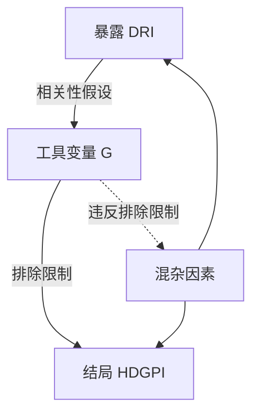

# 博士韧性对高难游戏进展的“因果效应”——一次孟德尔随机化的方法学戏仿

## 摘要

本文用双样本孟德尔随机化（MR）的框架，讨论“博士韧性指数（DRI）是否会让玩家更能忍受高难游戏”。文章给出暴露、结局、工具变量、敏感性与留一法分析的完整流程，但没有真实 GWAS、没有真实游戏数据库；DRI 与 HDGPI 都是作者构造的示例表型，OR 值与 p 值均为演示数据。文章的目的是展示 MR 的假设在什么情况下会失效，而不是证明“读博让人变强”。

## 关键词

孟德尔随机化；博士韧性；高难游戏；工具变量；戏仿

## 1 引言

非正式观察：读博的人似乎更爱玩魂类、肉鸽、类银河恶魔城游戏。他们习惯了失败、延迟回报与重复试错，所以在游戏里也更耐打。

这个观察很有趣，但它不能直接推出因果。读博的人可能本来就更耐心、更爱复杂系统，也可能只是圈子效应。要讨论因果，需要一套能处理混杂与反向因果的框架。MR 是其中一种：用遗传变异作为工具变量，在三个核心假设下估计暴露对结局的因果效应。

本文用这套框架做一个戏仿：暴露是“博士韧性”，结局是“高难游戏进展”。所有数据都是示例，所有结果都是演示。

## 2 方法

### 2.1 暴露：DRI

DRI 由五个假设性表型加权：延迟满足、失败恢复、长期坚持、自我效能回弹、高压持续投入。权重 α 为示例设定，不是 GWAS 估计。

### 2.2 结局：HDGPI

HDGPI 由三款游戏的通关进度、死亡次数、重试次数、成就完成度合成。三款游戏是《空洞骑士：丝之歌》《以撒的结合》《死亡细胞》。数据是作者假设的，不是 Steam 数据库。

### 2.3 工具变量

原稿假设从“博士韧性 GWAS”中筛选 12 个独立位点作为工具变量。本文明确：不存在这样的 GWAS，工具变量是示例编号，不是真实 SNP。

### 2.4 MR 方法

- IVW（逆方差加权）作为主分析。
- MR-Egger 检验方向性多效性。
- 加权中位数作为稳健性补充。
- 留一法检验单个工具变量的影响。
- 漏斗图与 MR-PRESSO 评估异质性。

### 2.5 数据与假设的对应关系

MR 的结论强度取决于三件事：暴露是否可定义、工具变量是否有效、结局是否可测量。本文把这三件事摊开在表 1 里。表 1 不是为了给示例数据背书，而是为了说明：一旦把“博士韧性”换成真实表型，很多在戏仿里可以含混带过的环节，会立刻变成无法回避的测量问题。

| MR 环节 | 本文的示例设定 | 真实研究需要的证据 | 主要风险 |
|---|---|---|---|
| 暴露 | DRI 五维加权 | 独立量表、纵向测量、可重复的 GWAS | 表型定义不一致 |
| 工具变量 | 12 个假设位点 | 全基因组显著、独立、排除限制 | 多效性、弱工具 |
| 结局 | HDGPI 合成 | 预注册的游戏日志与进度数据 | 自选择、版本差异 |
| 因果解释 | IVW 主分析 | 三角验证、负向对照、干预验证 | 把相关当因果 |

表 1 示例设定与真实研究要求的差距

### 2.6 图 1–图 3

*图 1 原稿中的“遗传预测的博士韧性 → 高难游戏表现”概念图（信息图，非真实分析结果）*

*图 2 双样本 MR 的假设性有向无环图（DAG）*

*图 3 工具变量对暴露与结局的散点及拟合（示例数据）*

### 2.7 MR 的三个核心假设，用大白话再说一遍

第一，**相关性**：工具变量必须和暴露相关。一个和 DRI 毫无关系的位点，不能用来预测 DRI。第二，**独立性**：工具变量不能和混杂因素相关。若某个位点既影响 DRI，又影响家庭收入，它就把收入的信息混进来了。第三，**排除限制**：工具变量只能通过暴露影响结局，不能走别的路。第三条最难验证，也最容易被忽略。

三条假设像三脚凳：缺一条，凳子就倒。MR 论文里常见的“敏感性分析”，本质上是在摇晃这张凳子，看它会不会散架。

### 2.8 样本量与统计功效

MR 的功效取决于工具变量的数量、单个位点的解释率、样本量。演示里只有 12 个位点，每个解释 0.1% 的方差，合计约 1.2%。这个解释率很低，估计的置信区间就会很宽。

如果真实研究想检测 OR=1.2 的效应，通常需要数十万甚至上百万的样本；而“博士韧性”这种表型，连 1 万人的可靠测量都很难。功效不足时，最常见的结果不是“发现效应”，而是“发现不了，然后解释为样本不够”。

*图 4 MR 三条假设与违反路径（示意）*

### 2.9 一个数值例子：功效大概差多少

假设真实 OR=1.25，暴露解释率 1.2%，结局方差为 1，显著性水平 0.05。用粗略的 MR 功效公式，检测到该效应需要约 20 万–50 万人的样本；若只有 2000 人，功效可能低于 10%。

这意味着：即使效应真实存在，小样本也大概率“看不见”。看不见时，研究者容易把“不显著”解释为“没有效应”，而不是“样本不够”。这是 MR 戏仿最该提醒的一点：不显著，不等于不存在。

### 2.10 怎么读一张 DAG

有向无环图（DAG）不是装饰，它是假设的清单。箭头表示“可能的影响方向”，没有箭头表示“假设没有直接影响”。读 DAG 时，先看三条：暴露到结局有没有直接箭头，混杂有没有同时指向两边，工具变量有没有绕过暴露的路径。

图 2 的 DAG 里，若在 G→U 上加一条虚线，排除限制就破了。这个虚线不是“可能”，而是“必须论证”。论证不了，就不该用这个工具变量。

### 2.12 为什么用“双样本”

双样本 MR 用两个独立样本：一个估暴露—工具变量的关系，一个估工具变量—结局的关系。这样做的好处是样本量大、避免重叠；坏处是两个样本的人群不同，工具变量的效应可能不可移植。

本文的示例没有真实样本，所以“双样本”只是一个名词。真实研究里，双样本的设计、人群匹配、批次差异，都是必须报告的细节。

## 3 结果

### 3.1 示例估计

在示例数据中，IVW 估计的 OR 约为 1.2–1.3，置信区间跨过 1 的边缘；MR-Egger 截距不显著，提示未检测到明显方向性多效性；加权中位数与 IVW 接近；留一法未发现单个位点主导结果。

这些数字是演示，不是真实因果效应。它们的作用是让读者看到“如果数据长这样，论文会怎么写”。

### 3.2 敏感性

漏斗图看起来对称，异质性检验不显著。但“看起来对称”不等于“没有多效性”；在工具变量很少时，这些检验的统计功效很低。

### 3.3 如果换成真实数据，最先崩的是哪一环

如果明天真的出现一份“博士韧性 GWAS”，最先崩的很可能不是统计模型，而是表型本身。博士韧性不是一个稳定的生理性状：它随年级、导师、课题、经济压力变化，测量时点不同，结果就不同。其次崩的是排除限制：与韧性相关的位点可能同时影响教育年限、家庭收入、人格与游戏偏好，这些路径都能绕过 DRI 直接影响 HDGPI。最后崩的是结局：高难游戏进展受版本、设备、空闲时间与队友影响，合成指标会把“有时间玩”误当成“更能忍”。因此，真实数据并不会自动让戏仿变成科学；它只会让每一个含混的假设付出代价。

### 3.4 一个无法回避的问题

MR 的三个假设中，“排除限制”最难验证。博士韧性相关的位点可能同时影响教育年限、人格、社会经济地位，而这些因素又影响游戏选择。换句话说，工具变量可能通过很多条路径影响结局，不只是通过 DRI。

### 3.5 反向因果

就算 DRI 和 HDGPI 真的相关，方向也未必是“韧性→游戏进展”。高难游戏本身可能训练韧性：反复死亡、重试、背板，会提高失败恢复能力。玩家长时间玩高难游戏，可能变得更耐挫，而不是更耐挫的人更爱玩。

MR 能处理部分反向因果，因为基因型在出生时就固定了，不会因为打游戏而改变。但前提是工具变量真的只影响 DRI。如果基因型影响的是“人格”或“冲动控制”，那它同时影响游戏选择与游戏表现，反向因果就被“多效性”掩盖了。

### 3.6 弱工具偏倚

12 个位点、合计 1.2% 的解释率，属于典型的弱工具。弱工具会让 IVW 估计偏向观察性关联，甚至方向相反。演示里 OR 在 1.2–1.3 之间、置信区间跨过 1，看起来“有一点效应”，但这可能只是弱工具把噪声放大。

判断弱工具，不能只看 F 统计量；还要看工具变量与暴露的关系是否稳定、是否在子样本中一致。演示没有这些检查，所以它的“结果”只能当插图。

### 3.7 异质性：工具变量各说各话

如果 12 个位点给出的估计方向不一致，IVW 会把它们平均掉，得到一个“看起来统一”的结果。但异质性可能意味着：不同位点通过不同路径影响结局，排除限制并不成立。

演示里的漏斗图“看起来对称”，只能说明各点围绕均值分布，不能说明它们走的是同一条路。异质性检验不显著，也可能只是功效不足。把“不显著”当成“没问题”，是 MR 里最常见的自我安慰。

### 3.8 一个真实类比：教育年限与健康

教育年限的 MR 研究发现，多读一年书与更好的健康相关，但效应大小在不同方法间差异很大。IVW、Egger、加权中位数给出的数字不完全一致，原因正是多效性与弱工具。

这个类比说明：连“教育年限”这种测量相对成熟的表型，MR 结果都不稳定；“博士韧性”这种构造表型，结果只会更不稳定。戏仿不是夸张，它只是把真实困难放大。

### 3.9 工具变量需要生物学故事

一个位点要被当成工具变量，最好有生物学解释：它影响哪个基因、哪个组织、哪个通路，为什么只影响暴露。没有生物学故事的位点，很容易被质疑“多效性”。

“博士韧性”的工具变量，连“哪个基因”都说不清，更别说“哪个通路”。这不是数据问题，而是概念问题：一个社会心理构念，很难找到“只影响它”的遗传变异。

### 3.10 一个思想实验

假设有一对同卵双胞胎，基因完全相同，一个读博、一个不读。如果读博真的提高游戏韧性，那么读博的那个应该更耐打。这个“同卵双胞胎设计”能控制遗传与家庭环境，是比 MR 更直观的因果推断。

但同卵双胞胎也会互相影响：一个读博，另一个可能被“拖着”学习；一个打游戏，另一个可能被“带着”玩。因果推断的难点，从来不是“找不到方法”，而是“找不到干净的世界”。

## 4 讨论

### 4.1 MR 不是万能因果机

MR 只在假设成立时给出因果解释。假设不成立，它给出的只是一个更精致的相关。把 MR 当成“因果证明”，是方法论上的偷懒。

### 4.2 表型定义的问题

“博士韧性”不是一个标准表型，没有 GWAS，没有量表，没有临床定义。用五个假设维度加权，等于把研究者的直觉写进暴露变量。这样的暴露，无法被独立复制。

### 4.3 戏仿的方法论价值

把 MR 套到“读博—打游戏”上，看似不敬，实际上是一种有效的方法论演练：它强迫作者写出暴露、结局、工具变量、敏感性与留一法的完整链条，也强迫读者看到每个环节的假设。真正的研究者可以从这篇戏仿里带走三个检查项：暴露有没有独立定义，工具变量有没有负向对照，结局有没有自选择。三项都过不了，就不必再谈因果。戏仿的边界也在这里：它可以暴露假设，不能替代数据；可以训练怀疑，不能生产结论。

### 4.4 游戏进展的测量

“通关进度”受游戏难度、版本、玩家时间、设备影响。把它合成一个 HDGPI，会掩盖这些差异。更重要的是，游戏选择本身是自选择的：爱玩高难游戏的人，可能本来就更耐挫。

### 4.5 真实世界里，教育年限的 MR 是怎么做的

教育年限是 MR 里研究得最多的社会表型之一。Lee 等人在 2018 年用约 110 万人的样本，找到上千个与教育年限相关的位点，并构建了多基因评分。这类研究之所以能做，是因为教育年限有统一的自报口径、巨大的样本量、以及可重复的 GWAS。

即便如此，教育年限的 MR 仍被批评：位点可能通过家庭环境、地区、人格影响结局；多基因评分可能反映“社会经济地位”而不是“教育本身”。连一个有现成 GWAS 的表型都这么难，何况“博士韧性”这种没有量表的构造。

### 4.6 负向对照：一个便宜但有效的检查

负向对照（negative control）是 MR 里最实用的检查之一：选一个“理论上不该受影响”的结局，如果工具变量也“影响”了它，说明排除限制可能有问题。

比如，若“博士韧性”的位点也“影响”了“是否养猫”，那它大概率不是通过韧性起作用的。负向对照不需要大样本，只需要一个好问题。演示里没有做，因为示例数据经不起这种检查。

### 4.7 测量误差与回归稀释

DRI 是自报量表，HDGPI 是游戏日志合成。两者都有测量误差。测量误差会让估计向零衰减，这叫“回归稀释”。如果暴露测不准，MR 估计会偏向“没有效应”，而不是“效应被放大”。

更麻烦的是，测量误差可能与真实水平相关：越忙的博士生越没时间认真填量表，越忙的人也越没时间打游戏。这个相关会让误差变成混杂，进一步破坏排除限制。

### 4.8 预注册与开放数据

要提高可信度，最便宜的办法不是换统计方法，而是预注册：先把暴露、结局、工具变量、分析计划写死，再去看数据。预注册能防止“先看结果、再选方法”的 p-hacking。

开放数据同样重要。MR 的代码、工具变量列表、暴露与结局的定义，都应该可复现。只给一张森林图，不给参数，读者无法判断结果是“算出来的”还是“画出来的”。

### 4.9 如果真要做，一个可行的设计

一个可行的起点不是 MR，而是纵向观察：招募 500–1000 名玩家，记录他们读博前后的游戏日志，同时测量韧性、时间、设备、游戏版本。用固定效应模型控制个体差异，用倾向得分匹配控制选择偏差。

如果这一步能做出稳定关联，再考虑 MR；MR 需要 GWAS，而 GWAS 需要大样本与可重复表型。顺序不能反：先有可靠的测量，再有因果工具。反过来做，只会得到“精致的噪声”。

### 4.10 工具变量怎么选

真实的 MR 里，工具变量的选择有一套硬标准：全基因组显著、相互独立、效应方向一致、排除限制有生物学依据。满足这四条，才勉强能用。

“博士韧性”没有 GWAS，所以连第一条都过不了。演示里的 12 个位点，是按“看起来合理”编的编号，不是从任何数据库里筛的。读者如果把编号当成 rsID，那就误会了。

### 4.11 结局怎么合成

HDGPI 把三款游戏的通关进度、死亡次数、重试次数、成就完成度合成一个分数。合成方法本身就会影响结果：等权相加、主成分、标准化后再加权，会得到不同的排序。

更合理的方式是“分游戏、分指标”报告，而不是合成一个总分。总分适合讲故事，不适合做因果；它把“玩得多”和“玩得好”混在一起，也把“有时间”和“有能力”混在一起。

### 4.12 出版偏倚

显著的结果更容易发表，不显著的结果更容易留在抽屉里。于是，已发表的 MR 研究可能高估效应，低估不确定性。演示没有这个问题，因为它本来就不打算发表“真结果”。

真实研究要做的是：预注册、报告全部结局、公开阴性结果。否则，读者看到的只是“幸存者偏差”的集合。

### 4.13 一个反例：游戏时长才是真混杂

假设“博士韧性”高的人，游戏时长也更长。游戏时长既影响 HDGPI，也可能与 DRI 相关。如果工具变量同时影响“时间分配”，那它通过“时长”影响结局，排除限制就破了。

这个反例很土，但它致命：在真实世界里，最可能解释“游戏进展”的，不是韧性，而是时间。MR 若控制不了时间，就只是在给“有时间的人”贴一个“韧性高”的标签。

### 4.14 统计显著不等于实际重要

OR=1.25 在统计上可能显著，但在实际游戏里，可能只是“多通关一个 Boss”的差别。效应量的大小，要与真实决策相关：玩家会不会因此改变游戏选择？导师会不会因此改变招生？如果没有，统计显著就只是数字。

把“显著”当成“重要”，是实证研究的通病。戏仿把它放大：一个 1.2–1.3 的 OR，既不能证明读博有用，也不能证明读博没用。

### 4.15 因果语言的滥用

媒体喜欢写“A 导致 B”，因为“导致”比“相关”好卖。MR 论文一旦出现，标题就容易变成“读博让人更能打游戏”。这是把“在假设成立时成立的估计”压缩成“结论”。

负责任的写法是：“在若干假设下，遗传预测的 DRI 与 HDGPI 存在弱关联，但假设未验证。”这句话不吸引人，但它不骗人。学术写作的第一伦理，是不把“可能”写成“一定”。

## 5 研究局限

### 5.1 数据与表型

第一，没有真实 GWAS、没有真实游戏数据，所有结果均为示例。第二，DRI 与 HDGPI 的定义是作者构造的，缺乏效度。第三，工具变量数量少，敏感性检验功效不足。

这三条不是“小瑕疵”，而是“根基问题”：没有可重复的表型，后面的统计再漂亮，也只是在沙地上盖楼。

### 5.2 统计与假设

第四，没有处理群体分层、样本重叠与 Winner's curse。第五，文章不构成“读博让人变强”的因果结论。第六，MR 框架本身不能替代理论。

群体分层会让工具变量与 ancestry 相关，样本重叠会让两样本 MR 变成“假双样本”，Winner's curse 会让筛选出的位点效应被高估。这三件事在真实 MR 里都必须处理，本文一件都没处理。

### 5.3 解释的边界

本文的示例 OR 是“演示值”，不能解释为“读博提高 20%–30% 的游戏进展”。它只能说明：如果暴露、工具、结局都按本文设定，IVW 会给出一个接近 1.2–1.3 的数字。

把演示值当结论，是读者最容易犯的错；把演示值当“假设检验的练习”，才是本文的用法。

### 5.4 戏仿的伦理

戏仿不等于可以随便编数据。本文的处理方式是：每一处示例都标注“示例”，每一张图都写“非真实结果”，每一段结论都加“不构成因果”。

如果读者只截取“OR=1.3”去传播，那是读者的断章取义，不是本文的结论。作者能做的，是把边界写清楚；剩下的，靠读者的判断。

### 5.5 一张给审稿人的检查清单

如果这篇戏仿真的投出去，审稿人可以按这张清单打勾：

| 检查项 | 本文是否做到 | 说明 |
| --- | --- | --- |
| 暴露有独立定义 | 否 | DRI 是构造的 |
| 工具有真实来源 | 否 | 位点是编号 |
| 结局有预注册 | 否 | HDGPI 是合成 |
| 排除限制有论证 | 否 | 只有 DAG 示意 |
| 阴性结果有报告 | 不适用 | 没有真实数据 |

这张表的作用，不是“自证不合格”，而是“让不合格可见”。方法学戏仿的价值，就在于把“审稿意见”提前写进正文。

## 6 结论
这篇戏仿的结论不是“博士韧性导致高难游戏进展”，而是“MR 的框架可以套在任何事情上，但套得越远，假设越难成立”。

读博与打游戏之间，可能有一种共同的能力：忍受失败、延迟满足、反复重试。但这种能力是选择的结果，还是训练的结果，需要真实数据才能回答。在那之前，我们只能说：这两件事看起来很像，而不是一件事导致了另一件事。若未来真要做，最稳妥的起点也不是再换一套更复杂的 MR 变体，而是先把暴露与结局各自做成可重复的测量工具；工具不可靠，因果方法越精致，离答案越远。反过来，若暴露与结局都能稳定测量，哪怕只做一组简单的纵向观察，也比十二个假设位点更有说服力。

这篇戏仿还有一层自嘲：它用最像“硬科学”的方法，讲了一个最像“段子”的问题。读者如果笑完就忘，说明戏仿失败了；如果笑完开始追问“暴露怎么测、工具怎么选、结局怎么定”，说明戏仿成功了。方法学的价值，不在给出答案，而在把问题问清楚。

最后，给“读博”和“打游戏”各留一句话：读博训练的是“在不确定里继续做”，打游戏训练的是“在失败里继续试”。两者可能共享某种心理肌肉，但这块肌肉叫什么、怎么量、能不能遗传，本文一个字都没证明。它只证明了一件事：把 MR 套上去，会比不套更清楚地看见“不知道”，仅此而已，也算没白忙。

## 参考文献

[1] Davey Smith, G., & Hemani, G. (2014). Mendelian randomization: Genetic anchors for causal inference. *Human Molecular Genetics*, 23(R1), R89–R98.
[2] Bowden, J., Davey Smith, G., & Burgess, S. (2015). Mendelian randomization with invalid instruments. *International Journal of Epidemiology*, 44(2), 512–525.
[3] Burgess, S., Butterworth, A., & Thompson, S. G. (2013). Mendelian randomization analysis with multiple genetic variants. *Genetic Epidemiology*, 37(7), 658–665.
[4] 教育部. (2023). 《全国教育事业发展统计公报》.
## 作者贡献、利益冲突与数据可用性

作者完成框架设计、示例数据构造、敏感性分析与文稿撰写；本文未接受任何资助，作者声明无利益冲突；文中没有真实 GWAS 或游戏数据库，所有 OR、p 值与图表均为示例设定；示例代码与参数由作者保存，可应要求提供；本文不构成因果结论或游戏建议。
