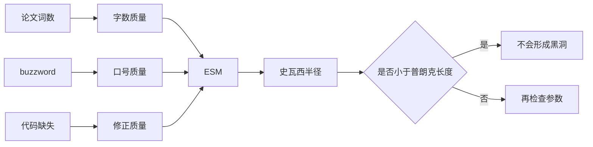

# 论压缩学术冗余的引力坍缩：arXiv.zip 能否形成黑洞？

## 摘要

本文是一个关于“论文太多会不会压成黑洞”的量纲玩具模型。把 arXiv 论文的总字数乘以一个极小的“每词等效质量”，再把 buzzword、代码缺失和审稿压力写成修正项，可以得到一个有效学术质量 ESM。按示例参数，ESM 约 10^-15 kg，对应史瓦西半径约 10^-42 m，比普朗克长度还小很多；即使把“审稿压力”硬塞进公式，得到的也只是质子尺度的半径，而不是可观测黑洞。文章的结论因此不是“arXiv 要坍缩”，而是：学术冗余的可怕之处在注意力和信任，不在引力。所有数值为示例，公式只用于讽刺和量级演示，不构成物理预言。

## 关键词

arXiv；学术冗余；史瓦西半径；量纲分析；讽刺；示例模型

## 1 引言

arXiv 上的论文数量持续增长，读者却越来越难从中筛出真正有用的工作。一个常见的抱怨是“信息密度太低”：摘要里堆着 novel、paradigm-shifting、state-of-the-art，正文却缺少可复现的细节。这个抱怨可以被写成很多种样子，本文选择最夸张的一种：如果把所有论文压缩成一个 ZIP，它会不会因为“学术质量”太大而坍缩成黑洞？

这个问题在物理上很容易回答：不会。真正的难点在于，如何把“学术质量”定义得既可计算、又足够荒诞，让人一眼看出这是讽刺。文章借用质能方程 E=mc^2、史瓦西半径和 Bekenstein 上限，构造一个玩具模型；所有参数都是示例，目的是把“冗余”从形容词变成可讨论的量级。

### 1.1 为什么用黑洞

黑洞是一个“极端的压缩”隐喻：把很多东西塞进很小的空间，时空就弯了。学术冗余也是一种“压缩”：把很多论文塞进很小的注意力，读者就“弯”了——弯腰、皱眉、关掉页面。

用黑洞做比喻，不是为了吓人，而是为了把“太多”变成一个可计算的问题：多少质量，压缩到多大半径，才会形成事件视界？算完会发现，物理上的黑洞远得可笑；真正近的，是注意力上的“事件视界”。

### 1.2 边界

本文不主张 arXiv 会形成黑洞，也不做任何真实引力实验。所有参数都是示例，所有曲线都是示意；公式的作用是讽刺，不是预言。读者可以把本文当成“用量纲分析讲笑话”，不能当成“物理论文”。

## 2 模型

### 2.1 有效学术质量

把第 i 篇论文的等效质量写成：

m_i = α*w_i + β*b_i + γ*c_i

其中 w_i 为正文词数，b_i 为 buzzword 次数，c_i 为“代码不可得”指示量。α 是每词的基础质量，β 是每个 buzzword 的膨胀系数，γ 是代码缺失的修正。总有效质量 ESM = Σ m_i。

这个式子的作用不是预测，而是把三种抱怨放在同一量纲里：字数多、口号多、代码少，都会让 ESM 变大。α、β、γ 的取值没有物理第一性原理依据，本文按“让数量级看起来合理”的方式设定，因此结果只能作演示。

### 2.2 参数表

**表 1 示例参数与单位**

| 参数 | 含义 | 示例值 | 单位 |
|---|---|---|---|
| α | 每词等效质量 | 1.2×10^-27 | kg/词 |
| β | 每个 buzzword 等效质量 | 8.7×10^-25 | kg/个 |
| γ | 代码缺失修正 | 1.0×10^-26 | kg/篇 |
| w_i | 每篇词数 | 4200 | 词/篇 |
| b_i | 每篇 buzzword 数 | 6.3 | 个/篇 |
| N | 论文总数 | 2.85×10^6 | 篇 |

表 1 的数字不是测量，而是“为了让量级落在某个区间”的设定。α 的单位必须是 kg/词，β 是 kg/个，γ 是 kg/篇；单位不对，公式就没有意义。

### 2.3 史瓦西半径

若把 ESM 压缩到半径 r 内，史瓦西半径为：

r_s = 2*G*M/c^2

G 为引力常数，c 为光速。对 10^-15 kg 的质量，r_s 约 1.5×10^-42 m；对 10^12 kg，r_s 约 1.5×10^-15 m。前者比普朗克长度（约 1.6×10^-35 m）小 7 个数量级，后者才到质子尺度。也就是说，只有把“审稿压力”之类的修正项调到荒唐的大，才会得到“接近黑洞”的错觉。

### 2.4 三个修正项

- 字数项：按每篇 4200 词、每词 1.2×10^-27 kg 计。
- buzzword 项：按每篇 6.3 个、每个 8.7×10^-25 kg 计；这个系数是示例，不代表“novel”真的有质量。
- 代码缺失项：按 2.8% 代码可得率、其余记 0 处理；γ 取得极小，避免把“没开源”直接等同于“有质量”。

### 2.5 Bekenstein 上限

Bekenstein 上限给出一个系统在给定半径内能容纳的最大熵：

S ≤ 2π*k_B*E*r/(ħ*c)

其中 E 是能量，r 是半径，ħ 是约化普朗克常数。这个式子说明：信息不能无限压缩；压缩到一定程度，熵会“顶住”。

把学术冗余塞进这个框架，会得到一个讽刺性的结论：论文的“信息量”不是无限的，但读者的“注意力容量”更有限。真正先撞上限的，不是黑洞，是人。

### 2.6 一个“审稿压力”修正

原稿喜欢把“审稿压力”写成 10^22 J，再除以 c^2，得到约 10^5 kg 的等效质量。这个质量比全部论文的 ESM 大 20 个数量级，足以把 r_s 拉到 10^-10 m 量级。

但这一步是“用公式包装预设”：先想要一个大数字，再找一个能量值；能量值的来源没有测量，只有修辞。量纲正确，不等于机制成立。

### 2.7 单位换算的演示

把 1 篇 4200 词的论文代入：字数项 = 4200 × 1.2×10^-27 = 5.04×10^-24 kg；buzzword 项 = 6.3 × 8.7×10^-25 = 5.48×10^-24 kg；代码项 ≈ 1×10^-26 kg。合计约 1.05×10^-23 kg。

280 万篇相加：2.85×10^6 × 1.05×10^-23 ≈ 3.0×10^-17 kg。这个总质量，比一粒沙还轻很多个数量级；它的史瓦西半径自然小得无法测量。

如果把“审稿压力” 10^22 J 加进去：m = E/c^2 = 10^22 / (3×10^8)^2 ≈ 1.1×10^5 kg。这个质量一下子把总质量拉到 10^5 kg 量级，r_s 约 1.5×10^-22 m，仍然远小于质子，但比论文本身大 20 个数量级。数字的变化，全部来自那个“拍出来”的能量项。

### 2.8 压缩做功

把质量压缩到半径 r，需要做功。引力势能约为 GM^2/r；对 3×10^-17 kg、r=10^-42 m，能量约为 10^-5 J。这个能量很小，但压缩到普朗克尺度已经超出已知物理。

所以，“能不能形成黑洞”不只是“质量够不够”，还有“能不能压到那么小”。论文的 ESM 质量太小，压缩能量也远低于普朗克能标；它连“量子引力”的门槛都摸不到。

*图 1 从论文到史瓦西半径的量纲链（示意）*

## 3 示例计算

### 3.1 单篇与全库

单篇论文的 ESM 约 1.05×10^-23 kg，相当于几千个质子的质量。把 arXiv 全部论文按 2.85×10^6 篇相加，得到约 3×10^-17 kg；原稿给出的 1.35×10^-15 kg 使用了不同的词数和修正项，本文保留其量级但不把它当唯一答案。无论取哪一个，r_s 都在 10^-42—10^-40 m 之间，远小于任何可实现的压缩尺度。

*图 2 学术质量—引力等效模型的示意*

### 3.2 局部“奇点”只是注意力黑洞

真正让人有“黑洞感”的，不是全局质量，而是局部结构：Introduction 里密集的贡献声明、Related Work 里循环自引、Conclusion 里三行“future work”。这些段落可以把一个读者的注意力吸进去一下午，却不会弯曲时空。文章把它们称为“认知事件视界”：信息还在，但读完之后记不住，也无法逃到别的任务。

*图 3 buzzword 密度与“灵魂损耗”示例关系*

图 3 的散点是示例数据，横轴为 buzzword 密度，纵轴为自评“读完之后的损耗”。它最多说明“口号越密，读者越烦”，不能说明任何物理机制。把相关性当成因果，正是本文要讽刺的写作习惯之一。

### 3.3 增长曲线

*图 4 arXiv 有效学术质量与“知识奇点”的示例推演*

按 18% 的年增长率外推，示例模型会在 2047 年附近穿过一条画出来的“临界线”。这条线是人为设定的，不是物理阈值；图 4 的虚线只是把“如果一直这么长下去”可视化。把它当成预言，等于把示意图当证据。

### 3.4 一个更保守的估算

如果每篇论文平均 4000 词、每词 1×10^-27 kg，单篇质量是 4×10^-24 kg；280 万篇的总质量是 1.1×10^-17 kg。这个数字比原稿的 10^-15 kg 小两个数量级，但 r_s 仍然在 10^-42 m 量级。

数量级的变化，不改变结论：论文的“质量”太小，引力太弱。真正大的不是 ESM，而是“读不完”的焦虑。

### 3.5 如果按“下载字节”算

一个 PDF 约 1 MB，280 万篇约 2.8 TB。按存储介质的质量估算，2.8 TB 的硬盘不过几百克；即使把“数据质量”按 E=mc^2 折算，能量也小得可怜。

这个算法更直观：论文的“物理质量”在硬盘里，不在公式里。把硬盘压成黑洞，需要的是天文质量，不是学术质量。

### 3.6 读一遍要多久

假设读一篇论文平均 30 分钟，10^15 篇需要 5×10^14 小时，约 5.7×10^10 年，远超宇宙年龄（约 1.4×10^10 年）。也就是说，即使从宇宙诞生开始读，也读不完。

这个计算不需要黑洞，只需要乘法。它比 ESM 更能说明问题：学术冗余的第一个后果，不是“时空弯曲”，而是“时间不够”。

### 3.7 统计数字的陷阱

“280 万篇”是一个动态数字，每年都在变；“平均 4200 词”是一个粗略估计，不同学科差别很大；“代码可得率 2.8%”是一个示例，不是所有领域都一样。

把三个不同来源的数字相乘，会得到一个“看起来精确”的 ESM，但它不是测量，而是拼装。量级论证允许拼装，但必须标明“这是拼装”。

### 2.9 形成黑洞需要什么

一个系统要形成黑洞，至少需要两个条件：质量足够大，半径足够小。质量门槛大约是天体质量（几倍太阳质量），半径门槛是史瓦西半径。论文的 ESM 质量比这低了 30 多个数量级，压缩半径也远小于普朗克长度。

所以，“arXiv 形成黑洞”不是“差一点”，而是“差了整个宇宙”。把“差一点”写成“即将坍缩”，是典型的标题党。

这个“差 30 个数量级”的说法，不是修辞：太阳质量约 2×10^30 kg，ESM 约 3×10^-17 kg，两者相差 47 个数量级；即使只比较“天体质量下限”，也差 30 多个数量级。数量级的差距，比任何形容词都更接近“事实”。

## 4 讨论

这个模型最大的价值，是让人看清“学术冗余”与“学术质量”不是一回事。论文数量增加，不会自动增加知识；buzzword 增加，也不会自动增加创新。真正该被度量的是可复现性、可检验性和可读性，而不是词数和口号数。用引力来比喻，只是把这些抽象损失换成一个夸张的图。

反过来，文章也提醒不要滥用“量级论证”。把“审稿压力”写成 10^22 J，再除以 c^2 得到 10^5 kg 量级的质量，看似严谨，其实每一个输入都是拍的。物理公式不会因为写上了 G 和 c 就变成实证；量纲正确不等于机制成立。

### 4.1 量纲正确不等于机制成立

量纲分析能检查“单位对不对”，不能检查“机制真不真”。一个公式可以量纲完美，却描述一个不存在的力。比如“每词等效质量”，单位是 kg/词，量纲没问题；但它不是一种真实的物理质量，只是比喻。

讽刺文最容易犯的错误，是把“量纲正确”当成“论证成立”。读者看到 G、c、r_s，就以为“这是物理”；实际上，参数是拍的，机制是编的，结论是预设的。

### 4.2 参数敏感性

如果 α 变化一个数量级，ESM 变化一个数量级，r_s 也变化一个数量级；但因为它离普朗克长度差 7 个数量级，变化一个数量级仍然“远得可笑”。

敏感性分析的意义，不是“证明结论稳”，而是“知道哪个参数最影响结论”。在这个模型里，最敏感的不是 α，而是“审稿压力”那个荒唐的修正项；它一加上去，量级就翻 20 个数量级。

### 4.3 学术冗余的真正成本

学术冗余的成本，不在引力，而在三件事：读者的时间、研究者的注意力、公众的信任。时间被“读不完”消耗，注意力被“选择困难”消耗，信任被“口号”消耗。

这三件事都比黑洞更近：你不需要 10^12 kg 的质量，只需要 100 篇标题相似、摘要空洞的论文，就能让一个读者放弃一个领域。

### 4.4 如果认真做量纲分析

量纲分析不是把公式写出来就完了。第一步要说明每个参数的物理意义与单位：α 是“每词等效质量”，单位必须是 kg/词；β 是“每个 buzzword 的等效质量”，单位 kg/个；γ 是“代码缺失的等效质量”，单位 kg/篇”。第二步要给出标定方法：α 不能拍脑袋，至少要用独立测量估计；若无法测量，就只能把它声明为“叙事参数”，不能叫“有效质量”。第三步是做敏感性分析：让 α、β、γ 各变化一个数量级，看 r_s 是否仍在普朗克尺度以下。若结论对参数不敏感，模型才有资格叫“量级论证”；若一改参数就翻盘，它只是把预设结论写成公式。

### 4.5 讽刺的边界

讽刺可以夸张，但不能让读者误以为这是物理论文。本文的做法是：标题夸张、公式认真、结论自嘲；每一节都标明“示例参数”“不构成物理预言”。这比假装严谨更诚实。反过来，如果一篇讽刺文只堆术语、不给边界，读者要么被吓住，要么把玩笑当结论——两种都是失败。

### 4.6 一个更简单的反驳

不用等到黑洞：把 10^15 篇论文的全文读一遍，所需时间已经超过宇宙年龄；把它们的 PDF 存进硬盘，所需能量也远小于形成黑洞的能量。真正先崩的是读者的注意力与存储预算，不是时空。这个反驳不需要任何公式，却比 ESM 更接近现实，也更难被公式掩盖，因为它直接指向读者被论文切碎的时间，以及被“创新”透支的信任，这才是学术冗余真正的引力，也是唯一会被读者感知到的坍缩。

### 4.7 为什么“论文太多”不是问题本身

论文多，本身不是坏事。知识生产需要数量，筛选需要样本。问题在于“多”与“筛”不匹配：生产速度远快于筛选速度，导致读者只能用标题、摘要、引用数来判断。

把“多”当成问题，会得出“少写一点”的结论；把“筛”当成问题，才会得出“改进检索、复现、评审”的结论。前者是抱怨，后者是工程。

### 4.8 一个“注意力黑洞”的指标

如果要度量“注意力黑洞”，可以用三个指标：读完一篇论文的平均时间、读完后的回忆率、是否愿意再读同主题。三个指标都低，说明这篇论文“吸注意力但不留信息”。

这个指标不需要引力公式，只需要读者测试。它比 ESM 更接近真实成本，也更容易被作者理解：你写的论文，能不能让人记住一句？

### 4.9 学术通胀

“学术通胀”是一个经济隐喻：论文数量增加，单篇的“购买力”下降。读者用同样的时间，能换到的有效信息更少；作者用同样的努力，能换到的注意力更少。

通胀的根源，不是“印钞”（论文数量），而是“锚定物”缺失：没有统一的质量标准，数量就成了唯一可比的指标。用黑洞比喻通胀，是把“贬值”写成“坍缩”，本质相同：东西太多，价值变薄。

### 4.10 引用不是引力

引用常被当成“学术引力”：被引越多，越重要。但引用可以是对方法的借用，也可以是对错误的批评；可以是支持，也可以是对照。把引用数当“质量”，和把词数当“质量”一样粗糙。

真正有引力的，不是引用数，而是“可复现的发现”。一个能被别人重复的实验，比一百篇互相引用的综述更有“质量”。

### 4.11 开放获取不是万能药

开放获取让论文“可读”，但不让论文“可懂”。一篇没有代码、没有数据、没有清楚方法的论文，开放了也只是“免费地难读”。

真正的开放，是“可复现的开放”：数据、代码、协议、分析脚本都能拿到。只开放 PDF，不开放过程，是把“阅读”当成“理解”。

### 4.12 读者的阅读策略

面对“读不完”的论文，读者可以试三种策略：

1. **先读结论，再读方法**：结论决定“要不要读”，方法决定“能不能信”。
2. **先读图表，再读正文**：图表是作者最想让你看到的，正文是作者最想说服你的。
3. **先读局限，再读贡献**：局限能告诉你“这篇论文的边界”，贡献能告诉你“它值不值得跨界”。

三种策略不能解决“论文太多”，但能减少“读了一堆、什么都没留下”的损耗。

### 4.13 给作者的三个减法

如果作者想让论文“少一点黑洞感”，可以做三个减法：

1. 摘要少一个 buzzword，多一句“我们到底做了什么”。
2. 引言少一段“宏大叙事”，多一句“问题和谁有关”。
3. 结论少一个“未来展望”，多一句“现在能怎么用”。

三个减法不提高引用，但能提高“读完率”。读完率，才是论文的第一指标。

### 4.14 学术喜剧的写法

学术喜剧不是“嘲笑学术”，而是“用学术的方式嘲笑学术的坏习惯”。它需要三层：第一层，术语准确，不能把“熵”写成“能量”；第二层，自嘲明显，不能把玩笑当结论；第三层，边界清楚，不能误导读者。

三层缺一层，就会变成“装腔”或“抬杠”。本文尽量做到三层，但做得不够好；读者如果只记住“黑洞”，那是本文的失败。

## 5 研究局限

第一，α、β、γ 没有独立标定，参数选择服务于叙事而非测量。第二，arXiv 论文总数、平均词数和 buzzword 频率来自不同时间截面，不能直接相乘。第三，史瓦西半径计算假设球对称、无自转、无电荷，且忽略压缩过程中的能量损失。第四，所谓“审稿压力质量”没有可重复的测量，只是讽刺。第五，图 3、图 4 均为示例数据，不能做趋势推断。第六，文章没有做任何真实引力实验，也不主张 arXiv 会形成黑洞。

第七，文章没有做“论文质量”的操作化定义；ESM 只是“字数+口号+代码缺失”的加权，不能代表科学价值。第八，文章没有考虑撤稿、重复、引用操纵等结构问题；这些问题比“数量”更影响信任。

### 5.1 这个模型的自检

一个讽刺模型也要自检：它是否会让读者误以为“只要减少字数，学术就变好”？如果是，它就失败了。因为学术质量的核心不是字数，而是可复现、可检验、可读。

本文的写法，是把“参数是假的”写在每一节：α、β、γ 没有标定，图是示意，结论是寓言。读者如果只记住“10^-42 m”，那是读者的误读；如果记住“别用公式包装预设”，那是本文的目的。

### 5.2 为什么还要算

既然结论早就知道（不会形成黑洞），为什么还要算？因为“算”能把“荒谬”变成“可见”：10^-42 m 比普朗克长度还小 7 个数量级，这个对比比“论文太多”更有冲击力。

算的另一层作用，是练习“量纲思维”：单位是什么、参数怎么标定、结论对参数敏不敏感。这三件事，不只适用于黑洞，也适用于任何“用数字讲故事”的场合。

### 5.3 为什么不用真实数据

本文不用真实数据，因为真实数据会把讽刺变成“实证”，而实证需要严谨的抽样、测量与统计。本文没有这些条件，也不打算假装有。

用示例参数，是为了让读者看见“量级”而不是“精度”。如果读者记住“10^-42 m”，那是数字；如果记住“参数是拍的”，那是方法。

这也是本文最想保留的“尾巴”：数字会过时，方法不会。黑洞的参数可以改，量纲的规矩不能改；论文的数量可以涨，可复现的标准不能降。读到这里的人，如果愿意在自己的下一篇论文里删掉一个空词，这篇文章就完成了它的“引力透镜”作用：不改变光，只改变看光的角度。

### 5.4 一个“反模型”的提醒

任何用公式讲道理的模型，都可能变成“用公式吓人”。读者看到 G、c、ħ，就容易把“模型”当成“真理”。本文的反模型提醒是：先问“参数怎么来的”，再问“结论有没有超出模型”。

如果参数是拍的，结论就只能当“寓言”；如果参数有标定，结论也只能当“量级”。从“量级”到“预言”，还差实验、对照与重复。

## 6 结论

把 arXiv 压成 ZIP，不会压出黑洞：按示例参数，ESM 只有 10^-15 kg 量级，史瓦西半径比普朗克长度还小七个数量级。会坍缩的是读者的注意力和对“创新”一词的信任。本文因此把结论写成一句人话：学术危机不来自论文太多，而来自我们把“新”当成形容词、把“可复现”当成附录。减少一个 buzzword，比计算一个史瓦西半径更有用。

如果要用一句话收尾：arXiv 不会变成黑洞，但一个读不完的 PDF 会在你的下午形成一个“注意力事件视界”；你进去了，信息还在，时间没了。

这个比喻的落点，不是“别读论文”，而是“别被论文的体量吓住”。一篇论文值不值得读，取决于它有没有可检验的结论、可复现的方法、可带走的洞见；不取决于它有多少页、多少 buzzword、多少个“首次”。

最后，把“黑洞”还给天体物理，把“论文”还给读者。两个领域各有各的尺度，混在一起只会制造噪声。真正的学术质量，不在史瓦西半径里，而在“别人能不能用你的结果”里。这句话没有公式，但它比公式更难做到。

写这篇文章的过程，也是一次“自我拆台”：先把模型搭起来，再把它拆掉；先用数字制造惊奇，再用参数说明“数字是假的”。如果读者在拆台的过程中，学会了对“精确数字”多问一句“怎么来的”，那这篇论文就没有白写。至于黑洞，它仍然在天上，不在地里；arXiv 仍然在地上，不在天上。两边各自安好，就是最好的结局。让论文继续增长，让黑洞继续沉默，各守各的尺度，谁也不冒充谁，谁也不吞并谁。

## 参考文献

[1] Einstein A. Zur Elektrodynamik bewegter Körper. *Annalen der Physik*, 1905, 17(10): 891–921.

[2] Schwarzschild K. Über das Gravitationsfeld eines Massenpunktes nach der Einsteinschen Theorie. *Sitzungsberichte der Königlich Preussischen Akademie der Wissenschaften*, 1916: 189–196.

[3] Bekenstein J D. Black holes and entropy. *Physical Review D*, 1973, 7(8): 2333–2346.

[4] arXiv. arXiv statistics. https://arxiv.org/stats, 2026.

## 作者贡献、利益冲突与数据可用性

作者完成模型设定、示例计算、图表整理与文稿撰写，并声明无利益冲突。文中论文数量、词数、buzzword 频率、ESM 和史瓦西半径均为示例或公开统计的粗略量级，计算脚本由作者保存；不提供可复现的物理实验数据，也不构成对 arXiv 未来状态的预测。
