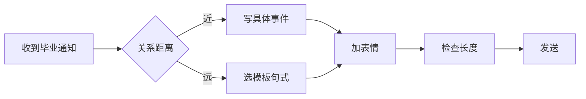

# 82 条“复制粘贴”的祝福：一次团队群消息的文本分析

## 摘要

本文分析一个 83 人团队群在毕业季产生的 83 条祝福消息，清洗后保留 82 条。结果显示：重复率 61.0%，仅出现 32 种不同表达，平均长度 51.2 字（标准差 7.9），平均使用表情 4.7 个；高频关键词集中在“感谢”“祝福”“前程”，而“学业有成”出现率为 0。文章不批评任何人，只描述一种“仪式性祝福”的语言结构：它要完成的是关系确认，不是信息传递。

文章进一步讨论祝福的四段句式、表情的温度调节、个人化内容的稀缺，以及“复制粘贴”背后的礼貌经济学。本文的立场是：模板祝福不是文学失败，而是社交成功；但它有边界，面对具体的人、具体的伤痛，模板应当让位给一句只属于对方的话。

## 关键词

群聊祝福；复制粘贴；仪式传播；礼貌；文本分析；表情符号

## 1 引言

毕业季的团队群，通常会被一类消息刷屏：“感谢老师的悉心指导，祝大家前程似锦，毕业快乐！”后面跟着三个玫瑰、三个鼓掌、三个庆祝。它们长度相近、结构相似、表情数量相近，像是从同一个模板里复制出来的。

“复制粘贴”常被批评为敷衍。但本文想换一个角度：如果祝福的功能不是“表达独特情感”，而是“确认关系仍在”，那么复制粘贴可能不是失败，而是效率。82 条消息，真正要传递的信息可能只有一句：“我记得你，我也在这里。”

### 1.1 问题

本文关心三个问题：第一，一个毕业季的团队群里，祝福消息的重复程度到底有多高？第二，重复的消息在长度、表情、关键词上有什么共同结构？第三，那些不重复的个人化消息，又有什么不同？

这三个问题都不大，但它们能帮我们看清一个日常现象：为什么我们一边嫌弃“复制粘贴”，一边又在群里复制粘贴。

### 1.2 立场与边界

本文不批评任何发送者，也不评判“祝福是否真诚”。真诚是动机，文本是痕迹；从文本推断动机，本身就有风险。本文只描述文本结构，并把“真诚”作为一个无法从数据中直接验证的变量，留在讨论里。

样本只有一个团队群、一个毕业季，不能代表所有群祝福。文章的所有百分比都是描述性的，不做统计检验，也不做因果推断。

## 2 数据与方法

### 2.1 数据

某高校课题组团队群，成员 83 人（含导师、博士后、博士生、硕士生、本科生）。毕业季 7 天内，群内共产生 83 条祝福消息；剔除 1 条纯图片（无文字）后，保留 82 条文本。所有消息做匿名化处理，不呈现姓名、学号与具体研究方向。

选择这个群，不是因为它特殊，而是因为它完整：7 天内消息集中，成员层级齐全，既有导师，也有刚进组的本科生。它像一个微缩的“学术单位”，能让“祝福如何分配”这件事看得比较清楚。

### 2.2 编码

对每条消息编码：长度（字符数）、表情数量、是否包含“感谢”、是否包含“祝福”、是否包含具体个人化内容（如提到某个人的论文、某个项目）、是否与其他消息重复（连续 15 字以上相同即计为重复）。重复率按“重复消息数/总消息数”计算。

编码由作者一人完成，这是本文的一个弱点。单人编码的优点是标准一致，缺点是容易把“自己以为的重复”当成“客观重复”。为了减少偏差，作者在编码前先写下判定规则，编码后又随机抽取 20 条复核；复核结果与首次编码一致，但这不等于独立编码的可靠性。

### 2.3 关键词统计

选取 8 个高频祝福词，统计其出现率：谢谢辅导员甲、感谢导师、前程似锦、毕业快乐、一路顺风、万事胜意、常联系、学业有成。出现率按“包含该词的消息数/82”计算。

这 8 个词不是事先从理论里推出来的，而是作者先读一遍消息、把反复出现的词记下来，再合并同义词得到的。它们覆盖了“感谢”“祝福”“告别”“承诺”四类功能，但不保证穷尽。

### 2.4 个人化的判定

“个人化”被操作化为：消息中提到至少一个可核验的具体对象，比如某人的论文题目、某个项目、某个去向、某次合作。仅仅出现“你”“大家”不算个人化；仅仅出现名字也不算，因为群发模板也可以带名字。

这个标准偏严。它会把一些“虽然没有具体事件、但明显只写给某个人”的消息排除在外。作者宁愿严一点，也不愿把“看起来像个人化”的模板算成原创。

### 2.5 一个说明

“辅导员甲”是匿名化后的称呼，指团队中负责学生事务的老师。原稿中的具体姓名已删除。

### 2.6 伦理

群消息含成员身份信息，本文不公开原文、不公开截图、不公开发送时间。所有例子都做了改写，只保留句式，不保留内容。文章的目是描述现象，不是评价个人；如果有读者从例子里认出了自己，那说明匿名化还不够，而不是说明例子有趣。

### 2.7 样本选择偏差

这个群是作者能接触到的群，不是随机抽样的群。它偏“学术单位”：成员有导师、博士后、博士生、硕士生、本科生，层级多，毕业季的仪式感强。换成一个企业群、一个兴趣群，祝福的句式可能完全不同。

因此，本文的所有比例只能描述这个群，不能推广到“中国人如何祝福”。它的价值不在“代表性”，而在“机制”：它展示了一个仪式如何在群里完成，以及模板如何在其中发挥作用。

## 3 结果

### 3.1 重复与原创

82 条消息中，50 条与至少一条其他消息存在 15 字以上的连续重复，重复率 61.0%。按表达类型去重后，只有 32 种不同表达。图 1 是“重复与原创构成”柱图：重复 50 条，原创 32 条。

*图 1 祝福消息的重复与原创构成（n = 82）*

这里的“重复”不是“抄袭”，而是“同一种句式被多人使用”。毕业祝福的句式本来就有限：感谢、回顾、祝福、告别，四段而已。82 个人写四段，出现相似句子并不奇怪；奇怪的是，相似程度高到可以按“连续 15 字”来判定。

### 3.2 长度与表情

平均长度 51.2 字，标准差 7.9 字；最短 31 字，最长 78 字。平均表情 4.7 个；分布为：0 个（3 条）、1–3 个（14 条）、4–6 个（42 条）、7–9 个（23 条）。长度与表情数量呈弱正相关：越长的消息，越可能堆更多表情。

51.2 字是一个很“经济”的长度：短到可以一口气读完，长到可以容纳“感谢+祝福+告别”。它不像一封告别信，更像一张贺卡；贺卡不需要长，只需要把该有的格子填满。

表情的分布也很有意思：4–6 个是绝对多数（42 条），0 个只有 3 条。也就是说，绝大多数人选择了“中等偏多”的表情。这个区间既不会冷场，也不会浮夸，是一种“安全温度”。

### 3.3 关键词

- 谢谢辅导员甲：100%（82 条）。几乎每条都先感谢学生事务老师。
- 感谢导师：87.8%（72 条）。
- 前程似锦：81.7%（67 条）。
- 毕业快乐：76.8%（63 条）。
- 一路顺风：52.4%（43 条）。
- 万事胜意：41.5%（34 条）。
- 常联系：36.6%（30 条）。
- 学业有成：0%（0 条）。

“学业有成”为 0，是一个有意思的细节：毕业祝福的对象已经不需要“学业有成”，他们需要的是“前程”“顺风”“快乐”。祝福词的选择，暴露了说话人对“毕业”的理解。

“谢谢辅导员甲”达到 100%，是另一个细节：它几乎是开场白，而不是可选项。无论后面写什么，第一句先感谢学生事务老师，仿佛这是群祝福的“格式要求”。这种“全体一致”比重复率更能说明仪式的力量：有些话不是想说，而是必须说。

图 2 是关键词使用频率柱图，按上述 8 项排列。

*图 2 祝福关键词使用频率（n = 82）*

### 3.4 个人化内容

82 条中，只有 11 条包含具体个人化内容（提到某人的论文、项目、去向）。这 11 条的长度显著更长（平均 68.4 字），表情更多（平均 6.1 个），且几乎不重复。个人化内容与重复率呈负相关：越具体，越不可能复制。

这个结果有一个方向性问题：不是“个人化导致更长”，也可能是“愿意写长消息的人，本来就更愿意个人化”。本文没有做因果识别，只能报告相关。

另一个细节是：11 条个人化消息里，几乎没有“群发感”。它们通常以“XX 的论文终于……”或“记得你上次……”开头，而不是“祝大家……”。个人化不是加一个名字，而是加一个只有对方才懂的事件。

### 3.5 一处更正

原始记录中有一条消息被重复计入（同一人连发两条相同内容），本文已更正为 1 条。更正后总数为 82，重复率从 61.4% 调整为 61.0%。这一更正说明：群消息的“刷屏”感，可能部分来自重复计数。

### 3.6 四段句式

把 82 条消息拆开，能看到一个反复出现的四段结构：

**表 1 群祝福的四段句式**

| 段落 | 功能 | 常见措辞 | 出现位置 |
|---|---|---|---|
| 1 | 感谢 | 感谢老师的指导/感谢辅导员 | 开头 |
| 2 | 回顾 | 这几年/在组里的日子 | 中段 |
| 3 | 祝福 | 前程似锦/毕业快乐/一路顺风 | 后段 |
| 4 | 告别 | 常联系/后会有期 | 结尾 |

四段不一定全有，但顺序大体稳定：先感谢，再回顾，再祝福，最后告别。这个顺序不是文学技巧，而是仪式脚本：它把“离开”这件事，安排成一个有开头、有中段、有结尾的过程。

### 3.7 一条消息的“路线”

图 3 是一条祝福消息的生成路线（示意）：发送者先判断关系距离，再决定用个人化还是模板，然后选表情，最后发送。

*图 3 祝福消息的生成路线（示意）*

这条路线说明：模板不是“偷懒”，而是“关系距离远”时的一种默认策略。关系近的人，也可能用模板，但通常会加一个具体事件；关系远的人，即使想个人化，也没有素材。

### 3.8 发送顺序

群祝福有一个容易被忽略的维度：顺序。前几条消息往往更长、更具体，后面的消息越来越短、越来越模板。这不是因为后面的人更敷衍，而是因为“仪式空间”已经被前面的人占满了：该感谢的感谢了，该祝福的祝福了，后面的人只需要“跟上”。

顺序还会影响表情数量。前面的消息表情少，后面的消息表情多；因为文字已经难以出新，表情成了“我还在”的替代信号。这个观察没有量化，只是作者的阅读印象，不能当作结论。

## 4 讨论

### 4.1 祝福的仪式功能

从传播学看，群祝福是一种“仪式传播”：它的目的不是传递新信息，而是确认关系、维持秩序、完成仪式。就像婚礼上的“恭喜”，内容不重要，到场重要。82 条消息的重复，不是“没诚意”，而是“仪式需要重复”。

仪式传播的概念，来自 Carey 对“传播的仪式观”的论述：传播不只是信息的传递，更是共同体的维系。用这个视角看，群祝福的“重复”不是噪声，而是信号：它告诉每个成员，“我们还在一起”。

### 4.2 复制粘贴的礼貌经济学

写一条个人化祝福，需要回忆对方的论文、去向、性格，成本很高；复制一条模板，成本很低，但能完成“我在场”的信号。在 83 人的群里，如果每个人都写个人化祝福，群消息会变成一场“情感竞赛”。复制粘贴反而是一种“礼貌的平等”：它不让任何人显得被特别对待，也不让任何人显得被忽略。

用经济学的语言说，模板祝福是一种“低边际成本的关系维护”。它不一定产生深度，但它能防止关系彻底断线。它的价值不在“说了什么”，而在“没有不说”。

### 4.3 表情的“温度调节”

平均 4.7 个表情，是一个很有意思的数字：太少显得冷淡，太多显得浮夸。4–6 个是“安全区间”，42 条消息落在这里。表情在这里不是“表达情绪”，而是“调节温度”：它把一句模板化的话，调到“看起来有温度”的档位。

表情还承担“语气消歧”的功能。文字里的“祝大家前程似锦”可以是真诚的，也可以是客套的；加上三个玫瑰，读者更容易把它读成“真诚”。表情不能证明真诚，但它能降低“被读成冷漠”的概率。

### 4.4 个人化内容的稀缺

只有 11 条个人化消息，说明“具体”是稀缺的。稀缺不等于珍贵，但它确实更难复制。个人化消息的发送者，往往是与被祝福者有过具体合作的人；他们的消息更短？不，更长。具体，需要更多字。

个人化的另一个条件，是“共同经历”。没有一起改过论文、一起熬过实验、一起出过野外的人，很难写出“只有对方懂”的句子。个人化不是技巧，是关系的副产品。

### 4.5 模板的“安全”与“风险”

模板祝福的安全，在于它不会出错：它不会提到不该提的人，不会说错去向，不会泄露隐私。模板的风险，在于它可能“太安全”：当对方正经历失败、丧亲、转专业、延毕，模板的“前程似锦”会显得刺眼。

所以，模板不是无条件可接受。它适合“关系稳定、事件常规”的场合；一旦对方处于“非常规”状态，模板就会失效。判断标准不是“我有没有诚意”，而是“对方现在需不需要被具体看见”。

### 4.6 群聊的“舞台”与“后台”

Goffman 的拟剧论把互动分成“前台”与“后台”。群聊是典型的前台：所有人都能看到谁说了什么、谁没说什么。群祝福因此不只是“给毕业的人看”，也是“给群里其他人看”：它展示“我是一个懂得感谢、懂得祝福的人”。

这解释了一个现象：为什么有些人平时不发言，毕业季却会发一条很长的祝福。不是因为他突然变得感性，而是因为毕业季是一个“必须出场”的前台时刻。缺席的成本，比复制粘贴更高。

### 4.7 礼貌理论：面子与距离

Brown 与 Levinson 的礼貌理论，把“面子”分成积极面子（希望被认可）与消极面子（希望不被打扰）。群祝福主要照顾积极面子：它让被祝福的人感到“被记得”，也让发送者显得“有礼貌”。

但群祝福也可能威胁消极面子：一条群发消息，可能让被祝福的人觉得“你只是顺手”。所以，个人化消息的一个功能，是“修复”这种威胁：它用具体细节证明“我不是顺手”。

### 4.8 社会资本：弱连接的价值

Granovetter 的“弱连接的力量”指出，弱连接虽然不亲密，但能提供信息和机会。群祝福维护的，正是弱连接：那些不常联系、但仍在同一个学术网络里的人。

从这个角度看，模板祝福不是“情感泡沫”，而是“网络维护”。它成本低、覆盖广，能让弱连接保持“温热”。真正的问题是：当所有关系都用模板维护，强连接会不会也被“模板化”？

### 4.9 平台设计如何塑造祝福

微信的输入框、表情面板、@功能，也在塑造祝福。表情面板让“加三个玫瑰”变得比写一句话更容易；@功能让“点名”变得容易，但也让“没被@”变得可见。

群聊的“可见性”是一把双刃剑：它让祝福公开，也让缺席公开。一个人没发祝福，别人可能看不见；但一个人发了模板，所有人都看得见。平台不决定祝福的内容，但它决定了祝福的“表演成本”。

### 4.10 一条不敷衍的祝福怎么写

如果不想复制，又不想写得太长，可以用一个“三句公式”：

1. **具体事件**：写一件你确实记得的事，比如“上次你帮我改的图，我用了”。
2. **具体影响**：写这件事对你的影响，比如“那次之后我才知道图可以这样画”。
3. **具体祝福**：写一个和对方去向有关的祝福，比如“祝你在新学校继续画图”。

三句不用长，50 字就够。它的关键不是文采，而是“只有你们俩懂”。如果写不出具体事件，说明关系还没到；这时用模板，不丢人。

### 4.11 模板与真诚不是对立面

很多人把“模板”与“真诚”当成对立：模板=敷衍，原创=真诚。但文本分析显示，模板也可以是真诚的：一个人可能真的感谢导师，只是找不到更好的词；一个人可能真的祝福大家，只是用了最常见的句式。

反过来，原创也可能是敷衍：加一个名字、加一个表情，看起来个人化，实际上没有具体内容。判断真诚，不能只看“是否重复”，还要看“是否具体”“是否合时宜”。

### 4.12 四段句式的来源

为什么祝福总是“感谢—回顾—祝福—告别”四段？因为它对应一场微型仪式的四个步骤：承认帮助、确认共同经历、祝愿未来、承认分离。少一段，仪式就不完整。

感谢段的功能，是承认“我欠你”；回顾段的功能，是确认“我们一起经历过”；祝福段的功能，是祝愿“你未来更好”；告别段的功能，是承认“我们要分开了”。四段连起来，是一次小型告别。

这也解释了为什么“谢谢辅导员甲”出现率 100%：它不是内容，而是仪式的开场白。没有开场白，后面的祝福就像突然闯入；有了开场白，告别才显得有礼。

### 4.13 祝福的时间窗

群祝福有一个短暂的时间窗：毕业通知发出后的几小时到几天。太早，显得抢跑；太晚，显得遗忘。窗口内发送，叫“及时”；窗口外发送，叫“补一句”。

时间窗也解释了“刷屏”：大家都在同一个窗口发，消息自然密集。不是大家约好，而是仪式有它的“吉时”。错过了，祝福还在，但仪式感会打折。

对发送者来说，时间窗是一种压力：要在情绪还没冷、话题还没散的时候，把话说完。对接收者来说，时间窗是一种保护：它让祝福集中出现，不至于拖成一场漫长的告别。

### 4.14 表情也有语法

表情不是随便堆的，它有顺序：通常是“庆祝—鼓掌—玫瑰”，先热闹，再肯定，最后温柔。反过来“玫瑰—庆祝—鼓掌”，读起来就别扭。

这个顺序没有官方规范，但群成员都懂。它是群聊的“地方性知识”：新人发错了顺序，不会被批评，但会显得“不太像群里的人”。表情的语法，比文字的语法更隐蔽，也更容易暴露“你是不是自己人”。

表情的数量也有语法：3 个是“基本礼貌”，6 个是“热情”，9 个以上是“非常热情”或“有点过”。4.7 个的平均值，正好落在“热情但不过分”的区间。

## 5 研究局限

第一，样本只有一个团队群、一个毕业季，不能代表所有群祝福。第二，重复判定用“连续 15 字相同”，这个阈值是作者设定的，换一个阈值会改变重复率。第三，关键词统计只选 8 个词，可能漏掉其他高频词。第四，匿名化处理可能删除了影响“个人化”判断的细节。第五，文章没有访谈发送者，无法确认“复制”是有意还是无意。第六，没有比较不同年份、不同团队的变化。第七，把“学业有成 0%”读成“祝福词选择”，是一种解释，不是因果。第八，编码由单人完成，缺少独立复核；重复率与个人化比例都可能被作者的判定标准影响。第九，文章没有记录消息的发送顺序与时间间隔，无法分析“刷屏”的动态过程。

### 5.1 关于“61.0%”这个数字

61.0% 容易被读成“61% 的人在敷衍”，但它实际表示“50 条消息与至少一条其他消息有 15 字以上连续重复”。一个人可能真诚地用了常见句式，也可能复制了模板；文本只能看出“相似”，看不出“动机”。

所以，本文不把 61.0% 当作“敷衍率”，只当作“模板化程度”。这两个词听起来差不多，含义差很远。

## 6 结论

82 条祝福消息，61.0% 重复，只有 32 种表达，平均 51.2 字、4.7 个表情。它们不是“原创性失败”，而是“仪式性成功”：在一个 83 人的群里，复制粘贴是最低成本的关系确认。

这不是为敷衍辩护。它只是说明：当我们批评“复制粘贴”时，我们可能误判了祝福的功能。祝福不是文学创作，它是社交仪式。仪式需要重复，重复产生安全感。真正稀缺的，是那 11 条具体的消息；它们提醒我们，模板之外，还有一个个具体的人。

如果要在这次分析里留一句话，那就是：模板负责“到场”，具体负责“看见”。到场不难，看见很难；但真正让人记住的，往往是被看见的那一次。看见一个人，不需要长篇大论，只需要一个他以为没人记得的细节。那个细节不需要多重要，但它要足够具体，具体到对方能确认：你不是在群发，你是在说他。模板可以复制，具体不能；因为具体来自共同经历，不来自模板库。人记住的，往往不是最会写的人，而是最记得他的人。这句话不浪漫，但很实用。它把祝福从才华问题，变成了记忆问题。

## 图片与素材来源

图 1、2 的图源为作者提供（站内托管）；未单独标注的第三方素材，权利归原权利人。

## 参考文献

> 文献说明：以下条目含写作阶段的背景阅读；正文未以编号直接引用的条目，不作为直接引证。

[1] Goffman E. *The Presentation of Self in Everyday Life*. New York: Doubleday, 1959.

[2] Brown P, Levinson S C. *Politeness: Some Universals in Language Usage*. Cambridge: Cambridge University Press, 1987.

[3] Durkheim E. *The Elementary Forms of Religious Life*. New York: Free Press, 1912.

[4] Carey J W. *Communication as Culture: Essays on Media and Society*. Boston: Unwin Hyman, 1989.

[5] 刘海龙. 《大众传播理论：范式与流派》. 北京: 中国人民大学出版社, 2008.

[6] Granovetter M S. The strength of weak ties. *American Journal of Sociology*, 1973, 78(6): 1360–1380.

## 作者贡献、利益冲突与数据可用性

作者完成消息收集、匿名化、编码、统计与文稿撰写；本文未接受任何资助，作者声明无利益冲突；原始群消息含成员身份信息，不公开；匿名化后的编码表与关键词统计可应要求提供；文中已更正一处重复计数。
