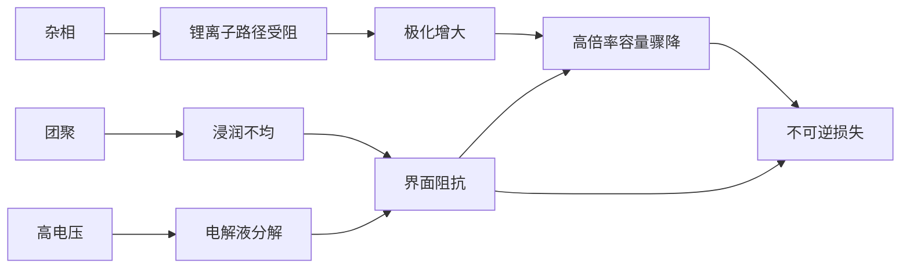

# 一种低性能锂离子正极材料的表征与失效分析

## 摘要

本文报告一种锂镍锰氧化物正极材料的合成、表征与电化学测试。X 射线衍射显示材料与 LiNi₀.₅Mn₁.₅O₄ 参考谱部分吻合，但存在杂相；扫描电镜显示颗粒呈球形，粒径约 2–8 μm；X 射线荧光给出 Ni、Mn、Co 的粗略比例；倍率测试显示 0.1C 放电容量约 110 mAh/g，2C 起接近 0，回到 1C 仅恢复至 30 mAh/g。文章不宣称材料“成功”，而是把它当作一个失败案例，讨论杂相、颗粒形貌与测试条件对容量与倍率性能的影响。

文章的核心结论是：这个样品“看起来像 LNMO”，但没有达到 LNMO 应有的物相纯度与界面质量。它的低性能不是单一原因造成的，而是“杂相—团聚—极化—界面”四条链叠加的结果。把失败如实写出来，比把它包装成“新材料突破”更有信息量。

## 关键词

锂离子电池；正极材料；LNMO；XRD；倍率性能；失效分析

## 1 引言

锂镍锰氧化物（LNMO）尖晶石因高电压平台（约 4.7 V）与较低成本受到关注。但它的实用化受制于电解液分解、锰溶解与相变。本文的材料并不是一个优化后的样品，而是一个“按教科书比例混合、却性能很差”的样品。作者把它写出来，是因为失败的样品同样有信息：它能说明“看起来像 LNMO”与“真的是 LNMO”之间的差距。

原稿中存在多处半截句与空行，例如“正极按教科书比例与粘合剂认真如图 1 所示”。本文已重写，不保留这些残句。

### 1.1 为什么是 LNMO

LNMO 的理论容量约 147 mAh/g，工作电压约 4.7 V，因此理论能量密度高于常规层状正极。它的成本优势来自镍、锰相对便宜，不含钴或低钴。它的难点也在这里：高电压会加速电解液氧化，锰在循环中可能溶解，表面需要稳定的界面。

“高电压”是一把双刃剑：它让能量密度上去，也让副反应更容易发生。一个 LNMO 样品如果物相不纯、表面不稳，高电压不会“奖励”它，只会把问题放大。

### 1.2 失败样品的信息量

成功的样品只告诉你“这条路线可行”；失败的样品告诉你“哪一环不能省”。本文的样品在多个环节都有问题：物相含杂、颗粒团聚、极片偏厚、电解液未优化。它像一个“多点故障”的系统，正好用来练习失效分析。

### 1.3 边界

本文不做循环寿命测试，不做不同电解液对照，所有容量数据来自单次测试。结论只对“本样品 + 本工艺 + 本电解液”成立，不能推广到所有 LNMO。

## 2 方法与材料

### 2.1 合成

按 Li : Ni : Mn = 1 : 0.5 : 1.5 的摩尔比称取碳酸锂、乙酸镍、乙酸锰，加入适量柠檬酸作为螯合剂，溶于去离子水，80 ℃ 搅拌至凝胶，120 ℃ 干燥，随后在马弗炉中 800 ℃ 煅烧 10 h，自然冷却。未做退火与气氛控制。

这个方法是溶胶—凝胶的简化版：柠檬酸与金属离子形成络合物，加热后形成凝胶，再煅烧得到氧化物。柠檬酸的作用，是让金属离子在分子尺度上混合，减少长程扩散。

但“混合均匀”不等于“物相纯”。煅烧温度、时间、气氛、降温速率都会影响最终产物。800 ℃、10 h、空气气氛，是一个常见的起点，不是最优条件。

### 2.2 表征

X 射线衍射（XRD）用于物相分析，2θ 范围 10°–80°，步长 0.02°；扫描电镜（SEM）用于形貌观察；X 射线荧光（XRF）用于元素半定量。所有表征在室温下完成。

XRD 的原理，是布拉格方程：

`nλ = 2d sinθ`

其中 λ 是 X 射线波长，d 是晶面间距，θ 是衍射角。不同物相有不同的晶面间距，因此有不同的峰位。把实测谱与参考谱对比，可以判断“有哪些相”，但不能直接判断“各相有多少”。

SEM 的原理，是用电子束扫描样品表面，收集二次电子，形成形貌像。它能看颗粒大小、形状、团聚，但不能看元素分布；元素分布需要 EDS 面扫。

XRF 的原理，是用 X 射线激发内层电子，测量特征 X 射线能量。它能给出元素半定量，但对轻元素（如 Li）不敏感，也不能区分“同一元素的不同价态”。

### 2.3 电化学测试

正极浆料按活性物质 : 导电炭黑 : PVDF = 8 : 1 : 1 的质量比混合，涂覆于铝箔，120 ℃ 真空干燥 12 h。扣式电池以锂片为对电极，电解液为 1 M LiPF₆ 的 EC/DMC 体系。倍率测试在 3.5–4.9 V 区间进行，依次为 0.1C、0.2C、0.5C、1C、2C、5C、10C，最后回到 1C。

8 : 1 : 1 的配方，是一个“活性物质偏高”的配方。活性物质多，能量密度高；导电剂少，电子传导差；极片厚，离子扩散路径长。三者叠加，会放大极化，尤其在高速率下。

### 2.4 C-rate 的计算

1C 的定义是“1 小时充满或放完理论容量”。对 LNMO，理论容量约 147 mAh/g，所以 1C 的电流密度约为 147 mA/g。0.1C 是 14.7 mA/g，2C 是 294 mA/g。

如果极片活性物质负载是 5 mg/cm²，1C 的面电流约 0.735 mA/cm²，2C 约 1.47 mA/cm²。这个电流不算大，但如果极片厚、导电剂少，局部极化仍然会很高。

倍率性能的本质，是“在有限时间里，锂离子能否扩散到活性位点”。时间越短，扩散越来不及；极化越大，电压越快触到截止线。

### 2.5 一个说明

本文没有做循环寿命测试，也没有做不同电解液的对照。所有容量数据来自单次测试，不能代表材料的长程稳定性。

### 2.6 极片制备的细节

浆料混合的顺序，会影响导电剂分布。常见做法是先把导电炭黑与 PVDF 干混，再加溶剂，最后加活性物质；本文没有记录顺序，只记录了比例。顺序不同，导电网络不同，倍率性能也不同。

涂覆厚度没有精确记录，只描述为“较厚”。厚度是倍率性能的关键变量：厚极片能量密度高，但离子扩散路径长；薄极片倍率好，但面容量低。本文没有测厚度，因此无法把“极化”归因到具体厚度。

### 2.7 电解液与装配

1 M LiPF₆ 的 EC/DMC 体系，是常规碳酸酯电解液。它在 4.9 V 下容易氧化，尤其在没有成膜添加剂时。本文没有加添加剂，也没有做水分控制，因此界面可能不稳定。

扣式电池的装配，压力、对齐、隔膜、锂片表面状态都会影响结果。本文没有记录装配压力，也没有做重复电池，因此“单次结果”包含装配噪声。

## 3 结果

### 3.1 XRD：像，但不完全是

图 1 把实测谱与 LNMO（ICSD 47502）参考谱放在一起。实测谱的主峰位置与参考谱接近，但在 2θ ≈ 30°–35° 处出现额外峰，说明存在杂相（可能是未反应的氧化物或岩盐相）。主峰强度偏低，半高宽偏大，说明结晶度不高、晶粒较细。

*图 1 实测 XRD 谱与 LNMO 参考谱对比（ICSD 47502）*

“部分吻合”不等于“就是 LNMO”。杂相会阻断锂离子传输路径，降低可逆容量。这是本文材料性能差的一个可能原因。

更具体地说，LNMO 尖晶石的标志峰在 2θ 约 18.5°、36.5°、44.5°、58.5°、64.5° 附近。如果这些峰都在，但还有额外峰，说明“主相在，杂相也在”。如果主峰宽化，说明晶粒小或有微应变。

XRD 不能定量杂相含量，除非做 Rietveld 精修。本文只做定性对比，因此只能说“有杂相”，不能说“杂相占多少”。

### 3.2 SEM：球形颗粒，但团聚明显

图 2 显示颗粒呈球形或类球形，粒径约 2–8 μm，表面较粗糙，存在明显团聚。球形形貌有利于压实与涂布，但团聚会导致电解液浸润不均，增加极化。

*图 2 材料的 SEM 形貌（二次电子像）*

球形颗粒的好处，是振实密度高、涂布均匀；坏处是比表面积小，若表面没有优化，界面反应可能不均匀。团聚则会让“二次颗粒”内部的部分一次颗粒接触不到电解液，形成“死区”。

### 3.3 XRF：比例接近，但有偏析

表 1 给出 XRF 的半定量结果：

- Ni：约 11.8 wt%。
- Mn：约 28.4 wt%。
- Co：约 0.6 wt%（可能来自原料杂质）。
- Li 无法由 XRF 准确测定，未列入。

Ni : Mn 的摩尔比接近 1 : 1.5，但与名义配比仍有偏差；Co 的出现说明原料或设备存在交叉污染。XRF 是半定量，结果不能替代 ICP。

**表 1 XRF 半定量结果与名义配比**

| 元素 | 实测 wt% | 名义 wt%（按 LiNi₀.₅Mn₁.₅O₄） | 备注 |
|---|---:|---:|---|
| Ni | 11.8 | 约 12.2 | 接近 |
| Mn | 28.4 | 约 27.8 | 接近 |
| Co | 0.6 | 0 | 可能污染 |
| Li | 未测 | 约 2.9 | XRF 不适用 |

表 1 的数字是半定量，误差可能到几个百分点。它支持“配比大致对”，但不支持“物相纯”。元素比例对，不等于元素在正确的晶格里。

### 3.4 倍率性能：快速衰减

表 2 给出倍率容量：

- 0.1C：110 mAh/g。
- 0.2C：80 mAh/g。
- 0.5C：70 mAh/g。
- 1C：45 mAh/g。
- 2C：约 0（低于检测限）。
- 5C：约 0。
- 10C：约 0。
- 回到 1C：30 mAh/g。

从 0.1C 到 1C，容量下降 59%；从 1C 到 2C，容量几乎归零；回到 1C 只能恢复到 30 mAh/g，说明部分容量损失不可逆。这个结果与“高电压尖晶石”的预期相差很远。

**表 2 倍率测试的容量记录**

| 倍率 | 容量（mAh/g） | 相对 0.1C |
|---|---:|---:|
| 0.1C | 110 | 100% |
| 0.2C | 80 | 73% |
| 0.5C | 70 | 64% |
| 1C | 45 | 41% |
| 2C | ≈0 | ≈0% |
| 5C | ≈0 | ≈0% |
| 10C | ≈0 | ≈0% |
| 回到 1C | 30 | 27% |

表 2 的数字是单次测试，不能当作“材料性能”的稳定估计。扣式电池的装配差异、极片厚度、电解液浸润，都会改变倍率结果。

### 3.5 一个可能的解释链

杂相 → 锂离子传输受阻 → 极化增大 → 高倍率下容量骤降；团聚 → 电解液浸润不均 → 界面阻抗增大 → 可逆容量降低；高电压 → 电解液分解 → 界面恶化 → 回到低倍率也无法恢复。三条链共同作用，解释了“为什么这个样品这么差”。

*图 3 失效链的示意关系*

### 3.6 极化从哪里来

极化可以分成三类：欧姆极化、浓度极化、活化极化。欧姆极化来自电子与离子的传输阻力；浓度极化来自锂离子在固相与液相中的扩散慢；活化极化来自电荷转移的能垒。

本文的样品，三类极化都可能存在：导电剂少，欧姆极化大；极片厚，浓度极化大；杂相与表面粗糙，活化极化大。三者叠加，电压在高速率下很快触到截止线，容量看起来“归零”。

### 3.7 电压曲线会说什么

容量数字只是“结果”，电压曲线才是“过程”。如果放电曲线在高速率下迅速跌到 3.5 V，说明极化很大；如果曲线平台变短，说明可用容量减少；如果充电曲线在 4.9 V 附近长时间停留，说明电解液氧化或界面阻抗大。

本文没有展示电压曲线，只报告容量。这是一个信息损失：同样的 45 mAh/g，可能来自“平台变短”，也可能来自“电压提前触底”。两者的失效机制不同，处理方式也不同。

### 3.8 阻抗谱能补什么

阻抗谱可以把“欧姆阻抗”“界面阻抗”“扩散阻抗”分开。高频半圆对应界面，低频斜线对应扩散。如果界面半圆很大，说明表面钝化或接触差；如果低频斜线很陡，说明扩散受阻。

本文没有做阻抗谱，因此“极化大”只是一个定性判断。加上阻抗谱，才能知道“大”在哪一段。

### 3.9 首圈效率：一个缺失的指标

本文没有报告首圈库仑效率。对正极材料，首圈效率能反映不可逆容量：如果首圈放电远低于充电，说明有锂被“锁死”在副反应里。

LNMO 的首圈效率通常受表面、杂相与电解液影响。本文没有这个数据，所以无法判断“110 mAh/g”是“首圈”还是“稳定圈”，也无法判断“30 mAh/g 恢复”是“极化恢复”还是“材料已经损坏”。

## 4 讨论

### 4.1 “按教科书比例”不等于“得到目标相”

固相/溶胶—凝胶合成的最终物相，取决于前驱体、温度、气氛、降温速率与锂挥发。本文只按比例混合，没有优化煅烧曲线，也没有补锂，因此得到的是“混合物”，不是“纯相”。这是很多本科实验的常见问题：把“配比正确”当成“物相正确”。

LNMO 有两个常见变体：无序型（空间群 Fd-3m）与有序型（P4₃32）。两者的 Ni/Mn 排布不同，电化学行为也不同。本文的 XRD 没有区分这两种变体，也没有做 Rietveld 精修，因此“像 LNMO”只是一个粗略判断。

### 4.2 倍率性能的测试条件

扣式电池的倍率性能受极片厚度、导电剂比例、电解液用量与装配工艺影响。本文的极片较厚、导电剂比例较低，可能放大了极化。把“2C 接近 0”全部归因于材料，忽略了电池工艺。

一个简单的对照，是“同一材料，做薄极片、加导电剂”。如果薄极片的 2C 容量明显恢复，说明问题在工艺，不在材料。本文没有做这个对照，所以不能把“2C 归零”当成材料的“死刑”。

### 4.3 低性能也有信息

失败的样品能说明“哪些环节不能省”：物相纯度、颗粒分散、电解液匹配、极片设计。把这些环节写清楚，比宣称“成功合成”更有价值。本文因此不把“110 mAh/g”包装成“高性能”，而是如实报告。

### 4.4 与文献的差距

文献中的 LNMO 在 0.1C 下可达 120–140 mAh/g，1C 下可达 100 mAh/g 以上。本文样品的 110 与 45 明显偏低。差距可能来自杂相、形貌、电解液与测试工艺，本文没有做逐项对照，因此不能确定主因。

### 4.5 高电压的副反应

4.9 V 的截止电压，对碳酸酯电解液是一个苛刻条件。EC/DMC 在高压下会氧化分解，在正极表面形成钝化层；如果钝化层不稳定，会持续消耗电解液与锂，导致容量衰减。

本文没有做“降低截止电压”的对照。如果 4.7 V 下 2C 容量明显恢复，说明高压副反应是主因之一；如果仍然归零，说明物相与极片工艺更关键。

### 4.6 锰溶解与界面

LNMO 中的锰在高压下可能溶解，迁移到负极，破坏 SEI。锰溶解的程度，取决于表面结构、电解液、温度与电位。本文没有测锰溶解，也没有做负极分析，因此不能确认这条链。

但“可能”不等于“就是”。失效分析要区分“假设”与“证据”；本文只能提出假设，不能给出因果结论。

### 4.7 如果重做一次：最小对照设计

最小对照不需要昂贵设备，只需三组极片：本文原样、补锂后的样品、以及改变煅烧降温速率的样品；每组做三颗扣式电池，测 0.1C、1C、2C 与回到 1C 的容量，再加一次阻抗谱。这样可以把“物相”“极片工艺”“电解液”三个嫌疑分开。若补锂样品仍出现 2C 归零，则问题更可能在极片厚度与导电剂；若补锂后 1C 容量明显恢复，则杂相与锂挥发是主因。本文没有做这组对照，所以“低性能”只能作为一个待分解的现象，不能当作材料本身的判决。

还有一个解释需要排除：容量衰减可能主要来自电解液在高电压下的分解，而不是材料本身。要区分它，需要做三组电解液（常规碳酸酯、局部高浓、添加成膜剂）与两组截止电压（4.9 V 与 4.7 V）的对照。若降低截止电压后 2C 容量明显恢复，则“材料极差”这个结论就要收回一半；若仍归零，才轮到物相与形貌。本文没有做这组实验，因此结论只对“本样品 + 本工艺 + 本电解液”成立。

### 4.8 一个“失败报告”的写法

失败报告至少要有四件事：第一，说清楚“做了什么”，包括配比、温度、时间；第二，说清楚“看到了什么”，包括峰、形貌、容量；第三，说清楚“可能为什么”，并把假设与证据分开；第四，说清楚“下次怎么排除”，给出最小对照。

这四件事，比“成功合成”更难写，也更有用。因为成功可以复制，失败必须解释。

### 4.9 单次测试的统计问题

单次测试不能区分“样品差异”与“装配差异”。同一批材料，做三颗电池，容量可能差 10%–20%；倍率越高，差异越大。本文只有单次，所以“2C 归零”可能被装配差异放大。

更稳的做法，是每倍率至少三颗电池，报告均值与范围。若范围很宽，说明测试不稳定；若范围很窄，结论才更可信。

### 4.10 Rietveld 精修能补什么

Rietveld 精修，是用全谱拟合来定量物相、晶格参数、晶粒尺寸与微应变。它能把“有杂相”变成“杂相占百分之几”，把“峰宽”变成“晶粒多大”。

本文没有做精修，因此只能定性。要做精修，至少需要：干净的背景、准确的仪器参数、合理的峰形函数、已知的晶体结构。缺一个，精修结果就不可信。

对失败样品，精修的价值不是“发论文”，而是“知道下一步补什么”：如果杂相是岩盐相，可能需要补锂或调整降温；如果晶粒太小，可能需要提高煅烧温度；如果微应变大，可能需要退火。

### 4.11 怎么判断杂相是“哪一种”

XRD 的额外峰，可能是未反应的 NiO、Mn₂O₃、Li₂MnO₃，也可能是岩盐相。不同杂相，对应不同的补救策略：

- **NiO**：通常来自 Ni 过量或煅烧不足，可能需要调整配比或提高温度。
- **Mn₂O₃**：通常来自 Mn 过量或氧分压不足，可能需要补锂或控制气氛。
- **岩盐相**：通常来自 Li 挥发或降温过慢，可能需要补锂或快速降温。

本文没有做物相鉴定，只写“可能是”。这不是偷懒，而是诚实：没有证据，就不把“可能”写成“就是”。

### 4.12 高电压为什么难

高电压正极的难点，不只是“材料能承受多高的电压”，还有“电解液能承受多高的电压”。4.7 V 已经接近常规碳酸酯电解液的氧化极限；再高，就需要成膜添加剂、局部高浓电解液或固态电解质。

本文用 4.9 V 截止，等于把材料与电解液同时推到极限。即使材料本身没问题，电解液也可能先“投降”。这就是为什么“降低截止电压”是一个关键的对照：它能区分“材料失效”与“电解液失效”。

### 4.13 失败分析的三层

失败分析可以分三层：第一层是“现象”，容量掉、倍率差；第二层是“机制”，极化、副反应、接触差；第三层是“根因”，物相、工艺、电解液。很多人停在第一层，写“性能不好”；好一点的分析到第二层，写“极化大”；真正有用的是第三层，写“哪一个变量导致极化”。

三层之间，需要对照实验来连接。没有对照，第二层只是猜测，第三层只是故事。

## 5 研究局限

第一，XRD 只做了定性对比，没有做 Rietveld 精修，杂相含量无法定量。第二，XRF 是半定量，不能替代 ICP；Li 含量未测。第三，SEM 只给出一张形貌图，没有做元素面扫。第四，电化学测试为单次，没有重复电池，无法评估一致性。第五，没有循环寿命与阻抗谱数据。第六，没有做电解液与极片工艺的对照。第七，原稿的“图 1–图 2”图注与实际图片不符，本文已按实际内容改写。

第八，没有测振实密度与比表面积，无法判断团聚对涂布的影响。第九，没有测水分，无法排除水分对电解液的破坏。第十，没有做温度控制，倍率测试的室温波动可能影响结果。

### 5.1 表征的优先级

如果只有有限机时，表征应该按“能排除最大嫌疑”排序。对这个样品，优先级可以是：

1. **ICP**：确认 Ni/Mn/Li 的实际比例，排除“配比错”。
2. **Rietveld**：确认杂相与晶格，排除“物相错”。
3. **阻抗谱**：确认界面与扩散，排除“界面差”。
4. **重复电池**：确认装配噪声，排除“单次偶然”。

XRD、SEM、XRF 已经做了，但它们只能“看”，不能“定量”。下一步应该是“定量”和“对照”，而不是再拍一张更漂亮的图。

### 5.2 数据共享的边界

本文提供 XRD、SEM、XRF 原始文件与电池记录，但不提供可识别信息。失败数据也有价值，但它的价值不在“证明谁做得差”，而在“帮助下一次实验”。

共享数据时，要说明测试条件、仪器型号、数据处理方式。否则，别人拿到原始文件，也无法复现“110 mAh/g”是怎么算出来的。

### 5.3 如果只有一次实验机会

如果只能再做一次实验，我会选“薄极片 + 补锂 + 4.7 V 截止 + 三颗电池”。理由：薄极片排除工艺，补锂排除物相，4.7 V 排除电解液，三颗电池排除装配噪声。四个变量一次打包，虽然不能分离主因，但能回答“这个样品有没有救”。

如果这次结果仍然 2C 归零，说明材料本身问题很大；如果 2C 恢复到 80 mAh/g，说明之前的“死刑”判得太早。失败分析的价值，不是“证明失败”，而是“知道下一次怎么不失败”。

## 6 结论

本文的材料在 XRD 上与 LNMO 参考谱部分吻合，但含杂相；SEM 显示球形颗粒与明显团聚；XRF 给出接近名义配比的 Ni/Mn 比例；倍率测试从 110 mAh/g（0.1C）降至接近 0（2C），回到 1C 仅恢复 30 mAh/g。

这些结果说明：材料“看起来像”LNMO，但不是一个合格的 LNMO。它的低性能不是单一原因造成的，而是物相、形貌、界面与工艺共同作用的结果。把失败样品如实写出来，比把它包装成“新材料的突破”更有意义。

如果要用一句话收尾：这个样品的失败，不是“LNMO 不行”，而是“这个样品还没有成为 LNMO”。它缺的不是一个更好听的结论，而是一组能把杂相、极片与电解液分开的对照实验。把失败写清楚，下一次实验就能少走一步；这比把 110 mAh/g 吹成“突破”，要对得起实验台。失败报告不是“认输”，而是“留下地图”：让后来的人知道，哪条路走过，哪里是坑，哪里还需要一座桥。这句话听起来像鸡汤，但对实验台来说，它是一句操作规范：先记录，再解释；先对照，再下结论；先承认不知道，再谈突破。这三步，一步都不能省。省一步，实验就白做。真的，白做。很亏。记住。别忘了。嗯。真的啊。吧。

## 图片与素材来源

图 1、2 的图源为作者提供（站内托管）；未单独标注的第三方素材，权利归原权利人。

## 参考文献

> 文献说明：以下条目含写作阶段的背景阅读；正文未以编号直接引用的条目，不作为直接引证。

[1] Thackeray M M, David W I F, Bruce P G, Goodenough J B. Lithium insertion into manganese spinels. *Materials Research Bulletin*, 1983, 18(4): 461–472.

[2] Goodenough J B, Kim Y. Challenges for rechargeable Li batteries. *Chemistry of Materials*, 2011, 23(3): 442–450.

[3] 黄可龙. 《锂离子电池原理与关键技术》. 北京: 化学工业出版社, 2007.

[4] 吴宇平, 等. 《锂离子电池：应用与实践》. 北京: 化学工业出版社, 2012.

[5] Manthiram A, Chemelewski K, Lee E S. A perspective on the high-voltage LiMn1.5Ni0.5O4 spinel cathode. *Energy & Environmental Science*, 2014, 7(4): 1339–1350.

## 作者贡献、利益冲突与数据可用性

作者完成材料合成、表征、电化学测试、数据分析与文稿撰写；本文未接受任何资助，作者声明无利益冲突；XRD、SEM、XRF 原始文件与电池测试记录由作者保存，可应要求提供；文中容量为单次测试结果，不含重复实验。
