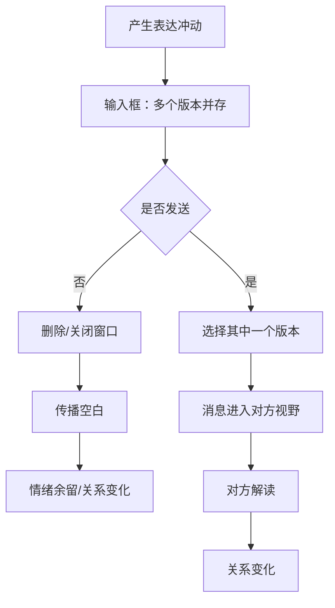

# 言说即坍塌——聊天框里那些没被发送的话

## 摘要

本文是一篇传播学随笔，讨论即时通讯中输入、删除、未发送的信息。文章提出“传播空白”概念：已发送的消息只是冰山一角，输入框里的犹豫、删除与重写，构成了看不见的传播活动。文章不使用“量子”作为物理理论，只把它当作隐喻：信息在被发送之前，处于多种可能状态；一旦发送，就“坍缩”为一种表达。文章没有数据，方法是内省与概念分析，目的是提出一个可被后续研究检验的问题。文章进一步把未发送行为分成风险删除、礼貌删除、自我保护删除与关系测试四类，讨论“正在输入”、延迟回复与沉默如何成为元信息，并给出一套可操作的实证设计：日记法、访谈法与经同意的输入日志三角验证。最后，文章讨论这一研究方向的伦理边界：输入框是用户最私密的空间，不能因为“有研究价值”就被随意读取。

## 关键词

传播空白；输入框；未发送信息；数字媒介；隐喻；人际传播

## 1 引言

传播学长期研究“已发送的信息”：谁说了什么、通过什么渠道、产生了什么效果。但数字聊天制造了一个新的空间：输入框。

在输入框里，一句话可以先被写下、再被删掉、再被改写。它没有进入传播通道，却真实地参与了思考与表达。接收者看不到它，发送者却知道它存在。

本文想讨论的，就是这些“没被发送的话”。

它们不是边角料。很多关系的转折，不是在消息发出去之后发生的，而是在输入框里发生的：一句“我们谈谈”被删成“在吗”，一句“我想你”被删成“今天好冷”，一句“我生气了”被删成一个句号。发送者以为自己在选择措辞，实际上在选择关系的温度。

### 1.1 为什么现在谈这件事

即时通讯把“说话”变成了一个可以反复编辑的动作。面对面说话没有撤回键，电话也没有草稿箱；聊天软件却有。你可以写下、删掉、再写，可以在“正在输入”里暴露自己，也可以在最后一秒关掉窗口。技术给了表达一个缓冲区，也给了沉默一个新的位置。

这个位置长期被传播学忽略。研究者习惯把“传播”定义为“信息从 A 到 B 的传递”，没发出去的信息似乎不算传播。但从发送者的角度看，未发送的信息一直在工作：它占着注意力，改变着情绪，影响着下一句真正发出去的话。它没有到达 B，却已经改变了 A。

### 1.2 文章的边界

本文不是实证研究，没有聊天记录、没有访谈、没有编码。它做的是概念分析：把“未发送”从一个模糊的感受，拆成可以命名的类型；把“输入框”从一个界面元素，拆成一个传播场景；把“沉默”从“没有传播”，拆成“另一种传播”。

文章也不打算把“量子”当成科学。它只是借“多种可能并存、发送后选择其一”这个结构做隐喻。聊天信息没有波函数，没有观测者效应，没有纠缠；把隐喻当证据，是对物理学的误用，也是对传播学的偷懒。

## 2 输入框作为传播场景

### 2.1 发送前的多重状态

在按下发送键之前，一句话有很多版本：想说的、敢说的、说得体的、说了会后悔的。它们同时存在，互相竞争。发送，就是选择其中一个版本，放弃其他版本。

还有一个常被忽略的区别：输入框里的句子不是“完整意思”，而是“为某个接收者准备的版本”。在按下发送前，发送者已经在想象对方会怎么读：这句话会不会显得太冷、太黏、太正式。所谓“想清楚再说”，很多时候不是独自想清楚，而是在心里预演一次对方的反应。未发送的文本因此不只是内心独白，它已经带上了“想象中的受众”。这也解释了为什么同一个人在不同对话窗口里会写出完全不同的话：不是人格分裂，而是接收者设计不同。

### 2.2 输入框是一个“半公共”空间

输入框既不是完全私人的日记，也不是完全公开的聊天记录。它处在一个尴尬的中间态：只有发送者能看见，但发送者知道它可能随时变成公共的。这个“可能公开”的压力，让输入框里的语言比日记更克制，比聊天记录更真实。

日记可以写“我恨他”，因为没有人会读到；聊天框里写“我恨他”，手指会停在发送键上。停住的那一秒，就是传播发生的地方：不是信息从 A 到 B，而是 A 在想象 B 的反应，并据此修改自己。

### 2.3 发送不是“表达的开始”，而是“表达的截断”

我们习惯把发送当作表达的开始：消息出去了，传播开始了。但从输入框的角度看，发送更像一次截断：它把多种可能的表达砍成一种，把“我还可以改”变成“我已经说了”。

截断有解脱感，也有失落感。解脱是因为不用再选了；失落是因为其他版本永远没有机会了。很多人发送之后会立刻后悔，不是因为他们说错了，而是因为他们意识到自己刚刚杀死了另外几句话。

### 2.4 输入框里的时间

输入框不是静止的。它有时间：光标闪烁的频率、打字的速度、停顿的长度、删除的次数。一个人打了三分钟，删了两次，最后只发“好的”，这三分钟没有被记录，却构成了“好的”的重量。

时间也改变了句子的意思。同一句“在吗”，早上发是求助，深夜发是想念；同一句“随便”，刚吵完架发是赌气，平静时发是真的随便。输入框里的时间不是背景，而是语义的一部分。研究未发送信息，不能只记录文本，还要记录它被写下的时刻、被删掉的时刻、被重新写下的时刻。

这也是数字聊天与面对面交谈的差别：面对面的话一旦出口就进入空气，数字聊天的话可以在草稿里停留很久。停留不是空白，而是加工。一个人在心里反复修改一句话，和他在输入框里反复修改一句话，心理过程可能相似；但输入框留下了可观察的痕迹：删除、停顿、重新输入。这些痕迹不读内容，也能提示“这里有过犹豫”。

### 2.5 发送键之前的“预演受众”

在按下发送前，发送者已经在想象对方会怎么读：这句话会不会显得太冷、太黏、太正式。所谓“想清楚再说”，很多时候不是独自想清楚，而是在心里预演一次对方的反应。未发送的文本因此不只是内心独白，它已经带上了“想象中的受众”。这也解释了为什么同一个人在不同对话窗口里会写出完全不同的话：不是人格分裂，而是接收者设计不同。

预演受众有一个副作用：它会让人越来越会“写给别人看”，而不是“写自己想写的”。久而久之，输入框里的第一稿可能就不是自己的话，而是“对方可能爱听的话”。未发送的，不只是句子，还有那个不会修辞的自己。

## 3 未发送的类型学

### 3.1 风险删除

第一种是风险删除：话是真的，但说出来会带来工作、关系或安全上的后果。比如对上司说“这个方案根本不可行”，对伴侣说“我已经不爱你了”，对陌生人说“我知道你住哪”。这些话不是不重要，而是太重要；不是不想说，而是说了之后的生活会更难。

风险删除的关键不是“懦弱”，而是“代价评估”。发送者在极短时间内做了一个成本—收益计算：说出来的收益是什么，代价是什么，有没有第三种说法。这个计算未必理性，但它确实发生了。

### 3.2 礼貌删除

第二种是礼貌删除：话不致命，但不符合场合对体面的要求。比如在群里想纠正一个错误，最后只发了一个“哈哈”；在饭桌上想反驳一个偏见，最后低头夹菜。礼貌删除维护了表面的和谐，也把真实的分歧留在了输入框里。

礼貌删除不一定是坏事。社会需要一些缓冲，否则每一次分歧都会变成冲突。但礼貌删除积累太多，关系会变得很轻：每个人都在说“没事”，没有人知道对方真正想什么。

### 3.3 自我保护删除

第三种是自我保护删除：不想暴露脆弱、嫉妒、依赖。比如打了“你能不能多陪我一会”，删掉，改成“你忙你的”；打了“我今天很难受”，删掉，改成“没事”。这种删除保护了自尊，也把需要藏了起来。

自我保护删除最容易被误读。接收者看到“没事”，可能真的以为没事；发送者却在心里记了一笔“你不在乎”。未发送的话没有进入聊天记录，却进入了关系的暗账。

### 3.4 关系测试

第四种是关系测试：故意不发，等对方先开口。比如明明在线却不回，看看对方会不会追问；明明想说“我想你”，却发一个无关的表情，看看对方能不能接住。关系测试把“未发送”变成一种信号：我不说，但你应该懂。

关系测试带有操纵性，但它不一定是恶意。很多时候，发送者只是不敢直接要，于是用“缺席”来试探对方是否在意。问题在于，接收者未必能解码；未被理解的测试，会变成双方的失望。

**表 1 未发送行为的四种类型**

| 类型 | 动机 | 典型例子 | 关系后果 |
|---|---|---|---|
| 风险删除 | 避免代价 | 不敢对上司说真话 | 压抑、疏远 |
| 礼貌删除 | 维持体面 | 群里不纠正错误 | 表面和谐、真实分歧消失 |
| 自我保护删除 | 保护自尊 | “没事”替代“我难受” | 需要被藏、暗账积累 |
| 关系测试 | 试探在意 | 在线不回、发无关表情 | 误解、失望、权力游戏 |

### 3.5 四种类型的边界

四种类型不是互斥的。同一次删除可能同时是风险删除和自我保护删除；同一次沉默可能既是礼貌，也是测试。分类的价值不是给每个行为贴标签，而是让发送者看见自己正在做什么。

看见之后，选择会多一点。你可以继续删，但知道自己为什么删；你也可以换一种说法，把风险降低，把需要说出一点。未发送的话不会因此消失，但它不再完全控制你。

## 4 “正在输入”、延迟与沉默

### 4.1 “正在输入”是一种元信息

“正在输入…”出现又消失，却没有消息，接收者会意识到：对方写了什么，又删了。这个信号本身，就是一种传播。它传递的不是内容，而是“我有话想说，但没说出来”。

“正在输入”之所以有效，是因为它把传播的“过程”暴露了一小段。传统聊天只显示结果：发了什么；输入状态显示的是“正在准备结果”。接收者看到的不是一个字符，而是一个未完成的动作。这个动作可能持续几秒，也可能反复出现又消失。它的意义高度不确定：对方可能在写长句，也可能打了又删，还可能只是误触。正是这种不确定，让接收者自动补全故事。平台并没有传递内容，却传递了“内容正在形成”的元信息。

### 4.2 延迟回复

延迟回复是另一种未发送。消息已经发出，但回复被推迟；推迟的每一分钟都在传递东西：我在忙、我在生气、我在斟酌、我不想理你。延迟没有内容，却有节奏；节奏本身可以被解读。

延迟的危险在于，它把解释权交给了接收者。发送者可能真的在忙，接收者却可能读出“你不在乎”。同一个延迟，在不同关系里有不同的含义；没有元沟通，延迟就会变成猜谜。

### 4.3 沉默与未发送的区别

不回复、延迟回复、只回表情，都是传播。它们与“未发送”不同：未发送是“没有进入通道”，沉默是“进入通道但没有内容”。两者都会影响关系，但机制不同。

未发送是发送者内部的截断；沉默是发送者对外部的拒绝。前者留下的是“我差点说了”，后者留下的是“你为什么不理我”。把它们混为一谈，就会把所有的沉默都解释成“有话没说”，也会把所有的未发送都解释成“冷暴力”。

## 5 一个可做的实证设计

### 5.1 研究单位

如果要把“传播空白”做成实证研究，研究单位不应是“某条消息”，而应是“一次未发送事件”：从产生冲动，到编辑，到删除或发送。一次事件至少包含五个节点：冲动、草稿、修改、裁决、后果。

### 5.2 三层材料

最少需要三层材料：

1. **发送者的即时记录**：记下“想发什么、为什么没发、最后发了什么”。可以用结构化日记，每天固定时间回填，减少事后叙事。
2. **事后的访谈**：让当事人解释当时的风险评估、关系判断与情绪。访谈要询问“如果发了会怎样”，而不只是“为什么没发”。
3. **经明确同意的输入行为日志**：用来核对“记得的”和“实际发生的”有多大差距。日志必须最小必要、可撤回，不能记录无关对话。

### 5.3 编码框架

编码可以分四层：动机（风险、礼貌、自我保护、测试）、对象（亲密关系、工作、陌生人）、关系类型（权力高低、依赖程度）、后果（松了一口气、后悔、关系变化）。四层编码让“未发送”从一句感受，变成可比较的数据。

### 5.4 可检验的假设

至少可以提出三个假设：

- H1：关系越不对等，风险删除的比例越高。
- H2：自我保护删除越多，关系满意度越低，但短期冲突越少。
- H3：“正在输入”出现后没有消息，接收者的不确定感显著高于直接沉默。

这些假设不一定成立，但它们可以被数据推翻。一个概念分析能做到这一步，就从随笔变成了研究纲领。

### 5.5 反例与负结果

好的研究设计要给“没有传播空白”留位置。有些人确实想到什么就说什么，删除很少；有些关系确实不需要缓冲，直接表达也不会出事。如果研究只挑“犹豫很多”的人，就会把一种特殊状态当成普遍状态。

因此，采样要包括低犹豫者；编码要记录“没有删除”的事件；分析要问“为什么这里没有空白”，而不只是“为什么这里有空”。负结果不是失败，它能让概念站稳：如果所有人都在删除，那删除就不是个体差异，而是媒介结构；如果只有一部分人在删除，那删除就与关系、性格、场景有关。

### 5.6 不要量化“真心”

实证研究容易滑向一个危险结论：删除越少，人越真诚；删除越多，人越虚伪。这个结论既不公平，也不成立。删除可能是礼貌，可能是保护，可能是权力压迫下的自保。用删除次数给“真心”打分，是把复杂的关系压成一个道德指标。

研究可以量化行为，但不能量化真心。它可以问“在什么条件下，人更可能删除”，不能问“谁更爱谁”。前者是可检验的传播问题，后者是无法用日志回答的私人问题。

## 6 关系与权力

### 6.1 谁有资格不发送

未发送不是中性的。权力高的人可以不回，权力低的人不敢不回；权力高的人可以“已读不回”，权力低的人会把“正在输入”当成希望。同一个沉默，在不同的位置上，含义完全不同。

这也是为什么“传播空白”不能只从个体心理研究。它同时是关系结构的问题：谁拥有退出的权利，谁承担解释的义务，谁必须随时在线。把这些结构忽略，就会把“未发送”写成个人性格，而看不到它背后的权力。

### 6.2 未发送的性别与阶层

不同性别、阶层、年龄的人，面对同一句话，删除的理由可能不同。有人担心“太强势”，有人担心“太冷漠”，有人担心“说了也没人听”。这些担心不是天生的，而是长期社会化的结果。

本文没有数据去证明这些差异，但它提醒后来的研究：不要把“发送者的犹豫”当成同质的心理现象。犹豫有社会形状。

### 6.3 未发送与亲密关系

亲密关系里，未发送的话最多。因为亲密关系给了人最大的表达欲望，也给了人最大的暴露风险。你越在意一个人，越可能删掉“我想你”，改成“你在干嘛”；越可能删掉“我很难过”，改成“我没事”。

这不是虚伪，而是脆弱。未发送的话，是亲密关系里没有被接住的部分。它们不会消失，只会变成下一次争吵的素材，或者下一次沉默的理由。

### 6.4 群聊里的未发送

群聊把“未发送”放大了一个量级。一对一聊天里，你只需要面对一个人；群聊里，你要面对一群人，而且这群人还有不同的权力位置。你想纠正一个错误，但担心让领导难堪；你想支持一个人，但担心被看成站队；你想开玩笑，但担心冷场。于是你打了字，又删掉，最后发一个表情。

群聊里的未发送，往往不是“没有话说”，而是“话太多，不知道对谁说”。同一个群，有人在积极发言，有人在长期潜水；潜水不等于没有意见，可能只是意见的发言成本太高。表面上看，群聊很热闹；实际上，很多成员在用沉默支付“合群”的费用。

群聊还制造了一种“半公开的未发送”：你可以在小窗里对一个人说真话，然后在群里说套话。两套话同时存在，前者是关系，后者是秩序。未发送的话没有消失，它转移到了另一个窗口。

## 7 伦理边界

### 7.1 输入框是私密空间

研究“未发送信息”很容易侵犯隐私：输入框里的内容，是用户最私密的部分。任何研究都应遵循知情同意、最小必要、可撤回。不能因为“有研究价值”就读取用户的草稿。

### 7.2 不要用“未发送”推断他人

读者可能会用这篇文章去分析身边的人：“他正在输入又不发，一定是在乎我”“她已读不回，一定是在试探”。这种推断很危险。未发送是发送者的内部状态，接收者没有权限直接读取；把猜测当成事实，会把关系变成侦探游戏。

### 7.3 研究者与平台的责任

平台可以看到输入行为日志，但“能看到”不等于“应该看”。平台应把输入内容排除在默认分析之外，只保留必要的聚合指标；研究者应把日志限制在同意范围内，不把私人对话变成论文素材。

## 8 研究局限

第一，文章是概念分析，没有实证数据。第二，没有采集聊天记录或输入行为日志。第三，没有讨论不同关系类型（亲密、工作、陌生人）的差异。第四，没有控制平台、年龄、文化的差异。第五，文章不构成对任何个体的隐私推断。第六，文章为概念随笔，不构成传播效果结论。第七，“量子”只是隐喻，不是物理模型；任何把文章读成“量子传播学”的解释，都超出了本文的范围。

### 8.1 一个更小的研究起点

如果读者真的想研究“传播空白”，不必一上来就做大规模日志。可以从一个更小的起点开始：连续七天，每天记录一次“我删掉了什么”。只记录三件事：想发什么、为什么没发、最后发了什么。七天之后，你会得到一份很小的样本，但它足以让你看见自己的模式。

这个练习的价值不在数据量，而在“看见”。很多人以为自己“想说什么就说什么”，记录之后才发现，自己每天都在删。看见之后，可以选择继续删，也可以选择换一种说法；重要的是，从“自动删除”变成“有意识的删除”。

如果要做成研究，再把这份记录扩展成访谈、编码与对照。不要跳过小样本，直接去读别人的聊天记录；那既不伦理，也不科学。

## 9 结论

聊天记录很短，输入框却很长。每一条发送的消息背后，可能有好几条没发送的句子。它们没有留下痕迹，却参与了关系的走向。

传播学如果只研究“已发生”的传播，就会漏掉“未发生”的传播。把输入框纳入视野，不是为了窥探隐私，而是为了理解：人如何在开口之前，就已经在交流。

言说即坍塌。发送让一句话成为事实，也让其他可能成为沉默。我们无法把每一句未发送的话都说出来，但可以承认它们存在：在“正在输入”里，在删掉的草稿里，在那句最终变成“没事”的“我很难过”里。承认之后，也许下一次，我们能多说一点点，也能在说之前，少删掉一点自己；这不是要人停止思考，而是让思考有机会被听见。这并不浪漫，但很真实，也很值得；记住这一点，就足够让我们对输入框多一点耐心。

## 参考文献

[1] Goffman E. *The Presentation of Self in Everyday Life*. New York: Doubleday, 1959.

[2] Petronio S. *Boundaries of Privacy: Dialectics of Disclosure*. Albany: State University of New York Press, 2002.

[3] Walther J B. Computer-mediated communication: Impersonal, interpersonal, and hyperpersonal interaction. *Communication Research*, 1996, 23(1): 3–43.

[4] Turkle S. *Alone Together: Why We Expect More from Technology and Less from Each Other*. New York: Basic Books, 2011.

[5] boyd d, Ellison N B. Social network sites: Definition, history, and scholarship. *Journal of Computer-Mediated Communication*, 2007, 13(1): 210–230.
