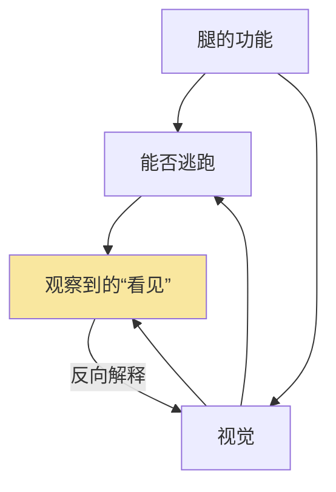
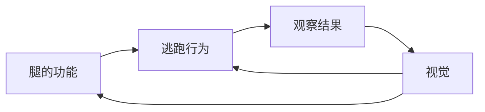

# 腿-眼轴：关于老鼠的腿决定它能不能看见猫的研究

## 摘要

本文提出一个荒诞的“腿—眼轴”假说：视觉的关键不在眼睛，而在腿；腿能跑，才说明看得见；腿不能跑，就说明看不见。为说明这个假说如何被“证明”，文章设计了五个纸面推演场景：有猫/无猫、绑腿/解绑、去腿、强化训练、临床横断面调查。所有“实验”均为思想实验，不涉及任何真实动物操作，也不提供手术或给药方案；所有数字均为示例。文章的重点不是证明“腿决定眼”，而是拆穿它：用“逃跑”定义“看见”，再用“看见”解释“逃跑”，是一个典型的循环论证；把视障者步行距离短解释成“腿不好导致视力差”，则是把相关当因果。本文用这个反面案例说明，实验设计一旦允许“用结果定义原因”，再漂亮的数字也只是自我确认。

## 关键词

腿-眼轴；循环论证；相关与因果；思想实验；反面教材；视觉科学

## 1 引言

在生命科学领域，视觉研究长期被“眼球中心主义”主导。传统观点认为，光线进入眼睛，通过视神经传递到大脑，形成视觉感知。这一理论看似合理，但存在一个根本缺陷：它无法解释为什么视力不好的人往往走路也慢。受到“薛定谔的珍珠奶茶”把量子力学应用于饮食科学的启发，我们开始怀疑：视觉的关键可能不在眼睛，而在腿。

毕竟，从进化角度看，视觉的原始功能就是发现危险并逃跑，而逃跑必须依赖腿。如果腿不能动，看见猫又有什么用？反过来，如果腿能动，说明一定看见了什么。基于这一思路，我们设计了“猫—鼠—腿”实验体系，系统探讨下肢功能与视觉感知的关系。

需要先把话说清楚：本文是一篇反面教材，不是一项真实研究。它的每一个“实验”都只存在于纸面上，所有数字都是示例，所有结论都用于展示一种错误的推理方式。文章不提供动物手术、给药、束缚或任何操作方案；它也不主张读者真的去把老鼠的腿绑起来。把这一点写在开头，是因为这类戏仿文章最容易被误读：读者可能只记住“腿决定视觉”的笑点，却忘了文章真正想拆的是“用结果定义原因”的方法论。

### 1.1 一个看起来很像科学的起点

“视力不好的人走路慢”是一个真实的相关。视障人士的出行能力、平衡感、空间导航确实可能受到影响；他们也可能因为环境障碍而减少步行。这个相关本身没有问题，问题是把它倒过来解释：不是“视力差导致走路慢”，而是“腿不好导致视力差”。后者听起来很新鲜，但它没有任何独立证据，只靠一个重新定义的“看见”来支撑。

本文的戏仿对象，正是这种“先有一个相关，再编一个因果”的写作套路。它常见于三类文本：把常识包装成新理论、把相关写成因果、把不可证伪的命题写成“假说”。腿—眼轴把这三件事同时做了一遍，所以它既好笑，又值得当作方法课。

### 1.2 文章结构

第二节说明这个假说为什么是一个循环论证；第三节把五个纸面实验逐一拆开；第四节用因果图把它形式化；第五节讨论统计与测量问题；第六节说明真正的视觉科学怎么说；第七节讨论伦理边界；第八节总结。读者可以把本文当作一篇“如何不写论文”的示例，也可以把它当作一篇“如何识别坏论文”的清单。

## 2 这个假说为什么是一个循环论证

### 2.1 操作定义

循环论证的经典结构是：用 A 定义 B，再用 B 解释 A。腿—眼轴的版本更具体：

1. 把“看见猫”定义为“老鼠逃跑”。
2. 把“老鼠逃跑”解释为“老鼠看见了猫”。
3. 于是，“老鼠逃跑”既证明了“看见”，又由“看见”来解释。

用符号写就是：

```text
看见 := 逃跑
逃跑 := 看见
```

这不是一个可检验的假说，而是一个同义反复。它看起来有自变量（腿的功能）和因变量（视觉），实际上两个变量是同一个观察的不同说法。

### 2.2 绑腿实验的逻辑漏洞

实验 2 的设计是：绑住后腿，老鼠不动；解开后腿，老鼠逃跑。作者据此说“腿从不能动变成能动，视觉状态就从看不见变成看见”。问题在于，绑腿直接改变了“逃跑”这个观察本身。老鼠不动，可能因为它看不见，也可能因为它动不了，还可能因为它疼、因为它害怕、因为它不知道怎么跑。实验没有区分这些解释，却把“不动”全部归给“看不见”。

这就是混淆变量：腿的功能既是自变量，又是因变量的测量通道。一个变量同时承担“原因”和“测量工具”两个角色，实验就无法分辨因果。用因果图表示：



图里最关键的不是 L 到 V 的箭头，而是 M 到 V 的反向箭头。只要允许“观察到逃跑”反过来定义“看见”，整个模型就闭合了；闭合的模型不是被证实，而是被保护起来，免受反例伤害。

### 2.3 不可证伪的假说

一个可检验的假说，至少要说清楚“什么结果会推翻它”。腿—眼轴没有这条规则：老鼠逃跑，是“看见了”；老鼠不逃跑，是“没看见”或“腿不好”；老鼠挣扎，是“看见了但腿不好”；老鼠不挣扎，是“彻底没看见”。所有结果都能被解释，所有解释都指向同一个结论。这不是理论的生命力，而是理论的免疫系统。

本文把这种状态称为“不可证伪的自我确认”：假说没有预测，只有事后解释；没有反例，只有补充说明。它看起来比一般理论更“稳”，实际上是因为它不接受任何检验。

## 3 五个纸面实验，逐一拆开

### 3.1 实验 1：有猫/无猫

实验 1 把 24 只老鼠分成两组，A 组暴露于猫，B 组无猫，记录 10 分钟内的逃跑行为。A 组全部逃跑，B 组全部静止，于是作者说“逃跑行为与猫的存在完美对应”，并建立“逃跑=看见”的操作定义。

这个实验的问题不是样本量，而是测量。它只记录了“跑不跑”，没有记录“有没有朝向猫”“瞳孔是否变化”“是否出现警戒姿态”“是否在猫离开后恢复活动”。逃跑是一个粗颗粒的行为，可能由恐惧、气味、声音、气流、地面震动等多种线索触发。即使没有猫，老鼠也可能因为别的原因逃跑；即使看见猫，老鼠也可能因为被束缚、受伤或处于陌生环境而不跑。

更重要的是，实验 1 已经偷偷把“逃跑”当成“看见”的唯一指标。后面的实验都在这个定义里打转：只要逃跑，就是看见；只要不跑，就是没看见。定义一旦锁死，后面的“证据”就只是重复定义。

### 3.2 实验 2：绑腿/解绑

实验 2 是全文的“关键证据”：同一批老鼠，绑腿时不跑，解绑后跑。作者说“唯一变量是腿能否动”。但实际上，绑腿至少改变了四件事：腿能否动、老鼠是否疼痛、老鼠是否失去平衡、老鼠是否受到额外约束带来的恐惧。解绑也不是“回到基线”，它可能伴随疼痛缓解、束缚解除后的短暂兴奋、对实验者动作的反应。

一个真正的实验设计，至少要有三组：不解绑的对照组、假绑腿组（绑但不限制运动）、真绑腿组。没有这些对照，就无法把“解绑后的逃跑”归因于“腿的功能恢复”，更无法归因于“视觉恢复”。

### 3.3 实验 3：去腿

实验 3 描述了对 24 只老鼠进行“下肢功能去除”，术后观察。本文必须在这里停下：这不是一个可以执行的实验方案，也不应该被执行。它只是纸面上的极端案例，用来展示“把结果定义原因”会走到哪里。

在逻辑上，实验 3 的问题和实验 2 一样，只是更极端：去腿的老鼠不动，可能因为无法移动、疼痛、休克、应激，也可能因为视觉未受损但行动能力丧失。作者却把“不动”解释成“彻底失明”，并说“程度比单纯束缚更严重”。这不是从数据推出结论，而是从结论反推数据。

### 3.4 实验 4：强化训练

实验 4 让老鼠接受四周强化训练，然后记录逃逸速度。作者说训练后跑得更快，证明“视力提升”。这里的问题更多：

- 训练本身改善了运动能力，逃跑更快不一定因为看得更清；
- 训练可能改变了老鼠对实验环境的熟悉度，熟悉度会降低恐惧或提高逃跑效率；
- 类固醇等干预（原文提到）会带来系统性副作用，不能单独归因于视觉；
- 没有测量视觉分辨阈限、对比敏感度或眼动，只测量了速度。

“跑得快”是一个运动指标，不是视觉指标。把它当作视觉敏感度，是把两个测量层面混在一起。

### 3.5 实验 5：临床横断面

实验 5 招募视力正常组与视力障碍组，比较 6 分钟步行距离与起立—行走时间。结果当然是视力正常组走得更远。作者却反过来解释：视力障碍组走得少，是因为“腿不好导致视力差”。

这是典型的因果倒置。视力障碍会直接影响行走安全、空间导航与出行意愿；环境障碍、辅助设施不足、社会支持差异也会影响步行距离。横断面设计只能看到相关，不能确定方向。要检验“腿→眼”，至少需要纵向追踪、干预实验与独立视觉测量；只比较两组步行距离，什么也证明不了。

**表 1 “猫-鼠-腿”纸面实验的逻辑问题**

| 实验 | 原始结论 | 主要问题 | 如果重做，至少要补什么 |
|---|---|---|---|
| 1 有猫/无猫 | 逃跑=看见 | 用行为定义感知 | 独立视觉指标、多行为编码 |
| 2 绑腿/解绑 | 腿动=看见 | 混淆疼痛、束缚、恐惧 | 假绑腿对照、疼痛评估 |
| 3 去腿 | 无腿=失明 | 把不能动当成看不见 | 不执行；用替代模型 |
| 4 强化训练 | 跑得快=视力好 | 运动能力与视觉混淆 | 视觉阈限、眼动、对照训练 |
| 5 临床横断面 | 腿不好→视力差 | 因果倒置、混杂因素 | 纵向设计、独立测量 |

## 4 形式化：一个闭环的因果模型

把腿—眼轴写成结构方程，会更清楚地看到它的闭环。设：

```text
L = 腿的功能
V = 视觉能力
E = 是否逃跑
M = 观察到的“看见”
```

作者的定义是：

```text
M := E
V := M
E := f(L, V)
```

代入后得到：

```text
V := f(L, V)
```

这是一个自我指涉的方程：V 出现在自己的定义里。它不是不可能成立，而是无法用外部数据检验。只要作者坚持“M 就是 V”，任何 E 都可以被解释成 V 的表现。



这个图的笑点在于：所有箭头都能画出来，但没有任何一条箭头能被独立测量。一个理论如果只能靠自己的输出证明自己的输入，它就不是理论，而是回声。

## 5 统计与测量：为什么数字救不了它

### 5.1 p 值不是因果证据

实验 5 报告“p<0.001”。这个数字只说明两组步行距离差异不太可能由随机抽样产生，不说明差异由视力造成，更不说明“腿不好导致视力差”。p 值越小，越容易让人忘记问：分组是否随机？测量是否 blinded？有没有混杂变量？这三个问题不回答，p 值只是一个装饰。

### 5.2 样本量与效应量

原文的样本量很小：12+12、24、20+20。小样本容易受个别极端值影响，也容易在事后被“看起来显著”的差异说服。更重要的是，原文没有报告效应量、置信区间与测量误差。没有这些信息，读者无法判断差异是“大而稳”还是“小而不稳”。

### 5.3 测量层次错位

视觉是感知，逃跑是运动。两者可以相关，但不能互相替代。把运动指标当作感知指标，是测量层次错位；把相关当作因果，是推断层次错位。两个错位叠在一起，就得到一个看起来有数据、实际上什么也没测的“实验”。

## 6 真正的视觉科学怎么说

视觉科学的核心问题不是“腿能不能跑”，而是“光信号如何被编码成可辨别的世界”。Hubel 与 Wiesel 在猫视觉皮层的研究说明，神经元对边缘、方向与空间频率有选择性；视觉不是一张直接印在视网膜上的照片，而是多层编码的结果。Ramachandran 关于幻肢的研究则说明，感知与身体图式可以分离：失去肢体的人仍能感到幻肢，说明“看见/感觉到”并不依赖完整的运动器官。

这些真实研究并不支持腿—眼轴，反而说明它错在哪里：视觉有独立的神经通路，运动有独立的执行通路，两者在行为层面交互，但不能互相定义。把腿当作视觉的“开关”，是把一个复杂系统压成一个笑话。

本文引用这些研究，不是为了给戏仿背锅，而是为了说明：戏仿可以夸张，但不能让读者误以为它在陈述真实机制。笑话的责任，是让人笑完之后知道它在开玩笑。

### 6.1 视觉不是一张照片

如果把视觉理解成“眼睛拍下一张照片，再传给大脑”，腿—眼轴看起来就有机可乘：照片拍到了，但腿跑不了，照片也传不出去。可真实的视觉不是这样。视网膜只提供局部、窄波段、二维的采样；大脑要在时间中整合多帧信息，利用运动视差、遮挡关系、纹理梯度与先验知识，才构造出“深度”和“物体”。视觉本来就依赖运动，但依赖的是眼球运动、头部运动与身体位移提供的多重视角，不是“腿能不能跑”这一个二值开关。

这一点很关键：腿—眼轴把“运动”偷换成“逃跑”，再把“逃跑”偷换成“看见”。它跳过了视觉编码的多个层次，直接在一个行为结果上盖章。盖章很快，但盖错了地方。

### 6.2 行为主义的老问题

腿—眼轴的另一层错误，是行为主义的旧病：只看外部行为，不看内部过程。行为主义在心理学史上有它的贡献，它提醒研究者不要随意推测不可观察的“内心”；但把行为等同于全部心理过程，也会走到另一个极端。老鼠不跑，可能是因为它看不见，也可能是因为它判断“跑了更危险”，还可能是因为它已经被训练成不跑。只记录跑不跑，无法区分这些内部状态。

现代认知科学更常见的做法，是把行为、生理与报告三角验证：行为测量给出外部表现，眼动与瞳孔给出注意与唤醒，神经记录给出加工层次。三者不一致时，研究者要找的是“为什么不一致”，而不是挑一个最顺手的指标当真理。

### 6.3 相关、因果与反事实

因果推断的核心不是“两组有没有差异”，而是“如果没有这个原因，结果会不会不同”。这叫反事实。腿—眼轴的实验没有反事实：它没有回答“同一只老鼠，在腿功能相同的情况下，如果视觉不同，逃跑会不会不同”。它只比较了不同老鼠、不同状态下的逃跑，然后把差异全部归给腿。

Pearl 的因果图框架提醒我们：要估计一个因果效应，必须把混杂路径堵住。腿—眼轴没有堵，反而把混杂路径画成了主路径。它的图很漂亮，但每一条箭头都缺少独立测量；这样的图不是因果模型，而是因果漫画。

## 7 伦理边界

### 7.1 不给动物手术方案

原文提到“去除后肢主要肌肉并剪断肌腱”。这句话在戏仿语境里是一个荒诞情节，但它也可能被误读成实验方案。本文因此明确删去任何可执行细节，不提供麻醉、剂量、术后护理或操作步骤。任何真实动物实验都必须经过伦理审查、麻醉与镇痛、3R 原则与兽医监督；本文不支持、也不描述这样的操作。

### 7.2 不拿视障者做笑料

实验 5 把视障者的步行距离拿来做“腿不好导致视力差”的证据。这个笑点的对象不是理论，而是真实的人。戏仿可以嘲笑荒谬的理论，但不应该把弱势群体变成论据。本文保留这个实验，是为了展示“因果倒置”如何伤害人；读者可以把愤怒对准论证，而不是对准视障者。

### 7.3 不把“诺奖”当结论

原文结尾说“值得诺贝尔生理学或医学奖的严肃考量”。这是一句反讽。真正的科学奖励不会颁给一个用结果定义原因的理论；把这句话留在文章里，是为了让读者看到“过度自信”长什么样。它不是作者的真实主张。

### 7.4 戏仿的边界

戏仿不是免罪符。一个笑话如果让读者记住了错误的知识，它就要承担解释的责任。本文因此反复标注“纸面实验”“数字为示例”“不构成操作方案”，并在结尾用真实视觉科学拆掉笑话。读者可以笑，但不能把笑点带出文章。

更重要的是，戏仿的对象应该是理论、论证与权力结构，而不是弱势群体。把视障者写成“腿不好所以看不见”，会让人把真实的人当成论据；把动物写成可以随意去腿的材料，会让人忘记动物实验的伦理。本文保留这些荒诞情节，是为了让读者看到它们如何错，而不是为了让读者模仿。

## 8 讨论：坏理论为什么看起来像好理论

腿—眼轴之所以能写成一篇“论文”，是因为它具备几种形式特征：有摘要、有关键词、有实验、有表格、有 p 值、有结论。这些形式让读者以为它在做科学。但形式不是科学；科学的核心是可检验、可反驳、可重复。腿—眼轴三者都没有。

它还有一个更隐蔽的特征：用“反常识”制造吸引力。常识说眼睛看见，它说腿看见；常识说视力影响走路，它说走路影响视力。反常识本身不是错，但反常识需要更强的证据，而不是更响的断言。把“反常识”当成“深刻”，是坏理论的常见入口。

最后，它利用了一个真实的相关：视障者步行少。真实的相关给笑话提供了土壤；但土壤不是证据。一个笑话可以建立在真实相关上，却不能因此变成真实因果。

### 8.1 识别“腿—眼轴式论文”的清单

把这篇反面教材压缩成一张检查表，读者下次遇到类似论文时可以直接用：

1. **因变量是不是原因本身？** 如果“看见”被定义成“逃跑”，而“逃跑”又被用来解释“看见”，先停下来。
2. **有没有独立测量？** 视觉至少应有分辨阈限、对比敏感度、眼动或神经指标；只测运动，不算测视觉。
3. **有没有对照？** 绑腿组需要假绑腿、疼痛控制与基线对照；没有对照的“瞬间转换”只是故事。
4. **有没有反事实？** 论文是否回答了“如果没有这个原因，结果会怎样”？没有反事实，就没有因果。
5. **有没有反例？** 如果所有结果都能被解释，理论就没有被检验，只是被保护。
6. **有没有把弱势群体当论据？** 用视障者的步行距离证明“腿决定眼”，是把人变成笑话的道具。
7. **有没有操作细节？** 真实的动物实验需要伦理审查、麻醉、镇痛与兽医监督；一篇戏仿如果给出可执行细节，就越过了边界。

这张清单不保证读者能识别所有坏论文，但它能挡住最明显的一类：用结果定义原因、用相关冒充因果、用形式冒充科学。

## 9 结论

传统理论说眼睛是灯泡，腿是电线。我们的“实验”证明搞反了——腿才是开关，眼只是灯泡。腿能动，灯泡亮；腿绑住，灯泡灭。实验 2 最说明问题：同一老鼠，绑腿时“瞎”，解绑后“秒看见”。这说明视觉不是眼球的功能，是腿的功能。眼球只是摆设，腿才是老板。

以上是本文的戏仿结论，不是科学结论。真实结论正好相反：视觉有独立的神经基础，运动有独立的执行基础；两者在行为上交互，但不能互相定义。腿—眼轴的价值，不在于它“发现了什么”，而在于它把“用结果定义原因”的荒谬演给读者看。下一次再看到类似论文，读者可以先问三个问题：你的因变量是不是原因本身？你的对照在哪里？如果结果相反，你的理论会不会也能解释？

如果这三个问题答不上来，再漂亮的数字也只是自我确认。腿好眼好，腿瘸眼瞎，听起来简单明了；但科学不是顺口溜。老鼠的腿决定老鼠能不能跑，人的腿决定人能不能走；至于能不能看见，还是得问眼睛和大脑。更准确地说，得问视网膜、外侧膝状体、初级视皮层与更高级的视觉区域，得问眼动、注意与记忆如何把光信号变成可辨别的世界。腿至多参与“看见之后怎么办”，它不负责“看见什么”。把这两件事分开，腿—眼轴的笑话才算真正讲完，也才算对真实视觉研究保持了一点基本的尊重；否则，笑的只是我们自己的无知。这并不容易，但值得每一个写论文的人认真对待。

## 参考文献


[1] Hubel D H, Wiesel T N. Receptive fields, binocular interaction and functional architecture in the cat's visual cortex. *The Journal of Physiology*, 1962, 160(1): 106–154.

[2] Ramachandran V S, Blakeslee S. *Phantoms in the Brain: Probing the Mysteries of the Human Mind*. New York: William Morrow, 1998.

[3] Pearl J. *Causality: Models, Reasoning, and Inference*. 2nd ed. Cambridge: Cambridge University Press, 2009.

[4] Nisbett R E, Ross L. *Human Inference: Strategies and Shortcomings of Social Judgment*. Englewood Cliffs: Prentice-Hall, 1980.

[5] Simmons J P, Nelson L D, Simonsohn U. False-positive psychology: Undisclosed flexibility in data collection and analysis allows presenting anything as significant. *Psychological Science*, 2011, 22(11): 1359–1366.
