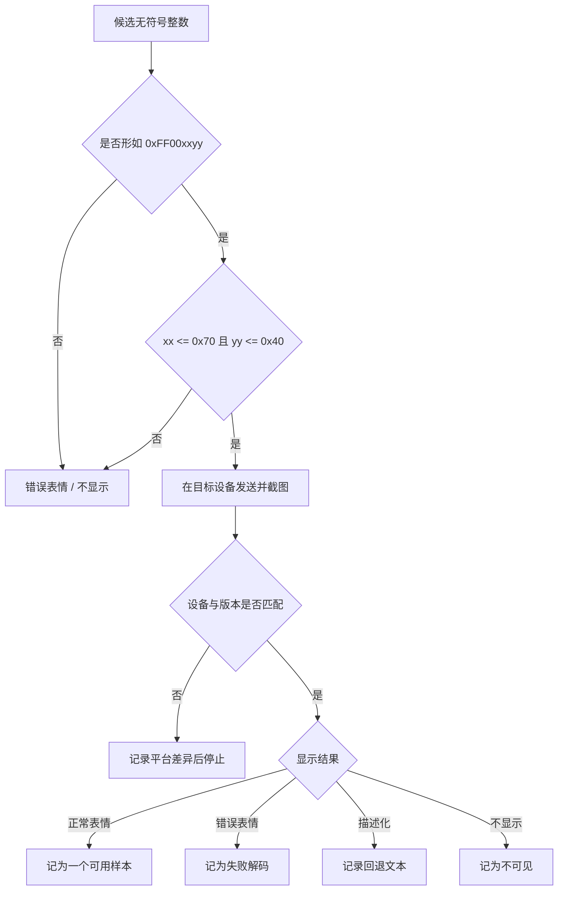

# QQ 神秘小表情发送研究

## 摘要

本文记录 QQ 客户端中一类不在表情面板内、却可由特定 Unicode 码位区间召唤的“神秘小表情”。文章不把它写成“隐藏表情大全”，而是把它当作一次平台考古：先给出触发条件的可操作描述——候选整数需落在 `0xFF00xxyy` 形式内，`xx` 与 `yy` 分别受区间约束；再归纳它在不同设备、版本与发送强度下的显示性质，包括仅安卓端可见、错误表情形态、描述化显示、头像碎片与批量发送时的客户端卡顿。本文属于客户端行为的技术记录，不主张这些码位具有官方定义，也不把“能召唤”等同于“应使用”。文章最后讨论版本依赖、平台差异、群聊骚扰边界与可复核的最小实验步骤，并给出一个可被后续观察推翻的临时模型：这些字符更像是旧字体表、私有区映射与客户端回退机制叠在一起留下的缝，而不是一套被设计出来的表情系统。

## 关键词

QQ；Unicode；表情渲染；客户端行为；平台考古；技术记录

## 1 引言

每一个长期运行的聊天软件里，都会留下一些工程师没有打算让用户看见的东西。它们可能是一个失效的入口、一段没有删干净的旧代码，也可能是一组不在面板里、却仍然能被字体和渲染器认出来的字符。本文研究的“神秘小表情”属于最后一类：它们不占表情面板的位置，不触发任何常规的收藏或举报流程，却可以通过一段精心构造的文本被召唤出来。

围绕这批表情，社群里流传着各种说法。有人说它们是“QQ 隐藏表情”，有人说发送之后会被封号，还有人把它和“你冲 Q 币吗”之类的老梗绑在一起。传说越多，可复核的事实反而越少。本文想做的，是把传说拆成可以重复的观察：在什么版本、什么设备、什么输入方式下，哪个码位会显示成什么；哪些结论只是社群记忆，哪些结论能在一次最小实验里被验证或推翻。

文章的贡献有三点。第一，给出神秘表情的可操作触发描述，把“神秘”压缩成一条可以检验的候选规则。第二，归纳它的显示性质，包括平台差异、错误表情、描述化回退、头像碎片与批量发送的副作用。第三，把它放回平台文化与群聊互动的语境里，讨论“能召唤”与“该不该用”之间的边界。文章不提供“表情大全”，也不鼓励读者去骚扰任何人；它提供的是一份带版本号的观察记录。

需要先说明边界：这是一份客户端行为的技术记录，不是对 QQ 内部实现的逆向工程报告，也不主张这些码位具有官方定义。下文所说的“能召唤”，只表示在笔者观察到的版本与设备上可复现，不表示它“应该被使用”。如果某一天版本更新让所有现象消失，这篇文章不会因此变成谎言；它只会变成一份关于某个旧版本的考古报告。

## 2 概念边界：什么算“神秘小表情”

### 2.1 不是面板里的 emoji

日常所说的“表情”，通常指表情面板里可以点选、可以收藏、可以搜索的 emoji 或贴纸。它们有名称、有分类、有官方或半官方的语义。本文的对象不是这些。它更像一段“没有被登记”的字符资源：你无法从面板里找到它，只能通过输入特定的文本把它召唤出来；它显示出来之后，也未必有一个稳定的名称。

因此，本文使用“神秘小表情”这个工作称呼，而不是“隐藏表情”。前者描述的是一种观察状态：它不在常规入口里，显示结果又像表情；后者暗示它一定属于某个官方表情集合，而本文没有证据支持这一点。

### 2.2 与 Unicode 私有区的关系

从形式上看，这些候选值落在 Unicode 的私有使用区附近。私有区本来就不是给某一个厂商的公开字符准备的，而是留给字体、输入法、旧系统或特定应用自行映射。不同字体可以把同一个私有码位画成完全不同的东西，甚至什么都不画。这个结构决定了三件事：

1. 同一个整数在不同设备上可能显示成不同图形；
2. 同一个图形也可能对应多个整数；
3. 没有一份“官方名称表”可以告诉你它到底是什么。

这三点是理解后文所有异常的前提。把它们忽略，就会把“某台手机上能显示”误写成“这个字符本来就是那个表情”。

### 2.3 与“错误表情”的区别

在观察中，有一类结果会显示成眼睛是 ×、嘴巴是波浪线的圆脸。它通常表示渲染器认出了“这里应该有一个表情”，但没有拿到可用的图形。本文把它称为“错误表情”，并与“正常表情”“描述化显示”“不显示”分开记录。这个区分很重要：错误表情说明候选值进入了某条渲染路径，却不说明它是一枚可用的表情；它更像一次失败的解码，而不是一次成功的召唤。

### 2.4 观察单位

本文把每一次“输入—发送—显示”记为一个观察单位，并记录以下变量：设备型号、安卓版本、QQ 版本、输入法、候选字符、发送数量、显示结果、是否可重复。只有这些变量一起记录，某个结论才有意义。否则，“我这边能显示”只是一句无法复核的群聊发言。

## 3 方法：在自用群里做最小实验

### 3.1 观察对象与范围

观察对象是 QQ 安卓客户端中一类不在表情面板内、但可由特定无符号整数区间召唤的字符资源。观察材料来自笔者在自用群聊中的逐条发送记录、客户端截图与显示结果；没有抓取客户端安装包，也没有读取账号数据。样本只覆盖笔者能够接触到的安卓设备与 QQ 版本，不能外推到 iOS、桌面端或全部版本。

选择自用群而不是公开群，是伦理上的硬约束。公开群里的成员没有同意参与一场“表情实验”，批量发送造成的卡顿会直接打断别人的聊天。本文的所有观察都以“不影响他人”为前提；一旦出现成员不适、消息无法加载或客户端明显卡顿，实验立即停止。

### 3.2 触发规则的形式化描述

一个无符号整数生成一个非错误表情的一个比较紧的必要条件是：它形如 `0xFF00xxyy`，其中 `xx` 这个十六进制数小于等于 `0x70`，`yy` 小于等于 `0x40`，且二者都大于等于 0。用公式写就是：

```text
c = 0xFF000000 + (xx << 8) + yy
0 <= xx <= 0x70
0 <= yy <= 0x40
```

在样本记录中，每四行为一个系列，第四行只有一个字符；每个系列的 `xx` 相同，按阅读顺序，`yy` 遍历 1–40。这个“四行一系列”的排布不是官方协议，而是观察到的输入习惯：它让同一组候选值在聊天框里形成一个可比较的块，方便逐行截图。

例如，下面这个表情可以用 `<$ÿĀ ꅄꄈ >` 召唤，对应的无符号整数值为 `0xFF004408`。这个例子只用于说明计算关系，不构成“推荐使用”的清单。

这里的“必要条件”只在观察样本内成立，不能被写成充分条件：`0xFF00xxyy` 区间内仍可能落出错误表情，客户端版本变化也会让同一数值的渲染结果改变。本文因此把规则表述为“可操作的筛选条件”，而不是“协议规范”。



### 3.3 最小复核步骤

为了让读者能判断本文结论是否仍成立，下面给出最小复核步骤；它只在自用、已获得所有参与者同意的小群里进行，不用于骚扰他人。

1. 准备一台安卓设备，记录 QQ 版本号、系统版本与输入法版本。
2. 在自用群中逐条发送候选字符，每次只改变一个变量（`xx` 或 `yy`），并截图记录显示结果。
3. 将显示结果分为“正常表情”“错误表情”“描述化显示（如显示为‘[放电]’）”“不显示”四类。
4. 对同一候选字符重复发送三次，确认结果是否稳定；若不稳定，记录发生时间与客户端状态。
5. 更换一台安卓设备或一个 QQ 版本重复第 2–4 步；若结果不同，停止扩大样本，并把差异写进记录。
6. 一旦出现客户端明显卡顿、消息无法加载或群成员表示不适，立即停止批量发送；这类现象本身是边界，不是可继续放大的实验条件。

### 3.4 记录表的设计

记录表至少要有三张。第一张是“设备表”，记录型号、系统、QQ 版本、输入法；第二张是“发送表”，记录候选值、发送时间、发送数量与显示结果；第三张是“异常表”，记录卡顿、闪退、消息加载失败、描述化回退与头像碎片。三张表分开，是为了避免把“设备差异”“发送副作用”和“字符本身的显示结果”混成同一个结论。

本文没有做统计显著性检验，也没有把样本量吹成“实验”。它是一次带记录的自观察，适合提出假设，不适合估计总体比例。

## 4 结果：一类字符资源的显示性质

### 4.1 平台差异

最稳定的观察是平台差异：同一候选字符在安卓设备上可能显示为表情，在 iOS 或桌面端则可能显示为空白、方框、错误表情或一段描述文本。这个差异不是“哪个平台更先进”，而是字体与渲染路径不同。安卓端可能使用了带私有区映射的字体或表情兼容层；iOS 与桌面端则可能直接走系统字体回退，把没有映射的码位画成占位符。

平台差异提醒我们：本文讨论的不是“字符的本质”，而是“字符在某一套渲染栈里的表现”。换一套栈，结论就可能变。把安卓端的观察写成跨平台事实，是这类研究最常见的错误。

### 4.2 错误表情与描述化回退

错误表情是另一种稳定的失败形态：眼睛是 ×、嘴巴是波浪线的圆脸。它说明渲染器识别出“这里应该有一个表情”，但没有可用的图形。描述化回退则更奇怪：某些字符会显示成“[放电]”这样的文本，而不是图形。它说明客户端在图形缺失时走了另一条回退路径，把码位映射到一条旧描述。

这两种结果都很有价值。它们不是“成功召唤”的反面，而是揭示了渲染栈内部分层的证据：图形层、描述层、占位层并不是同时失效的。某个字符可以在图形层失败，却在描述层成功；也可以在安卓端成功，在桌面端只剩一个方框。

### 4.3 头像碎片与旧资源

笔者注意到，某些默认头像出现在了这些表情中，包括样本记录里的那个系列，以及某校知名 ACM 教练的海豚头像。这个现象不能证明“这些表情是官方为某个人做的”，它更可能说明旧字体表或旧资源包里混入了头像切片。聊天软件的历史很长，头像、表情、贴纸、挂件在不同版本里被反复打包、替换、复用；一个没有清理干净的旧资源，完全可能在新的码位路径里露出来。

把它称为“头像碎片”而不是“彩蛋”，是为了避免过度解释。碎片的存在说明资源包有历史层，不说明有人故意埋了一个彩蛋。

### 4.4 批量发送与客户端卡顿

如果同时发送大量用本文方法召唤的表情，QQ 可能会变卡，并无法加载出。选中表情可显著增加加载速度。这个现象说明渲染成本不是线性的：单个字符可能只触发一次字体查找，批量字符则可能触发反复的布局、缓存与回退；当回退路径被反复调用，聊天窗口就会卡住。

这条观察同时是伦理边界。批量发送不是“更完整的实验”，而是对群聊成员的干扰。本文不提供批量脚本，也不建议用自动化工具放大发送量。实验的最小单位应该是“一个候选值、一次发送、一张截图”，而不是“把整个群刷到不能说话”。

### 4.5 结果汇总

**表 1 神秘表情触发参数与显示性质汇总**

| 项目 | 条件 / 表现 |
|---|---|
| 触发格式 | 形如 `0xFF00xxyy` 的无符号整数 |
| `xx` 取值 | 十六进制 ≤ `0x70` 且 ≥ 0 |
| `yy` 取值 | ≤ `0x40` 且 ≥ 0，按阅读顺序遍历 1–40 |
| 系列划分 | 每四行为一个系列，同系列 `xx` 相同 |
| 显示平台 | 样本中仅安卓设备稳定显示 |
| 错误表情 | 眼睛为 ×、嘴巴为波浪线的圆脸 |
| 描述化显示 | 如 `<$ÿĀ ꅄꄈ >` 显示为“[放电]” |
| 头像碎片 | 旧资源包中的头像切片可能露出 |
| 批量发送 | 客户端变卡、加载失败；选中表情可提速 |
| 版本依赖 | 同一数值在不同版本可能改变 |

## 5 讨论：这不是“隐藏表情大全”

### 5.1 平台考古，而不是逆向工程

本文的方法更像平台考古：从可见的碎片反推它可能属于哪一层，但不打开安装包，也不读取账号数据。考古的优点是克制：你只能根据地表上的陶片说话，不能假装自己看见了整座城市。缺点是结论永远不完整：你知道这里有一层旧资源，却不知道它在哪一代版本里被放入、为什么没有被清理。

把“神秘小表情”称为“考古对象”，也意味着放弃一种诱惑：不要为了让文章看起来完整，就补一个“官方就是这样设计的”的故事。本文没有证据支持这种故事；相反，平台差异、错误表情与描述化回退都说明它更像是历史层的缝，而不是一套统一设计。

### 5.2 社群语义的漂移

在群聊文化里，这类表情的语义并不稳定。它可能被当作“我懂这个梗”的身份标记，也可能被当作恶作剧：发送一个别人看不见的字符，让对方怀疑自己的手机坏了。前者是社群内部的暗号，后者是把平台差异变成社交攻击。

同一个技术现象，在不同关系里会有完全不同的伦理含义。自用群里，它是“你看这个”；公开群里，它可能是“我让你看不见”。本文不试图给出一条通用规则，只给出一个判断起点：如果发送者无法确认接收者也能看见，且对方没有同意参与实验，那么默认不发。

### 5.3 为什么“你冲 Q 币吗”会流行

社群传说往往需要一个可复述的钩子。“你冲 Q 币吗”就是这样的钩子：它把一组无法解释的字符，和一个熟悉的充值场景绑在一起，让传说变得好笑、好记、好像有内部消息。传说的流行不等于事实的成立；它只说明这类现象需要一个叙事外壳，才能从“技术异常”变成“群聊梗”。

本文不打算拆掉这个梗的乐趣。它只想把梗和事实分开：你可以继续玩“你冲 Q 币吗”，但不要把“我见过”写成“官方确认”。

### 5.4 平台差异也是一种权力

平台差异不只是“这边能看见、那边看不见”的技术事实，它还是一种微小的权力关系。谁能看见，谁就有资格说“这里有个表情”；谁看不见，谁就可能被怀疑“你手机不行”“你版本太旧”“你是不是在骗我”。在一个以“见多识广”为荣的社群里，看不见的人往往先失去解释权。

这也是本文坚持记录设备与版本的原因。记录环境不是为了给读者一张“正确版本”的清单，而是为了把“看不见”从个人缺陷还原成平台差异。只有把差异写清楚，群聊里的嘲笑才会少一点：不是对方瞎，而是两套渲染栈没有对上。

进一步说，平台差异还会影响“证据”的形态。安卓用户能截图，截图就成了证据；iOS 用户只能说自己看到方框，方框很难被当作“表情存在”的证据。于是，同一个现象在不同平台上产生了不对称的可信度：能看见的人掌握叙事，看不见的人只能提供反例。本文不试图替任何一方站台，它只提醒后来者：当你引用一张截图时，先问这张截图来自哪套设备、哪个版本、哪条渲染路径。

### 5.5 从“可用”到“可解释”

“能用”是一个很低的门槛：只要某个字符在某一台设备上显示成图像，就可以说它“能用”。但“可解释”要求更高：它要说明为什么是这一个字符、为什么在这台设备上、为什么显示成这个结果、换一台设备为什么会变。本文的大部分篇幅都在从“可用”往“可解释”挪，尽管最后也没有完全到达。

这个差别决定了文章的性质。如果只追求“可用”，文章会变成一份字符清单；清单会过期，过期后什么也解释不了。如果追求“可解释”，文章会变成一份方法记录；方法可以迁移到别的平台、别的版本、别的字符资源。前者是收藏，后者是研究。

## 6 版本、平台与未来

### 6.1 三种可能的渲染机制

在没有拆包的前提下，本文只能提出三种可能的机制，并把它们当作待检验的假设，而不是结论。

第一种是“字体私有区映射”。某些安卓字体或表情兼容字体会把私有区码位映射到图形，图形可能来自旧资源包，也可能来自第三方字体。只要字体还在，字符就能显示；字体一换，字符就变成方框。

第二种是“客户端回退链”。客户端先尝试图形渲染，失败后尝试描述化文本，再失败后显示错误表情或占位符。不同平台的回退链长度不同，所以同一个码位会在一个平台上显示成图，在另一个平台上显示成“[放电]”。

第三种是“缓存与资源复用”。旧版本的头像、贴纸、表情切片可能被反复打包进新资源；某个码位恰好指向了旧切片，于是头像碎片露出来。这个机制不需要“官方设计”，只需要一次没有清理干净的资源复用。

三种机制并不互斥。一个字符可能同时踩中字体映射、回退链和旧资源缓存；这也是为什么同一现象会表现出这么多形态。把它们分开列出来，是为了让后来的验证有抓手：换字体、换版本、换平台，看哪一层先变。

### 6.2 版本更新之后

这类现象随时可能消失。客户端更新字体、替换表情兼容库、改变私有区回退策略，都会让同一候选值从“正常表情”变成“方框”。因此，本文的结论必须带时间戳：它描述的是笔者在 2026 年观察到的某些安卓版本，不是 QQ 的永久属性。

如果后来者要复核，最重要的不是找到一个“还能用”的字符，而是保留完整的环境记录。一个没有版本号的“我这边能显示”，在版本更新之后就没有证据价值；一个带设备、系统、QQ 版本、输入法和截图的记录，即使现象消失，也能说明它曾经如何工作。

版本更新还有一个不太被注意的后果：它会把“社群记忆”与“当前事实”切开。老玩家记得某个字符“以前能出表情”，新玩家怎么试都试不出来；如果没有人保存版本信息，这段记忆就会被当成吹牛。本文的记录表，某种程度上就是为这种时刻准备的。

## 7 伦理边界

### 7.1 记录者的自我约束

记录者最容易犯的错误，是把“我能复现”当成“所有人都应该配合我复现”。本文因此给自己定了三条约束：第一，不向不知情的人发送不可见字符；第二，不在公开群批量测试；第三，不公开含他人昵称、头像、群名的原始截图。三条约束都不难做到，难的是在“发现了好玩的东西”时还记得它们。

另一条约束是“不把技术记录写成教程”。教程会鼓励读者去试，而本文的对象带有骚扰风险。技术记录只说明“曾经观察到什么”，不提供“如何大规模复制”。这两者的差别，决定了文章是分享，还是教唆。

### 7.2 平台、用户与旁观者

这类现象至少涉及三方：平台、发送者、旁观者。平台拥有修改渲染规则的权利；发送者拥有在自己的设备上做实验的权利；旁观者拥有不被打扰的权利。三者冲突时，旁观者的权利优先，因为旁观者没有同意参与实验，也没有能力阻止批量消息。

本文不试图给平台提产品建议。平台完全可以修复这些码位，也可以保留它们作为历史兼容。文章只主张：在平台没有修复之前，用户应当把“看不见的字符”当作一种可能影响他人的东西，而不是纯粹的私人玩具。

## 8 研究局限

第一，样本只覆盖笔者接触到的安卓设备与 QQ 版本，不能代表全部平台。第二，本文没有抓取安装包，也没有读取账号数据，因此不能解释码位的来源，只能描述显示结果。第三，观察依赖截图与手动记录，存在遗漏与记忆偏差。第四，没有做统计设计，不能估计“多少候选值会成功”。第五，社群传说无法被完全核实，本文只把它们当作背景，不当作证据。第六，版本更新可能让所有结论失效，这不是失败，而是这类研究的正常命运。

## 9 结论

本文给出的不是一个“隐藏表情大全”，而是一份可复核的客户端行为记录：在笔者观察到的安卓 QQ 版本中，形如 `0xFF00xxyy` 的候选字符可以触发一类不在面板内的表情，其显示结果受平台、版本与发送数量影响。这个结论随时可能被版本更新推翻，因此更有价值的不是记住某个具体字符，而是保留“记录版本、逐条验证、发现异常即停止”的方法。

至于这些表情到底是什么、为什么会在那里，笔者也不知道。把不知道的部分明确留在正文里，比补一个看似完整的解释更接近事实。平台考古的乐趣，恰恰在于你只能捡到碎片，而不能假装自己拥有整座博物馆。

## 参考文献

[1] The Unicode Consortium. *The Unicode Standard, Version 15.1.0*. 2023. https://www.unicode.org/versions/Unicode15.1.0/

[2] The Unicode Consortium. *UTS #51: Unicode Emoji*. https://www.unicode.org/reports/tr51/

[3] Android Developers. *Emoji compatibility*. https://developer.android.com/guide/topics/ui/look-and-feel/emoji-compat

[4] Danesi M. *The Semiotics of Emoji: The Rise of Visual Language in the Age of the Internet*. London: Bloomsbury, 2016.

[5] Evans V. *The Emoji Code: The Linguistics Behind Smiley Faces and Scary Cats*. London: Picador, 2017.

[6] Goffman E. *The Presentation of Self in Everyday Life*. New York: Doubleday, 1959.
