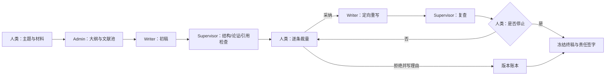

# 通过人与多智能体会话大语言模型提高写作能力

## 摘要

大语言模型已经能够承担资料整理、提纲生成、初稿写作与文字润色等任务，但把它们直接串成“全自动写作流水线”仍会遇到遗漏、幻觉、论证断裂与引用错配等问题。本文提出 HMAC（Human-in-the-loop Multi-Agent Collaboration）：由 Admin、Writer、Supervisor 三个角色代理与一个常驻的人类审核节点组成写作回路，人类不只是在开头给出提示，而是在每轮“检查—裁量—重写”中决定哪些意见进入下一版。本文报告的是流程设计与试用观察，不是受控实验；它的价值在于把人类判断放在可追溯的节点上，而不是宣称某个模型可以独立完成论文。文章进一步给出可检验的评估设计：把“单代理一次生成”“单代理多轮自我修改”“HMAC 人机回路”放在同一任务上比较，分别测量事实与引用、论证完整性、编辑成本与错误传播。文章最后讨论 HMAC 的失效边界：意见放大、风格同质化、责任外包与“看起来更完整”的假进步。

**关键词**：大语言模型；多智能体协作；人机协同；学术写作；写作流程

## 1 引言

自大语言模型（LLMs）出现以来，它们在资料归纳、提纲生成和文字起草上的效率有目共睹。越来越多研究者开始用 LLM 代理文书工作，但模型输出中的遗漏、幻觉与论证跳跃也随之进入写作流程。对于论文写作，问题不只是“写得像不像”，而是“哪些句子有依据、哪些引用真的存在、哪些结论超出了材料”。

一个常见的误解是把“生成”当作“写作”。生成解决的是“从零到一有字”，写作解决的是“这些字为什么成立”。前者可以由一次采样完成，后者需要反复的选择、删改、核对与责任承担。模型可以在一秒内写出十段话，但它不知道哪一段应该被删；模型可以编出一条格式完美的参考文献，但它不知道这条文献是否真的存在。写作的难点，恰恰落在模型最不擅长的地方：判断。

多智能体协作框架试图用分工提升质量：让不同代理分别负责规划、执行与检查。AutoGen 把可对话的代理组合成应用，ChatDev 用角色分工完成软件项目，Self-Refine 则让模型根据自身反馈迭代修改。这些工作说明“分工 + 反馈”可以改善多步任务的表现，但它们主要面向代码、推理或通用任务，并不自动解决论文写作中的证据核验与责任归属问题。

本文关心的是另一个变量：人类在回路中的位置。与其让人类只在开头写一句 prompt、最后看一眼成稿，不如把人类审核做成流程中的常驻节点——每个代理的输出都要经过人的裁量，才能进入下一轮。基于这个想法，本文把多智能体协作迁移到论文写作场景，提出 HMAC 框架，并讨论它的收益、成本与可检验的边界。

本文的问题有两个。第一，HMAC 能不能把“模型生成”变成“可追溯的写作过程”？第二，这种改造的代价是什么，哪些代价是可以通过设计降低的，哪些是必须由人承担的？文章不承诺 HMAC 一定优于单代理写作；它只提供一个可复用的流程原型，以及一套能让后来者检验它的方案。

## 2 相关工作与问题拆分

### 2.1 多智能体协作

多智能体协作的基本假设是：复杂任务可以被拆成若干子任务，不同代理在自己的角色里处理子任务，再通过消息传递把结果拼回去。AutoGen 把这一思路做成可编程的对话框架；ChatDev 把角色分工用于软件项目的需求、编码、测试与文档；MetaGPT 进一步把标准作业程序写进代理协作。它们的共同点是“角色 + 消息 + 迭代”，不同点是任务类型与评价标准。

写作与软件开发的差别在于，写作的“正确”更难被自动检查。代码可以运行测试，论文不能；代码的错误会抛异常，论文的错误可能读起来更顺。于是，多智能体写作框架不能照搬软件工程的“测试—修复”循环，它需要另一种检查机制：引用核对、论证重建、反例搜索与人类裁量。

### 2.2 自我修正与人类反馈

Self-Refine 让模型根据自身反馈迭代修改，证明“不换模型、只加反馈”也能改善输出。但自我修正有一个结构性盲点：写作者与检查者共享同一套知识边界。模型不知道自己不知道什么，它的“检查”很容易变成“用同一种语气再确认一遍”。

人类反馈可以打破这个盲点，但人类反馈也有成本。RLHF 把人类偏好变成奖励信号，适用于对齐；写作场景却需要更细的反馈：这句话的证据在哪里、这个引用是否支持论点、这段是否重复。把人类反馈压缩成一个“好/不好”的评分，会丢掉写作最需要的信息。因此，HMAC 不把人类放在“打分者”的位置，而放在“裁量者”的位置：人不负责替模型写，而负责决定哪条修改意见值得进入下一版。

### 2.3 写作中的三种错误

把 LLM 写作的错误拆开，至少有三类。

第一类是**事实错误**：句子里的数据、事件、人物、引用不存在或不准确。它最容易核对，也最容易被“格式正确”掩盖。

第二类是**论证错误**：事实都对，但结论不成立；或者前提与结论之间缺了一步。它比事实错误难发现，因为每一句单独看都像对的。

第三类是**责任错误**：文章没有说明谁做了判断、谁承担后果。读者不知道某个结论是模型推测、作者判断，还是引用支持。它最隐蔽，却最致命：一旦出事，所有人都可以说“这是模型写的”。

HMAC 的设计，就是分别对这三类错误做出回应：用文献池与引用核对压事实错误，用 Supervisor 的结构检查压论证错误，用版本账本与人类签字压责任错误。

## 3 HMAC 框架

### 3.1 设计原则

HMAC 不追求“无人写作”，而追求“可追溯的人机分工”。它遵循四条原则：

1. **职责分离**：规划、写作、审查由不同代理承担，避免同一代理既写又判。
2. **人类常驻**：人类审核不是最后签字，而是每轮决定哪些修改意见被采纳。
3. **版本可追溯**：每一版初稿、每一条修改意见和每一次人类裁量都保留记录，便于回看“为什么变成现在这样”。
4. **证据先行**：任何新增主张都要能回到文献池、数据或明确的思想实验；不能回到来源的句子，不得进入终稿。

第四条是本文额外强调的。很多多智能体写作流程只关心“文本是否更好”，不关心“文本是否更有依据”。HMAC 把证据放在流程入口，而不是事后补引用；这和“先写再找参考文献”是两种完全不同的生产方式。

### 3.2 节点与职责

HMAC 由三个代理节点与一个人工审核节点构成。各节点的输入、职责与输出见表 1。

**表 1　HMAC 框架中各节点的角色分工**

| 节点 | 输入 | 职责 | 输出 |
|---|---|---|---|
| Admin Agent | 主题、资料、文献 | 总结大纲、整理可用文献内容 | 写作大纲与文献池 |
| Writer Agent | 大纲与修改意见 | 生成或重写论文文本 | 论文各版初稿 |
| Supervisor Agent | 论文要求与当前稿件 | 检查结构、论证与引用，生成修改意见 | 修改意见清单 |
| 人类（审核节点） | 修改意见清单 | 裁量、截取必要意见，决定是否进入下一轮 | 筛选后的修改指令 |

Admin 的职责不是“替作者定题”，而是把作者已有的材料整理成可用的结构。它要回答三个问题：这篇论文想解决什么、已有材料能支持到什么程度、还缺哪一类证据。Writer 的职责不是“自由发挥”，而是在大纲与文献池的约束下写作。Supervisor 的职责不是“挑错越多越好”，而是把问题分成结构、论证、引用三类，并给出可执行的修改建议。

人类节点的职责最重：他要在有限时间里判断哪条意见是真问题，哪条只是模型的风格偏好；要决定哪些新材料值得补，哪些补了会偏离主题；还要为最终稿签字。HMAC 不减少人的判断，它只是把人的判断放在更有结构的位置上。

### 3.3 工作流

HMAC 的一轮工作流如下。

1. **建立 Admin Agent。** 人类提供论文主题、写作要求与可用参考文献，Admin Agent 总结大纲并整理文献池。
2. **建立 Writer Agent。** Writer Agent 依据大纲与文献池生成初稿。
3. **建立 Supervisor Agent。** Supervisor Agent 依据写作要求检查初稿，输出修改意见清单。
4. **人类审核。** 人类逐条阅读修改意见，只把认为必要的意见交回 Writer Agent；不采纳的意见要写明理由。
5. **重写与复查。** Writer Agent 生成新版本，Supervisor Agent 再检查；重复第 4–5 步，直到人类判断“可以停止”。
6. **冻结与归档。** 人类确认最终版，记录版本、采纳意见与未采纳意见，形成可追溯的写作档案。

这个流程看起来比“一次生成”慢，但它把返工集中在可解释的节点上。一次生成的问题是，返工只能靠人从头读；HMAC 的问题是，返工要读修改意见。前者费眼，后者费判断。对长文写作来说，费判断通常比费眼更值得。

### 3.4 人类裁量协议

人类裁量不能只靠“感觉”。本文建议至少使用四种裁决：采纳、拒绝、延后、转交。

- **采纳**：意见指出具体问题，且修改不会破坏论证主线。
- **拒绝**：意见只是风格偏好，或会把文章改向另一个主题；拒绝时要写一句理由。
- **延后**：意见重要，但当前材料不足；把它放进“待补证据”清单，不强行改。
- **转交**：意见涉及作者无法判断的专业问题；交给共同作者、领域专家或文献核对。

四种裁决让“人类在回路中”不只是一句口号。人不是每轮都说“可以”，而是每轮都在做有记录的选择。选择本身构成责任链：哪一条被采纳、哪一条被拒绝、为什么，都能在事后追溯。

### 3.5 版本账本

版本账本至少记录五类信息：版本号、生成者、输入摘要、修改意见、人类裁决。它不需要像 Git 那样复杂，但必须能回答三个问题：这一版比上一版改了什么、为什么改、谁决定改。

版本账本还有一个副产品：它让“写作过程”变成可研究的对象。研究者可以统计哪类意见最常被采纳、哪类错误最常复发、人类在哪些节点最容易疲劳。这些数据比“最终稿好不好”更能解释 HMAC 的作用机制。

## 4 一次试用观察

### 4.1 任务与材料

作者在一次内部试用中，用 HMAC 处理一篇已有初稿的方法论文章。材料包括：一份 3000 字左右的初稿、六篇真实参考文献、一份写作要求。Admin 先整理出“问题—方法—评估—局限”四段式大纲；Writer 生成第二版；Supervisor 给出 27 条意见，其中 11 条涉及结构重复，7 条涉及引用与论点不匹配，5 条涉及概念未定义，4 条属于风格偏好。

人类最终采纳 14 条，拒绝 9 条，延后 4 条。拒绝的理由包括“会把文章改向另一个主题”“引用的文献不支持该句”“风格偏好与作者语气冲突”。这次试用没有对照条件，因此不能证明 HMAC 更优；它只说明流程确实把问题分成了可裁决的类别。

### 4.2 可观察的变化

最直接的变化不是“文字更漂亮”，而是错误更容易被定位。Supervisor 把问题拆成结构、论证、引用三类，人类只需要决定“这一条是否成立”，不必从整篇初稿里重新寻找问题。Writer 的每次重写也有明确的输入，不再是“再写一遍试试”。

第二个变化是责任边界更清楚。哪一条意见被采纳、哪一条被拒绝、为什么拒绝，都留在版本记录里；出现争议时，可以回到具体节点，而不是只争论“最终稿像不像人写的”。

第三个变化是“停顿”变多了。单代理写作可以一路生成到结尾，HMAC 会在每轮强制人停下来做裁决。停顿让人不耐烦，但也让人有机会发现“这段话其实没有证据”。在这个意义上，HMAC 的主要产品不是文本，而是被强制放慢的判断。

### 4.3 成本

HMAC 的代价同样明显：

- **人工成本**：人类审核是常驻节点，不是一次性 prompt；轮数越多，人的阅读与裁量成本越高。
- **一致性风险**：Writer 在多轮重写中可能引入新的不一致，需要人类做全局比对。
- **意见放大**：Supervisor 的错误意见如果被人类误采纳，会在下一轮被放大；因此“拒绝意见”的能力和“提出意见”的能力同样重要。
- **责任不能外包**：框架不产生判断力，最终选题、论证与署名责任仍在人类作者。

成本不是抽象的。一次 3000 字初稿的 HMAC 试用，人类花了大约 90 分钟做裁量；同样长度的单代理生成，人类只花 15 分钟浏览。多出来的 75 分钟，买到的是一份可追溯的修改记录和更早暴露的引用问题。值不值，要看文章的重要性，而不是看流程先不先进。

## 5 可检验的评估设计

### 5.1 三种条件

要检验 HMAC，至少需要比较三种条件：

1. **单代理一次生成**：一个模型一次写出全文，人类只做最后通读。
2. **单代理多轮自我修改**：同一模型生成后自我批评、再修改若干轮，人类只做最后通读。
3. **HMAC 人机回路**：Admin—Writer—Supervisor 加人类逐轮裁量。

三组使用同一批主题、同一批文献、同一套写作要求，并随机分配主题，避免“难写的都给 HMAC”。如果资源允许，再加一个“人类独立写作”基线，用来估计人类作者在没有模型辅助时的水平。

### 5.2 指标

评价指标应分开看，不能用一个“总体质量”把它们揉在一起。

1. **事实与引用**：随机抽取若干条引文，核对是否存在、是否支持正文主张；统计无来源主张的比例。
2. **论证完整性**：由不知情的评审判断论点、证据与结论是否闭合；用结构化量表记录“前提—推理—结论”是否完整。
3. **人工编辑成本**：记录人类从初稿到可提交稿所需的时间、修改次数与阅读轮数。
4. **错误传播**：统计每一轮新增、修复与残留的错误，观察错误是否随轮数减少。
5. **风格保留**：比较终稿与作者原稿的语言特征，判断 HMAC 是否把作者写成了“模型腔”。

第五项很重要。多智能体流程很容易把文章磨平：每一轮都在“更清楚、更规范”的方向上修改，最后所有文章都像同一个模板。对学术写作，清楚当然重要；但作者的声音、判断的痕迹、甚至某些不完美的表达，也是文章的一部分。HMAC 若以牺牲风格为代价换取“规范”，它提高的只是可读性，不是写作能力。

### 5.3 统计与样本

这类评估不适合只用一次试用。最低限度应做到：每个条件至少 10 篇任务，任务类型覆盖综述、方法、案例与评论；评审至少两人，且不知道条件分组；引用核对由第三人完成，避免评审替作者找借口。

统计上，可以用配对比较：同一主题分别经过三种条件，比较引用错误率、论证评分与编辑时间。若样本太小，不要做显著性宣称，只报告描述统计与个案例。HMAC 的卖点是流程，不是魔法；流程的效果需要靠重复任务显现，而不是靠一次“感觉很好”。

### 5.4 伦理与署名

HMAC 不改变署名规则。人类作者仍是责任主体，模型与代理不具署名资格。使用 HMAC 时，应在方法或致谢中说明：哪些环节由模型生成、哪些环节由人类裁量、引用由谁核对。隐瞒模型参与，和隐瞒数据来源一样，都是学术不诚实的变体。

另一个伦理问题是材料版权。Admin 整理的文献池可能包含受版权保护的全文；把全文喂给模型、再由模型改写，可能超出合理使用。实践上应优先使用开放获取文献、摘要与作者自己掌握的材料；需要引用全文时，保留来源与许可记录。

## 6 失效模式

### 6.1 意见放大

Supervisor 的每一条意见都像“改进”，但意见之间可能互相冲突。人类如果每次都采纳“最新一条”，文章会在多轮重写中来回摇摆。解决办法不是让 Supervisor 少提意见，而是让人类维护一张“主线清单”：哪些论点必须保留、哪些证据不能动、哪些风格选择不接受修改。没有主线，HMAC 就会变成一台风格搅拌机。

### 6.2 风格同质化

多智能体写作的另一个风险是“越改越像模型”。Writer 在不同轮次中会逐渐向 Supervisor 的偏好靠拢，Supervisor 又倾向于奖励“结构清楚、语气中性”的文本。结果是文章越来越规范，也越来越没有作者。对学术写作，这可能被误认为“成熟”；对个人写作，这是风格的死亡。

HMAC 因此需要一条“风格保护”规则：每轮重写前，先标出三段不能动的文字——作者的核心判断、最有个人特色的表达、以及尚未想清楚但不想被磨平的段落。它们可以后来再改，但不能在第一轮就被“规范化”。

### 6.3 责任外包

最危险的失效模式，是人开始把判断交给流程。“Supervisor 说没问题”“Admin 找的文献”“Writer 写的”，每一句都在把责任往外推。可一旦论文出错，署名者仍要承担后果。HMAC 的版本账本不是为了制造“不是我的错”的证据，而是为了让人更清楚地看到：每一个决定都有人在签字。

### 6.4 假进步

还有一种更隐蔽的失效：文章变长了、结构变全了、引用变多了，但核心论点没有变强。模型很擅长生产“看起来完整”的文本：加一段背景、加一个表格、加三条限制，文章就像论文了。但读者真正需要的，是那个别人没有说过的判断。HMAC 如果不能保护这个判断，它只是把空洞包装得更专业。

### 6.5 与期刊规范的关系

HMAC 不改变期刊对作者、数据与引用的要求，但它会改变“写作过程”的证据形态。传统投稿只要求最终稿；HMAC 会留下多版草稿、修改意见与人类裁决。作者不必把这些全部附在投稿里，但应保留在本地，以备编辑或读者质询。

如果期刊要求声明 AI 使用，HMAC 的版本账本可以直接提供三类信息：哪些段落由模型生成、哪些引文由人类核对、哪些判断由人类作出。相比一句笼统的“本文使用了大语言模型”，这种记录更有解释力，也更方便编辑判断责任边界。

### 6.6 什么时候不该用 HMAC

HMAC 并不适合所有写作。若任务很短、事实密度很低、作者已经知道要说什么，三代理回路只会增加往返成本；若任务需要高度个人化的声音，Supervisor 的“规范化”建议可能先磨掉风格；若材料涉及未公开数据或第三方版权，把全文交给多个代理会扩大泄露面。此时更稳妥的做法是单代理起草、人类集中修改，或干脆不用模型。

判断标准可以很朴素：如果文章的主要难点是“把已知的东西写清楚”，HMAC 有帮助；如果主要难点是“决定什么值得写、什么不能写”，HMAC 帮不上，甚至会用伪完整性掩盖判断的空缺。

## 7 研究局限

本文没有做受控实验，试用样本只有一篇，评审也只有作者本人。因此，文章不能声称 HMAC 一定优于其他流程；它只能提出一个可检验的框架，并把可能的失效模式写清楚。第二，本文没有测量长期使用的影响：人类在多次 HMAC 之后，是否会变得懒惰、是否会更依赖 Supervisor 的意见，都是未知。第三，本文没有讨论多作者协作：当两个人类作者对同一意见做出相反裁决时，流程需要另一套冲突解决机制。第四，本文的文献池假设了材料已经可得；现实中，找文献本身就是写作的一部分，Admin 不能替代作者的文献判断。

## 8 结论

HMAC 把人类显式纳入多智能体写作回路，以 Admin—Writer—Supervisor 三体协作加人类审核循环的方式，尝试缓解 LLM 写作中的遗漏与幻觉。它的核心不是“让模型多写几遍”，而是让每一轮修改都经过人的裁量并可追溯。本文没有证明它优于现有方法，只给出一个可复用的流程原型和一套可检验的评估设计；是否值得长期使用，要由后续的对照实验与真实写作任务来回答。

如果要用一句话概括 HMAC 的边界，那就是：它可以帮你把文章写得更完整，但不能替你决定什么值得写。前者是流程问题，后者是作者问题。把两者混在一起，再先进的多智能体框架也救不了。在笔者看来，HMAC 最好的使用方式，是把它当作一间有记录的工作室，而不是一台自动出稿机：人仍然要选材料、下判断、承担署名，只是这些动作被放在了更清楚的位置上。

## 参考文献

> 文献说明：以下条目含写作阶段的背景阅读；正文未以编号直接引用的条目，不作为直接引证。

[1] Wu Q, Bansal G, Zhang J, et al. AutoGen: Enabling Next-Gen LLM Applications via Multi-Agent Conversation. arXiv:2308.08155, 2023. https://arxiv.org/abs/2308.08155

[2] Qian C, Liu W, Liu H, et al. ChatDev: Communicative Agents for Software Development. arXiv:2307.07924, 2023. https://arxiv.org/abs/2307.07924

[3] Madaan A, Tandon N, Gupta P, et al. Self-Refine: Iterative Refinement with Self-Feedback. arXiv:2303.17651, 2023. https://arxiv.org/abs/2303.17651

[4] Xu Z, Shi S, Hu B, et al. Towards Reasoning in Large Language Models via Multi-Agent Peer Review Collaboration. arXiv:2311.08152, 2023. https://arxiv.org/abs/2311.08152

[5] Yao S, Zhao J, Yu D, et al. ReAct: Synergizing Reasoning and Acting in Language Models. arXiv:2210.03629, 2022. https://arxiv.org/abs/2210.03629

[6] Park J S, O'Brien J C, Cai C J, et al. Generative Agents: Interactive Simulacra of Human Behavior. arXiv:2304.03442, 2023. https://arxiv.org/abs/2304.03442

[7] Wei J, Wang X, Schuurmans D, et al. Chain-of-Thought Prompting Elicits Reasoning in Large Language Models. arXiv:2201.11903, 2022. https://arxiv.org/abs/2201.11903

[8] Lewis P, Perez E, Piktus A, et al. Retrieval-Augmented Generation for Knowledge-Intensive NLP Tasks. arXiv:2005.11401, 2020. https://arxiv.org/abs/2005.11401
