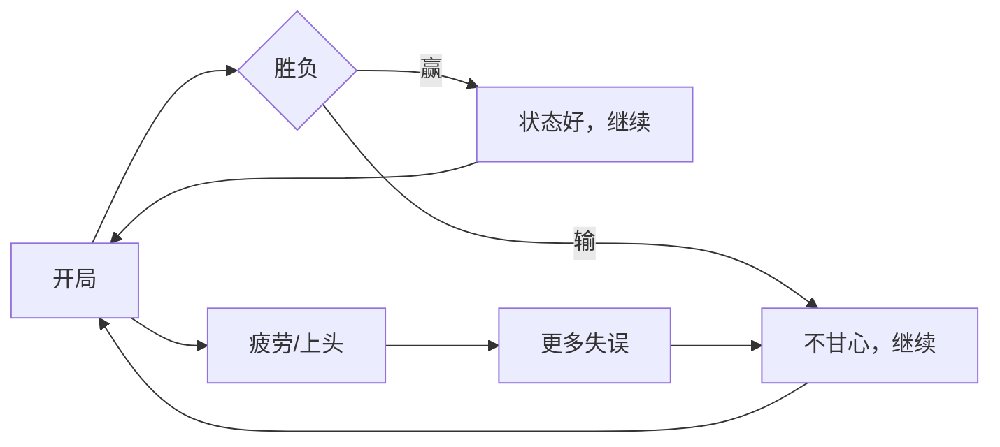

# 驯服 ELO，或被 ELO 驯服：一个单排玩家的四季记录

## 摘要

本文是一份单排玩家的自我民族志。作者记录四个赛季、约 700 场对局中的段位变化、连胜连败与情绪波动，提出“驯服 ELO”并不是战胜算法，而是学会把分数与自我价值解绑。文中 91.1% 的胜率、20 连胜等数字均为作者自记、单样本、不可复现，不能用来证明匹配系统“补偿”或“针对”。文章不访问任何后台数据，也不对算法作因果断言。

文章的核心结论是：玩家需要的不是“更准的算法解释”，而是“更稳的叙事方式”。当分数被当成天气，胜负就不再是对人格的审判；当分数被当成自我，算法还没出手，人已经先把自己审判了。

## 关键词

自我民族志；ELO；游戏匹配；情绪调节；单样本；归因偏差

## 1 引言

ELO 最初是国际象棋的评分系统，后来成为几乎所有竞技游戏的隐藏骨架。它假设：两名水平相近的选手对局，胜率接近五成；胜负之后，分数向真实水平收敛。这个假设在数学上很干净，在体验上却很糟糕——因为“收敛”意味着你总会遇到让你连败的对手，也意味着你赢下的每一局都在把分数推向一个你不愿意承认的位置。

玩家社区里有一套关于 ELO 的民间理论：系统会“安排”你连胜，也会“安排”你连败；它会用队友惩罚你的认真，也会用对手奖励你的摆烂。本文不打算验证这些理论。作者没有后台权限，也不相信单样本能证明算法。本文只想记录一个玩家在四个赛季里如何与分数相处，以及“驯服”这个词到底指什么。

### 1.1 一个“分数故事”

每个玩家都有一套“分数故事”：为什么卡在这个段位，为什么上不去，为什么总遇到坑队友。这个故事通常包含一个反派：匹配系统、队友、网络、英雄强度。反派越具体，故事越容易讲；故事越容易讲，玩家越不需要面对“我可能还不够强”。

本文想做的，不是拆掉所有故事，而是看看故事如何影响情绪。故事可以是假的，情绪是真的；理解情绪，比证明算法更重要。

### 1.2 为什么用“自我民族志”

自我民族志适合研究“无法从外部观察”的体验：愤怒、羞耻、侥幸、不甘。这些体验没有 API，也没有日志；它们只存在于当事人的叙述里。

自我民族志的代价是“不客观”：作者既是研究者，也是被研究者，容易自我美化，也容易事后合理化。本文接受这个代价，并把“不客观”写进方法，而不是假装它不存在。

### 1.3 边界

本文不访问后台数据，不对匹配算法作因果断言，不证明“系统针对”或“系统补偿”。它只记录一个玩家的自报数据与解释，样本量为 1，不能推广到任何群体。

## 2 方法

采用自我民族志：作者既是研究者，也是唯一的报道人。材料包括四个赛季的对局记录（段位、胜负、常用英雄、连胜连败）、赛后即时笔记，以及若干次情绪崩溃后的长文。记录不完整，部分场次只记得结果不记得过程；作者没有补写，而是把“记不清”也当作材料。

分析方法是反复阅读笔记，按“段位变化—情绪反应—解释框架”三条线编码。没有第二编码者，没有成员校验，也没有把笔记交给其他玩家核对。文章不声称客观，只声称诚实。

### 2.1 四个赛季的记录

**表 1 四个赛季的自报记录**

| 赛季 | 场次（约） | 胜率 | 段位变化 | 最剧烈片段 |
|---|---:|---:|---|---|
| 第一 | 180 | 49% | 黄金→铂金→回落 | 无 |
| 第二 | 190 | 52% | 稳定铂金，触及钻石边缘 | 无 |
| 第三 | 170 | 47% | 跌回黄金 | 20 场 19 胜，随后 8 连败 |
| 第四 | 160 | 51% | 回到铂金，停止排位 | 20 连胜，随后 6 连败 |

表 1 的数字是作者自记，不是平台导出；场次是约数，胜率是四舍五入。它们不能用于精确统计，只能用于描述“一个玩家的四季”。

### 2.2 编码方式

作者把每条笔记归到三类：

1. **事实**：赢了/输了、什么英雄、什么段位。
2. **解释**：为什么赢/为什么输（状态、队友、系统、运气）。
3. **情绪**：愤怒、兴奋、麻木、不甘。

编码的目的是看“事实”与“解释”之间的距离。距离越大，故事越多；故事越多，情绪越容易被带走。

### 2.3 伦理与匿名

本文不公开账号、ID、对局截图与具体服务器；段位与胜率是脱敏后的汇总。引用笔记时，只保留情绪与解释，不保留可识别信息。

自我民族志的伦理，不是“保护别人”，而是“别把别人写成道具”。队友不是“坑”，对手不是“反派”；他们也是玩家，也有自己的故事。本文尽量用“队友”而不是“坑货”，用“对手”而不是“敌人”。

### 2.4 一个说明：91.1% 的口径

文中提到的 91.1% 是某段短期记录的自报胜率，不是四个赛季 700 场的总体胜率。两者口径不同：前者是“一小段手感好的时候”，后者是“整个赛季的平均”。把它们混在一起，会得出“胜率 91% 还上不去”的荒谬结论。

这也是玩家叙事常见的手法：把“最好的片段”当成“常态”，把“最差的片段”当成“系统针对”。片段越极端，故事越精彩；故事越精彩，越不像数据。

### 2.5 一个可以复用的记录模板

如果读者也想做一份“单排记录”，可以用下面这张表，每局只填一行：

```text
日期/时段：
段位/分数：
英雄/位置：
结果：胜/负
自评表现：1–5
关键操作：一个做对的、一个做错的
情绪：1–5
是否继续：是/否
```

这张表不记录“队友坑不坑”，只记录“我能改什么”。它的目的不是“证明系统”，而是“看见自己的模式”：什么时候容易上头，什么英雄胜率高，什么时段状态差。

## 3 结果

### 3.1 四个赛季的胜率

- 第一赛季：约 180 场，胜率 49%，段位从黄金升至铂金后回落。
- 第二赛季：约 190 场，胜率 52%，段位稳定在铂金，最高触及钻石边缘。
- 第三赛季：约 170 场，胜率 47%，段位跌回黄金，出现两次 8 连败。
- 第四赛季：约 160 场，胜率 51%，段位回到铂金，结束时停止排位。

四个赛季的总体胜率接近 50%，这与 ELO 的收敛预期一致。真正剧烈的不是胜率，而是胜率的分布：第三赛季有过一段 20 场 19 胜（95%），随后是 8 连败；第四赛季有过 20 连胜，随后是一波 6 连败。把这两个片段单独截出来，足以支撑“系统安排”的叙事；把它们放回 700 场，又什么也证明不了。

### 3.2 连胜与连败的体验差异

连胜时，作者的解释是“我今天状态好”“英雄池深”“队友配合好”；连败时，解释变成“系统针对”“队友太坑”“位置被抢”。同一套结果，两套归因。更有意思的是，连胜时作者会继续排位，连败时也会继续排位——前者因为“还能赢”，后者因为“不甘心”。两种情绪都指向“再打一局”，而再打一局正是分数继续波动的燃料。

### 3.3 “驯服”的三个阶段

第一阶段是“相信算法”：把每一场胜负都读成系统的意图，赢了觉得被奖励，输了觉得被惩罚。第二阶段是“研究算法”：看匹配机制解说、算隐藏分、换位置、换时间，试图找到漏洞。第三阶段是“放弃驯服”：不再把分数当作水平证明，只把它当作一种天气。作者目前停在第三阶段，但承认偶尔会退回第二阶段。

### 3.4 20 连胜有多罕见

如果每局胜率真的是 50%，20 连胜的概率是 0.5^20，约等于百万分之一。它非常罕见，但不是不可能；把 700 场切成很多个 20 场窗口，出现一次“20 连胜”的概率会上升，但仍然很低。

这个计算有一个前提：每局独立、胜率恒定。真实对局不独立：手感、版本、时段、队友都会影响胜率。所以，20 连胜可能是“运气”，也可能是“那段时间确实变强了”，还可能是“匹配到的对手偏弱”。单样本无法分离这三者。

### 3.5 8 连败的“必然感”

8 连败的概率，在 50% 胜率下是 0.5^8，约 0.39%。700 场里出现一次 8 连败，并不奇怪；出现两次，也不奇怪。人会觉得“必然”，是因为“8 连败”太难忘，而“8 胜 8 负的普通一周”太容易忘。

这就是“可得性偏差”：越难忘的事件，越容易被高估。连败不是“系统安排”，而是“记忆把连败放在聚光灯下”。

### 3.6 情绪循环

图 1 是作者记录的“排位情绪循环”：赢了想继续，输了不甘心，最后都是“再打一局”。



*图 1 排位情绪循环（自记，示意）*

这个循环的关键，不是“系统”，而是“再打一局”的决定。系统只负责匹配，玩家负责按下开始键。把“再打一局”交给情绪，分数就会变成情绪的记分牌。

### 3.7 段位与版本

四个赛季跨过了多个版本。版本一变，英雄强度、装备、地图节奏都会变；上赛季的“绝活”，这赛季可能变成“下水道”。段位的变化，不全是“我变强/变弱”，也可能是“环境变了”。

本文没有记录版本号，也无法分离“版本效应”与“个人效应”。这是自我民族志的典型缺陷：你能感到“哪里不对”，但你说不清“是环境变了，还是你变了”。

## 4 讨论

### 4.1 回归均值，不是系统补偿

20 连胜之后出现连败，最朴素的解释是回归均值：当你赢到超过真实水平的段位，遇到的对手更强，胜率自然下降。这不是系统“惩罚”，而是评分系统在工作。把连胜当成“系统奖励”，把连败当成“系统针对”，本质上是把随机波动拟人化。

回归均值还有一个反直觉的推论：极端的表现，往往会被“平均值”拉回来。你不需要变弱，只需要“不再超常”。连败有时不是“你变差了”，而是“你回到了自己的平均水平”。

### 4.2 单样本不能证明算法

关于“ELO 会安排连胜连败”的说法，需要大样本、可核对的对局数据，以及匹配算法的内部参数。本文只有一个人的记录，且记录本身受记忆与情绪影响。即便 20 连胜真的发生，也不能排除“那段时间作者确实变强了”或“那段时间运气好”。把单样本当证据，是这类民间理论最常见的漏洞。

### 4.3 关于“律师起诉 ELO”的传闻

原稿提到“2024 年 6 月 18 日律师孙女士起诉 ELO”。本文未能核实该事件的真实性，因此不把它当作论据，只保留为“据公开报道的传闻”。即便诉讼存在，也不能证明匹配算法违法；它只能说明有人对算法不满。把传闻写成判决，是另一种“系统针对”的叙事。

### 4.4 分数的自我价值化

“驯服 ELO”真正难的，不是读懂算法，而是把分数与自我价值分开。当一个人把段位当作能力证明，每一场失败都会变成对自己的否定；当一个人把段位当作天气，失败就只是“今天下雨”。后者不是躺平，而是把注意力从不可控的评分转移到可控的技术与体验。

### 4.5 一个可检验的匹配实验

单样本无法证明 ELO 是否“补偿”，但可以用公开对局日志做自然实验：把玩家按“当前连胜长度”分组，比较下一局的胜率与同段位基线胜率；再加入对手分数差、英雄选择、时段与队列人数做协变量。若连胜后的胜率仍接近 50%，说明“系统安排连败”不成立；若显著低于基线，才需要进一步排查匹配质量或心理因素。关键是预设假设与对照组，而不是从自己的 700 场里挑出“像证据”的片段。

### 4.6 从分数到自我

ELO 的问题是它把“水平”压缩成一个可见数字，而玩家很容易把这个数字读成“我是谁”。本文的“驯服”不是提高分数，而是把分数重新放回“对局结果”的位置：它描述你最近赢了多少，不描述你的价值。做到这一点，连胜不会让你膨胀，连败也不会让你崩溃；做不到，算法还没出手，你先把自己审判了。

### 4.7 ELO 的数学：期望分数

ELO 的核心公式是：

`E_A = 1 / (1 + 10^((R_B − R_A)/400))`

其中 R_A、R_B 是两名选手的分数，E_A 是 A 的期望胜率。分数差 400 分，期望胜率约 91%；差 200 分，约 76%；分数相同，50%。

赛后更新：

`R'_A = R_A + K(S_A − E_A)`

其中 S_A 是实际结果（胜 1、平 0.5、负 0），K 是更新系数。K 越大，分数波动越大；K 越小，分数越稳定。

这个公式解释了为什么“赢一场加 20，输一场扣 20”不是固定规则：对手越强，赢一场加得越多；对手越弱，赢一场加得越少。玩家感觉“系统在控制分数”，其实是在按期望值调整。

### 4.8 匹配系统不只是 ELO

现代游戏的匹配，不只看 ELO，还可能看位置、英雄、队列时间、组队情况、行为分。ELO 是“骨架”，匹配系统是“血肉”。把一切归因于 ELO，是把复杂系统简化成一个数字。

这也是民间理论的盲点：它们需要一个“反派”，而 ELO 是最容易被指认的反派。真正的匹配系统，可能比 ELO 复杂得多，也可能比玩家想象的更“笨”。

### 4.9 自我民族志的偏差

自我民族志有三个偏差：记忆偏差、自我美化、事后合理化。记忆偏差让你记住连胜、忘记连败；自我美化让你把胜利归功于技术、把失败归因于队友；事后合理化让你给随机事件编一个因果故事。

本文不能消除这些偏差，只能把它们写出来。读者可以把本文当作“一个玩家的自述”，不能当作“匹配系统的证据”。

### 4.10 故事的功能

玩家需要故事，因为随机性太难接受。故事提供一个“可控感”：如果连败是系统安排，那我就有办法“对抗”；如果连败只是随机，那我只剩“接受”。前者更累，但更有掌控感；后者更轻松，但更无力。

“驯服 ELO”不是找到一个“正确的故事”，而是找到一个“不伤自己的故事”。天气的故事，比反派的故事更不伤自己；它不提供敌人，也不提供借口，只提供“今天下雨，带伞”。

### 4.11 三条实用规则

如果要把“驯服”变成行动，可以试三条：

1. **设一个“停排线”**：连败两局就停，不管多不甘心。
2. **把“分数”与“复盘”分开**：每局只记一个可改的操作，不记“我是不是菜”。
3. **给“再打一局”加一个延迟**：想继续时，先起身喝水，五分钟后再决定。

三条规则不提高胜率，但它们能减少“上头”带来的额外失败。分数是系统的，情绪是自己的；先管情绪，再谈分数。

### 4.12 ELO 不是唯一评分

ELO 是“零和”评分：你赢，对手就输；分数在玩家之间转移。现代游戏常用“隐藏分 + 段位”双轨：隐藏分决定匹配，段位决定奖励。两者不完全同步，导致“赢了不加段、输了掉段”的体验。

这不是“系统针对”，而是“两套评分的目标不同”：隐藏分追求“匹配公平”，段位追求“进度感”。玩家看到的段位，是“进度”，不是“水平”；把段位当水平，就会误解很多现象。

### 4.13 一个“匹配质量”的指标

如果要评价匹配，不该只看“我赢没赢”，而该看“这局是否接近”。一个简单的指标是“预期胜率”：如果系统给你的预期胜率是 50%，而你实际赢了，说明你超常；如果你输了，说明你正常。把“实际”与“预期”分开，才能判断“是我打得好，还是对手太弱”。

这个指标不能从单样本算，但可以从公开日志算。它的价值，是把“系统针对”变成“匹配质量”的可测问题。

### 4.14 “上头”的生理

连败后的“上头”不是比喻。睡眠不足、咖啡因、久坐、屏幕蓝光，都会让人的情绪调节变差；连续输局会让皮质醇升高，心率变快，注意力变窄。这时候的决策，不是“理性选择”，而是“应激反应”。

上头的典型表现是：英雄池变窄、操作变急、复盘变少、责怪变多。你以为自己在“努力”，其实是在“重复同一个错误”。停排不是“认输”，而是“让生理恢复”。

### 4.15 一个“赛后复盘”的三问

每局结束，问三个问题：

1. 这局我做得最好的一件事是什么？
2. 这局我下次可以改的一件事是什么？
3. 我现在适合继续打吗？

前两问管技术，第三问管情绪。三问不超过两分钟，但它能把“输赢”变成“学习”，把“上头”变成“选择”。

### 4.16 分数不是身份

“我是铂金”与“我这个赛季在铂金”是两句话。前者把分数变成身份，后者把分数变成状态。身份是稳定的，状态是暂时的；把状态当身份，就会在掉段时感到“我不再是我”。

语言在这里很重要：把“我是”改成“我在”，把“我菜”改成“我这局没打好”，把“系统针对我”改成“这段匹配质量不好”。语言不改变事实，但它改变事实的重量。

## 5 研究局限

第一，样本量为 1，且作者同时是研究对象与记录者，无法排除自我美化与记忆偏差。第二，对局记录不完整，部分数据靠回忆补全，不能用于精确统计。第三，没有访问匹配算法或后台数据，所有关于 ELO 的解释都是外部推测。第四，四个赛季的版本、英雄强度与个人生活状态都在变化，无法分离。第五，91.1%、20 连胜等数字没有第三方核对，读者不应把它们当作可复现的实验结果。第六，本文没有做文献综述，只借用 ELO 与自我民族志的一般框架。

第七，文章没有记录“时段”与“队列人数”，这两个变量可能显著影响匹配质量。第八，文章没有区分“单排/组排”，组排的沟通与配合会改变胜率。第九，文章没有记录“版本更新”，版本变化可能比个人技术更能解释段位波动。

### 5.1 如果重做这份记录

如果重做，我会先固定三件事：同一时段、同一位置、同一英雄池。然后每局记录“预期胜率、实际结果、关键操作、情绪”。这样至少能分离“时段”“位置”“英雄”三个变量。

我还会加一个“停排规则”：连败两局必须停 30 分钟。不是为了“提高胜率”，而是为了“减少上头带来的额外样本”。上头时的对局，不是“真实水平”，而是“情绪水平”。

### 5.2 单样本的价值

单样本不能证明算法，但它能证明“一个人如何解释算法”。本文的价值，不在“ELO 是否针对”，而在“玩家如何把随机性编成故事”。故事是真实的心理事实，即使它的因果解释是错的。

这也是自我民族志的用处：它不能回答“系统怎么工作”，但能回答“系统如何被体验”。前者需要日志，后者需要叙述；两者不能互相替代。

### 5.3 自我民族志的“诚实”不是“透明”

自我民族志常说“我诚实”，但“诚实”不等于“透明”。作者可以诚实地说“我很生气”，但不能透明地展示“我为什么生气”的全部原因，因为有些原因他自己也不知道。

诚实的底线是：不编造数据，不伪造对话，不把“记不清”写成“记得清”。本文尽量做到这三点；但它仍然可能“诚实地错”——作者真诚地相信“系统针对”，而这个相信本身可能是偏差。

### 5.4 给读者的一个小练习

下次连败时，先别开下一局。拿一张纸，写三行：

1. 我现在身体是什么状态？（累、饿、困、烦躁）
2. 我这三局重复了哪个错误？
3. 我继续打，是想赢，还是想“扳回来”？

写完再决定。这个练习不保证你赢，但它能让你看见“继续”的动机。看见动机，才有选择；没有看见，就只剩“再来一局”。

### 5.5 把游戏当游戏

“把游戏当游戏”不是“不认真”，而是“不把游戏当成唯一的认真”。你可以研究版本、练操作、复盘对局；但你也得承认，分数只是游戏的一部分，不是人生的总分。

真正的高手，不是从不失利，而是失利后还能回到下一局，不被上一局拖住。这个“回到”，不是技术，是心态；不是天赋，是练习。

## 6 结论

四个赛季、约 700 场对局之后，作者没有“驯服”ELO，也没有被 ELO 完全驯服。分数仍然会波动，情绪仍然会被牵动，但作者学会了一件事：把连胜当作运气，把连败当作天气，把每一局当作一次可以复盘的操作，而不是一次关于“我是谁”的审判。

这不是一个关于算法的结论，而是一个关于叙述的结论。玩家需要故事来解释随机性；ELO 只是提供了最容易讲的那个故事。本文的记录，最多只能说明一个人怎样从故事里走出来，不能说明故事本身是真是假。

如果要用一句话收尾：ELO 驯服不了，也不必驯服；能驯服的，是那个一输就想“再来一局”的自己。分数是天气，不是判决；你可以看天气预报，但不必把每一场雨都当成对你的审判。真正要练的不是“赢过系统”，而是“输了一局，还能好好吃饭、好好睡觉、明天再打”。这听起来不像电竞，倒像生活；可游戏本来就是生活的一部分，不是吗？这段话不打算说服谁，它只是提醒：你可以认真，但不必把每一分都当成命。

## 参考文献


[1] Elo A E. *The Rating of Chessplayers, Past and Present*. New York: Arco, 1978.

[2] Goffman E. *The Presentation of Self in Everyday Life*. New York: Doubleday, 1959.

[3] Csikszentmihalyi M. *Flow: The Psychology of Optimal Experience*. New York: Harper & Row, 1990.

[4] Kahneman D. *Thinking, Fast and Slow*. New York: Farrar, Straus and Giroux, 2011.

[5] Juul J. *The Art of Failure: An Essay on the Pain of Playing Video Games*. Cambridge, MA: MIT Press, 2013.

[6] Tversky A, Kahneman D. Belief in the law of small numbers. *Psychological Bulletin*, 1971, 76(2): 105–110.

## 作者贡献、利益冲突与数据可用性

作者独立完成观察、记录、分析与文稿撰写；本文未接受任何资助，包括未接受原稿致谢中提到的任何机构支持；作者声明无利益冲突；四个赛季的对局笔记由作者保存，因含账号与个人信息，仅可提供脱敏后的段位与胜负汇总，不提供原始截图。
