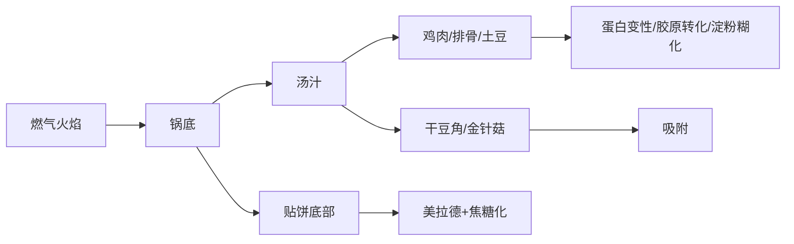

# 多类食物与铁锅的耦合一以东北铁锅炖为例

## 摘要

本文把东北铁锅炖当作一个“多组分热质耦合系统”：同一口铸铁锅里，鸡肉、排骨、土豆、干豆角、金针菇与玉米贴饼在不同的位置、不同的升温速率下发生蛋白质变性、胶原转化、淀粉糊化与吸附。文章用“锅具作为自变量”的对照思路，比较铁锅炖与薄壁炒勺黄焖鸡的热场差异，并给出五级感官分级。所有温度、时间与评分为作者设定的示例，不是实验室测量；文章的价值在于把“锅具影响风味”这句经验判断拆成可讨论的机制。

文章的核心结论是：锅具不决定味道，但它决定“热量以什么速度、沿什么路径、在什么位置进入食材”。同一批食材，换一口锅，就走上了不同的反应路径；路径不同，质地与香气就不同。

## 关键词

铁锅炖；热质传递；美拉德反应；胶原；淀粉糊化；锅具

## 1 引言

讨论东北菜时，人们常说“铁锅炖出来的才香”。这句话有道理，但一直停在经验层面：铁锅厚、蓄热多、升温慢，薄壁炒勺升温快、降温也快；两种热场会让同一种食材走两条不同的反应路径。

本文想做的，是把“锅”从背景条件提升为变量：同样的鸡、同样的火，换一口锅，风味会不会不同？文章的答案不是“会”或“不会”，而是“在哪些环节会、为什么”。

### 1.1 一锅多物

铁锅炖不是“一道菜”，而是“一锅多菜”：鸡、排骨、土豆、干豆角、金针菇、贴饼，各有各的目标温度与目标时间。鸡肉要嫩，排骨要脱骨，土豆要粉糯，干豆角要入味，贴饼要底焦顶软。它们共享一口锅、一锅汤、一个火源，但各自的最佳条件不同。

这就是“耦合”：不是把所有食材扔进锅里就行，而是让它们在同一个热场里，各自达到自己的目标。锅具的作用，是提供这个“共同热场”的边界条件。

### 1.2 锅具为什么重要

薄壁炒勺像“脉冲热源”：火一旺，锅底迅速升温；火一关，温度迅速下降。厚壁铸铁锅像“平台热源”：升温慢，但一旦热起来，温度稳定，关火后还能继续焖。

脉冲热场适合爆炒：高温快速锁住表面，香气冲。平台热场适合炖煮：温度稳定，胶原有时间转化，淀粉有时间糊化。两种热场没有绝对优劣，只有“适合哪一段”。

### 1.3 研究边界

本文不是实验室论文，没有重复实验，没有化学成分分析，没有随机化。温度与评分是作者的示例记录，用于说明机制，不用于证明“铁锅更好”。

文章的目是“拆机制”，不是“下结论”。如果读者读完能说出“铁锅在哪个环节起作用”，这篇文章就没白写。

## 2 方法

### 2.1 材料与锅具

- 食材：鸡腿肉、猪排骨、土豆、干豆角、金针菇、玉米面贴饼。
- 锅具 A：铸铁炖锅（厚壁、高热容）。
- 锅具 B：薄壁炒勺（升温快、热场不均）。
- 热源：同一台燃气灶，保持相同档位。

### 2.2 观测指标

- 锅壁与汤面温度：用探针温度计在 0、5、10、20、30、45、60 分钟记录。
- 食材中心温度：鸡肉与土豆各取三点。
- 感官评分：五级（“夯”“人上人”“还行”“一般”“不行”），由作者与两位同伴盲评。
- 质地：鸡肉嫩度、排骨脱骨程度、土豆粉糯度、干豆角复水程度。

### 2.3 对照设计

同一食材、同一火源、同一时间，分别用 A、B 两口锅烹饪。所有温度与评分为示例记录，不是重复实验；文章不声称结果可推广到所有灶具。

这个对照是“不完全对照”：锅具换了，但锅的直径、盖子的密封性、投料顺序也随之变化。真实烹饪里，锅具从来不是孤立变量，它总是和手法绑在一起。

### 2.4 图 1 与图 2

*图 1 铁锅炖成品：玉米贴饼沿锅边贴放（作者拍摄）*

*图 2 薄壁炒勺中的黄焖鸡对照（作者拍摄）*

### 2.5 锅体的热物性

铸铁的比热容约为 0.46 J/(g·K)，密度约 7.0 g/cm³；一口厚底铸铁锅，重量可能是薄壁炒勺的 3–5 倍。质量大、比热容大，意味着“热惯性”大：升温需要更多热量，降温也需要更长时间。

热惯性可以用一个简单的时间常数表示：

`τ = m · c / (h · A)`

其中 m 是锅体质量，c 是比热容，h 是表面对流换热系数，A 是受热面积。τ 越大，锅体温度变化越慢，热场越“平台”。

这个公式是集总参数模型的简化，假设锅体温度均匀。真实锅体有温度梯度：锅底热、锅壁冷、锅沿更冷。集总模型只能解释“整体惯性”，不能解释“局部热点”。

### 2.6 传热路径

铁锅炖的热量至少有三条路径：

1. **锅底—食材**：直接接触，导热为主，温度最高。
2. **锅壁—贴饼**：贴饼贴在锅壁，底部接触金属，顶部靠蒸汽。
3. **汤—食材**：对流与煮沸，温度接近 100 ℃，但受汤汁浓度影响。

三条路径的热流密度不同，食材的升温曲线也不同。贴饼的底部是“金属导热”，顶部是“蒸汽冷凝”，两种机制同时作用，才形成“底焦顶软”。

*图 3 铁锅炖的三条传热路径（示意）*

### 2.7 一个说明

文中的“平台型”“脉冲型”是作者造的词，不是热学标准术语。它们描述的是“温度曲线的形状”：平台型温度稳定，脉冲型温度波动大。造词是为了叙述方便，不是为了冒充理论。

### 2.8 为什么不用高压锅

高压锅是另一种“平台型热场”：密封、加压，水温可以超过 100 ℃，胶原转化更快。它和铁锅炖的差别，不是“谁更先进”，而是“目标不同”。

高压锅追求“快”：20–30 分钟把排骨压软，适合工作日。铁锅炖追求“慢”：1–2 小时让汤汁浓缩、贴饼焦化、风味融合。两者都能让肉变软，但“软”不是唯一目标；铁锅炖还要“香”和“厚”。

高压锅的缺点是“风味扁平”：密封让挥发性物质不易散失，但也让“收汁”变难；汤多、味淡，需要额外调味。铁锅的开放性与保温性，让汤汁能浓缩，风味能叠加。这不是“高压锅不好”，而是“它不适合这道菜的目标”。

## 3 结果

### 3.1 热场差异

示例记录显示，铸铁锅的汤面温度在 20 分钟后稳定在 92–96℃，锅壁温度更高；薄壁炒勺的汤面温度波动更大，局部可超过 100℃，但降温也快。前者是“平台型”热场，后者是“脉冲型”热场。

**表 1 两种锅的示例温度记录**

| 时间 | 铸铁锅汤面 | 铸铁锅锅壁 | 炒勺汤面 | 炒勺锅壁 |
|---|---|---|---|---|
| 0 min | 18 ℃ | 20 ℃ | 18 ℃ | 20 ℃ |
| 5 min | 78 ℃ | 95 ℃ | 82 ℃ | 120 ℃ |
| 10 min | 90 ℃ | 110 ℃ | 96 ℃ | 145 ℃ |
| 20 min | 94 ℃ | 118 ℃ | 98 ℃ | 150 ℃ |
| 30 min | 95 ℃ | 120 ℃ | 97 ℃ | 148 ℃ |
| 45 min | 94 ℃ | 119 ℃ | 95 ℃ | 140 ℃ |
| 60 min | 93 ℃ | 117 ℃ | 92 ℃ | 135 ℃ |

表 1 的数字是示例，不是实测。它想说明的是“形状”：铸铁锅的温度曲线更平，炒勺的温度曲线更尖。形状不同，食材经历的热历史就不同。

### 3.2 鸡肉：蛋白质热耦合

鸡肉在 60–75℃ 区间收缩明显，持水力下降。平台型热场让鸡肉缓慢通过这个区间，肉纤维收缩更均匀，汁水流失较少；脉冲型热场让表面迅速收缩，内部升温滞后，容易出现“外老内嫩”或“外嫩内老”的不均匀。

“外老内嫩”与“外嫩内老”听起来矛盾，其实对应不同的热历史：前者是表面过热、内部刚好；后者是表面刚好、内部还没到。炒勺的局部高温容易造成前者，厚锅的缓慢升温容易避免两者。

### 3.3 排骨：胶原转化与油脂迁移

排骨的“脱骨”取决于胶原在 58–65℃ 区间的转化与后续长时间维持。铁锅的稳定温度让胶原有足够时间转化为明胶；炒勺的波动温度让部分胶原“半途而废”，咬起来更韧。油脂在两种锅里的迁移方向也不同：铁锅的厚壁让边缘油脂更容易回到汤中，炒勺的薄壁让局部油脂焦化。

胶原转化不是“越热越好”。温度太高，胶原会迅速收缩，表面变硬，内部还没来得及转化；温度太低，转化太慢，肉会“柴”。平台型热场的好处，是让温度停在“够热但不沸腾”的区间，给胶原时间。

### 3.4 土豆：淀粉结构重构

土豆的粉糯感来自淀粉糊化与细胞壁破裂。铁锅的稳定湿热让外层先糊化、中心逐渐跟进，形成均匀的粉糯结构；炒勺的快速升温让外层迅速糊化，中心仍硬，出现“夹生”的风险。

淀粉糊化需要“温度+水分+时间”。三者缺一不可：温度不够，淀粉不糊化；水分不够，糊化不均匀；时间不够，中心还是硬的。铁锅炖的“慢”，本质上是在给这三个条件同时到位的时间。

### 3.5 干豆角与金针菇：多孔吸附

干豆角复水后像海绵，吸附汤汁中的油脂与风味物质；金针菇的菌柄结构也提供大量表面。铁锅的慢炖让吸附更充分，炒勺的快炒让吸附停留在表面。两者没有绝对优劣，取决于你想要“入味”还是“脆口”。

吸附是一个“时间—浓度”过程：汤汁里的风味物质浓度越高、接触时间越长，吸附越多。铁锅的密封性好，汤汁不易蒸发，浓度稳定；炒勺的开放性强，汤汁蒸发快，浓度波动大。

### 3.6 玉米贴饼：边缘界面反应

贴饼贴在锅壁，底部接触高温金属，发生美拉德反应与焦糖化；顶部靠蒸汽蒸熟。铁锅的厚壁让底部温度稳定，焦壳均匀；炒勺的薄壁让底部容易焦黑。贴饼的“香”来自底部焦壳，“软”来自顶部蒸汽，两者需要不同的热条件。

贴饼是这锅菜里最“界面”的食材：它同时接触金属、蒸汽、汤汁。三种介质的热传递方式不同，导致它的底部、中部、顶部有三条不同的成熟曲线。铁锅的优势，是能让这三条曲线在同一个时间窗口里收口。

### 3.7 炒勺对照：阶段性强化

炒勺黄焖鸡在爆炒阶段表现更好：高温快速锁住表面，香气更冲。但进入炖煮阶段后，薄壁的热稳定性不足，风味输出变得离散。它不是“更差”，而是“强在另一段”。

这个对照说明：锅具的优劣是“分段”的，不是“整体”的。炒勺强在“前段”，铁锅强在“后段”；把两段拼起来，才是完整的烹饪。

### 3.8 五级感官评分

**表 2 五级感官评分示例**

| 维度 | 铁锅炖 | 炒勺对照 | 差异来源 |
|---|---|---|---|
| 鸡肉嫩度 | 人上人 | 还行 | 升温速率 |
| 排骨脱骨 | 夯 | 一般 | 胶原转化时间 |
| 土豆粉糯 | 人上人 | 还行 | 淀粉糊化均匀度 |
| 干豆角入味 | 夯 | 还行 | 吸附时间 |
| 贴饼焦香 | 人上人 | 不行 | 锅壁温度稳定性 |
| 爆炒香气 | 还行 | 夯 | 局部高温 |

表 2 的评分是作者与两位同伴的示例评分，不是盲评数据。它的作用是“把差异定位到维度”，不是“证明铁锅更好”。

## 4 讨论

### 4.1 锅具是变量，但不是唯一变量

火源功率、食材大小、投料顺序、盖盖时机都会改变热场。本文只控制了口锅与火源，没有控制所有变量。把“铁锅更好”当成绝对结论，会忽略烹饪的技术性。

同一口铁锅，火太大，底部会焦；火太小，汤不滚；盖太早，腥味散不出去；盖太晚，香气跑了。锅具是舞台，火候是导演；舞台再好，导演不行，戏也演不好。

### 4.2 “好吃”的测量问题

五级感官分级把“好吃”压成等级，方便比较，但损失了细节。有人喜欢焦香，有人喜欢清淡；有人喜欢脱骨，有人喜欢嚼劲。感官评分是群体平均，不是个体体验。

更重要的是，评分受“期待”影响：知道是铁锅炖的人，可能给更高的分；知道是炒勺做的人，可能给更低的分。盲评能减少期待偏差，但不能完全消除。

### 4.3 铁锅的“非热”作用

铸铁锅可能释放微量铁，影响汤色与风味；厚壁锅的保温性让“关火后继续焖”成为可能。这些作用不在热场模型里，但在实际烹饪中存在。

铁离子的释放量与锅的 seasoning（开锅形成的油膜）、汤汁的酸度、烹饪时间有关。酸性汤汁（比如加番茄）可能溶出更多铁；长时间炖煮也可能增加铁含量。这个变化对风味是“加分”还是“减分”，取决于剂量，不能一概而论。

### 4.4 一个可重复的热场实验

要证明“锅具影响风味”，至少需要三件事：第一，温度记录不能只取汤面，要在锅壁、食材中心、汤底各放探针，采样间隔不超过 30 秒；第二，同一种食材、同一批次、同一重量，随机分配到两口锅，顺序用拉丁方平衡，避免“第一锅总是先做”；第三，感官评分要盲：评者不知道哪锅是哪锅，至少 8 人，使用 0–10 分连续尺度，而不是“夯/人上人”这类梗等级。主结局可以设为“鸡肉剪切力”和“排骨脱骨时间”，副结局是汤中游离氨基酸与挥发性风味物质。只有把“香”拆成可测的质地与化学指标，锅具才从经验变成变量。

这个实验的难点，是“同一火源”。两口锅的锅底面积、厚度不同，即使火档相同，实际吸热量也不同。更稳的做法，是用同一个电磁炉，记录功率，或者用同一口锅做“换锅壁”的对照（比如在薄锅外贴一层保温层）。控制火源，比控制锅更难。

### 4.5 反例：预处理与食材差异可能更大

同一道铁锅炖，鸡肉是否焯水、土豆切块大小、干豆角泡发时长，都会显著改变结果；这些预处理差异可能比“铁锅 vs 炒勺”更大。若实验只换锅、不控制预处理，很容易把“厨师手法”误读成“锅具效应”。另一个反例是食材批次：同一品种的鸡，不同批次的肌内脂肪与持水力不同，足以让感官评分差出一级。锅具研究必须先做食材标准化，否则只是在比较两锅不同的鸡，而不是两口不同的锅；锅具的蓄热与热场，只有在食材与手法被固定后才有讨论意义；否则“锅好”只是“这锅食材好”的同义语，真正的变量仍在预处理与火候里，而不是在锅的材质神话里。

### 4.6 美拉德反应：香气的化学

贴饼底部的焦香，主要来自美拉德反应与焦糖化。美拉德反应是氨基酸与还原糖在加热下的一系列反应，生成吡嗪、呋喃、醛、酮等挥发性物质；焦糖化是糖在高温下直接分解，生成焦糖色与焦香。

美拉德反应需要三个条件：温度（通常 120 ℃ 以上）、水分（不能太湿）、时间。铁锅的锅壁温度稳定在 130–150 ℃，正好给贴饼底部一个“够热但不至于瞬间烧焦”的窗口；炒勺的局部温度可能超过 180 ℃，底部容易焦黑。

### 4.7 胶原转化：脱骨的化学

排骨的“脱骨”，本质是胶原蛋白转化为明胶。胶原是一种三联螺旋结构，长时间受热后，螺旋解开，部分肽键水解，变成可溶的明胶。明胶让汤汁浓稠，也让肉变得“软糯”。

胶原转化需要“时间+温度+水分”。温度在 60–70 ℃ 时，转化缓慢但稳定；超过 80 ℃，转化加快，但肉纤维也会收缩，汁水流失。铁锅的“微沸”状态，正好落在这个区间；炒勺的“大滚”，温度更高，转化更快，但肉更容易柴。

### 4.8 淀粉糊化：粉糯的化学

土豆的粉糯，来自淀粉颗粒吸水、膨胀、破裂。淀粉糊化的温度因淀粉类型而异，土豆淀粉大约在 60–70 ℃ 开始糊化，完全糊化需要更高温度与更多水分。

糊化后的淀粉冷却，会发生“回生”（老化），部分直链淀粉重新排列，口感变硬。铁锅炖的“保温”让土豆在关火后仍处于高温，减少回生；炒勺的快速降温，可能让土豆外层先回生，口感变“硬”。

### 4.9 感官实验的“盲”怎么做

“盲评”不是“闭上眼睛”，而是“评者不知道样品身份”。具体可以做：

1. 两份样品用随机编号（A/B），不用“铁锅/炒勺”标签。
2. 评者逐个品尝，中间用清水或无盐饼干清口。
3. 评分表用 0–10 连续尺度，不先用“夯/人上人”这种梗。
4. 每个样品至少两份（技术重复），避免“第一口效应”。
5. 评者不知道实验假设，避免“期待偏差”。

这些步骤不能消除所有偏差，但能把“我觉得铁锅好”变成“我在不知道锅的情况下，觉得这份更好”。

### 4.10 铁锅的“锅气”到底是什么

“锅气”常被描述为“香、冲、有火味”。从化学上看，它可能是高温下油脂、蛋白质、糖类反应生成的挥发性混合物；从物理上看，它可能是高温瞬间产生的蒸汽与油烟携带的风味物质。

薄壁炒勺的“锅气”更强，因为它的局部温度更高，能快速完成美拉德与焦糖化；铁锅的“锅气”更弱，但它的“底味”更厚，因为长时间炖煮让胶原、淀粉、风味物质充分释放。

所以，“锅气”与“底味”是两种目标，不是两种优劣。爆炒要锅气，炖煮要底味；一口锅很难同时做到极致，这正是厨房里要有不同锅具的原因。

### 4.11 投料顺序：同一口锅里的时间差

铁锅炖不是“全部倒进去”，而是“按耐煮程度排队”：排骨先下，鸡肉后下，土豆再后，干豆角提前泡，贴饼最后贴。顺序错了，就会出现“排骨还没软，土豆已经烂”的错位。

投料顺序的本质，是“让不同食材在同一口锅里，各自经历合适的热历史”。锅具提供热场，顺序提供时间；两者配合，才有“一锅多味”。

顺序还影响汤的浓度：先下的肉释放胶原，汤变浓；后下的土豆吸收汤汁，变粉糯；最后贴饼，靠蒸汽与锅壁完成焦化。每一步都在改变下一步的条件，这就是“耦合”。

### 4.12 盖盖与蒸汽：被忽略的变量

盖盖的时机，比很多人想的更重要。早盖，蒸汽回流，锅內湿度高，肉更容易软，但腥味不易散；晚盖，腥味散了，但水分蒸发快，汤容易咸。

铁锅的厚重盖子，密封性好，蒸汽不易跑；薄壁炒勺的盖子轻，密封性差，蒸汽容易跑。两者的“微气候”不同，食材的成熟速度也不同。

贴饼尤其依赖蒸汽：顶部靠蒸汽蒸熟，底部靠金属焦化。盖太严，顶部太湿，贴饼发黏；盖太松，蒸汽不足，顶部夹生。铁锅的“厚盖+稳火”，正好给了一个“湿而不涝”的环境。

### 4.13 为什么剩菜更香

很多人说“铁锅炖第二天更好吃”。这不是错觉，也不全是“情感加成”。从食品化学看，至少有三个原因：

1. **风味继续反应**：关火后，余温仍在，美拉德产物与脂质氧化继续缓慢进行，香气更厚。
2. **汤汁浓缩**：放置一夜，水分蒸发或与食材重新分配，汤更浓，味道更集中。
3. **胶原与淀粉回生**：胶原进一步交联，汤汁更稠；淀粉回生让土豆口感变化，有人更喜欢“入味”的硬度。

但“更香”也有风险：反复加热会让肉变柴，油脂氧化会产生哈喇味，绿叶菜不适合隔夜。铁锅炖的“隔夜香”，适合肉类与根茎，不适合所有食材。

## 5 研究局限

第一，温度与感官评分为示例记录，不是重复实验。第二，样本量小，只有作者与两位同伴。第三，没有做化学成分分析（游离氨基酸、挥发性风味物质）。第四，没有控制食材批次、切块大小与灶具功率。第五，五级感官分级缺乏信度检验。第六，文章不构成烹饪标准或食品安全建议。

第七，文章没有测量锅体的实际温度分布，只用探针取了几个点；锅底、锅壁、锅沿的温度梯度，可能比文中描述的更复杂。

第八，文章没有讨论“焖”的阶段。铁锅关火后的余温焖制，可能是风味形成的关键，但本文只记录了加热阶段。

### 5.1 食品安全边界

铁锅炖涉及生肉、禽类、汤汁与贴饼，食品安全不能只谈“香”。鸡肉与排骨必须充分加热，中心温度达到安全范围；贴饼底部接触锅壁，要注意焦糊物中的有害物质；隔夜剩菜要尽快冷藏，复热要彻底。

本文只讨论风味机制，不提供食品安全标准。读者如果要做这道菜，应以当地食品安全指南为准，不要用“铁锅保温”代替“彻底加热”。这很重要，确实重要。

## 6 结论

铁锅炖的“香”，不是玄学，而是热场、时间与食材结构共同作用的结果：平台型热场让胶原从容转化、淀粉均匀糊化、贴饼底部稳定焦化；脉冲型热场让爆炒更香，却让炖煮更难稳定。

锅具值得被当作变量研究。它不决定一切，但它决定了“同样的食材，走哪条路”。

如果要用一句话收尾：铁锅不是魔法，它只是把火调成了一个更慢、更稳、更适合炖煮的形状。真正让菜好吃的，是食材、火候与时间的合作；锅具，是这场合作里最沉默、也最容易被忽略的那个角色。它不保证成功，但它能让成功更容易发生一点。

## 图片与素材来源

图 1、2 的图源为作者提供（站内托管）；未单独标注的第三方素材，权利归原权利人。

## 参考文献

[1] McGee H. *On Food and Cooking: The Science and Lore of the Kitchen*. New York: Scribner, 2004.

[2] 中国营养学会. 《中国居民膳食指南》. 北京: 人民卫生出版社, 2022.

[3] Fellows P J. *Food Processing Technology* (4th ed.). Cambridge: Woodhead Publishing, 2017.

[4] Barham P. *The Science of Cooking*. Berlin: Springer, 2001.

## 作者贡献、利益冲突与数据可用性

作者完成食材选择、烹饪记录、感官评分与文稿撰写；本文未接受任何资助，作者声明无利益冲突；温度与评分为作者示例记录，不构成实验室测量；原始照片由作者保存，可应要求提供；本文不构成烹饪标准或食品安全建议。
